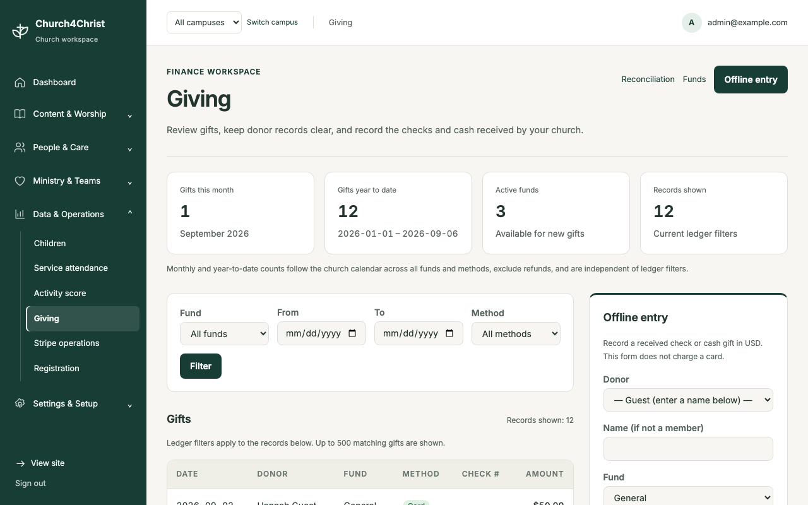

# Church4Christ: Open-Source-Gemeindeverwaltung und Gemeinde-Website

<p align="center"></p>

<p align="center"><a href="README.md">English</a> · <a href="README.zh.md">简体中文</a> · <a href="README.es.md">Español</a> · <a href="README.pt.md">Português (Brasil)</a> · <a href="README.fr.md">Français</a> · <b>Deutsch</b> · <a href="README.ja.md">日本語</a> · <a href="README.ko.md">한국어</a> · <a href="README.ms.md">Bahasa Melayu</a> · <a href="README.id.md">Bahasa Indonesia</a> · <a href="README.vi.md">Tiếng Việt</a> · <a href="README.hi.md">हिन्दी</a></p>

*Dies ist eine Übersetzung der [README.md](README.md), der maßgeblichen englischen Fassung. KI-gestützt; Korrekturen von Muttersprachlerinnen und Muttersprachlern sind willkommen.*

[](https://github.com/leveo/church4christ/actions/workflows/ci.yml)
[](https://github.com/leveo/church4christ/releases)
[](LICENSE)
[](https://astro.build/)
[](https://workers.cloudflare.com/)
[](docs/i18n.md)

**Ein KI-nativ gedachtes, quelloffenes Gemeindeverwaltungssystem (ChMS) und Gemeinde-CMS mit
einer mehrsprachigen Gemeinde-Website in 12 Oberflächensprachen, darunter Englisch und Chinesisch. Eine selbst gehostete, modulare Planning-Center-Alternative
für kleine und mittelgroße Gemeinden, Fellowships und gemeinnützige Organisationen, gebaut auf Astro
und Cloudflare Workers.**

Menschen und Haushalte, Gruppen, Dienstplanung für Ehrenamtliche, Kinder-Check-in, Anwesenheit,
Neuen-Nachsorge, Gebetsseelsorge, Predigten, Gemeindebriefe, Veranstaltungen und ein optionales Mitgliederportal,
ein Spendenbuch und die Veranstaltungsanmeldung, alles in einer Codebasis, die du lesen, verändern
und selbst hosten kannst.

**Website: [church4christ.org](https://church4christ.org) · Live-Demo: [demo.church4christ.org](https://demo.church4christ.org).**

[](https://church4christ.yunfei-song.com/C4C-modular-Voice.mp4)

Sieh dir **[Built Around Your Ministry](https://church4christ.yunfei-song.com/C4C-modular-Voice.mp4)** an,
das Werbevideo der Demo-Website (MP4).

**Hier geht's los: [Einrichtung für Menschen und KI-Agenten](docs/setup.md).** Mit `npm run onboard`
wählst du auf einer lokalen Browserseite die Identität, die Farben, das Logo und die ersten Funktionen deiner Organisation aus
und übergibst die gespeicherten Einstellungen dann an den bestehenden Installer. Coding-Agenten beginnen mit
[AGENTS.md](AGENTS.md); Claude liest außerdem [CLAUDE.md](CLAUDE.md).

Church4Christ verbindet eine mehrsprachige öffentliche Website mit einem Admin-System für Inhalte,
Gebetsseelsorge, Dienstplanung für Ehrenamtliche, Personen und Haushalte. Optionale Module ergänzen ein
Mitgliederportal und weitere Abläufe der Gemeindeverwaltung. Das Projekt will die
Start- und laufenden Wartungskosten einer individuell angepassten Umsetzung senken und dabei
den Code und die Bereitstellungskonfiguration für die Betreibenden zugänglich halten.

Der **aktuelle Quellcode-Release ist 1.7**. Church4Christ ist ein quelloffenes Fundament,
kein schlüsselfertiger Managed Service. Die lokale Evaluation ist kostenlos, und manche Bereitstellungen
passen in die kostenlosen Kontingente der Anbieter, aber Hosting, E-Mail, Datenbanken, Domains, Backups und weitere Dienste
im Produktivbetrieb können je nach Konfiguration und Nutzung Geld kosten. Lies
[Bereitstellungsprofile und Kosten](#bereitstellungsprofile-und-kosten),
bevor du ein Produktiv-Setup auswählst.

|  |  |  |
|---|---|---|
|  |  |  |
|  |  |  |
|  |  |  |

**Ein eigener Arbeitsbereich für jedes Kernmodul.** Das Standarddesign Sanctuary verbindet
warme elfenbeinfarbene Flächen und eine waldgrüne Navigation mit Layouts, die zur jeweiligen Aufgabe passen:
Redaktionswerkzeuge mit lokaler Vorschau, Personen- und Haushaltsdaten, Seelsorge-Warteschlangen,
Dienstmatrizen, touchfreundlicher Kinder-Check-in, Kurs-Player und Finanzbücher.
Die Menüs für Öffentlichkeit, Mitglieder, Leitende und Administratoren richten sich nach den aktivierten Modulen
und den Berechtigungen der jeweiligen Person. Harvest und Midnight bleiben verfügbar, jeweils mit hellem und
dunklem Modus. Siehe das [Design-Inventar der 21 Module](docs/design/module-coverage.md).

Die Screenshots verwenden die fiktiven Demo-Inhalte des Repositorys. Bei der Ersteinrichtung kannst du diese Beispiele
mitinstallieren oder ohne sie starten; beide Varianten behalten dieselben Layouts,
dasselbe Theme und dieselben mitgelieferten Standardbilder. Englische Seiten verwenden englische Oberfläche und Demo-Texte;
chinesische Seiten unterstützen chinesische und zweisprachige Inhalte. Alle 29 Oberflächen-Screenshots wurden
in der laufenden Anwendung neu aufgenommen; siehe das [Aufnahme-Inventar und den Befehl
zur Neuerstellung](docs/design/readme-screenshot-inventory.md).

**Gruppierte Navigation.** Eine vollständig aktivierte Website fasst ihre öffentlichen Ziele in
Willkommen, Entdecken, Verbinden und Mitmachen zusammen. Eingebaute Links bleiben in ihrer Zielgruppe,
während eigene Seiten und externe Links unter „Mehr“ erscheinen. Die unter
Admin → Navigation gespeicherte Reihenfolge bleibt innerhalb jeder Gruppe erhalten, und leere Gruppen verschwinden.


Zwölf Oberflächensprachen sind enthalten: Englisch und Chinesisch sowie Spanisch, brasilianisches
Portugiesisch, Französisch, Deutsch, Japanisch, Koreanisch, Malaiisch, Indonesisch, Vietnamesisch und Hindi. Jede
Gemeinde wählt bei der Einrichtung oder später unter Einstellungen → Sprachen, welche Sprachen ihre Website anbietet, und legt eine Standardsprache fest. Die zehn
neueren Übersetzungen sind KI-gestützt; Korrekturen von Muttersprachlerinnen und Muttersprachlern sind
willkommen. Drei fertige Designs und ein modularer Ausgangspunkt für weitere
Anpassungen sind ebenfalls dabei.

---

## Für wen ist das?

Church4Christ richtet sich an kleine und mittelgroße Gemeinden, Fellowships und gemeinnützige Organisationen —
besonders mehrsprachige Gemeinden und Migrantengemeinden —, die eine öffentliche Website und eine
anpassbare Grundlage für die Gemeindeverwaltung brauchen. Am besten passt es, wenn eine technisch versierte Mitarbeiterin oder ein
Mitarbeiter, Ehrenamtliche oder ein Umsetzungspartner Bereitstellung und Wartung übernehmen können. Eine
Managed-Plattform ist womöglich die bessere Wahl, wenn die Organisation Einrichtung,
Support, Updates und Betriebsverantwortung lieber einem Anbieter überlässt, statt den Quellcode anzupassen.

## Wie schneidet dieser Ansatz im Vergleich ab?

Verschiedene Produktkategorien erfüllen unterschiedliche Bedürfnisse, und die Bedingungen der Anbieter variieren. Diese Tabelle
vergleicht Betriebsmodelle, ohne allgemeingültige Preise, Portabilität oder Datenrechte zu versprechen.

| | **Church4Christ** | **Selbst verwaltetes Plugin-CMS** | **Gehosteter Website-Baukasten** | **Managed-Gemeindeplattform** |
|---|---|---|---|---|
| **Hauptzweck** | Individuell angepasste mehrsprachige Website plus modulare Abläufe der Gemeindeverwaltung | Erweiterbare Inhalts-Website aus Plugins | Vom Anbieter betriebene öffentliche Website | Vom Anbieter betriebene Abläufe der Gemeindeverwaltung |
| **Kostenmodell** | Infrastruktur und Dienstnutzung; manche Profile passen in kostenlose Kontingente | Hosting, Erweiterungen und Wartung | Abonnement und Zusatzangebote | Abonnement, oft nach Tarif oder Modul |
| **Anpassung** | Änderungen am Quellcode und optionale Module | Themes, Plugins und, wo verfügbar, Änderungen am Quellcode | Vom Anbieter unterstützte Vorlagen und Erweiterungen | Vom Anbieter unterstützte Konfiguration und Integrationen |
| **Betrieb** | Dein Team oder ein Umsetzungspartner stellt bereit, aktualisiert, überwacht und sichert | Dein Team oder der Host pflegt Kern und Plugins | Der Anbieter übernimmt den Großteil des Plattformbetriebs | Der Anbieter übernimmt den Großteil des Plattformbetriebs |
| **Portabilität** | Zugriff auf Code und Datenbank erleichtert den Umzug, doch die Migration ist Handarbeit | Hängt von Hosting, Plugins und Formaten ab | Hängt von den Exporten und Bedingungen des Anbieters ab | Hängt von den Exporten, APIs und Bedingungen des Anbieters ab |
| **Sprachen als Ausgangspunkt** | Zwölf Oberflächensprachen enthalten; jede Gemeinde wählt ihre eigene Auswahl | Hängt von den gewählten Erweiterungen ab | Hängt von Dienst und Tarif ab | Hängt von Dienst und Tarif ab |

**Die Kompromisse.** Church4Christ ist für Cloudflare Workers und deren Bindings optimiert;
ein Umzug auf einen anderen Hosting-Stack ist mit Quellcode-Arbeit möglich, aber kein unterstützter Klick-Weg.
Außerdem gibt es keine automatisierte Inhaltsmigration von D1 zu Supabase. Die eingebauten Seiten
werden durch Themes geprägt, und Drag-and-drop-Bearbeitung gibt es nur für eigene Seiten. Das Projekt
ist versioniert, aber Anwendende sollten trotzdem mit Umsetzungsaufwand und sorgfältig geprüften Upgrades rechnen.

Das Projekt zu betreiben heißt auch, es zu pflegen. Deine technische Verantwortliche oder dein technischer Verantwortlicher bleibt zuständig
für Abhängigkeits-Updates, Sicherheitsprüfung und -konfiguration, Monitoring, Backups und Restore-Tests
sowie das Ausrollen von Fixes. Die Architektur verringert manchen Infrastrukturaufwand, nimmt dir aber
Sicherheits- und Betriebspflege nicht ab. Die Begründung des Designs findest du in
[**`docs/why-this-stack.md`**](docs/why-this-stack.md).

## Du suchst eine Open-Source-Alternative zu Planning Center?

Viele Gemeinden, die eine kostenlose oder selbst gehostete Alternative zu Planning Center,
Breeze, Church Community Builder oder ähnlicher gehosteter Gemeindesoftware suchen, wollen zweierlei:
Kontrolle über die eigenen Daten und eine Website, die dieselben Datensätze nutzt.
Church4Christ deckt einen großen Teil des Gemeindealltags in einer selbst gehosteten
Anwendung ab:

| Typischer ChMS-Bedarf | Church4Christ |
|---|---|
| Verzeichnis von Personen und Haushalten | [Personen & Haushalte](docs/features/people-households.md) mit CSV-Import, gespeicherten Zuordnungen der Quellspalten und Export |
| Kleingruppen | [Gruppen](docs/features/groups.md) mit öffentlichem Verzeichnis, Beitrittsanfragen, Veranstaltungen und Anwesenheit |
| Dienstplanung für Ehrenamtliche | [Dienstplanung für Ehrenamtliche](docs/features/volunteer-serve.md) mit Monatsmatrix und E-Mail-Bestätigung, ganz ohne Login |
| Gottesdienstplanung | [Ablaufpläne, Proben, Verfügbarkeiten und Kalender](docs/features/service-planning.md) für Gottesdienste und Veranstaltungen |
| Kinder-Check-in | [Kiosk-Check-in](docs/features/children-checkin.md) mit Abholcodes und Anwesenheitsdiagrammen |
| Anwesenheit und Engagement | [Gottesdienstanwesenheit](docs/features/service-attendance.md) und [Aktivitätswerte](docs/features/activity-score.md) |
| Nachsorge für Neue und Seelsorge | [Warteschlange für Neue](docs/features/newcomers.md), [Gebetswand](docs/features/prayer-wall.md) und [Gemeinschaftsabläufe](docs/features/community-workflows.md) |
| Gemeinde-Website und CMS | [Öffentliche Website, Themes, Predigten, Gemeindebriefe und Seiteneditor](docs/features/public-site-and-themes.md) |
| Selbstbedienung für Mitglieder | [Mitgliederportal](docs/features/member-portal.md) (Haushalt, Gruppen, Gebet; läuft auf D1 oder Supabase) |
| Mehrere Standorte | [Mehrere Standorte](docs/features/multi-campus.md) mit standortgetrennten Daten und Rollen |

**Schrittweise von Planning Center umziehen.** Eine optionale, schreibgeschützte
[Synchronisierung mit Planning Center People](docs/deploy.md#9-optional-configure-planning-center-synchronization)
verknüpft Personendatensätze aus Planning Center mit vorhandenen Personen in Church4Christ und gibt
nicht eindeutige Treffer zur menschlichen Prüfung weiter, sodass beide Systeme während
des Übergangs parallel laufen können. Personen werden mit dem CSV-Importer und seinen wiederverwendbaren Spaltenzuordnungen
übernommen.

**Was es noch nicht ersetzt.** Es gibt keine native Mobile-App, keine SMS-Nachrichten und
keine Liederdatenbank und keine Planung von Lobpreisliedern (die Gottesdienstplanung deckt Ablaufpläne und
Proben ab). Online-Spenden über Stripe (Karten und Bankeinzug)
laufen im Testmodus, bis du die Go-live-Checkliste abgeschlossen hast; kostenpflichtige Veranstaltungsanmeldung
nutzt denselben Stripe-Modus. Das Spendenmodul erfasst außerdem Schecks und Bargeld in einem Offline-Buch
und erstellt jährliche Spendenbescheinigungen. Church4Christ ist ein Fundament, das dein Team betreibt und pflegt, kein
gehosteter Dienst mit Anbieter-Support.

Planning Center und die anderen oben genannten Produktnamen sind Marken ihrer jeweiligen
Inhaber. Church4Christ ist ein unabhängiges Projekt und steht in keiner Verbindung zu ihnen.

---

## Brauchst du nur einen Teil?

Fang klein an und wachse später. Jede Einzelfunktions-Edition installiert dieses Repository mit nur
einem aktivierten Bereich und der standardmäßigen Cloudflare-D1-Datenbank:

| Wenn du brauchst | Starte mit | Preset |
|---|---|---|
| Einen Kinder-Check-in-Kiosk | [church-checkin](https://github.com/leveo/church-checkin) | `checkin` |
| Dienstplanung für Ehrenamtliche | [church-volunteer-scheduling](https://github.com/leveo/church-volunteer-scheduling) | `volunteer-scheduling` |
| Verwaltung von Kleingruppen | [church-small-groups](https://github.com/leveo/church-small-groups) | `small-groups` |
| Anmeldung und Check-in für Veranstaltungen | [church-event-registration](https://github.com/leveo/church-event-registration) | `event-registration` |
| Eine Gemeinde-Website und ein CMS | [church-website-cms](https://github.com/leveo/church-website-cms) | `website` |

Die Editionen enthalten keinen eigenen Code, es gibt also nichts zusätzlich zu pflegen. Du kannst sie auch
überspringen und hier `npm run onboard -- --preset checkin` ausführen. Weitere Funktionen schaltest du jederzeit
unter **Einstellungen → Module** ein. Siehe [Einzelfunktions-Editionen](docs/editions.md).

---

## Mit einem KI-Assistenten bauen

Menschen und Agenten nutzen dasselbe Browser-Onboarding, denselben Installer, denselben Funktionskatalog und dieselben
Bereitschaftsprüfungen. [AGENTS.md](AGENTS.md) und [CLAUDE.md](CLAUDE.md) weisen einen Assistenten an, zuerst die
Installation zu prüfen, bei einer Neueinrichtung ohne Einstellungen `npm run onboard` zu starten
und dich das Formular ausfüllen zu lassen. Deine Antworten bleiben in der von Git ignorierten Datei
`.church/preferences.json`; spätere Sitzungen lesen diese Datei, um deiner Identität, deinem Branding
und deinen Funktionsentscheidungen zu folgen. Die [Einrichtungsanleitung](docs/setup.md) enthält die Befehle und Wiederherstellungsschritte.
Starte einen Assistenten mit:

> „Lies AGENTS.md und docs/setup.md. Starte das Browser-Onboarding, damit ich das Branding
> und die ersten Funktionen unserer Organisation auswählen kann. Richte mit meinen gespeicherten Einstellungen eine lokale
> Vorschau ein, prüfe die Website und die Administrationsseiten und nenne mir dann die URL und die noch offenen Prüfungen."

Du musst nicht jede Änderung von Hand machen. Dieses Repository ist so aufgebaut, dass ein KI-Coding-
Assistent den leicht verständlichen Anleitungen in [`docs/features/`](docs/features/) folgen und
mit einer umfangreichen automatisierten Testabdeckung arbeiten kann. Das kann den Aufwand für Anpassung und
Wartung senken, aber ein Maintainer muss die Änderungen weiterhin prüfen, die relevanten
Tests ausführen und sie bewusst ausrollen.

Die Idee: Öffne dieses Projekt mit einem KI-Assistenten, beschreibe in normaler
Sprache, was du willst, und lass ihn die Bearbeitung übernehmen. Ein paar echte Beispiele zum Einfügen:

> „Lies `docs/features/public-site-and-themes.md`, ändere dann unsere Primärfarbe auf
> Königsblau und zeig mir die Startseite."

> „Füge eine italienische (`it`) Locale nach `docs/i18n.md` hinzu."

> „Folge docs/setup.md, um unsere Gemeinde ohne Demo-Inhalte zu konfigurieren. Zeig den Einrichtungsplan
> und die Bereitschaftsergebnisse und bereite dann die Bereitstellung nach docs/deploy.md vor."

Derselbe Ablauf hilft auch bei der Wartung: Beschreibe eine Änderung, sieh dir den vorgeschlagenen
Diff an, teste ihn lokal und rolle erst aus, wenn das Ergebnis geprüft wurde. KI-Unterstützung
ersetzt weder Sicherheitsentscheidungen noch Backups, Produktivtests oder die Verantwortung für den Betrieb.

---

## Unsere Mission

**Die Kosten und den Aufwand zu senken, ein individuell angepasstes Gemeindeverwaltungssystem und
eine mehrsprachige Website zu starten.** Church4Christ bietet ein getestetes, modulares Fundament, das eine Gemeinde oder ein
Umsetzungspartner anpassen kann, statt bei null anzufangen. Es verspricht keinen
Produktivdienst ohne Abonnement oder ohne Budget: Entscheidungen zu Infrastruktur, E-Mail, Datenbank,
Domain, Support und Wartung bestimmen die tatsächlichen Betriebskosten.

---

## Was drinsteckt

Jede Funktion hat ihre eigene leicht verständliche Anleitung. Fang mit einer davon an:


| | Funktion | Was sie kann |
|---|---|---|
| [](docs/features/public-site-and-themes.md) | **[Öffentliche Website & Themes](docs/features/public-site-and-themes.md)** | Die Eingangstür deiner Gemeinde — Startseite, Predigten, Veranstaltungen, Mitarbeitende — in einem von drei fertigen Designs. |
| [](docs/features/cms-admin.md) | **[Der Admin-Bereich](docs/features/cms-admin.md)** | Anmeldung ohne Passwort, Rollen und Wiederherstellung per Klick für unterstützte versionierte redaktionelle Inhalte. |
| [](docs/features/admin-permissions.md) | **[Admin-Berechtigungen](docs/features/admin-permissions.md)** | Gib jedem Admin nur die Bereiche, die er braucht — Gebetswand und Mitgliederverzeichnis sind inklusive, der Rest nach Wahl. |
| [](docs/features/multi-campus.md) | **[Mehrere Standorte](docs/features/multi-campus.md)** | Betreibe mehrere Standorte auf einem Backend mit getrennten Daten, Einstellungen, Funktionen und standortlokalen Rollen; nur die Master-Administration sieht alle Standorte. |
| [](docs/features/bulletins.md) | **[Wöchentliche Gemeindebriefe](docs/features/bulletins.md)** | Erstelle das Blatt für den Sonntagsgottesdienst und plane seine automatische Veröffentlichung. |
| [](docs/features/sermons.md) | **[Predigtarchiv](docs/features/sermons.md)** | Füge einen YouTube-Link ein und erhalte eine durchsuchbare, schnell ladende Bibliothek vergangener Predigten. |
| [](docs/features/prayer-wall.md) | **[Gebetswand](docs/features/prayer-wall.md)** | Nimm Gebetsanliegen entgegen und bearbeite sie vertraulich auf einem einfachen Board. |
| [](docs/features/volunteer-serve.md) | **[Dienstplanung für Ehrenamtliche](docs/features/volunteer-serve.md)** | Plane einen Monat Dienste auf einen Blick; Ehrenamtliche bestätigen per E-Mail, ohne Login. |
| [](docs/features/people-households.md) | **[Personen & Haushalte](docs/features/people-households.md)** | Profile und Haushalte sowie kanonischer reiner Neuanlage-CSV-Export und wiederverwendbare Zuordnung der Quellspalten für Migrationen. |
| [](docs/features/member-identity.md) | **[Sichere Mitgliederidentität](docs/features/member-identity.md)** | Nachweisgebundene Identität über Spenden, Anmeldung, Gruppen, Teams, Neue und Importe hinweg; unklare Dubletten gehen zur Prüfung, statt nur nach Namen zusammengeführt zu werden, mit OTP-gebundener Freigabe und einem geschützten 24-Stunden-Rollback. |
| [](docs/features/groups.md) | **[Gruppen](docs/features/groups.md)** | Kleingruppen mit öffentlichem Verzeichnis, Mitgliederchecklist, Beitrittsanfragen, Veranstaltungen und Anwesenheit per E-Mail-Link für jede Person. |
| [](docs/features/children-checkin.md) | **[Kinder-Check-in](docs/features/children-checkin.md)** | Ein touchfreundlicher Kiosk, an dem Eltern ihre Kinder mit einem Abholcode ein- und auschecken, dazu wöchentliche Anwesenheitsdiagramme. |
| [](docs/features/service-attendance.md) | **[Gottesdienstanwesenheit](docs/features/service-attendance.md)** | Erfasse aggregierte Erwachsenenzahlen, leite optionale Kinderzahlen aus Check-ins ab, korrigiere den Verlauf und lade identitätsfreie CSV-Berichte herunter. |
| [](docs/features/newcomers.md) | **[Nachsorge für Neue](docs/features/newcomers.md)** | Nimm zweisprachige öffentliche Karten mit Einwilligung entgegen, sichte eine begrenzte Mitarbeitenden-Warteschlange und übergib eindeutige Treffer an Personen, ohne Notizen oder Antworten preiszugeben. |
| [](docs/features/onboarding-readiness.md) | **[Startbereitschaft](docs/features/onboarding-readiness.md)** | Eine zweisprachige Checkliste für Einrichtung, Doctor und jede echte Administration, mit Bestätigungen der Super-Admins für manuelle Prüfungen. |
|  | **[Gottesdienstplanung](docs/features/service-planning.md)** | Plane einen zeitlich getakteten Ablaufplan, Proben mit den eingeteilten Personen, Verfügbarkeit der Mitglieder, eine Terminfindung, Kalender und automatische E-Mails. |
|  | **[Aktivitätswert](docs/features/activity-score.md)** | Kombiniere ausgewählte personenbezogene Aktivitäten zu nachvollziehbaren Mitgliederwerten und einer gemeindeweiten Engagement-Übersicht. |
| [](docs/features/learning.md) | **[Learning](docs/features/learning.md)** | Führe Sonntagsschule und Jüngerschaft zwischen den Treffen mit zweisprachigen Videos, Dateien, Aufgaben, Quizzen und anbietersynchronisiertem Status fort. |
| [](docs/features/page-builder.md) | **[Seiteneditor](docs/features/page-builder.md)** | Stelle eigene Seiten per Drag-and-drop zusammen — mehrsprachig, immer im Theme, und veröffentlichte Seiten laden ganz ohne JavaScript. Optional; das Abschalten macht bereits gebaute Seiten nie kaputt. |
| [](docs/features/giving.md) | **[Spenden](docs/features/giving.md)** | Umgesetzt: Online-Spenden über Stripe (standardmäßig Testmodus, live nach der Go-live-Checkliste), ein Offline-Buch für Schecks und Bargeld und jährliche Spendenbescheinigungen. |
| [](docs/features/registration.md) | **[Anmeldung](docs/features/registration.md)** | Umgesetzt: kostenlose Veranstaltungsanmeldung auf D1 oder Supabase, eigene Fragen, Warteliste, Veranstaltungsphasen und Teilnehmerlisten-Export, dazu kostenpflichtiger Stripe-Checkout auf Supabase im selben Stripe-Modus wie Spenden (prüfe mit einer kleinen Live-Anmeldung, bevor du dich darauf verlässt). |
|  | **[Veranstaltungslogistik](docs/features/event-logistics.md)** | Optionale Ergänzung zur Anmeldung: Teile Personen Zimmern zu, setze sie mit einer Vorschau der Auto-Platzierung an Tische, ordne sie Kleingruppen zu und drucke Zimmerlisten, Türschilder und Tischkarten. |
| [](docs/features/member-portal.md) | **[Mitgliederportal](docs/features/member-portal.md)** | Ein angemeldeter Hub für aktuelle Beteiligung und offene Möglichkeiten, dazu Haushaltsprofile, Veranstaltungen, Dienste, Kalender, Spenden und Gebet im passenden Rahmen. |
| [](docs/features/i18n.md) | **[Zwölf Sprachen](docs/features/i18n.md)** | Wähle pro Website aus 12 Oberflächensprachen, mit englischem Fallback und Umwandlung von vereinfachtem in traditionelles Chinesisch per Klick. |
| [](docs/features/email-automation.md) | **[E-Mail & Automatisierung](docs/features/email-automation.md)** | Anmelde-Links, Erinnerungen und Zusammenfassungen, mit lokalem Logging und einer Produktivkonfiguration, die auch kostenpflichtig sein kann. |
| [](docs/features/modules.md) | **[Module](docs/features/modules.md)** | Schalte Funktionen ab, die du nicht nutzt; nichts wird gelöscht, du kannst jederzeit zurückschalten. |

**Wähle deine Module.** Die meisten optionalen Fachfunktionen sind **Module**, die du
in den Einstellungen in einem Bereich abschalten kannst — Gemeindebriefe, Predigten, die Gebetswand, Dienstplanung für Ehrenamtliche
und mehr. Neue Installationen schreiben jede Moduleinstellung ausdrücklich aus der Auswahl bei der Einrichtung;
die Demo „Full Church“ wählt ihre 21 aus (die Gottesdienstplanung und die Veranstaltungslogistik werden separat eingeschaltet). Nur bei älteren Installationen behalten fehlende Modulzeilen
das frühere Standardverhalten „an“. Eine Gemeinde, die nur Gottesdienstzeiten und Predigten will, kann
den Rest mit einem Klick ausblenden: Die Seiten, Links und E-Mails des Moduls verschwinden gemeinsam, und nichts
wird gelöscht. Siehe [**`docs/features/modules.md`**](docs/features/modules.md).

| Key | English | 中文 | Required database |
|---|---|---|---|
| `bulletins` | Bulletins | 周报 | Either |
| `sermons` | Sermons | 讲道 | Either |
| `prayer-sheets` | Prayer Sheets | 祷告单 | Either |
| `prayer-wall` | Prayer Wall | 祷告墙 | Either |
| `events` | Events | 活动 | Either |
| `serve` | Volunteer Scheduling | 服事排班 | Either |
| `gifts` | Spiritual Gifts | 恩赐探索 | Either |
| `testimonies` | Testimonies | 见证 | Either |
| `articles` | Articles | 文章 | Either |
| `fellowships` | Fellowships | 团契 | Either |
| `groups` | Groups | 小组 | Either |
| `people` | People & Households | 会友与家庭 | Either |
| `children` | Children Check-in | 儿童报到 | Either |
| `attendance` | Service Attendance | 崇拜出席 | Either |
| `newcomers` | Newcomer Follow-up | 新朋友跟进 | Either |
| `activity-score` | Activity Score | 活跃度评分 | Either |
| `page-builder` | Page Builder | 页面编辑器 | Either |
| `portal` | Member Portal | 会友平台 | Either |
| `giving` | Giving | 奉献 | Supabase |
| `registration` | Registration | 活动报名 | Either |
| `learning` | Learning | 学习 | Either |
| `planning` | Service Planning | 服事流程 | Either |
| `event-logistics` | Event Logistics | 活动后勤 | Either |

### Gemeinschaftsverwaltung und Abläufe

Standorte können Gruppen und die Nachsorge für Mitglieder direkt verwalten. Optionale Fellowships fügen eine Gemeinschaftsebene mit unabhängiger Mitgliedschaft und untergeordneten Gruppen hinzu. Wiederverwendbare Abläufe bieten zugewiesene Schritte, Fälligkeitstermine, Abschlussverfolgung und E-Mail-Erinnerungen über Cloudflare. Einrichtung, Berechtigungen und Zustellungssteuerung findest du im [Leitfaden zu Gemeinschaftsabläufen](docs/features/community-workflows.md).

### Lernen über den Sonntag hinaus

Version 1.1 bringt das optionale Modul **Learning** für Sonntagsschule,
Jüngerschaft und andere Dienste, die zwischen den Treffen weitergehen. Lernende erhalten
eine zweisprachige, datenschutzbegrenzte Kursansicht für nicht gelistete YouTube-Videos, Dateien,
Aufgaben und Quizze. Die Abgabe bleibt beim Anbieter: Die Website
verweist Lernende auf den konfigurierten Anbieter, statt selbst Hausaufgaben,
Antworten, Kommentare, Noten oder Dateiinhalte einzusammeln.

Administratoren können Google Classroom über dessen offizielle APIs oder ein
separat betriebenes Canvas-Derivat von Church4Christ anbinden. Kurszuordnung, verschlüsselte
OAuth-Zugangsdaten, signierte Anbieterbenachrichtigungen, manuelle Synchronisierung und begrenzter
geplanter Abgleich liefern nur die Aktivitätsmetadaten, die Church4Christ braucht.


| Englische Lernansicht | Chinesische Lernansicht | Anbieterverwaltung |
|---|---|---|
| [](docs/images/learning/genesis-1-en.png) | [](docs/images/learning/genesis-1-zh.png) | [](docs/images/learning/admin-overview.png) |

Im **[Leitfaden zur Learning-Funktion](docs/features/learning.md)** findest du die Anbietereinrichtung,
Datenschutzgrenzen, Synchronisierungsbudgets, die Genesis-1-Demo sowie die
getrennten Canvas-Betriebs- und Corresponding-Source-Anforderungen.

### Ein Zuhause für deine Mitglieder

Das optionale **Mitgliederportal** macht aus den Datensätzen, die deine Gemeinde ohnehin pflegt, ein
nützliches Erlebnis nach der Anmeldung. Die Startseite der Möglichkeiten zeigt alle aktivierten Wege zum
Lernen, Dazugehören und Dienen an einem Ort: sowohl die Gruppen, Kurse und Teams, mit denen das Mitglied
bereits verbunden ist, als auch Möglichkeiten, bei denen man gerade beitreten oder sich bewerben kann. Mitglieder
können außerdem Haushaltsdaten aktualisieren, ihre Spenden einsehen, sich für Veranstaltungen anmelden, ihre Dienste
einsehen, einen persönlichen Kalender abonnieren und Gebete im passenden Rahmen teilen. Es nutzt dieselben
Anmelde-Links ohne Passwort wie der Rest von Church4Christ — kein neues Konto und kein Passwort, das man sich merken muss.


Leitende von Dienstbereichen, Gruppen, Sonntagsschule und Dienstteams erhalten ein auf ihre Ressourcen begrenztes Panel unter
`/<locale>/manage`. Die Anmeldung der Gemeinde-App schützt es, und jede Operation prüft
die Befugnis der leitenden Person für genau diese Ressource. Cloudflare Zero Trust kann daher
auf den gesamten Bereich `/admin` beschränkt bleiben.


Das Portal läuft sowohl auf dem Standard-Backend D1 als auch auf dem optionalen Backend **Supabase (Postgres)**.
Haushalte, Gruppen, geschützte Gruppendateien und die Moderation von Gemeinde-, Gruppen- und privaten Gebeten
funktionieren auf D1. Gebete im Veranstaltungsbereich, Veranstaltungsadministratoren und „Meine Anmeldungen“
brauchen die Anmeldung, die nach dem Einschalten für kostenlose Veranstaltungen auf D1 läuft. Mehr dazu in
[**`docs/features/member-portal.md`**](docs/features/member-portal.md).

---

## In 5 Minuten ausprobieren (auf deinem eigenen Computer)

Du kannst die Website lokal betreiben, mit optionalen fiktiven Beispielinhalten, bevor du dich für eine
Bereitstellung entscheidest. Du brauchst [Node.js](https://nodejs.org/) 22.22.1 oder neuer. Das Browser-
Onboarding empfiehlt für den ersten Start **Website + Community** mit **Cloudflare D1**.


```bash
# 1. Get the code and install it
git clone https://github.com/leveo/church4christ.git
cd church4christ
npm ci

# 2. Open the local browser form, complete it, and save your preferences
npm run onboard

# 3. Review the plan, then initialize with those same preferences
node scripts/setup/index.mjs --preferences .church/preferences.json --yes --dry-run --json
node scripts/setup/index.mjs --preferences .church/preferences.json --yes --json

# 4. For D1, start it (always follow the exact handoff setup prints)
npm run dev
```

Das Formular fragt, ob es sich um eine Gemeinde, eine gemeinnützige Organisation oder einen Standort handelt, und erfasst Namen,
Leitspruch, Adresse, Zeitzone, Primär- und Sekundärfarbe, optionales PNG/JPEG/WebP-Logo
(bis zu 2 MiB), Sprache, die erste Administration und die Entscheidung zu Demo-Inhalten. Hake nur die
Funktionen an, die du brauchst.
Die empfohlene Auswahl nutzt D1 als Datenbank; die Anwendung läuft trotzdem auf
Cloudflare Workers und speichert Medien in R2. **Spenden und kostenpflichtige Anmeldung**
sind erweiterte Optionen, die den ausdrücklichen Wechsel zu Supabase-kompatiblem PostgreSQL erfordern.

Beim Speichern entstehen `.church/preferences.json` und ein hochgeladenes Logo unter `.church/`, was
Git ignoriert. Es werden keine Datenbanken angelegt und keine Website bereitgestellt. Führe `npm run onboard` erneut aus, um die
gespeicherten Einstellungen zu laden und zu bearbeiten. Lass das Terminal laufen, während du das
Formular ausfüllst; beende es danach mit Strg+C. Um die ausgegebene URL selbst zu öffnen, nutze
`npm run onboard -- --no-open`; für einen anderen Port füge `--port 4310` hinzu. Der direkte Einstiegspunkt
ist `node scripts/onboard/index.mjs`. In [der Einrichtungsanleitung](docs/setup.md) steht, was der
Installer anwendet und wie Agenten die übrigen Einstellungen nutzen.

Wenn du mit `npm ci --ignore-scripts` installierst, führe `npm run tokens` manuell aus, bevor du
den Installer oder `npm run dev` startest.

Für lokales Supabase exportiert die Übergabe stattdessen
`CLOUDFLARE_HYPERDRIVE_LOCAL_CONNECTION_STRING_HYPERDRIVE` in der Host-Shell vor
`npm run dev`; diese Verbindungs-URL darf nicht in `.dev.vars` stehen.

Wähle bei der Ersteinrichtung **Include demo content** oder **No demo content**. Beide behalten dasselbe
mitgelieferte Design, dieselben lokalen Dekorbilder, dieselben aktivierten Funktionen und dieselben Administrationswerkzeuge.
Demo-Inhalte fügen fiktive Personen, Predigten, Gemeindebriefe, Veranstaltungen, Dienstbereiche und weitere
Beispiele hinzu. Ihr Medienschritt kopiert das erzeugte Bildpaket aus `seed/media/` in den lokalen R2.
Ohne Demo-Inhalte entstehen das Datenbankschema, die Betriebsvorgaben, die Gemeindeeinstellungen, die Modul-
auswahl und die erste Administration, aber keine Beispieldatensätze.

Die Einstellungsdatei hält die Entscheidung des Formulars zu Demo-Inhalten fest. Für eine Einrichtung mit expliziten CLI-
Antworten übergib `--demo-data` oder `--no-demo-data`; wenn du bei nicht interaktiver Einrichtung beides weglässt, bleibt
die bisherige Vorgabe ohne Demo. Die Flags lassen sich nicht kombinieren. Eine wiederholte
Einrichtung bewahrt die festgehaltene Inhaltsentscheidung und die vorhandenen Datensätze. `--no-demo-data` leert
keine bestehende Datenbank, und die Einrichtung weigert sich, Demodaten zu bestehenden Personen hinzuzufügen.
Nutze einen separaten frischen Workspace bzw. eine frische Datenbank, um den anderen Startmodus auszuprobieren.

Öffne die Adresse, die die Einrichtung ausgibt (meist `http://localhost:4321`).

**Anmeldung im Admin-Bereich.** Es gibt kein Passwort. Gib auf der Anmeldeseite die
E-Mail-Adresse der ersten Administration aus deinen Einrichtungsantworten ein, die auch in der Übergabe der Einrichtung wiederholt wird, und fordere einen
Link an. Da die lokale E-Mail auf Ausgeben statt Senden steht, **erscheint die Magic-Link-URL
direkt in deinem Terminal**. Füge sie in den Browser ein, und du bist drin. (Für schnelleres lokales
Testen schreibt die Einrichtung dieselbe Adresse als `AUTH_DEV_BYPASS_EMAIL` in `.dev.vars`, was
dich automatisch anmeldet. Entferne diese Zeile, um den echten Anmeldeablauf zu testen.)

In beiden Inhaltsmodi legt die Einrichtung eine neue Administration und deren prüfbare Anmelde-
Identität gemeinsam an. Wiederholte Läufe bewahren die bestehende Kontaktzuordnung; sie verifizieren keine
vorhandene E-Mail-Adresse und stellen keinen entzogenen Zugang wieder her. Meldet die Einrichtung ein Identitätsproblem, schließe den
[Ablauf zur Identitätsprüfung oder Wiederherstellung](docs/features/member-identity.md) ab, bevor du sie erneut ausführst.

Das reine Terminal-Kommando `npm run setup` bleibt verfügbar. Die Einrichtung bietet **Website** (8 fokussierte
Veröffentlichungsmodule), **Website + Community** (18 Module; das Mitgliederportal lässt sich auf D1 ergänzen) und
**Full Church** (21 Module; die Gottesdienstplanung wird separat eingeschaltet). Spenden
wählt automatisch Supabase (die kostenlose Anmeldung läuft auf D1); D1-kompatible Auswahlen wählen D1, sofern du das Backend nicht
ausdrücklich überschreibst. Welche Konten du brauchst, hängt vom Modus Lokal oder Deploy ab,
wie unten beschrieben. Für Automatisierung übergib alle Antworten mit `--yes`; füge `--json` für ein
maschinenlesbares Ergebnis hinzu. Für einen menschenlesbaren nicht interaktiven Lauf nutze dieselben vollständigen
Flags mit `npm run setup -- ... --yes` und lass `--json` weg. Damit stdout über
npm strikt JSON bleibt, nutze die stille Form:

```bash
npm run --silent setup -- --mode local --preset website --site-slug my-church \
  --church-name "My Church" --locale en --admin-email admin@example.com \
  --admin-name "First Admin" --app-origin http://localhost:4321 \
  --email-from admin@example.com --demo-data --yes --json
```

---

## Bereitstellungsprofile und Kosten

Das sind Planungsprofile, keine Preisgarantien. Die folgenden Preise gelten
**Stand August 2026**, können sich ändern und sollten vor der Bereitstellung auf den verlinkten offiziellen
Preisseiten bestätigt werden.

| Profil | Enthaltener Umfang | Hinweise zu Kosten und Bereitschaft |
|---|---|---|
| **Lokale Evaluation** | Website- oder Community-Module mit lokalem D1; alle Module mit kompatiblem lokalem Postgres | Für die lokale D1-Evaluation fallen keine Gebühren für gehostete Dienste an. Computer, Entwicklungszeit und optionale externe Dienste stellst du aber selbst. |
| **D1 Website/Community** | Cloudflare Worker, D1 und R2 für bis zu 22 D1-kompatible Module | Eine bescheidene Bereitstellung kann in die kostenlosen Kontingente von Cloudflare passen. Traffic, Speicher, Operationen über die Kontingente hinaus, eine Domain und andere Dienste können Geld kosten; siehe [Workers-Preise](https://developers.cloudflare.com/workers/platform/pricing/). Produktiv-E-Mail kommt separat dazu. |
| **Produktiv-E-Mail** | Transaktionale Anmelde-Links, Erinnerungen, Anfragen und Zusammenfassungen an beliebige Empfänger | Das Repository unterstützt eine Cloudflare-E-Mail-Konfiguration, die auch kostenpflichtig sein kann. Der Versand an beliebige Empfänger erfordert Workers Paid, derzeit mindestens **5 $/Monat** inklusive **3.000 E-Mails**, danach **0,35 $ pro 1.000 E-Mails**. Diese Beträge können sich ändern; siehe [Preise von Cloudflare Email Service](https://developers.cloudflare.com/email-service/platform/pricing/). |
| **Supabase/alle Module** | Cloudflare-Bereitstellung plus Supabase/Postgres für die 21 Module von Full Church, einschließlich Mitgliederportal, Spenden und Anmeldung | Die Cloudflare-Kosten fallen weiterhin an, und der gewählte [Supabase-Tarif](https://supabase.com/pricing) kann Abo- oder Nutzungsgebühren hinzufügen. Stand August 2026 hat Supabase Free keine automatischen täglichen Backups, und wenig genutzte Free-Projekte können je nach Aktivität über einen Zeitraum von sieben Tagen [automatisch pausiert](https://supabase.com/docs/guides/platform/free-project-pausing) werden. Erstelle für den Produktivbetrieb regelmäßig externe Datenbank-Dumps und übe die Wiederherstellung, oder wähle einen kostenpflichtigen Tarif, dessen [Backup-Optionen](https://supabase.com/docs/guides/platform/backups) deine Anforderungen an die Betriebskontinuität erfüllen. Preise und Servicerichtlinien können sich ändern. Stripe startet im Testmodus; Live-Zahlungen sind eine ausdrückliche Entscheidung nach der Go-live-Checkliste in [`docs/supabase-setup.md`](docs/supabase-setup.md). |

Kostenlose Kontingente der Anbieter sind nützlich für Evaluation oder bescheidene Bereitstellungen, aber sie
sind kein Versprechen, dass ein Produktivdienst kostenlos bleibt. Plane neben den oben genannten Diensten auch
technische Verantwortung, Pflege von Abhängigkeiten und Sicherheit, Monitoring, Backups, Restore-Tests und künftiges
Nutzungswachstum ein.

---

## Online gehen

Neu dabei? Beginne mit [**`docs/cloudflare-setup.md`**](docs/cloudflare-setup.md) — einer
leicht verständlichen Anleitung, die erklärt, was Cloudflare ist, wie das Kostenmodell aussieht und welche zwei
Wege ins Netz es gibt (auch den, einen KI-Assistenten das für dich erledigen zu lassen). Wenn du die
genauen Befehle willst, ist [**`docs/deploy.md`**](docs/deploy.md) die vollständige Schritt-für-Schritt-
Anleitung.

Starte mit `npm run setup`, wähle **Deploy** und beantworte die Fragen zu Funktionen und Gemeinde.
Der Assistent legt die benötigten Ressourcen an oder importiert sie, schreibt die erzeugte Konfiguration, wendet
Migrationen an, hält alle 23 Moduleinstellungen fest und richtet die erste Administration ein. Danach übergibt er
an `npm run deploy`. Führe `npm run doctor` für den Bereitschaftsbericht im Schema v2 aus und nutze
die immer verfügbare Checkliste unter `/admin/onboarding` mit denselben stabilen Prüfidentitäten.
Spenden, Anmeldung, Gruppen, Teams, Neue, Importe und die optionale schreibgeschützte Planning-Center-
Integration teilen sich ein nachweisgebundenes Identitäts-Gateway, das erst prüft. Es führt
Personen nie automatisch nach Namen oder einem unbestätigten Kontakt zusammen. Siehe [Mitgliederidentität](docs/features/member-identity.md)
für den Ablauf, die Betrugskontrollen, die aktuelle Migrationsgrenze und die Lücke bei der Anbieterverifizierung;
Regeln für Einrichtung und Rotation von Secrets stehen weiter im [Deployment-Runbook](docs/deploy.md#stable-identity-source-key).
Die Bereitstellung ist bewusst manuell: Die Automatisierung des Repositorys testet Änderungen, veröffentlicht
sie aber nicht und migriert auch keine Produktivdaten für dich.

**Erstbereitstellung und Upgrades sind verschiedene Vorgänge.** Die geführte Einrichtung legt Ressourcen an oder
importiert sie und richtet eine geprüfte Installation ein. Sie ist kein unbeaufsichtigtes Ein-Klick-
Upgrade für eine Website, die bereits Gemeindedaten enthält. Bestehende Betreibende beginnen mit dem
[Upgrade-Runbook](docs/upgrade.md), sichern Datenbank, R2-Medien, Konfiguration und das Inventar der Secrets,
proben im Staging und lesen den [Changelog unter `Unreleased`](CHANGELOG.md), bevor sie
Vorwärtsmigrationen anwenden. Maintainer, die einen Release vorbereiten, folgen
dem [Release-Prozess](docs/release-process.md).

**Deine Datenbank wählen.** Die 22 D1-kompatiblen Module schließen
**Spenden** aus, das Postgres braucht, und ebenso die **kostenpflichtige Anmeldung**. Welche Konten du brauchst, folgt dem
Modus: Lokales D1 braucht kein externes Konto; bereitgestelltes D1 braucht ein Cloudflare-Konto; lokales
Supabase braucht ein Supabase-Konto oder eine kompatible lokale Postgres-Datenbank; bereitgestelltes Supabase
braucht Cloudflare und Supabase. Eine automatisierte Inhaltsmigration zwischen D1 und Supabase gibt es noch nicht,
wähle also die Produktivdatenbank, bevor du echte Inhalte eingibst. Siehe
[**`docs/supabase-setup.md`**](docs/supabase-setup.md).

**Stripe startet im Testmodus; der Live-Modus ist eine ausdrückliche Entscheidung.** Stripe hostet Zahlungsseiten,
Belege, das Billing Portal, Rückerstattungen und Streitfälle; diese Anwendung speichert nur Beträge,
Spendenzwecke, Daten, Status und Stripe-IDs. Spenden und die kostenpflichtige Anmeldung laufen nur mit Supabase; D1 unterstützt
sie nicht. Wenn die Einrichtung eines der beiden Module abfragt, importiere einen `sk_test_…`-Schlüssel und das
`whsec_…`-Signing-Secret über die einmaligen Umgebungsvariablen `CHURCH_SETUP_STRIPE_SECRET_KEY` und
`CHURCH_SETUP_STRIPE_WEBHOOK_SECRET`; die Einrichtung speichert die Laufzeit-Secrets
und schreibt `STRIPE_MODE=test`. Für echte Spenden folge der Go-live-Checkliste im
Supabase-Leitfaden (Live-Schlüssel, Webhook mit API-Version `2025-03-31.basil`, `STRIPE_MODE=live`
plus `STRIPE_LIVE_CONFIRMED=1`). Ein Ereignis, dessen Modus nicht zum konfigurierten Modus passt, wird
abgelehnt, und der Supabase-gestützte Worker führt alle fünf Minuten eine dauerhafte Wiederherstellung aus. Lokale
Tests belegen nicht, dass Stripe live zustellt.

---

## Was unter der Haube steckt

Für Neugierige: Church4Christ ist mit **[Astro](https://astro.build/)** gebaut, das
Seiten auf dem Server rendert und als einzelner **Cloudflare Worker** läuft. Die Anwendungsdaten liegen im
gewählten Backend — Cloudflare **D1** oder **Supabase/Postgres** —, hochgeladene Medien liegen
in Cloudflare **R2** (Objektspeicher); E-Mails gehen über das E-Mail-Binding von Cloudflare raus.
Die Seiten für Besuchende liefern **kein clientseitiges JavaScript-Framework** aus — sie sind schlichtes, schnelles
HTML mit ein wenig Vanilla-Script —,
und das ist ein großer Teil des Grunds, warum die Website schnell lädt und so wenig im Betrieb kostet. (Die einzige
Ausnahme liegt hinter dem Mitarbeitenden-Login: Der Drag-and-drop-Seiteneditor ist ein kleiner React-
Editor, den nur dein Team je herunterlädt; die Seiten, die er veröffentlicht, sind weiterhin schlichtes HTML.)

Das gesamte Erscheinungsbild entsteht aus **[Design-Tokens](design/README.md)**: einem Satz von Farb- und Schrift-
werten, die zu drei fertigen Themes kompiliert werden (Sanctuary, Harvest, Midnight),
jeweils mit hellem und dunklem Modus. Das Projekt hat eine **umfangreiche automatisierte Abdeckung** seiner
Kernabläufe, damit Maintainer Änderungen vor der Bereitstellung prüfen können.

**Warum diese Entscheidungen?** Die Gründe für die auf Cloudflare optimierte Bereitstellung, den
Stack aus Astro + Tailwind + TypeScript und die Fälle, in denen eine Managed-Plattform das
bessere Betriebsmodell sein kann, stehen in
[**`docs/why-this-stack.md`**](docs/why-this-stack.md). Das technische Bild zeigen
[`docs/architecture.md`](docs/architecture.md),
[`docs/design-system.md`](docs/design-system.md) und [`docs/i18n.md`](docs/i18n.md).

---

## FAQ

**Was ist Church4Christ?**
Ein quelloffenes Gemeindeverwaltungssystem (ChMS) und Gemeinde-CMS. Es verbindet eine mehrsprachige
Gemeinde-Website (12 Oberflächensprachen) mit Werkzeugen für Mitarbeitende für Personen und Haushalte, Gruppen,
Dienstplanung für Ehrenamtliche, Kinder-Check-in, Anwesenheit, Nachsorge für Neue und Gebetsseelsorge.

**Gibt es eine kostenlose Open-Source-Alternative zu Planning Center?**
Church4Christ ist eine Möglichkeit. Der Quellcode ist unter GPL-3.0 frei, und du hostest ihn
selbst auf Cloudflare Workers. Er deckt Personen, Gruppen, Check-in, Dienstplanung für Ehrenamtliche,
Anwesenheit und eine Gemeinde-Website ab und kann Planning Center People über eine
optionale schreibgeschützte Synchronisierung lesen, während du umziehst. Die mobilen Apps, SMS und die Planung
von Lobpreisliedern von Planning Center bietet er nicht. Siehe
[Du suchst eine Open-Source-Alternative zu Planning Center?](#du-suchst-eine-open-source-alternative-zu-planning-center)

**Ist es kostenlos?**
Die Software ist kostenlos. Hosting, E-Mail, Datenbank und Domain können je nach Einrichtung und
Nutzung Geld kosten; manche kleine Bereitstellungen passen in die kostenlosen Kontingente der Anbieter.
Siehe [Bereitstellungsprofile und Kosten](#bereitstellungsprofile-und-kosten).

**Welche Sprachen unterstützt es?**
Zwölf Oberflächensprachen: Englisch, Chinesisch, Spanisch, brasilianisches Portugiesisch, Französisch, Deutsch,
Japanisch, Koreanisch, Malaiisch, Indonesisch, Vietnamesisch und Hindi. Jede Gemeinde wählt, welche davon ihre
Website anbietet, und eine Standardsprache; chinesische Seiten erhalten außerdem die Umwandlung von vereinfachtem in traditionelles Chinesisch
per Klick. Weitere Sprachen lassen sich hinzufügen; siehe [docs/i18n.md](docs/i18n.md).

**Kann eine kleine Gemeinde ohne Entwickler es betreiben?**
Es funktioniert am besten, wenn eine technisch versierte Mitarbeiterin, ein Ehrenamtlicher oder ein Partner
Bereitstellung und Updates übernimmt. Das Browser-Onboarding und die KI-Assistenten-Anleitungen senken diesen Aufwand,
aber jemand muss weiterhin Änderungen prüfen, Daten sichern und bereitstellen.

**Womit ist es gebaut?**
Astro auf Cloudflare Workers, mit Cloudflare D1 oder Supabase/PostgreSQL für Daten und
Cloudflare R2 für Medien. Öffentliche Seiten liefern kein clientseitiges Framework aus.

---

## Lizenz

Church4Christ ist freie und quelloffene Software unter der **[GNU General Public License
v3](LICENSE)** (GPL-3.0). Du darfst sie nutzen und studieren, privat verändern, Kopien weitergeben und
für Kopien, individuelle Entwicklung, Hosting, Support oder andere kommerzielle Dienste Geld verlangen.

Wenn du eine betroffene veränderte Version verbreitest, gelten die Bedingungen der GPL: Empfangende müssen
die jeweiligen GPL-Freiheiten erhalten, und der zugehörige Quellcode muss unter
der GPL bereitgestellt werden, wie es die Lizenz verlangt. Private Änderungen müssen nicht veröffentlicht werden. Eine veränderte Version
lediglich als Netzwerkdienst zu betreiben, ohne eine Kopie zu verbreiten, löst nach GPLv3
für sich genommen keine Pflicht zur Offenlegung des Quellcodes nach AGPL-Art aus.

[`LICENSE`](LICENSE) ist maßgeblich. Diese Zusammenfassung dient der Orientierung und ist
keine Rechtsberatung.

---

## Mitwirken & Roadmap

Beiträge sind willkommen — Fehlerberichte, Übersetzungen, neue Funktionen. Beginne mit
[`CONTRIBUTING.md`](CONTRIBUTING.md) für das Entwicklungs-Setup und die fünf Regeln des Projekts, und mit
[`SECURITY.md`](SECURITY.md), falls du ein Sicherheitsproblem gefunden hast.

**Am Horizont (noch nicht gebaut):** ein „Tauschmarkt“ zwischen Gemeinden zum Teilen von
Themes und Inhalten ist eine Idee, die wir erwägen, kein Versprechen. Wenn es für deine
Gemeinde wichtig ist, eröffne ein Issue, und wir reden darüber.

---

Mit Sorgfalt und mit Hilfe von KI gebaut, für Gemeinden und gemeinnützige Organisationen überall.
