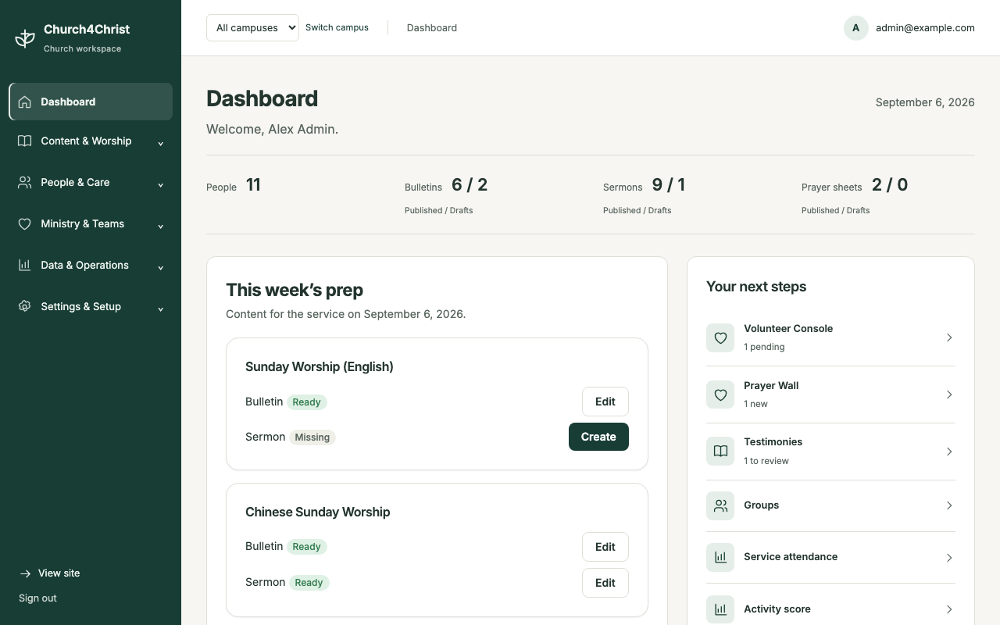
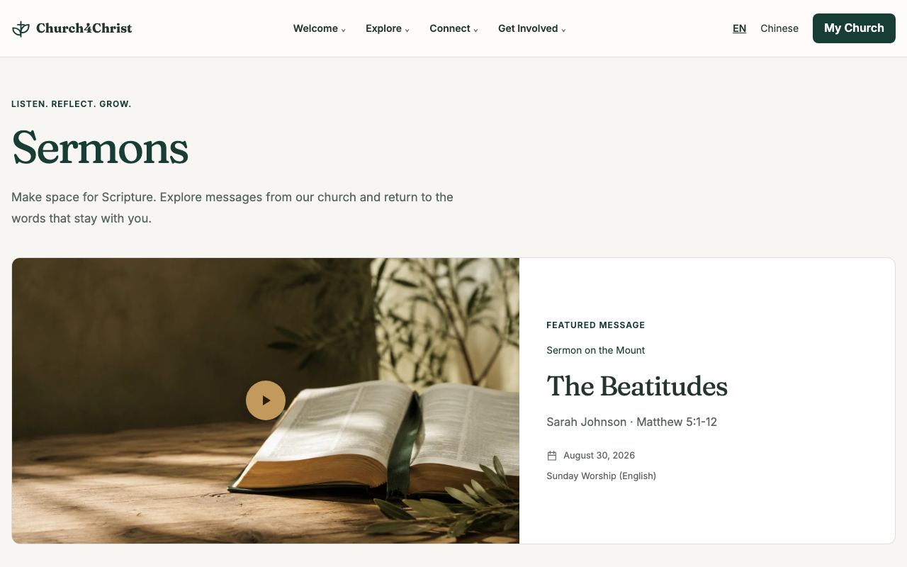
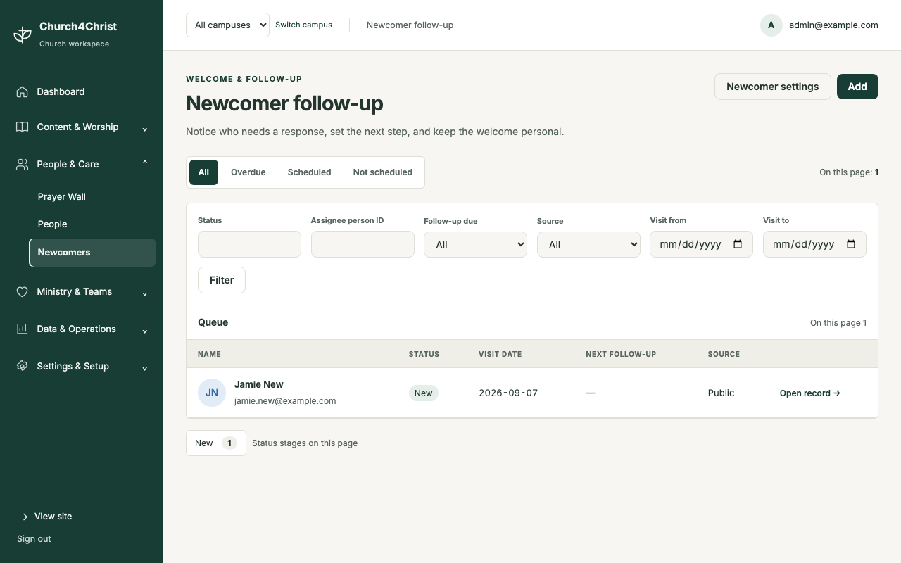
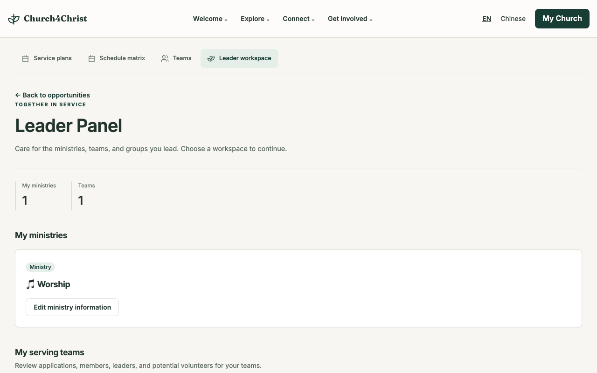

# Church4Christ: software de código abierto para la gestión de iglesias y sitio web de la iglesia

<p align="center"></p>

<p align="center"><a href="README.md">English</a> · <a href="README.zh.md">简体中文</a> · <b>Español</b> · <a href="README.pt.md">Português (Brasil)</a> · <a href="README.fr.md">Français</a> · <a href="README.de.md">Deutsch</a> · <a href="README.ja.md">日本語</a> · <a href="README.ko.md">한국어</a> · <a href="README.ms.md">Bahasa Melayu</a> · <a href="README.id.md">Bahasa Indonesia</a> · <a href="README.vi.md">Tiếng Việt</a> · <a href="README.hi.md">हिन्दी</a></p>

*Esta es una traducción de [README.md](README.md), que es la versión oficial en inglés. Se hizo con ayuda de IA; las correcciones de hablantes nativos son bienvenidas.*

[](https://github.com/leveo/church4christ/actions/workflows/ci.yml)
[](https://github.com/leveo/church4christ/releases)
[](LICENSE)
[](https://astro.build/)
[](https://workers.cloudflare.com/)
[](docs/i18n.md)

**Un sistema de gestión de iglesias (ChMS) y CMS para iglesias de código abierto, pensado
desde la IA, con un sitio web multilingüe en 12 idiomas de interfaz, entre ellos inglés y chino. Una alternativa modular y autoalojada a Planning Center
para iglesias pequeñas y medianas, comunidades de fe y organizaciones sin fines de lucro, construida sobre Astro
y Cloudflare Workers.**

Personas y familias, grupos, programación de voluntarios, registro de entrada de niños, asistencia,
seguimiento de visitantes nuevos, cuidado en oración, sermones, boletines, eventos y, de forma opcional, un portal
para miembros, un registro de donaciones e inscripción a eventos, todo en un solo código que puedes leer, modificar
y alojar tú mismo.

**Sitio web: [church4christ.org](https://church4christ.org) · Demostración en vivo: [demo.church4christ.org](https://demo.church4christ.org).**

[](https://church4christ.yunfei-song.com/C4C-modular-Voice.mp4)

Mira **[Built Around Your Ministry](https://church4christ.yunfei-song.com/C4C-modular-Voice.mp4)**,
el video promocional del sitio de demostración (MP4).

**Empieza aquí: [Configuración para personas y agentes de IA](docs/setup.md).** Ejecuta `npm run onboard`
para elegir la identidad de tu organización, los colores, el logo y las primeras funciones en una página local
del navegador, y luego pasa las preferencias guardadas al instalador existente. Los agentes de programación empiezan por
[AGENTS.md](AGENTS.md); Claude también lee [CLAUDE.md](CLAUDE.md).

Church4Christ combina un sitio público multilingüe con un sistema de administración para contenido,
cuidado en oración, programación de voluntarios, personas y familias. Los módulos opcionales añaden un
portal para miembros y otros flujos de trabajo de gestión de la iglesia. El proyecto busca reducir el
costo inicial y el de mantenimiento continuo de una implementación personalizada, y a la vez mantener el
código y la configuración de despliegue a disposición de quienes lo operan.

La **versión de código fuente actual es la 1.7**. Church4Christ es una base de código abierto,
no un servicio administrado listo para usar. La evaluación local es gratuita y algunos despliegues
pueden caber dentro de las cuotas gratuitas de los proveedores, pero el alojamiento de producción,
el correo electrónico, las bases de datos, los dominios, las copias de seguridad y otros servicios pueden tener costo según la
configuración y el uso. Consulta [Perfiles de implementación y costos](#perfiles-de-implementación-y-costos)
antes de elegir una configuración de producción.

|  |  |  |
|---|---|---|
|  |  |  |
|  |  |  |
|  |  |  |

**Un espacio de trabajo propio para cada módulo principal.** El diseño Sanctuary, que viene por defecto,
combina superficies en marfil cálido con una navegación en verde bosque y diseños adecuados para cada tarea:
editores de publicación con vistas previas locales, registros de personas y familias, colas de cuidado,
matrices de servicio, registro de entrada de niños apto para pantallas táctiles, reproductores de cursos y libros contables
de finanzas. Los menús públicos, de miembros, de líderes y de administradores siguen los módulos habilitados
y los permisos de cada persona. Harvest y Midnight siguen disponibles, con modos claro y
oscuro. Consulta el [inventario de diseño de los 21 módulos](docs/design/module-coverage.md).

Las capturas de pantalla usan el contenido de demostración ficticio del repositorio. En la primera configuración puedes
incluir esos ejemplos o empezar sin ellos; ambas opciones conservan los mismos diseños,
el mismo tema y las mismas imágenes predeterminadas incluidas. Las páginas en inglés usan interfaz y textos de demostración en inglés;
las páginas en chino admiten contenido en chino y bilingüe. Las 29 capturas de la interfaz se
volvieron a tomar de la aplicación en funcionamiento; consulta el [inventario de capturas y el comando
de regeneración](docs/design/readme-screenshot-inventory.md).

**Navegación agrupada.** Un sitio con todo habilitado condensa sus destinos públicos en
Bienvenida, Explorar, Conectar y Participar. Los enlaces integrados permanecen en el grupo de su público,
mientras que las páginas personalizadas y los enlaces externos aparecen en Más. El orden guardado en
Admin → Navegación se conserva dentro de cada grupo, y los grupos vacíos desaparecen.


Se incluyen doce idiomas de interfaz: inglés y chino, además de español, portugués de Brasil,
francés, alemán, japonés, coreano, malayo, indonesio, vietnamita y hindi. Cada
iglesia elige qué idiomas ofrece su sitio y uno predeterminado durante la configuración o más adelante en
Configuración → Idiomas. Las diez traducciones más recientes se hicieron con ayuda de IA; las correcciones de hablantes
nativos son bienvenidas. También se incluyen tres estilos listos para usar y un punto de partida modular para seguir
personalizando.

---

## ¿Para quién es?

Church4Christ está pensado para iglesias pequeñas y medianas, comunidades de fe y organizaciones sin fines de lucro —
sobre todo congregaciones multilingües y de inmigrantes — que necesitan un sitio web público y una
base personalizable para la gestión de la iglesia. Funciona mejor cuando un miembro del equipo, un voluntario
o un socio de implementación con buen manejo técnico puede encargarse del despliegue y el mantenimiento. Una
plataforma administrada puede ser más adecuada si la organización prefiere que el proveedor se encargue de la configuración,
el soporte, las actualizaciones y la responsabilidad operativa en lugar de la personalización a nivel de código fuente.

## ¿Cómo se compara este enfoque?

Cada categoría de producto atiende necesidades distintas, y las condiciones de los proveedores varían. Esta tabla
compara modelos de operación; no promete precios, portabilidad ni derechos sobre los datos que valgan en todos los casos.

| | **Church4Christ** | **CMS con plugins autogestionado** | **Constructor de sitios alojado** | **Plataforma administrada para iglesias** |
|---|---|---|---|---|
| **Ajuste principal** | Sitio web multilingüe personalizado y flujos de trabajo modulares para la iglesia | Sitio de contenido extensible armado con plugins | Sitio web público administrado por el proveedor | Flujos de trabajo de la iglesia administrados por el proveedor |
| **Modelo de costos** | Uso de infraestructura y servicios; algunos perfiles pueden caber en las cuotas gratuitas | Alojamiento, extensiones y mantenimiento | Suscripción y complementos | Suscripción, a menudo por nivel o módulo |
| **Personalización** | Cambios a nivel de código fuente y módulos opcionales | Temas, plugins y cambios en el código fuente cuando están disponibles | Plantillas y extensiones compatibles con el proveedor | Configuración e integraciones compatibles con el proveedor |
| **Operación** | Tu equipo o un socio de implementación despliega, actualiza, monitorea y respalda | Tu equipo o el proveedor de alojamiento mantiene el núcleo y los plugins | El proveedor administra la mayor parte de la operación de la plataforma | El proveedor administra la mayor parte de la operación de la plataforma |
| **Portabilidad** | El acceso al código y a la base de datos permite migrar, pero la migración es manual | Depende del alojamiento, los plugins y los formatos | Depende de las exportaciones y condiciones del proveedor | Depende de las exportaciones, las API y las condiciones del proveedor |
| **Punto de partida de idiomas** | Incluye doce idiomas de interfaz; cada iglesia elige su propio conjunto | Depende de las extensiones elegidas | Depende del servicio y del plan | Depende del servicio y del plan |

**Las contrapartidas.** Church4Christ está optimizado para Cloudflare Workers y sus bindings;
pasar a otra pila de alojamiento es posible como trabajo sobre el código fuente, pero no es un camino de un clic con soporte.
Tampoco existe una migración automatizada de contenido de D1 a Supabase. Las páginas integradas las definen
los temas, mientras que la edición con arrastrar y soltar se aplica solo a las páginas personalizadas. El proyecto
tiene versiones, pero quienes lo adopten deben esperar trabajo de implementación y actualizaciones revisadas con cuidado.

Operar el proyecto también implica mantenerlo. Tu responsable técnico sigue a cargo
de las actualizaciones de dependencias, la revisión y configuración de seguridad, el monitoreo, las copias de seguridad y las
pruebas de restauración, y el despliegue de correcciones. La arquitectura reduce parte del trabajo de infraestructura, pero
no elimina el mantenimiento de seguridad ni el operativo. Consulta
[**`docs/why-this-stack.md`**](docs/why-this-stack.md) para conocer las razones del diseño.

## ¿Buscas una alternativa de código abierto a Planning Center?

Muchas iglesias que buscan una alternativa gratuita o autoalojada a Planning Center,
Breeze, Church Community Builder o software de gestión de iglesias alojado similar quieren dos
cosas: control sobre sus propios datos y un sitio web que comparta esos mismos registros.
Church4Christ cubre buena parte de la gestión cotidiana de una iglesia en una sola aplicación
autoalojada:

| Necesidad común de un ChMS | Church4Christ |
|---|---|
| Directorio de personas y familias | [Personas y familias](docs/features/people-households.md) con importación CSV, asignaciones guardadas de columnas de origen y exportación |
| Grupos pequeños | [Grupos](docs/features/groups.md) con directorio público, solicitudes de ingreso, eventos y asistencia |
| Programación de voluntarios | [Programación de voluntarios](docs/features/volunteer-serve.md) con una matriz mensual y confirmación por correo, sin necesidad de iniciar sesión |
| Planificación de cultos | [Guiones, ensayos, disponibilidad y calendarios](docs/features/service-planning.md) para cultos y eventos |
| Registro de entrada de niños | [Registro de entrada en quiosco](docs/features/children-checkin.md) con códigos de recogida y gráficos de asistencia |
| Asistencia y participación | [Asistencia a los cultos](docs/features/service-attendance.md) y [puntajes de actividad](docs/features/activity-score.md) |
| Seguimiento de visitantes nuevos y cuidado | [Cola de visitantes nuevos](docs/features/newcomers.md), [muro de oración](docs/features/prayer-wall.md) y [flujos de trabajo comunitarios](docs/features/community-workflows.md) |
| Sitio web de la iglesia y CMS | [Sitio público, temas, sermones, boletines y editor de páginas](docs/features/public-site-and-themes.md) |
| Autoservicio para miembros | [Portal de miembros](docs/features/member-portal.md) (familia, grupos, oración; funciona con D1 o Supabase) |
| Varias sedes | [Multisede](docs/features/multi-campus.md) con datos y roles aislados por sede |

**Pasar de Planning Center de forma gradual.** Una
[sincronización de Planning Center People](docs/deploy.md#9-optional-configure-planning-center-synchronization)
opcional y de solo lectura vincula los registros de personas de Planning Center con las personas que ya existen en Church4Christ y envía
las coincidencias ambiguas a revisión humana, de modo que ambos sistemas puedan funcionar en paralelo durante la
transición. Las personas se traen con el importador CSV y sus asignaciones de columnas reutilizables.

**Lo que todavía no reemplaza.** No hay una aplicación móvil nativa, ni mensajería SMS, ni
biblioteca de canciones ni planificación de canciones de adoración (Service Planning cubre guiones y
ensayos). Las donaciones en línea con Stripe (tarjetas y débitos bancarios)
funcionan en modo de prueba hasta que completes la lista de verificación de puesta en producción; la inscripción pagada a eventos
usa el mismo modo de Stripe. El módulo de donaciones también registra cheques y efectivo en un libro contable
fuera de línea y genera estados anuales de donaciones. Church4Christ es una base que tu equipo opera y mantiene, no un
servicio alojado con soporte del proveedor.

Planning Center y los demás nombres de productos mencionados arriba son marcas comerciales de sus respectivos
dueños. Church4Christ es un proyecto independiente y no está afiliado a ellos.

---

## ¿Solo necesitas una parte?

Empieza con poco y crece después. Cada edición de una sola función instala este repositorio con
un solo ámbito activado, usando la base de datos Cloudflare D1 predeterminada:

| Si necesitas | Empieza con | Preajuste |
|---|---|---|
| Un quiosco de registro de entrada para niños | [church-checkin](https://github.com/leveo/church-checkin) | `checkin` |
| Programación de voluntarios | [church-volunteer-scheduling](https://github.com/leveo/church-volunteer-scheduling) | `volunteer-scheduling` |
| Gestión de grupos pequeños | [church-small-groups](https://github.com/leveo/church-small-groups) | `small-groups` |
| Inscripciones a eventos y control de entrada | [church-event-registration](https://github.com/leveo/church-event-registration) | `event-registration` |
| Un sitio web y CMS para la iglesia | [church-website-cms](https://github.com/leveo/church-website-cms) | `website` |

Las ediciones no contienen código aparte, así que no hay nada adicional que mantener. También puedes
omitirlas y ejecutar `npm run onboard -- --preset checkin` aquí. Activa más funciones en cualquier momento
en **Configuración → Módulos**. Consulta las [ediciones de una sola función](docs/editions.md).

---

## Constrúyelo con un asistente de IA

Las personas y los agentes comparten la misma incorporación en el navegador, el mismo instalador, el mismo catálogo de funciones y las mismas
verificaciones de preparación. [AGENTS.md](AGENTS.md) y [CLAUDE.md](CLAUDE.md) le indican a un asistente que revise
primero la instalación, que ejecute `npm run onboard` si es una configuración nueva sin preferencias
y que te deje completar el formulario. Tus respuestas quedan en el archivo
`.church/preferences.json`, que Git ignora; las sesiones posteriores leen ese archivo para respetar tu identidad, tu marca
y las funciones que elegiste. La [guía de configuración](docs/setup.md) incluye los comandos y los pasos de recuperación.
Inicia un asistente con:

> "Lee AGENTS.md y docs/setup.md. Inicia la incorporación en el navegador para que yo pueda elegir la
> marca de nuestra organización y las primeras funciones. Usa mis preferencias guardadas para preparar una vista
> previa local, verifica las páginas del sitio y de administración, y luego dime la URL y las verificaciones pendientes."

No tienes que hacer cada cambio a mano. Este repositorio está organizado para que un asistente de programación
con IA pueda seguir las guías en lenguaje sencillo de [`docs/features/`](docs/features/) y
trabajar con una amplia cobertura de pruebas automatizadas. Eso puede reducir el esfuerzo de personalización y
mantenimiento, pero alguien con la responsabilidad de mantener el proyecto debe revisar los cambios, ejecutar las pruebas
pertinentes y desplegarlos de forma deliberada.

La idea: abre este proyecto con un asistente de IA, describe lo que quieres en lenguaje
cotidiano y deja que haga la edición. Algunos ejemplos reales que puedes pegar:

> "Lee `docs/features/public-site-and-themes.md` y luego cambia nuestro color principal a
> azul rey y muéstrame la página de inicio."

> "Agrega la configuración regional en italiano (`it`) siguiendo `docs/i18n.md`."

> "Sigue docs/setup.md para configurar nuestra iglesia sin contenido de demostración. Muéstrame el plan
> de configuración y los resultados de preparación, y luego prepara el despliegue con docs/deploy.md."

El mismo flujo de trabajo sirve para el mantenimiento: describe un cambio, revisa el diff propuesto,
pruébalo en local y despliega solo después de revisar el resultado. La ayuda de la IA
no reemplaza las decisiones de seguridad, las copias de seguridad, las pruebas en producción ni la responsabilidad operativa.

---

## Nuestra misión

**Reducir el costo y el esfuerzo de empezar con un sistema de gestión de iglesias personalizado y un
sitio web multilingüe.** Church4Christ ofrece una base modular y probada que una iglesia o un
socio de implementación puede adaptar en lugar de empezar desde cero. No promete un
servicio de producción sin suscripciones ni sin presupuesto: las decisiones sobre infraestructura, correo electrónico, base de datos,
dominio, soporte y mantenimiento determinan el costo real de operación.

---

## Qué incluye

Cada función tiene su propia guía en lenguaje sencillo. Empieza con cualquiera de estas:


| | Función | Qué hace |
|---|---|---|
| [](docs/features/public-site-and-themes.md) | **[Sitio público y temas](docs/features/public-site-and-themes.md)** | La puerta de entrada de tu iglesia —inicio, sermones, eventos, equipo— en uno de tres estilos listos para usar. |
| [](docs/features/cms-admin.md) | **[El área de administración](docs/features/cms-admin.md)** | Inicio de sesión sin contraseña, roles y restauración con un clic para el contenido editorial con versiones que lo admite. |
| [](docs/features/admin-permissions.md) | **[Permisos de administración](docs/features/admin-permissions.md)** | Da a cada administrador solo las áreas que necesita: el muro de oración y el directorio de miembros vienen incluidos, el resto a elección. |
| [](docs/features/multi-campus.md) | **[Multisede](docs/features/multi-campus.md)** | Administra varias sedes en un mismo backend con datos, configuración, funciones y roles locales aislados por sede; solo el administrador maestro puede ver todas las sedes. |
| [](docs/features/bulletins.md) | **[Boletines semanales](docs/features/bulletins.md)** | Arma la hoja del culto del domingo y programa su publicación automática. |
| [](docs/features/sermons.md) | **[Archivo de sermones](docs/features/sermons.md)** | Pega un enlace de YouTube y obtén una biblioteca de mensajes pasados con búsqueda y carga rápida. |
| [](docs/features/prayer-wall.md) | **[Muro de oración](docs/features/prayer-wall.md)** | Recibe peticiones de oración y atiéndelas en un tablero sencillo, de forma privada. |
| [](docs/features/volunteer-serve.md) | **[Programación de voluntarios](docs/features/volunteer-serve.md)** | Planifica un mes de servicio de un vistazo; los voluntarios confirman por correo, sin iniciar sesión. |
| [](docs/features/people-households.md) | **[Personas y familias](docs/features/people-households.md)** | Perfiles y familias, además de exportación CSV canónica solo para crear y asignación reutilizable de columnas de origen para migraciones. |
| [](docs/features/member-identity.md) | **[Seguridad de identidad de miembros](docs/features/member-identity.md)** | Identidad respaldada por pruebas en Donaciones, Inscripciones, Grupos, Equipos, Visitantes nuevos e importaciones; los duplicados ambiguos pasan a revisión en lugar de fusionarse solo por el nombre, con aprobación vinculada a un OTP y una reversión protegida de 24 horas. |
| [](docs/features/groups.md) | **[Grupos](docs/features/groups.md)** | Grupos pequeños con directorio público, lista de verificación de miembros, solicitudes de ingreso, eventos y asistencia por persona mediante un enlace de correo. |
| [](docs/features/children-checkin.md) | **[Registro de entrada de niños](docs/features/children-checkin.md)** | Un quiosco apto para pantallas táctiles donde los padres registran la entrada y salida de sus hijos con un código de recogida, además de gráficos semanales de asistencia. |
| [](docs/features/service-attendance.md) | **[Asistencia a los cultos](docs/features/service-attendance.md)** | Registra totales agregados de adultos, obtén totales opcionales de niños a partir de los registros de entrada, corrige el historial y descarga informes CSV sin datos de identidad. |
| [](docs/features/newcomers.md) | **[Seguimiento de visitantes nuevos](docs/features/newcomers.md)** | Recibe tarjetas públicas bilingües con consentimiento, clasifica una cola del personal con alcance limitado y pasa las coincidencias exactas a Personas sin filtrar notas ni respuestas. |
| [](docs/features/onboarding-readiness.md) | **[Preparación para el lanzamiento](docs/features/onboarding-readiness.md)** | Una lista de verificación bilingüe compartida por la configuración, doctor y cada administrador real, con confirmaciones del superadministrador para las verificaciones manuales. |
|  | **[Planificación de cultos](docs/features/service-planning.md)** | Planifica un guion con horarios, ensayos con las personas convocadas, disponibilidad de los miembros, una búsqueda para encontrar horario, calendarios y correo automático. |
|  | **[Puntaje de actividad](docs/features/activity-score.md)** | Combina actividades seleccionadas vinculadas a personas en puntajes de miembros explicables y un resumen de participación de toda la iglesia. |
| [](docs/features/learning.md) | **[Aprendizaje](docs/features/learning.md)** | Continúa la escuela dominical y el discipulado entre reuniones con videos bilingües, archivos, tareas, cuestionarios y un estado sincronizado con el proveedor. |
| [](docs/features/page-builder.md) | **[Editor de páginas](docs/features/page-builder.md)** | Arma tus propias páginas personalizadas arrastrando y soltando: multilingües, siempre acordes al tema, y las páginas publicadas cargan sin nada de JavaScript. Opcional; desactivarlo nunca rompe una página que ya hayas creado. |
| [](docs/features/giving.md) | **[Donaciones](docs/features/giving.md)** | Implementado: donaciones en línea con Stripe (modo de prueba por defecto, en vivo tras la lista de verificación de puesta en producción), un libro contable fuera de línea para cheques y efectivo, y estados anuales de donaciones. |
| [](docs/features/registration.md) | **[Inscripciones](docs/features/registration.md)** | Implementado: inscripción gratuita a eventos en D1 o Supabase, preguntas personalizadas, lista de espera, etapas del evento y exportación de la lista de participantes, además de pago con Stripe en Supabase en el mismo modo de Stripe que Donaciones (verifica con una pequeña inscripción en vivo antes de depender de ello). |
|  | **[Logística de eventos](docs/features/event-logistics.md)** | Complemento opcional de Inscripciones: asigna habitaciones a las personas, siéntalas en mesas con una vista previa de Asignación automática, repártelas en grupos pequeños e imprime listas de habitaciones, carteles para las puertas y tarjetas de mesa. |
| [](docs/features/member-portal.md) | **[Portal de miembros](docs/features/member-portal.md)** | Un único centro con sesión iniciada para la participación actual y las oportunidades abiertas, además de perfiles de familia, eventos, servicio, calendario, donaciones y oración con alcance limitado. |
| [](docs/features/i18n.md) | **[Doce idiomas](docs/features/i18n.md)** | Elige entre 12 idiomas de interfaz por sitio, con inglés como respaldo y conversión con un clic de chino simplificado a tradicional. |
| [](docs/features/email-automation.md) | **[Correo y automatización](docs/features/email-automation.md)** | Enlaces de inicio de sesión, recordatorios y resúmenes, con registro local y una configuración de producción apta para planes de pago. |
| [](docs/features/modules.md) | **[Módulos](docs/features/modules.md)** | Desactiva las funciones que no uses; no se borra nada y puedes volver a activarlas cuando quieras. |

**Elige tus módulos.** La mayoría de las capacidades opcionales son **módulos** que puedes desactivar
desde un solo panel de Configuración: boletines, sermones, el muro de oración, la programación de voluntarios
y más. Las instalaciones nuevas escriben cada ajuste de módulo de forma explícita a partir de la selección de configuración;
la demostración Full Church selecciona sus 21 (Service Planning y Event Logistics se activan por separado). Solo en instalaciones antiguas, las filas de módulos que faltan conservan
el comportamiento heredado de estar activadas por defecto. Una iglesia que solo quiere horarios de culto y sermones puede ocultar
el resto con un clic: las páginas, los enlaces y los correos del módulo desaparecen juntos, y no
se borra nada. Consulta [**`docs/features/modules.md`**](docs/features/modules.md).

| Key | English | 中文 | Required database |
|---|---|---|---|
| `bulletins` | Bulletins | 周报 | Either |
| `sermons` | Sermons | 讲道 | Either |
| `prayer-sheets` | Prayer Sheets | 祷告单 | Either |
| `prayer-wall` | Prayer Wall | 祷告墙 | Either |
| `events` | Events | 活动 | Either |
| `serve` | Volunteer Scheduling | 服事排班 | Either |
| `gifts` | Spiritual Gifts | 恩赐探索 | Either |
| `testimonies` | Testimonies | 见证 | Either |
| `articles` | Articles | 文章 | Either |
| `fellowships` | Fellowships | 团契 | Either |
| `groups` | Groups | 小组 | Either |
| `people` | People & Households | 会友与家庭 | Either |
| `children` | Children Check-in | 儿童报到 | Either |
| `attendance` | Service Attendance | 崇拜出席 | Either |
| `newcomers` | Newcomer Follow-up | 新朋友跟进 | Either |
| `activity-score` | Activity Score | 活跃度评分 | Either |
| `page-builder` | Page Builder | 页面编辑器 | Either |
| `portal` | Member Portal | 会友平台 | Either |
| `giving` | Giving | 奉献 | Supabase |
| `registration` | Registration | 活动报名 | Either |
| `learning` | Learning | 学习 | Either |
| `planning` | Service Planning | 服事流程 | Either |
| `event-logistics` | Event Logistics | 活动后勤 | Either |

### Gestión de la comunidad y flujos de trabajo

Las sedes pueden administrar directamente los grupos y el seguimiento de los miembros. Las comunidades fraternales opcionales añaden una capa comunitaria con membresía independiente y grupos secundarios. Los flujos de trabajo reutilizables ofrecen pasos asignados, fechas límite, seguimiento de la finalización y recordatorios por correo de Cloudflare. Consulta la [guía de flujos de trabajo comunitarios](docs/features/community-workflows.md) para conocer la configuración, los permisos y los controles de envío.

### Aprender más allá del domingo

La versión 1.1 añade el módulo opcional **Aprendizaje** para la escuela dominical,
el discipulado y otros ministerios que continúan entre reuniones. Los estudiantes obtienen
una vista de curso bilingüe y de privacidad acotada con videos de YouTube no listados, archivos,
tareas y cuestionarios. La entrega sigue siendo responsabilidad del proveedor: el sitio
dirige a los estudiantes al proveedor configurado en lugar de recopilar por sí mismo tareas,
respuestas, comentarios, calificaciones o contenido de archivos.

Los administradores pueden conectar Google Classroom mediante sus API oficiales o una derivación
de Church4Christ Canvas operada por separado. La asignación de cursos, las credenciales OAuth cifradas, las notificaciones firmadas del proveedor, la sincronización manual y la conciliación
programada y acotada alimentan solo los metadatos de actividad que Church4Christ necesita.


| Vista del estudiante en inglés | Vista del estudiante en chino | Administración del proveedor |
|---|---|---|
| [](docs/images/learning/genesis-1-en.png) | [](docs/images/learning/genesis-1-zh.png) | [](docs/images/learning/admin-overview.png) |

Consulta la **[guía de la función Aprendizaje](docs/features/learning.md)** para conocer la configuración
del proveedor, los límites de privacidad, los presupuestos de sincronización, la demostración de Génesis 1 y los
requisitos de operación de Canvas por separado y de código fuente correspondiente.

### Un hogar para tus miembros

El **Portal de miembros** opcional convierte los registros que tu iglesia ya mantiene en una
experiencia útil con sesión iniciada. Su página de oportunidades muestra en un solo lugar todas las formas habilitadas de
aprender, pertenecer y servir: tanto los grupos, clases y equipos ya
vinculados al miembro como las oportunidades abiertas para unirse o postularse. Los miembros
también pueden actualizar los datos de su familia, ver sus donaciones, inscribirse en eventos, revisar sus compromisos
de servicio, suscribirse a un calendario personal y compartir oraciones con alcance limitado. Usa los mismos
enlaces de inicio de sesión sin contraseña que el resto de Church4Christ: no hay una cuenta nueva ni una contraseña
que recordar.


Los líderes de ministerios, grupos, escuela dominical y equipos de servicio tienen un panel limitado a sus recursos en
`/<locale>/manage`. El inicio de sesión de la aplicación de la iglesia lo protege, y cada operación verifica
la autoridad del líder sobre ese recurso específico. Así, Cloudflare Zero Trust puede limitarse
al área completa `/admin`.




El portal funciona tanto con el backend D1 predeterminado como con el backend opcional **Supabase (Postgres)**.
Las familias, los grupos, los archivos protegidos de los grupos y la moderación de oraciones de la iglesia, del grupo y privadas
funcionan en D1. Las oraciones de ámbito de evento, los administradores de eventos y "Mis inscripciones"
necesitan Inscripciones, que funciona en D1 para eventos gratuitos una vez activado. Más información en
[**`docs/features/member-portal.md`**](docs/features/member-portal.md).

---

## Pruébalo en 5 minutos (en tu propia computadora)

Puedes ejecutar el sitio en local, con contenido de ejemplo ficticio opcional, antes de elegir un
despliegue. Necesitarás tener instalado [Node.js](https://nodejs.org/) 22.22.1 o posterior. La incorporación
en el navegador recomienda **Website + Community** con **Cloudflare D1** para el primer lanzamiento.


```bash
# 1. Get the code and install it
git clone https://github.com/leveo/church4christ.git
cd church4christ
npm ci

# 2. Open the local browser form, complete it, and save your preferences
npm run onboard

# 3. Review the plan, then initialize with those same preferences
node scripts/setup/index.mjs --preferences .church/preferences.json --yes --dry-run --json
node scripts/setup/index.mjs --preferences .church/preferences.json --yes --json

# 4. For D1, start it (always follow the exact handoff setup prints)
npm run dev
```

El formulario pregunta si se trata de una iglesia, una organización sin fines de lucro o una sede, y recopila el nombre,
el lema, la dirección, la zona horaria, los colores principal y secundario, un logo opcional PNG/JPEG/WebP
(de hasta 2 MiB), el idioma, el primer administrador y la elección de contenido de demostración. Marca solo las
funciones que necesites.
La selección recomendada usa D1 como base de datos; la aplicación sigue ejecutándose en
Cloudflare Workers y guarda los medios en R2. **Donaciones e Inscripciones de pago**
son opciones avanzadas que requieren cambiar de forma explícita a PostgreSQL compatible con Supabase.

Al guardar se escribe `.church/preferences.json` y cualquier logo subido dentro de `.church/`, que
Git ignora. No crea bases de datos ni despliega un sitio. Vuelve a ejecutar `npm run onboard` para
recargar y editar las preferencias guardadas. Deja la terminal abierta mientras completas el
formulario; deténlo con Ctrl+C al terminar. Para abrir tú mismo la URL que se imprime, usa
`npm run onboard -- --no-open`; para elegir un puerto, añade `--port 4310`. El punto de entrada directo
es `node scripts/onboard/index.mjs`. Consulta [la guía de configuración](docs/setup.md) para saber qué
aplica el instalador y cómo usan los agentes el resto de las preferencias.

Si instalas con `npm ci --ignore-scripts`, ejecuta `npm run tokens` manualmente antes del
instalador o de `npm run dev`.

Para Supabase local, el handoff en cambio exporta
`CLOUDFLARE_HYPERDRIVE_LOCAL_CONNECTION_STRING_HYPERDRIVE` en el shell del host antes de
`npm run dev`; esa URL de conexión no debe ir en `.dev.vars`.

Durante la primera configuración, elige **Include demo content** o **No demo content**. Ambas opciones conservan el
mismo diseño incluido, las mismas imágenes decorativas locales, las mismas funciones habilitadas y las mismas herramientas de administración.
El contenido de demostración añade personas, sermones, boletines, eventos, ministerios y otros
ejemplos ficticios. Su paso de medios copia el paquete de imágenes generadas de `seed/media/` a R2 local.
Sin contenido de demostración se crean el esquema de la base de datos, los valores operativos predeterminados, los ajustes de la iglesia, la selección
de módulos y el primer administrador, sin registros de ejemplo.

El archivo de preferencias registra la elección de contenido de demostración del formulario. Para una configuración con respuestas
explícitas por CLI, pasa `--demo-data` o `--no-demo-data`; si omites ambos en una configuración no interactiva, se mantiene
el valor predeterminado actual de no incluir demostración. Las opciones no se pueden combinar. Repetir la misma
configuración conserva la elección de contenido registrada y los registros existentes. `--no-demo-data` no
borra una base de datos existente, y la configuración se niega a añadir datos de demostración sobre personas ya existentes.
Usa un espacio de trabajo y una base de datos nuevos y separados para probar el otro modo de inicio.

Abre la dirección que imprime la configuración (normalmente `http://localhost:4321`).

**Iniciar sesión en el área de administración.** No hay contraseña. En la página de inicio de sesión, ingresa el
correo del primer administrador que indicaste en la configuración, repetido en el handoff, y solicita un
enlace. Como el correo local está configurado para imprimirse en lugar de enviarse, la **URL del enlace mágico aparece
directamente en tu terminal**. Pégala en el navegador y ya estarás dentro. (Para pruebas locales más rápidas,
la configuración escribe esa misma dirección como `AUTH_DEV_BYPASS_EMAIL` en `.dev.vars`, lo que
inicia tu sesión automáticamente. Quita esa línea para probar el flujo real de inicio de sesión.)

En ambos modos de contenido, la configuración crea a la vez un administrador nuevo y su identidad de inicio de sesión
auditada. Al volver a ejecutarla se conserva la propiedad de los contactos existentes; no se verifica
un correo ya existente ni se restaura un acceso revocado. Si la configuración informa un problema de identidad, completa
el [flujo de revisión o recuperación de identidad](docs/features/member-identity.md) antes de volver a ejecutarla.

El comando `npm run setup`, solo para terminal, sigue disponible. La configuración ofrece **Website** (8 módulos de
publicación enfocados), **Website + Community** (18 módulos; el Portal de miembros se puede añadir en D1) y
**Full Church** (21 módulos; Service Planning se activa por separado). Donaciones
selecciona Supabase automáticamente (las Inscripciones gratuitas funcionan en D1); las selecciones compatibles con D1 eligen D1 a menos que
reemplaces el backend de forma explícita. Los requisitos de cuentas dependen del modo Local o Deploy,
como se detalla más abajo. Para automatizar, pasa todas las respuestas con `--yes`; añade `--json` para obtener un único resultado
legible por máquinas. Para una ejecución no interactiva legible por personas, usa las mismas banderas completas
con `npm run setup -- ... --yes` y omite `--json`. Para que stdout sea estrictamente JSON
a través de npm, usa la forma silenciosa:

```bash
npm run --silent setup -- --mode local --preset website --site-slug my-church \
  --church-name "My Church" --locale en --admin-email admin@example.com \
  --admin-name "First Admin" --app-origin http://localhost:4321 \
  --email-from admin@example.com --demo-data --yes --json
```

---

## Perfiles de implementación y costos

Estos son perfiles de planificación, no garantías de precio. Los precios de abajo están vigentes a
**agosto de 2026**, pueden cambiar y deben confirmarse en las páginas oficiales de precios enlazadas antes del despliegue.

| Perfil | Alcance incluido | Notas sobre costos y preparación |
|---|---|---|
| **Evaluación local** | Módulos de sitio web o comunidad con D1 local; módulos completos con Postgres local compatible | No se requiere ningún cargo por servicios alojados para evaluar con D1 local. Tú pones la computadora, el tiempo de desarrollo y cualquier servicio externo opcional. |
| **D1 sitio web/comunidad** | Worker de Cloudflare, D1 y R2 para hasta 22 módulos compatibles con D1 | Una implementación modesta puede caber dentro de las cuotas gratuitas de Cloudflare. El tráfico, el almacenamiento, las operaciones que superen las cuotas, un dominio y otros servicios pueden tener costo; consulta los [precios de Workers](https://developers.cloudflare.com/workers/platform/pricing/). El correo de producción va aparte. |
| **Correo de producción** | Enlaces de inicio de sesión, recordatorios, solicitudes y resúmenes transaccionales a destinatarios arbitrarios | El repositorio admite una configuración de correo de Cloudflare apta para planes de pago. Enviar a destinatarios arbitrarios requiere Workers Paid, que actualmente tiene un mínimo de **US$5 al mes** e incluye **3,000 correos**, y luego **US$0.35 por cada 1,000 correos**. Estos montos pueden cambiar; consulta los [precios de Cloudflare Email Service](https://developers.cloudflare.com/email-service/platform/pricing/). |
| **Supabase/módulos completos** | Despliegue en Cloudflare más Supabase/Postgres para los 21 módulos de Full Church, incluidos Portal de miembros, Donaciones e Inscripciones | Los costos de Cloudflare se mantienen, y el [plan de Supabase](https://supabase.com/pricing) elegido puede añadir cargos de suscripción o de uso. A agosto de 2026, Supabase Free no incluye copias de seguridad diarias automáticas, y los proyectos Free con poca actividad pueden [pausarse automáticamente](https://supabase.com/docs/guides/platform/free-project-pausing) según la actividad de un período de siete días. En producción, haz volcados periódicos de la base de datos en un sitio externo y practica la restauración, o elige un plan de pago cuyas [opciones de copia de seguridad](https://supabase.com/docs/guides/platform/backups) cumplan tus requisitos de continuidad. Los precios y las políticas del servicio pueden cambiar. Stripe empieza en modo de prueba; los pagos reales requieren una decisión explícita tras la lista de verificación de puesta en producción de [`docs/supabase-setup.md`](docs/supabase-setup.md). |

Las cuotas gratuitas de los proveedores pueden servir para evaluar o para despliegues modestos, pero
no son una promesa de que un servicio de producción seguirá siendo gratuito. Presupuesta también la responsabilidad técnica,
el mantenimiento de dependencias y de seguridad, el monitoreo, las copias de seguridad, las pruebas de restauración y el crecimiento
futuro del uso, además de los servicios mencionados arriba.

---

## Ponerlo en línea

¿Eres nuevo en esto? Empieza con [**`docs/cloudflare-setup.md`**](docs/cloudflare-setup.md): una
guía en lenguaje sencillo que explica qué es Cloudflare, su modelo de costos y las dos
formas de ponerlo en línea (incluida la de dejar que un asistente de IA lo haga por ti). Cuando quieras
los comandos exactos, [**`docs/deploy.md`**](docs/deploy.md) es la guía completa paso a
paso.

Empieza con `npm run setup`, elige **Deploy** y responde las preguntas sobre funciones y sobre la iglesia.
Crea o importa los recursos necesarios, escribe la configuración generada, aplica las
migraciones, registra los 23 ajustes de módulos y prepara al primer administrador. Luego pasa
a `npm run deploy`. Ejecuta `npm run doctor` para obtener el informe de preparación schema-v2 y usa
la lista de verificación siempre disponible en `/admin/onboarding` para las mismas identidades de verificación estables.
Donaciones, Inscripciones, Grupos, Equipos, Visitantes nuevos, las importaciones y la integración opcional de solo lectura con Planning
Center comparten una puerta de identidad respaldada por pruebas y con revisión previa. Nunca fusiona
automáticamente a las personas por nombre ni por un contacto no verificado. Consulta [Identidad de miembros](docs/features/member-identity.md)
para conocer el flujo de trabajo, los controles contra fraude, el límite actual de migración y la brecha de verificación del proveedor;
las reglas para configurar y rotar secretos siguen en el [manual de despliegue](docs/deploy.md#stable-identity-source-key).
El despliegue es manual a propósito: la automatización del repositorio prueba los cambios, pero no
los publica ni migra por ti los datos de producción.

**El primer despliegue y las actualizaciones son operaciones distintas.** La configuración guiada aprovisiona o
importa recursos y prepara una instalación revisada. No es una actualización desatendida de un clic
para un sitio que ya tiene datos de la iglesia. Quienes ya operan un sitio deben empezar con el
[manual de actualización](docs/upgrade.md), respaldar la base de datos, los medios de R2, la configuración y el inventario de
secretos, ensayar en un entorno de staging y revisar el [registro de cambios `Unreleased`](CHANGELOG.md) antes de
aplicar migraciones hacia adelante. Quienes preparen una versión deben seguir
el [proceso de lanzamiento](docs/release-process.md).

**Elegir tu base de datos.** Los 22 módulos compatibles con D1 excluyen
**Donaciones**, que requiere Postgres, y las **Inscripciones de pago**, que también lo requieren. Los requisitos de cuentas siguen el
modo: D1 local no necesita ninguna cuenta externa; D1 desplegado necesita una cuenta de Cloudflare; Supabase
local necesita una cuenta de Supabase o una base de datos Postgres local compatible; Supabase desplegado
necesita Cloudflare y Supabase. Todavía no hay una migración automatizada de contenido entre D1 y Supabase,
así que elige la base de datos de producción antes de ingresar contenido real. Consulta
[**`docs/supabase-setup.md`**](docs/supabase-setup.md).

**Stripe empieza en modo de prueba; el modo en vivo requiere una decisión explícita.** Stripe aloja las páginas de pago,
los recibos, el Billing Portal, los reembolsos y las disputas; esta aplicación solo guarda montos,
fondos, fechas, estados e identificadores de Stripe. Donaciones y las Inscripciones de pago solo funcionan con Supabase; D1 no
los admite. Cuando la configuración pida cualquiera de los dos módulos, importa una clave `sk_test_…` y
un secreto de firma `whsec_…` con las variables de entorno de un solo uso `CHURCH_SETUP_STRIPE_SECRET_KEY` y
`CHURCH_SETUP_STRIPE_WEBHOOK_SECRET`; la configuración guarda los secretos de ejecución
y escribe `STRIPE_MODE=test`. Para recibir donaciones reales, sigue la lista de verificación de puesta en producción de la
guía de Supabase (clave en vivo, webhook con la versión de API `2025-03-31.basil`, `STRIPE_MODE=live`
más `STRIPE_LIVE_CONFIRMED=1`). Se rechaza un evento cuyo modo no coincida con el modo configurado,
y el Worker con Supabase ejecuta una recuperación duradera cada cinco minutos. Las pruebas
locales no demuestran la entrega real de Stripe.

---

## Cómo funciona por dentro

Para los curiosos: Church4Christ está construido con **[Astro](https://astro.build/)**, que renderiza
las páginas en el servidor, y se ejecuta como un único **Worker de Cloudflare**. Los datos de la aplicación viven en
el backend elegido —**D1** de Cloudflare o **Supabase/Postgres**— y los medios subidos viven
en **R2** de Cloudflare (almacenamiento de objetos); el correo sale a través del binding de correo de Cloudflare.
Las páginas para visitantes **no incluyen ningún framework de JavaScript del lado del cliente**: son HTML
simple y rápido con un toque de script vanilla,
lo cual explica en buena parte por qué el sitio carga rápido y cuesta tan poco operar. (La única
excepción está tras el inicio de sesión del personal: el editor de páginas de arrastrar y soltar es un pequeño editor
en React que solo descarga tu equipo; las páginas que publica siguen siendo HTML simple.)

Todo el aspecto proviene de los **[design tokens](design/README.md)**: un conjunto de valores de color y tipografía
que se compilan en tres temas listos para usar (Sanctuary, Harvest, Midnight),
cada uno con modo claro y oscuro. El proyecto tiene una **amplia cobertura automatizada** en
sus flujos de trabajo principales para que quienes lo mantienen puedan verificar los cambios antes del despliegue.

**¿Por qué estas decisiones?** Las razones del despliegue optimizado para Cloudflare, de la
pila Astro + Tailwind + TypeScript y de los casos en que una plataforma administrada puede ser el
mejor modelo de operación se explican en
[**`docs/why-this-stack.md`**](docs/why-this-stack.md). Para la visión técnica, consulta
[`docs/architecture.md`](docs/architecture.md),
[`docs/design-system.md`](docs/design-system.md) y [`docs/i18n.md`](docs/i18n.md).

---

## Preguntas frecuentes

**¿Qué es Church4Christ?**
Un sistema de gestión de iglesias (ChMS) y CMS para iglesias de código abierto. Combina un sitio web
multilingüe para la iglesia (12 idiomas de interfaz) con herramientas para el personal sobre personas y familias, grupos,
programación de voluntarios, registro de entrada de niños, asistencia, seguimiento de visitantes nuevos y cuidado en oración.

**¿Existe una alternativa gratuita y de código abierto a Planning Center?**
Church4Christ es una opción. El código fuente es gratuito bajo GPL-3.0 y tú lo alojas
en Cloudflare Workers. Cubre personas, grupos, registro de entrada, programación de voluntarios,
asistencia y un sitio web para la iglesia, y puede leer Planning Center People mediante una
sincronización opcional de solo lectura mientras haces la transición. No tiene las aplicaciones móviles,
los SMS ni la planificación de canciones de adoración de Planning Center. Consulta
[¿Buscas una alternativa de código abierto a Planning Center?](#buscas-una-alternativa-de-código-abierto-a-planning-center)

**¿Es gratis?**
El software es gratuito. El alojamiento, el correo, la base de datos y el dominio pueden tener costo
según tu configuración y tu uso; algunos despliegues pequeños caben dentro de las cuotas gratuitas
de los proveedores. Consulta [Perfiles de implementación y costos](#perfiles-de-implementación-y-costos).

**¿Qué idiomas admite?**
Doce idiomas de interfaz: inglés, chino, español, portugués de Brasil, francés, alemán,
japonés, coreano, malayo, indonesio, vietnamita e hindi. Cada iglesia elige cuáles ofrece su
sitio y uno predeterminado; las páginas en chino también cuentan con conversión de chino simplificado a tradicional
con un clic. Se pueden añadir más idiomas; consulta [docs/i18n.md](docs/i18n.md).

**¿Puede una iglesia pequeña sin desarrollador ponerlo en marcha?**
Funciona mejor cuando un miembro del equipo, un voluntario o un socio con buen manejo técnico se encarga
del despliegue y las actualizaciones. La incorporación en el navegador y las guías para asistentes de IA reducen ese esfuerzo,
pero alguien igual tiene que revisar los cambios, respaldar los datos y desplegar.

**¿Con qué está construido?**
Astro en Cloudflare Workers, con Cloudflare D1 o Supabase/PostgreSQL para los datos y
Cloudflare R2 para los medios. Las páginas públicas no incluyen ningún framework del lado del cliente.

---

## Licencia

Church4Christ es software libre y de código abierto bajo la **[Licencia Pública General de GNU
v3](LICENSE)** (GPL-3.0). Puedes usarlo y estudiarlo, modificarlo en privado, compartir copias y
cobrar por copias, desarrollo a medida, alojamiento, soporte u otros servicios comerciales.

Si distribuyes una versión modificada cubierta por la licencia, se aplican las condiciones de la GPL: quienes la reciban deben
recibir las libertades que otorga la GPL, y el código fuente correspondiente debe ponerse a disposición bajo
la GPL, como exige la licencia. Las modificaciones privadas no tienen que publicarse. El simple hecho de
ejecutar una versión modificada como servicio de red, sin distribuir una copia, no activa
por sí solo una obligación de compartir el código fuente al estilo AGPL bajo GPLv3.

[`LICENSE`](LICENSE) es la que tiene validez legal. Este resumen se ofrece como orientación y no
constituye asesoría legal.

---

## Contribuir y hoja de ruta

Las contribuciones son bienvenidas: reportes de errores, traducciones, nuevas funciones. Empieza con
[`CONTRIBUTING.md`](CONTRIBUTING.md) para la configuración de desarrollo y las cinco reglas del proyecto, y
[`SECURITY.md`](SECURITY.md) si encontraste un problema de seguridad.

**En el horizonte (aún sin construir):** un "mercado de intercambio" entre iglesias para compartir
temas y contenido es una idea que estamos considerando, no una promesa. Si es importante para tu
iglesia, abre un issue y conversemos.

---

Hecho con cariño, y con la ayuda de la IA, para iglesias y organizaciones sin fines de lucro de todo el mundo.
