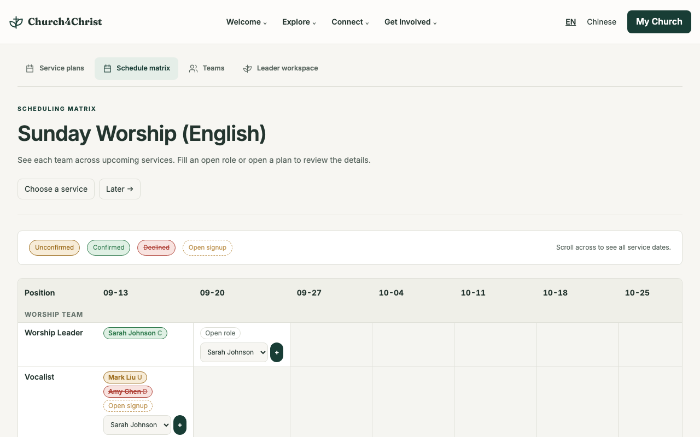
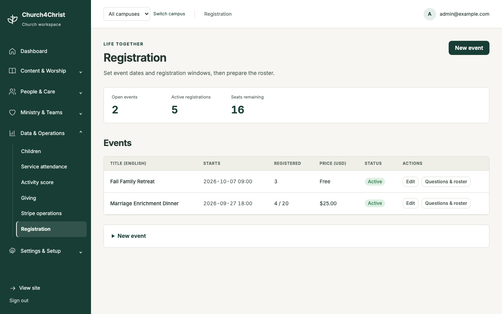
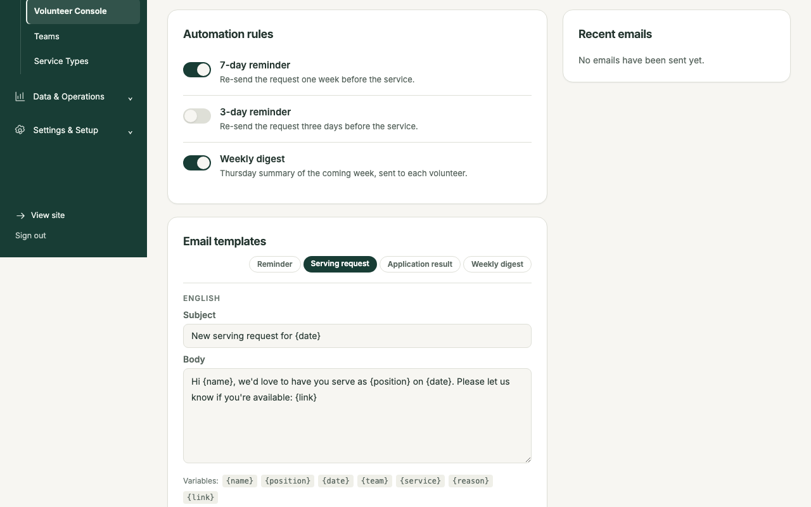

# Church4Christ : logiciel libre de gestion d'église et site web d'église

<p align="center"></p>

<p align="center"><a href="README.md">English</a> · <a href="README.zh.md">简体中文</a> · <a href="README.es.md">Español</a> · <a href="README.pt.md">Português (Brasil)</a> · <b>Français</b> · <a href="README.de.md">Deutsch</a> · <a href="README.ja.md">日本語</a> · <a href="README.ko.md">한국어</a> · <a href="README.ms.md">Bahasa Melayu</a> · <a href="README.id.md">Bahasa Indonesia</a> · <a href="README.vi.md">Tiếng Việt</a> · <a href="README.hi.md">हिन्दी</a></p>

*Ceci est une traduction de [README.md](README.md), qui est la version anglaise de référence. Traduction réalisée avec l'aide de l'IA ; les corrections de locuteurs natifs sont les bienvenues.*

[](https://github.com/leveo/church4christ/actions/workflows/ci.yml)
[](https://github.com/leveo/church4christ/releases)
[](LICENSE)
[](https://astro.build/)
[](https://workers.cloudflare.com/)
[](docs/i18n.md)

**Un système de gestion d'église (ChMS) et un CMS d'église libres, pensés pour l'IA, avec un
site web multilingue en 12 langues d'interface, dont l'anglais et le chinois. Une alternative modulaire et auto-hébergée à Planning Center
pour les petites et moyennes églises, les communautés fraternelles et les associations, construite sur Astro
et Cloudflare Workers.**

Personnes et foyers, groupes, planning des bénévoles, enregistrement des enfants, présence,
suivi des nouveaux venus, accompagnement par la prière, prédications, bulletins, événements, et, en option, un portail
des membres, un registre des dons et les inscriptions aux événements, le tout dans une seule base de code que vous pouvez lire, modifier
et héberger vous-même.

**Site web : [church4christ.org](https://church4christ.org) · Démo en ligne : [demo.church4christ.org](https://demo.church4christ.org).**

[](https://church4christ.yunfei-song.com/C4C-modular-Voice.mp4)

Regardez **[Built Around Your Ministry](https://church4christ.yunfei-song.com/C4C-modular-Voice.mp4)**,
la vidéo de présentation du site de démonstration (MP4).

**Commencez ici : [Installation pour les personnes et les agents IA](docs/setup.md).** Lancez `npm run onboard`
pour choisir l'identité de votre organisation, ses couleurs, son logo et ses premières fonctionnalités dans une page
locale de votre navigateur, puis transmettez les préférences enregistrées à l'installateur existant. Les agents de programmation commencent par
[AGENTS.md](AGENTS.md) ; Claude lit aussi [CLAUDE.md](CLAUDE.md).

Church4Christ associe un site public multilingue à un système d'administration pour le contenu,
l'accompagnement par la prière, le planning des bénévoles, les personnes et les foyers. Des modules optionnels ajoutent un
portail des membres et d'autres processus de gestion d'église. Le projet vise à réduire le
coût de démarrage et de maintenance continue d'une mise en œuvre personnalisée, tout en laissant le
code et la configuration de déploiement à la disposition de ceux qui l'exploitent.

La **version source actuelle est la 1.7**. Church4Christ est une base libre,
et non un service géré clés en main. L'évaluation en local est gratuite et certains déploiements
peuvent tenir dans les quotas gratuits des fournisseurs, mais l'hébergement de production,
la messagerie, les bases de données, les noms de domaine, les sauvegardes et d'autres services peuvent être facturés selon la
configuration et l'usage. Consultez [Profils de déploiement et coûts](#profils-de-déploiement-et-coûts)
avant de choisir une configuration de production.

|  |  |  |
|---|---|---|
|  |  |  |
|  |  |  |
|  |  |  |

**Un espace de travail distinct pour chaque module principal.** Le design Sanctuary, proposé par défaut,
associe des surfaces ivoire chaleureuses et une navigation vert forêt à des mises en page adaptées à chaque tâche :
éditeurs de publication avec aperçus locaux, fiches des personnes et des foyers, files d'accompagnement,
matrices de service, enregistrement des enfants adapté aux écrans tactiles, lecteurs de cours et registres
financiers. Les menus publics, ceux des membres, des responsables et des administrateurs suivent les modules activés
et les autorisations de chaque personne. Harvest et Midnight restent disponibles, avec un mode clair et
un mode sombre. Consultez l'[inventaire de design des 21 modules](docs/design/module-coverage.md).

Les captures d'écran utilisent le contenu de démonstration fictif du dépôt. Lors de la première installation, vous pouvez
inclure ces exemples ou commencer sans eux ; les deux choix conservent les mêmes mises en page,
le même thème et les mêmes images par défaut fournies. Les pages en anglais utilisent une interface et des textes de démonstration en anglais ;
les pages en chinois prennent en charge le contenu en chinois et bilingue. Les 29 captures d'écran de l'interface ont été
refaites à partir de l'application en fonctionnement ; consultez l'[inventaire des captures et la commande de
régénération](docs/design/readme-screenshot-inventory.md).

**Navigation groupée.** Un site entièrement activé regroupe ses destinations publiques sous
Bienvenue, Explorer, Se connecter et S'engager. Les liens intégrés restent dans le groupe de leur public,
tandis que les pages personnalisées et les liens externes apparaissent sous Plus. L'ordre enregistré dans
Admin → Navigation est conservé à l'intérieur de chaque groupe, et les groupes vides disparaissent.


Douze langues d'interface sont incluses : l'anglais et le chinois, ainsi que l'espagnol, le portugais
brésilien, le français, l'allemand, le japonais, le coréen, le malais, l'indonésien, le vietnamien et l'hindi. Chaque
église choisit les langues que propose son site et une langue par défaut lors de l'installation ou plus tard dans
Paramètres → Langues. Les dix traductions les plus récentes ont été réalisées avec l'aide de l'IA ; les corrections de locuteurs
natifs sont les bienvenues. Trois apparences prêtes à l'emploi et un point de départ modulaire pour aller plus loin dans
la personnalisation sont également fournis.

---

## À qui s'adresse-t-il ?

Church4Christ s'adresse aux petites et moyennes églises, aux communautés fraternelles et aux associations —
en particulier les congrégations multilingues et issues de l'immigration — qui ont besoin d'un site web public et d'une
base de gestion d'église personnalisable. Il convient le mieux lorsqu'un collaborateur, un bénévole
ou un partenaire de mise en œuvre à l'aise avec la technique peut se charger du déploiement et de la maintenance. Une
plateforme gérée peut mieux convenir si l'organisation préfère que le prestataire assure l'installation,
le support, les mises à jour et la responsabilité opérationnelle plutôt que la personnalisation au niveau du code source.

## Comment cette approche se compare-t-elle ?

Les différentes catégories de produits répondent à des besoins différents, et les conditions des fournisseurs varient. Ce tableau
compare des modèles d'exploitation ; il ne promet ni des prix, ni une portabilité, ni des droits sur les données valables partout.

| | **Church4Christ** | **CMS à extensions auto-géré** | **Constructeur de site hébergé** | **Plateforme d'église gérée** |
|---|---|---|---|---|
| **Usage principal** | Site web multilingue personnalisé et processus d'église modulaires | Site de contenu extensible assemblé à partir d'extensions | Site web public géré par le fournisseur | Processus d'église gérés par le fournisseur |
| **Modèle de coût** | Usage de l'infrastructure et des services ; certains profils peuvent tenir dans les quotas gratuits | Hébergement, extensions et maintenance | Abonnement et options | Abonnement, souvent par palier ou par module |
| **Personnalisation** | Modifications au niveau du code source et modules optionnels | Thèmes, extensions et modifications du code source lorsque c'est possible | Modèles et extensions pris en charge par le fournisseur | Configuration et intégrations prises en charge par le fournisseur |
| **Exploitation** | Votre équipe ou un partenaire de mise en œuvre déploie, met à jour, surveille et sauvegarde | Votre équipe ou l'hébergeur assure l'entretien du cœur et des extensions | Le fournisseur gère l'essentiel de l'exploitation de la plateforme | Le fournisseur gère l'essentiel de l'exploitation de la plateforme |
| **Portabilité** | L'accès au code et à la base de données permet la migration, mais celle-ci est manuelle | Dépend de l'hébergement, des extensions et des formats | Dépend des exports et des conditions du fournisseur | Dépend des exports, des API et des conditions du fournisseur |
| **Point de départ linguistique** | Douze langues d'interface incluses ; chaque église choisit son propre ensemble | Dépend des extensions choisies | Dépend du service et de la formule | Dépend du service et de la formule |

**Les compromis.** Church4Christ est optimisé pour Cloudflare Workers et ses bindings ;
passer à une autre pile d'hébergement est possible sous forme de travail sur le code source, mais ce n'est pas un parcours pris en charge en un clic.
Il n'existe pas non plus de migration automatisée du contenu de D1 vers Supabase. Les pages intégrées sont façonnées
par les thèmes, tandis que l'édition par glisser-déposer ne s'applique qu'aux pages personnalisées. Le projet
est versionné, mais ceux qui l'adoptent doivent tout de même prévoir un travail de mise en œuvre et des mises à niveau soigneusement relues.

Exploiter le projet, c'est aussi le maintenir. Votre responsable technique reste chargé
des mises à jour des dépendances, de la revue et de la configuration de la sécurité, de la supervision, des sauvegardes et des
tests de restauration, ainsi que du déploiement des correctifs. L'architecture réduit une partie du travail d'infrastructure, mais
n'élimine ni la sécurité ni l'entretien opérationnel. Consultez
[**`docs/why-this-stack.md`**](docs/why-this-stack.md) pour les raisons de cette conception.

## Vous cherchez une alternative open source à Planning Center ?

De nombreuses églises qui cherchent une alternative gratuite ou auto-hébergée à Planning Center,
Breeze, Church Community Builder ou à un logiciel de gestion d'église hébergé similaire veulent deux
choses : la maîtrise de leurs propres données et un site web qui partage les mêmes enregistrements.
Church4Christ couvre une grande partie de la gestion quotidienne d'une église dans une seule application
auto-hébergée :

| Besoin courant d'un ChMS | Church4Christ |
|---|---|
| Annuaire des personnes et des foyers | [Personnes et foyers](docs/features/people-households.md) avec import CSV, correspondances de colonnes sources enregistrées et export |
| Petits groupes | [Groupes](docs/features/groups.md) avec annuaire public, demandes d'adhésion, événements et présence |
| Planning des bénévoles | [Planning des bénévoles](docs/features/volunteer-serve.md) avec une matrice mensuelle et une confirmation par e-mail, sans connexion |
| Planification des cultes | [Déroulés, répétitions, disponibilités et calendriers](docs/features/service-planning.md) pour les cultes et les événements |
| Enregistrement des enfants | [Enregistrement sur borne](docs/features/children-checkin.md) avec codes de récupération et graphiques de présence |
| Présence et engagement | [Présence aux cultes](docs/features/service-attendance.md) et [scores d'activité](docs/features/activity-score.md) |
| Suivi des nouveaux venus et accompagnement | [File des nouveaux venus](docs/features/newcomers.md), [mur de prière](docs/features/prayer-wall.md) et [processus communautaires](docs/features/community-workflows.md) |
| Site web d'église et CMS | [Site public, thèmes, prédications, bulletins et éditeur de pages](docs/features/public-site-and-themes.md) |
| Libre-service pour les membres | [Portail des membres](docs/features/member-portal.md) (foyer, groupes, prière ; fonctionne sur D1 ou Supabase) |
| Plusieurs sites | [Multisite](docs/features/multi-campus.md) avec données et rôles isolés par site |

**Quitter Planning Center progressivement.** Une
[synchronisation Planning Center People](docs/deploy.md#9-optional-configure-planning-center-synchronization)
optionnelle, en lecture seule, relie les fiches de personnes de Planning Center aux personnes déjà présentes dans Church4Christ et envoie
les correspondances ambiguës en revue humaine, de sorte que les deux systèmes puissent fonctionner côte à côte pendant la
transition. Les personnes sont importées avec l'importateur CSV et ses correspondances de colonnes réutilisables.

**Ce qu'il ne remplace pas encore.** Il n'y a pas d'application mobile native, pas de messagerie SMS, et
pas de bibliothèque de chants ni de planification des chants de louange (Service Planning couvre les déroulés et les
répétitions). Les dons en ligne via Stripe (cartes et prélèvements bancaires)
fonctionnent en mode test tant que vous n'avez pas terminé la liste de contrôle de mise en production ; les inscriptions payantes aux événements
utilisent le même mode Stripe. Le module de dons enregistre aussi les chèques et les espèces dans un registre
hors ligne et produit des relevés annuels de dons. Church4Christ est une base que votre équipe exploite et maintient, et non un
service hébergé avec support du fournisseur.

Planning Center et les autres noms de produits ci-dessus sont des marques déposées de leurs
propriétaires respectifs. Church4Christ est un projet indépendant et n'est pas affilié à ces derniers.

---

## Vous n'avez besoin que d'une partie ?

Commencez petit et élargissez plus tard. Chaque édition à fonctionnalité unique installe ce dépôt avec un seul
domaine activé, en utilisant la base de données Cloudflare D1 par défaut :

| Si vous avez besoin de | Commencez avec | Préréglage |
|---|---|---|
| Une borne d'enregistrement des enfants | [church-checkin](https://github.com/leveo/church-checkin) | `checkin` |
| Un planning des bénévoles | [church-volunteer-scheduling](https://github.com/leveo/church-volunteer-scheduling) | `volunteer-scheduling` |
| La gestion des petits groupes | [church-small-groups](https://github.com/leveo/church-small-groups) | `small-groups` |
| Un site web d'église et un CMS | [church-website-cms](https://github.com/leveo/church-website-cms) | `website` |

Les éditions ne contiennent aucun code séparé, il n'y a donc rien de plus à maintenir. Vous pouvez aussi
les ignorer et lancer ici `npm run onboard -- --preset checkin`. Activez d'autres fonctionnalités à tout moment
dans **Paramètres → Modules**. Consultez les [éditions à fonctionnalité unique](docs/editions.md).

---

## Construisez-le avec un assistant IA

Les personnes et les agents partagent la même prise en main dans le navigateur, le même installateur, le même catalogue de fonctionnalités et les mêmes
contrôles de préparation. [AGENTS.md](AGENTS.md) et [CLAUDE.md](CLAUDE.md) demandent à un assistant d'inspecter
d'abord l'installation, de lancer `npm run onboard` pour une installation neuve sans préférences,
et de vous laisser remplir le formulaire. Vos réponses restent dans le fichier
`.church/preferences.json`, ignoré par Git ; les sessions suivantes lisent ce fichier pour respecter votre identité, votre charte
et vos choix de fonctionnalités. Le [guide d'installation](docs/setup.md) comprend les commandes et les étapes de reprise.
Lancez un assistant avec :

> "Lis AGENTS.md et docs/setup.md. Démarre la prise en main dans le navigateur pour que je choisisse l'identité visuelle
> de notre organisation et nos premières fonctionnalités. Utilise mes préférences enregistrées pour monter un
> aperçu local, vérifie les pages du site et d'administration, puis indique-moi l'URL et les vérifications restantes."

Vous n'avez pas à tout modifier à la main. Ce dépôt est organisé pour qu'un assistant de programmation
IA puisse suivre les guides en langage simple de [`docs/features/`](docs/features/) et
travailler avec une large couverture de tests automatisés. Cela peut réduire l'effort de personnalisation et de
maintenance, mais un mainteneur doit tout de même relire les modifications, exécuter les tests
pertinents et les déployer de manière réfléchie.

L'idée : ouvrez ce projet avec un assistant IA, décrivez ce que vous voulez en langage
courant, et laissez-le faire les modifications. Quelques exemples réels que vous pourriez coller :

> "Lis `docs/features/public-site-and-themes.md`, puis change notre couleur principale en
> bleu roi et montre-moi la page d'accueil."

> "Ajoute la langue italienne (`it`) en suivant `docs/i18n.md`."

> "Suis docs/setup.md pour configurer notre église sans contenu de démonstration. Montre-moi le plan
> d'installation et les résultats de préparation, puis prépare le déploiement avec docs/deploy.md."

Le même mode de travail aide pour la maintenance : décrivez une modification, examinez le diff proposé,
testez-la en local, et ne déployez qu'après avoir relu le résultat. L'aide de l'IA
ne remplace ni les décisions de sécurité, ni les sauvegardes, ni les tests en production, ni la responsabilité opérationnelle.

---

## Notre mission

**Réduire le coût et l'effort nécessaires pour démarrer avec un système de gestion d'église personnalisé et un
site web multilingue.** Church4Christ offre une base modulaire et testée qu'une église ou un
partenaire de mise en œuvre peut adapter plutôt que de repartir de zéro. Il ne promet pas un
service de production sans abonnement ni sans budget : les choix d'infrastructure, de messagerie, de base de données,
de nom de domaine, de support et de maintenance déterminent le coût réel d'exploitation.

---

## Ce qu'il contient

Chaque fonctionnalité a son propre guide en langage simple. Commencez par l'un de ceux-ci :


| | Fonctionnalité | Ce qu'elle fait |
|---|---|---|
| [](docs/features/public-site-and-themes.md) | **[Site public et thèmes](docs/features/public-site-and-themes.md)** | La porte d'entrée de votre église — accueil, prédications, événements, équipe — dans l'une de trois apparences prêtes à l'emploi. |
| [](docs/features/cms-admin.md) | **[L'espace d'administration](docs/features/cms-admin.md)** | Connexion sans mot de passe, rôles et restauration en un clic du contenu éditorial versionné pris en charge. |
| [](docs/features/admin-permissions.md) | **[Autorisations d'administration](docs/features/admin-permissions.md)** | N'accordez à chaque administrateur que les domaines dont il a besoin — le mur de prière et l'annuaire des membres sont inclus d'office, le reste au choix. |
| [](docs/features/multi-campus.md) | **[Multisite](docs/features/multi-campus.md)** | Gérez plusieurs sites sur un même back-end, avec des données, des paramètres, des fonctionnalités et des rôles locaux isolés par site ; seul l'administrateur principal peut voir tous les sites. |
| [](docs/features/bulletins.md) | **[Bulletins hebdomadaires](docs/features/bulletins.md)** | Composez la feuille du culte du dimanche et programmez sa publication automatique. |
| [](docs/features/sermons.md) | **[Archives de prédications](docs/features/sermons.md)** | Collez un lien YouTube ; obtenez une bibliothèque de messages passés, consultable et rapide à charger. |
| [](docs/features/prayer-wall.md) | **[Mur de prière](docs/features/prayer-wall.md)** | Recevez des sujets de prière et traitez-les sur un tableau simple, en toute confidentialité. |
| [](docs/features/volunteer-serve.md) | **[Planning des bénévoles](docs/features/volunteer-serve.md)** | Planifiez un mois de service d'un coup d'œil ; les bénévoles confirment par e-mail, sans connexion. |
| [](docs/features/people-households.md) | **[Personnes et foyers](docs/features/people-households.md)** | Fiches et foyers, avec un export CSV canonique en création seule et une correspondance de colonnes sources réutilisable pour les migrations. |
| [](docs/features/member-identity.md) | **[Sécurité de l'identité des membres](docs/features/member-identity.md)** | Identité liée à une preuve dans Dons, Inscriptions, Groupes, Équipes, Nouveaux venus et imports ; les doublons ambigus vont en revue au lieu d'être fusionnés sur le seul nom, avec une approbation liée à un OTP et une annulation protégée sous 24 heures. |
| [](docs/features/groups.md) | **[Groupes](docs/features/groups.md)** | Petits groupes avec annuaire public, liste de contrôle des membres, demandes d'adhésion, événements et présence par personne via un lien envoyé par e-mail. |
| [](docs/features/children-checkin.md) | **[Enregistrement des enfants](docs/features/children-checkin.md)** | Une borne tactile où les parents enregistrent l'arrivée et le départ de leurs enfants avec un code de récupération, ainsi que des graphiques hebdomadaires de présence. |
| [](docs/features/service-attendance.md) | **[Présence aux cultes](docs/features/service-attendance.md)** | Saisissez des totaux agrégés d'adultes, déduisez des totaux d'enfants facultatifs à partir des enregistrements, corrigez l'historique et téléchargez des rapports CSV sans identité. |
| [](docs/features/newcomers.md) | **[Suivi des nouveaux venus](docs/features/newcomers.md)** | Recevez des fiches publiques bilingues avec consentement, triez une file du personnel à périmètre limité et transmettez les correspondances exactes à Personnes sans divulguer ni notes ni réponses. |
| [](docs/features/onboarding-readiness.md) | **[Préparation au lancement](docs/features/onboarding-readiness.md)** | Une liste de contrôle bilingue partagée par l'installation, doctor et chaque administrateur réel, avec des validations du super-administrateur pour les contrôles manuels. |
|  | **[Planification des cultes](docs/features/service-planning.md)** | Planifiez un déroulé chronométré, des répétitions avec les personnes convoquées, les disponibilités des membres, une recherche de créneau commun, des calendriers et des e-mails automatiques. |
|  | **[Score d'activité](docs/features/activity-score.md)** | Combinez des activités choisies, liées aux personnes, en scores de membres explicables et en une synthèse de l'engagement de toute l'église. |
| [](docs/features/learning.md) | **[Formation](docs/features/learning.md)** | Poursuivez l'école du dimanche et le discipulat entre les rencontres avec des vidéos bilingues, des fichiers, des devoirs, des quiz et un statut synchronisé avec le fournisseur. |
| [](docs/features/page-builder.md) | **[Éditeur de pages](docs/features/page-builder.md)** | Assemblez vos propres pages personnalisées par glisser-déposer — multilingues, toujours fidèles au thème, et les pages publiées se chargent sans aucun JavaScript. Optionnel ; le désactiver ne casse jamais une page déjà créée. |
| [](docs/features/giving.md) | **[Dons](docs/features/giving.md)** | Implémenté : dons en ligne via Stripe (mode test par défaut, mode réel après la liste de contrôle de mise en production), registre hors ligne pour les chèques et les espèces, et relevés annuels de dons. |
| [](docs/features/registration.md) | **[Inscriptions](docs/features/registration.md)** | Implémenté : inscription gratuite aux événements sur D1 ou Supabase, questions personnalisées, liste d'attente, étapes de l'événement et export de la liste des participants, ainsi que paiement Stripe sur Supabase dans le même mode Stripe que Dons (vérifiez avec une petite inscription réelle avant de vous y fier). |
|  | **[Logistique des événements](docs/features/event-logistics.md)** | Complément facultatif d'Inscriptions : répartissez les participants dans des chambres, placez-les à table avec un aperçu du Placement automatique, répartissez-les en petits groupes et imprimez les listes de chambres, les affichettes de porte et les cartons de table. |
| [](docs/features/member-portal.md) | **[Portail des membres](docs/features/member-portal.md)** | Un espace unique après connexion pour la participation en cours et les occasions ouvertes, avec les fiches de foyer, les événements, le service, le calendrier, les dons et la prière à périmètre limité. |
| [](docs/features/i18n.md) | **[Douze langues](docs/features/i18n.md)** | Choisissez parmi 12 langues d'interface par site, avec l'anglais en repli et la conversion en un clic du chinois simplifié vers le chinois traditionnel. |
| [](docs/features/email-automation.md) | **[E-mail et automatisation](docs/features/email-automation.md)** | Liens de connexion, rappels et synthèses, avec journalisation locale et une configuration de production compatible avec les offres payantes. |
| [](docs/features/modules.md) | **[Modules](docs/features/modules.md)** | Désactivez les fonctionnalités que vous n'utilisez pas ; rien n'est supprimé, vous pouvez les réactiver à tout moment. |

**Choisissez vos modules.** La plupart des fonctionnalités métier optionnelles sont des **modules** que vous pouvez désactiver
depuis un seul panneau des Paramètres — bulletins, prédications, mur de prière, planning des bénévoles
et plus encore. Les nouvelles installations écrivent explicitement chaque paramètre de module à partir de la sélection d'installation ;
la démo Full Church sélectionne ses 21 modules (Service Planning et Event Logistics s'activent séparément). Sur les anciennes installations uniquement, les lignes de module manquantes conservent
l'ancien comportement d'activation par défaut. Une église qui ne veut que les horaires des cultes et les prédications peut masquer
le reste en un clic : les pages, les liens et les e-mails du module disparaissent ensemble, et rien
n'est supprimé. Consultez [**`docs/features/modules.md`**](docs/features/modules.md).

| Key | English | 中文 | Required database |
|---|---|---|---|
| `bulletins` | Bulletins | 周报 | Either |
| `sermons` | Sermons | 讲道 | Either |
| `prayer-sheets` | Prayer Sheets | 祷告单 | Either |
| `prayer-wall` | Prayer Wall | 祷告墙 | Either |
| `events` | Events | 活动 | Either |
| `serve` | Volunteer Scheduling | 服事排班 | Either |
| `gifts` | Spiritual Gifts | 恩赐探索 | Either |
| `testimonies` | Testimonies | 见证 | Either |
| `articles` | Articles | 文章 | Either |
| `fellowships` | Fellowships | 团契 | Either |
| `groups` | Groups | 小组 | Either |
| `people` | People & Households | 会友与家庭 | Either |
| `children` | Children Check-in | 儿童报到 | Either |
| `attendance` | Service Attendance | 崇拜出席 | Either |
| `newcomers` | Newcomer Follow-up | 新朋友跟进 | Either |
| `activity-score` | Activity Score | 活跃度评分 | Either |
| `page-builder` | Page Builder | 页面编辑器 | Either |
| `portal` | Member Portal | 会友平台 | Either |
| `giving` | Giving | 奉献 | Supabase |
| `registration` | Registration | 活动报名 | Either |
| `learning` | Learning | 学习 | Either |
| `planning` | Service Planning | 服事流程 | Either |
| `event-logistics` | Event Logistics | 活动后勤 | Either |

### Gestion de la communauté et processus

Les sites peuvent gérer directement les groupes et le suivi des membres. Les communautés fraternelles optionnelles ajoutent une couche communautaire avec des adhésions indépendantes et des groupes enfants. Les processus réutilisables fournissent des étapes assignées, des échéances, un suivi de l'achèvement et des rappels par e-mail via Cloudflare. Consultez le [guide des processus communautaires](docs/features/community-workflows.md) pour la configuration, les autorisations et les contrôles d'envoi.

### Se former au-delà du dimanche

La version 1.1 ajoute le module optionnel **Formation** pour l'école du dimanche,
le discipulat et d'autres ministères qui se poursuivent entre les rencontres. Les apprenants disposent
d'une vue de cours bilingue, à confidentialité limitée, pour des vidéos YouTube non répertoriées, des fichiers,
des devoirs et des quiz. Le rendu des travaux reste sous l'autorité du fournisseur : le site
renvoie les apprenants vers le fournisseur configuré au lieu de recueillir lui-même les devoirs,
réponses, commentaires, notes ou contenus de fichiers.

Les administrateurs peuvent connecter Google Classroom via ses API officielles ou un dérivé
de Church4Christ Canvas exploité séparément. La correspondance des cours, les identifiants OAuth chiffrés, les notifications signées du fournisseur, la synchronisation manuelle et la réconciliation
planifiée et bornée n'alimentent que les métadonnées d'activité dont Church4Christ a besoin.


| Vue de l'apprenant en anglais | Vue de l'apprenant en chinois | Administration du fournisseur |
|---|---|---|
| [](docs/images/learning/genesis-1-en.png) | [](docs/images/learning/genesis-1-zh.png) | [](docs/images/learning/admin-overview.png) |

Consultez le **[guide de la fonctionnalité Formation](docs/features/learning.md)** pour la configuration
du fournisseur, les limites de confidentialité, les budgets de synchronisation, la démo Genèse 1 et les
exigences distinctes d'exploitation de Canvas et de code source correspondant.

### Un foyer pour vos membres

Le **Portail des membres** optionnel transforme les données que votre église tient déjà en une
expérience utile après connexion. Sa page d'accueil des occasions de s'engager présente au même endroit toutes les façons activées
d'apprendre, d'appartenir et de servir : à la fois les groupes, les classes et les équipes déjà
liés au membre et les occasions actuellement ouvertes pour rejoindre ou candidater. Les membres
peuvent aussi mettre à jour les informations de leur foyer, consulter leurs dons, s'inscrire à des événements, passer en revue leurs engagements
de service, s'abonner à un calendrier personnel et partager des prières à périmètre limité. Il utilise les mêmes
liens de connexion sans mot de passe que le reste de Church4Christ — pas de nouveau compte ni de mot de passe
à retenir.


Les responsables de ministère, de groupe, d'école du dimanche et d'équipe de service disposent d'un panneau limité à leurs ressources à
`/<locale>/manage`. La connexion de l'application d'église le protège, et chaque opération vérifie
l'autorité du responsable sur cette ressource précise. Cloudflare Zero Trust peut ainsi rester
limité à l'ensemble de l'espace `/admin`.


Le portail fonctionne à la fois sur le back-end D1 par défaut et sur le back-end optionnel **Supabase (Postgres)**.
Les foyers, les groupes, les fichiers protégés de groupe et la modération des prières d'église, de groupe et privées
fonctionnent sur D1. Les prières liées à un événement, les administrateurs d'événements et « Mes inscriptions »
nécessitent Inscriptions, qui fonctionne sur D1 pour les événements gratuits une fois activé. Pour en savoir plus, consultez
[**`docs/features/member-portal.md`**](docs/features/member-portal.md).

---

## Essayez-le en 5 minutes (sur votre propre ordinateur)

Vous pouvez faire tourner le site en local, avec un contenu d'exemple fictif optionnel, avant de choisir un
déploiement. Vous aurez besoin de [Node.js](https://nodejs.org/) 22.22.1 ou plus récent. La prise en main
dans le navigateur recommande **Website + Community** avec **Cloudflare D1** pour le premier lancement.


```bash
# 1. Get the code and install it
git clone https://github.com/leveo/church4christ.git
cd church4christ
npm ci

# 2. Open the local browser form, complete it, and save your preferences
npm run onboard

# 3. Review the plan, then initialize with those same preferences
node scripts/setup/index.mjs --preferences .church/preferences.json --yes --dry-run --json
node scripts/setup/index.mjs --preferences .church/preferences.json --yes --json

# 4. For D1, start it (always follow the exact handoff setup prints)
npm run dev
```

Le formulaire demande s'il s'agit d'une église, d'une association ou d'un site, et recueille le nom,
le slogan, l'adresse, le fuseau horaire, les couleurs principale et secondaire, un logo PNG/JPEG/WebP facultatif
(jusqu'à 2 Mio), la langue, le premier administrateur et le choix du contenu de démonstration. Ne cochez que les
fonctionnalités dont vous avez besoin.
La sélection recommandée utilise D1 comme base de données ; l'application tourne toujours sur
Cloudflare Workers et stocke les médias sur R2. **Dons et Inscriptions payantes**
sont des options avancées qui exigent de passer explicitement à PostgreSQL compatible Supabase.

L'enregistrement écrit `.church/preferences.json` et tout logo téléversé dans `.church/`, que
Git ignore. Il ne crée ni base de données ni déploiement de site. Relancez `npm run onboard` pour
recharger et modifier les préférences enregistrées. Laissez le terminal actif pendant que vous remplissez le
formulaire ; arrêtez-le avec Ctrl+C une fois terminé. Pour ouvrir vous-même l'URL affichée, utilisez
`npm run onboard -- --no-open` ; pour choisir un port, ajoutez `--port 4310`. Le point d'entrée direct
est `node scripts/onboard/index.mjs`. Consultez [le guide d'installation](docs/setup.md) pour savoir ce que
l'installateur applique et comment les agents utilisent les autres préférences.

Si vous installez avec `npm ci --ignore-scripts`, lancez `npm run tokens` manuellement avant
l'installateur ou `npm run dev`.

Pour Supabase en local, le handoff exporte à la place
`CLOUDFLARE_HYPERDRIVE_LOCAL_CONNECTION_STRING_HYPERDRIVE` dans le shell de l'hôte avant
`npm run dev` ; cette URL de connexion ne doit pas figurer dans `.dev.vars`.

Lors de la première installation, choisissez **Include demo content** ou **No demo content**. Les deux conservent le
même design fourni, les mêmes images décoratives locales, les mêmes fonctionnalités activées et les mêmes outils d'administration.
Le contenu de démonstration ajoute des personnes, prédications, bulletins, événements, ministères et autres
exemples fictifs. Son étape médias copie le lot d'images générées depuis `seed/media/` vers R2 en local.
Sans contenu de démonstration, l'installation crée le schéma de base de données, les valeurs opérationnelles par défaut, les paramètres de l'église, la sélection
de modules et le premier administrateur, sans enregistrements métier d'exemple.

Le fichier de préférences enregistre le choix de contenu de démonstration du formulaire. Pour une installation avec des réponses
explicites en CLI, passez `--demo-data` ou `--no-demo-data` ; omettre les deux dans une installation non interactive conserve
la valeur par défaut actuelle, sans démonstration. Les options ne peuvent pas être combinées. Répéter la même
installation conserve le choix de contenu enregistré et les enregistrements existants. `--no-demo-data` ne
vide pas une base de données existante, et l'installation refuse d'ajouter des données de démonstration par-dessus des personnes existantes.
Utilisez un espace de travail et une base de données neufs et distincts pour essayer l'autre mode de démarrage.

Ouvrez l'adresse affichée par l'installation (généralement `http://localhost:4321`).

**Se connecter à l'espace d'administration.** Il n'y a pas de mot de passe. Sur la page de connexion, saisissez l'
e-mail du premier administrateur indiqué dans vos réponses d'installation, rappelé dans le handoff, et demandez un
lien. Comme l'e-mail local est configuré pour s'afficher au lieu d'être envoyé, l'**URL du lien magique apparaît
directement dans votre terminal**. Collez-la dans le navigateur et vous êtes connecté. (Pour des tests locaux plus rapides,
l'installation écrit cette même adresse comme `AUTH_DEV_BYPASS_EMAIL` dans `.dev.vars`, ce qui
vous connecte automatiquement. Supprimez cette ligne pour tester le véritable parcours de connexion.)

Dans les deux modes de contenu, l'installation crée ensemble un nouvel administrateur et son identité de connexion
auditée. Les relances conservent la propriété des contacts existants ; elles ne vérifient pas
un e-mail existant et ne rétablissent pas un accès révoqué. Si l'installation signale un problème d'identité, suivez
le [processus de revue ou de récupération d'identité](docs/features/member-identity.md) avant de la relancer.

La commande `npm run setup`, en terminal uniquement, reste disponible. L'installation propose **Website** (8 modules de
publication ciblés), **Website + Community** (18 modules ; le Portail des membres peut être ajouté sur D1) et
**Full Church** (21 modules ; Service Planning s'active séparément). Dons
sélectionne Supabase automatiquement (les Inscriptions gratuites fonctionnent sur D1) ; les sélections compatibles D1 choisissent D1, sauf si vous
remplacez explicitement le back-end. Les comptes requis dépendent du mode Local ou Deploy,
comme détaillé plus bas. Pour l'automatisation, passez toutes les réponses avec `--yes` ; ajoutez `--json` pour obtenir un unique résultat
lisible par une machine. Pour une exécution non interactive lisible par un humain, utilisez les mêmes options complètes
avec `npm run setup -- ... --yes` et omettez `--json`. Pour que stdout reste strictement du JSON
via npm, utilisez la forme silencieuse :

```bash
npm run --silent setup -- --mode local --preset website --site-slug my-church \
  --church-name "My Church" --locale en --admin-email admin@example.com \
  --admin-name "First Admin" --app-origin http://localhost:4321 \
  --email-from admin@example.com --demo-data --yes --json
```

---

## Profils de déploiement et coûts

Ce sont des profils de planification, non des garanties de prix. Les tarifs ci-dessous sont à jour d'**août
2026**, sont susceptibles de changer et doivent être confirmés sur les pages tarifaires officielles indiquées avant le déploiement.

| Profil | Périmètre inclus | Notes sur les coûts et la préparation |
|---|---|---|
| **Évaluation locale** | Modules de site web ou de communauté avec D1 en local ; modules complets avec Postgres local compatible | Aucun frais de service hébergé n'est requis pour une évaluation avec D1 en local. Vous fournissez toujours l'ordinateur, le temps de développement et les éventuels services externes optionnels. |
| **D1 site web/communauté** | Worker Cloudflare, D1 et R2 pour jusqu'à 22 modules compatibles D1 | Un déploiement modeste peut tenir dans les quotas gratuits de Cloudflare. Le trafic, le stockage, les opérations au-delà des quotas, un nom de domaine et d'autres services peuvent coûter de l'argent ; consultez les [tarifs de Workers](https://developers.cloudflare.com/workers/platform/pricing/). La messagerie de production est à part. |
| **Messagerie de production** | Liens de connexion, rappels, demandes et synthèses transactionnels vers des destinataires quelconques | Le dépôt prend en charge une configuration de messagerie Cloudflare compatible avec les offres payantes. L'envoi à des destinataires quelconques exige Workers Paid, actuellement au minimum **5 $/mois**, comprenant **3 000 e-mails**, puis **0,35 $ par 1 000 e-mails**. Ces montants sont susceptibles de changer ; consultez les [tarifs de Cloudflare Email Service](https://developers.cloudflare.com/email-service/platform/pricing/). |
| **Supabase/modules complets** | Déploiement Cloudflare plus Supabase/Postgres pour les 21 modules de Full Church, dont le Portail des membres, Dons et Inscriptions | Les coûts Cloudflare s'appliquent toujours, et le [plan Supabase](https://supabase.com/pricing) choisi peut ajouter un abonnement ou des frais d'usage. En août 2026, Supabase Free n'offre pas de sauvegardes quotidiennes automatiques, et les projets Free peu actifs peuvent être [mis en pause automatiquement](https://supabase.com/docs/guides/platform/free-project-pausing) selon l'activité sur une période de sept jours. En production, effectuez des sauvegardes régulières de la base de données hors site et des exercices de restauration, ou choisissez un plan payant dont les [options de sauvegarde](https://supabase.com/docs/guides/platform/backups) répondent à vos exigences de continuité. Les tarifs et les politiques de service sont susceptibles de changer. Stripe démarre en mode test ; les paiements réels sont un choix explicite à faire après la liste de contrôle de mise en production de [`docs/supabase-setup.md`](docs/supabase-setup.md). |

Les quotas gratuits des fournisseurs peuvent servir pour une évaluation ou un déploiement modeste, mais ils
ne garantissent pas qu'un service de production restera gratuit. Prévoyez un budget pour la responsabilité technique,
la maintenance des dépendances et de la sécurité, la supervision, les sauvegardes, les tests de restauration et la croissance
future de l'usage, en plus des services énumérés ci-dessus.

---

## Mise en ligne

Vous débutez ? Commencez par [**`docs/cloudflare-setup.md`**](docs/cloudflare-setup.md) — un
guide en langage simple qui explique ce qu'est Cloudflare, son modèle de coûts et les deux
façons de se mettre en ligne (y compris en laissant un assistant IA le faire pour vous). Quand vous voulez
les commandes exactes, [**`docs/deploy.md`**](docs/deploy.md) est le pas-à-pas
complet.

Commencez par `npm run setup`, choisissez **Deploy** et répondez aux questions sur les fonctionnalités et sur l'église.
Il crée ou importe les ressources nécessaires, écrit la configuration générée, applique les
migrations, enregistre les 23 paramètres de module et initialise le premier administrateur. Il passe ensuite
la main à `npm run deploy`. Lancez `npm run doctor` pour obtenir le rapport de préparation schema-v2, et utilisez
la liste de contrôle toujours disponible à `/admin/onboarding` pour les mêmes identifiants de contrôle stables.
Dons, Inscriptions, Groupes, Équipes, Nouveaux venus, les imports et l'intégration optionnelle en lecture seule de Planning
Center partagent une passerelle d'identité liée à une preuve et fondée sur la revue préalable. Elle ne fusionne jamais
automatiquement des personnes sur le nom ou sur un contact non vérifié. Consultez [Identité des membres](docs/features/member-identity.md)
pour le processus, les contrôles anti-fraude, la limite actuelle de migration et l'écart de vérification du fournisseur ;
les règles de mise en place et de rotation des secrets restent dans le [guide d'exploitation du déploiement](docs/deploy.md#stable-identity-source-key).
Le déploiement est volontairement manuel : l'automatisation du dépôt teste les modifications, mais ne
les publie pas et ne migre pas pour vous les données de production.

**Le premier déploiement et les mises à niveau sont deux opérations différentes.** L'installation guidée provisionne ou
importe des ressources et initialise une installation relue. Ce n'est pas une mise à niveau automatique en un clic
pour un site qui contient déjà des données d'église. Les exploitants existants doivent commencer par le
[guide de mise à niveau](docs/upgrade.md), sauvegarder la base de données, les médias R2, la configuration et l'inventaire des
secrets, répéter l'opération en préproduction et relire le [journal des modifications `Unreleased`](CHANGELOG.md) avant
d'appliquer les migrations vers l'avant. Les mainteneurs qui préparent une version doivent suivre
le [processus de publication](docs/release-process.md).

**Choisir votre base de données.** Les 22 modules compatibles D1 excluent
**Dons**, qui exige Postgres, ainsi que les **Inscriptions payantes**, qui l'exigent aussi. Les comptes requis suivent le
mode : D1 en local ne nécessite aucun compte externe ; D1 déployé nécessite un compte Cloudflare ; Supabase
en local nécessite un compte Supabase ou une base Postgres locale compatible ; Supabase déployé
nécessite à la fois Cloudflare et Supabase. Il n'existe pas encore de migration automatisée de contenu entre D1 et Supabase,
choisissez donc la base de données de production avant de saisir du contenu réel. Consultez
[**`docs/supabase-setup.md`**](docs/supabase-setup.md).

**Stripe démarre en mode test ; le mode réel est un choix explicite.** Stripe héberge les pages de paiement,
les reçus, le Billing Portal, les remboursements et les litiges ; cette application ne conserve que les montants,
les fonds, les dates, les statuts et les identifiants Stripe. Dons et les Inscriptions payantes n'existent que sur Supabase ; D1 ne
les prend pas en charge. Lorsque l'installation demande l'un de ces modules, importez une clé `sk_test_…` et
un secret de signature `whsec_…` avec les variables d'environnement à usage unique `CHURCH_SETUP_STRIPE_SECRET_KEY` et
`CHURCH_SETUP_STRIPE_WEBHOOK_SECRET` ; l'installation conserve les secrets d'exécution
et écrit `STRIPE_MODE=test`. Pour recevoir de vrais dons, suivez la liste de contrôle de mise en production du
guide Supabase (clé réelle, webhook à la version d'API `2025-03-31.basil`, `STRIPE_MODE=live`
plus `STRIPE_LIVE_CONFIRMED=1`). Un événement dont le mode ne correspond pas au mode configuré est
rejeté, et le Worker adossé à Supabase exécute une reprise durable toutes les cinq minutes. Les tests
locaux ne prouvent pas la livraison réelle de Stripe.

---

## Sous le capot

Pour les curieux : Church4Christ est construit avec **[Astro](https://astro.build/)**, qui génère
les pages côté serveur, et s'exécute comme un seul **Worker Cloudflare**. Les données de l'application résident dans
le back-end choisi — **D1** de Cloudflare ou **Supabase/Postgres** — et les médias téléversés résident
sur **R2** de Cloudflare (stockage d'objets) ; les e-mails partent par le binding de messagerie de Cloudflare.
Les pages destinées aux visiteurs n'embarquent **aucun framework JavaScript côté client** — ce sont de simples
pages HTML rapides avec une pincée de script natif —
ce qui explique en grande partie pourquoi le site se charge vite et coûte si peu à exploiter. (La seule
exception se trouve derrière la connexion du personnel : l'éditeur de pages par glisser-déposer est un petit éditeur
React que seule votre équipe télécharge ; les pages qu'il publie restent de simples pages HTML.)

Tout l'aspect visuel provient de **[design tokens](design/README.md)** : un ensemble de valeurs de couleur et de typographie
qui se compilent en trois thèmes prêts à l'emploi (Sanctuary, Harvest, Midnight),
chacun avec un mode clair et un mode sombre. Le projet bénéficie d'une **large couverture automatisée** sur
ses processus principaux afin que les mainteneurs puissent vérifier les modifications avant le déploiement.

**Pourquoi ces choix ?** Les raisons du déploiement optimisé pour Cloudflare, de la
pile Astro + Tailwind + TypeScript et des cas où une plateforme gérée peut être le
meilleur modèle d'exploitation sont exposées dans
[**`docs/why-this-stack.md`**](docs/why-this-stack.md). Pour le tableau technique, consultez
[`docs/architecture.md`](docs/architecture.md),
[`docs/design-system.md`](docs/design-system.md) et [`docs/i18n.md`](docs/i18n.md).

---

## FAQ

**Qu'est-ce que Church4Christ ?**
Un système de gestion d'église (ChMS) et un CMS d'église libres. Il associe un site web
d'église multilingue (12 langues d'interface) à des outils pour le personnel couvrant les personnes et les foyers, les groupes,
le planning des bénévoles, l'enregistrement des enfants, la présence, le suivi des nouveaux venus et l'accompagnement par la prière.

**Existe-t-il une alternative libre et gratuite à Planning Center ?**
Church4Christ en est une. Le code source est libre sous GPL-3.0 et vous l'hébergez
vous-même sur Cloudflare Workers. Il couvre les personnes, les groupes, l'enregistrement des enfants, le planning des bénévoles,
la présence et un site web d'église, et peut lire Planning Center People grâce à une
synchronisation optionnelle en lecture seule pendant votre transition. Il n'a pas les applications mobiles,
les SMS ni la planification des chants de louange de Planning Center. Consultez
[Vous cherchez une alternative open source à Planning Center ?](#vous-cherchez-une-alternative-open-source-à-planning-center-)

**Est-il gratuit ?**
Le logiciel est gratuit. L'hébergement, la messagerie, la base de données et le nom de domaine peuvent coûter de l'argent
selon votre configuration et votre usage ; certains petits déploiements tiennent dans les quotas gratuits
des fournisseurs. Consultez [Profils de déploiement et coûts](#profils-de-déploiement-et-coûts).

**Quelles langues prend-il en charge ?**
Douze langues d'interface : anglais, chinois, espagnol, portugais brésilien, français, allemand,
japonais, coréen, malais, indonésien, vietnamien et hindi. Chaque église choisit celles que propose son
site et une langue par défaut ; les pages en chinois bénéficient aussi de la conversion en un clic du chinois simplifié
vers le chinois traditionnel. D'autres langues peuvent être ajoutées ; consultez [docs/i18n.md](docs/i18n.md).

**Une petite église sans développeur peut-elle le faire fonctionner ?**
Il fonctionne mieux lorsqu'un collaborateur, un bénévole ou un partenaire à l'aise avec la technique se charge
du déploiement et des mises à jour. La prise en main dans le navigateur et les guides pour assistants IA réduisent cet effort,
mais quelqu'un doit encore relire les modifications, sauvegarder les données et déployer.

**Avec quoi est-il construit ?**
Astro sur Cloudflare Workers, avec Cloudflare D1 ou Supabase/PostgreSQL pour les données et
Cloudflare R2 pour les médias. Les pages publiques n'embarquent aucun framework côté client.

---

## Licence

Church4Christ est un logiciel libre et open source distribué sous la **[Licence publique générale GNU
v3](LICENSE)** (GPL-3.0). Vous pouvez l'utiliser et l'étudier, le modifier en privé, en partager des copies et
facturer des copies, du développement sur mesure, de l'hébergement, du support ou d'autres services commerciaux.

Si vous distribuez une version modifiée couverte par la licence, les conditions de la GPL s'appliquent : les destinataires doivent
recevoir les libertés prévues par la GPL, et le code source correspondant doit être mis à disposition sous
la GPL, comme l'exige la licence. Les modifications privées n'ont pas à être publiées. Le simple fait
d'exécuter une version modifiée comme service réseau, sans en distribuer de copie, ne déclenche pas
à lui seul une obligation de partage du code source de type AGPL sous la GPLv3.

Le fichier [`LICENSE`](LICENSE) fait foi. Ce résumé est fourni à titre d'orientation et ne
constitue pas un conseil juridique.

---

## Contribuer et feuille de route

Les contributions sont les bienvenues — signalements de bogues, traductions, nouvelles fonctionnalités. Commencez par
[`CONTRIBUTING.md`](CONTRIBUTING.md) pour l'environnement de développement et les cinq règles du projet, et par
[`SECURITY.md`](SECURITY.md) si vous avez découvert une faille de sécurité.

**À l'horizon (pas encore réalisé) :** une « place d'échange » entre églises pour partager
des thèmes et du contenu est une idée que nous envisageons, pas une promesse. Si cela compte pour votre
église, ouvrez une issue et discutons-en.

---

Réalisé avec soin, et avec l'aide de l'IA, pour les églises et les associations du monde entier.
