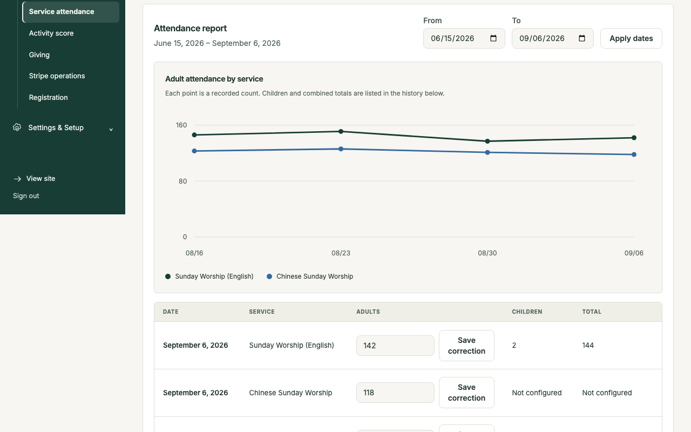
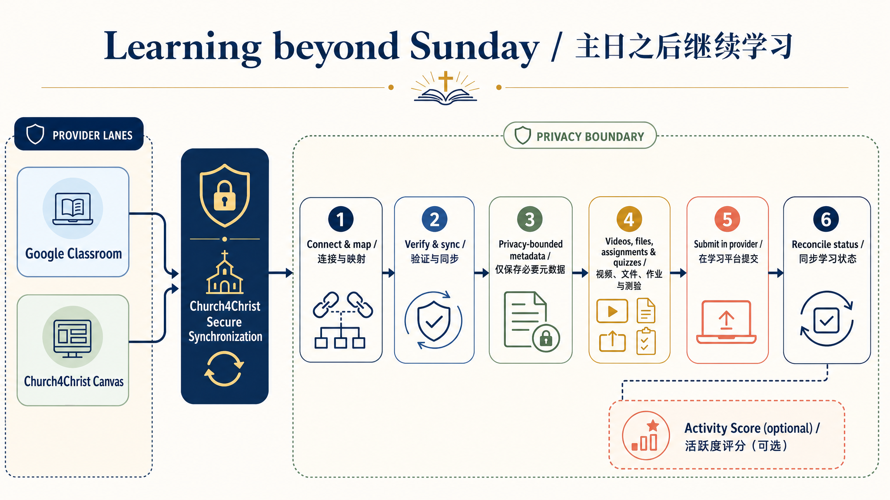
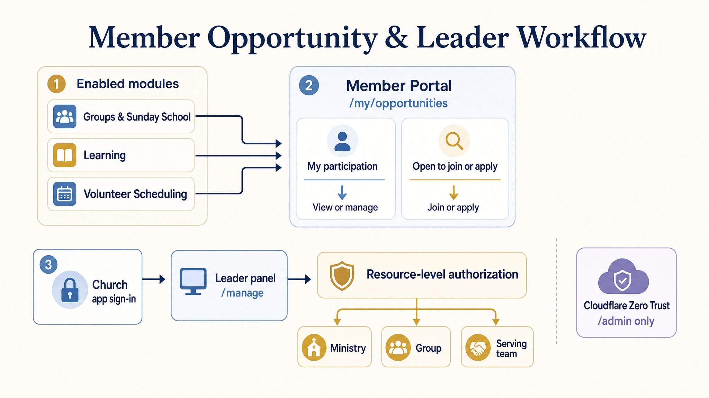

# Church4Christ: ओपन-सोर्स कलीसिया प्रबंधन सॉफ़्टवेयर और कलीसिया की वेबसाइट

<p align="center"></p>

<p align="center"><a href="README.md">English</a> · <a href="README.zh.md">简体中文</a> · <a href="README.es.md">Español</a> · <a href="README.pt.md">Português (Brasil)</a> · <a href="README.fr.md">Français</a> · <a href="README.de.md">Deutsch</a> · <a href="README.ja.md">日本語</a> · <a href="README.ko.md">한국어</a> · <a href="README.ms.md">Bahasa Melayu</a> · <a href="README.id.md">Bahasa Indonesia</a> · <a href="README.vi.md">Tiếng Việt</a> · <b>हिन्दी</b></p>

*यह [README.md](README.md) का अनुवाद है, जो अंग्रेज़ी का प्रामाणिक संस्करण है। यह अनुवाद AI की सहायता से किया गया है; मातृभाषा के पाठकों के सुधार का स्वागत है।*

[](https://github.com/leveo/church4christ/actions/workflows/ci.yml)
[](https://github.com/leveo/church4christ/releases)
[](LICENSE)
[](https://astro.build/)
[](https://workers.cloudflare.com/)
[](docs/i18n.md)

**AI-नेटिव, ओपन-सोर्स कलीसिया प्रबंधन प्रणाली (ChMS) और कलीसिया CMS, जिसमें 12 इंटरफ़ेस भाषाओं
में बहुभाषी कलीसिया वेबसाइट शामिल है, अंग्रेज़ी और चीनी समेत। छोटी और मध्यम आकार की कलीसियाओं, संगतियों और
गैर-लाभकारी संस्थाओं के लिए Planning Center का स्व-होस्टेड, मॉड्यूलर विकल्प, जो Astro
और Cloudflare Workers पर बना है।**

लोग और परिवार, समूह, स्वयंसेवक शेड्यूलिंग, बच्चों का चेक-इन, उपस्थिति,
नए आगंतुकों का फॉलो-अप, प्रार्थना देखभाल, संदेश, साप्ताहिक बुलेटिन, कार्यक्रम, और वैकल्पिक सदस्य
पोर्टल, दान बही और कार्यक्रम पंजीकरण, सब एक ही कोडबेस में, जिसे आप पढ़ सकते हैं, बदल सकते हैं
और स्वयं होस्ट कर सकते हैं।

**वेबसाइट: [church4christ.org](https://church4christ.org) · लाइव डेमो: [demo.church4christ.org](https://demo.church4christ.org)।**

[](https://church4christ.yunfei-song.com/C4C-modular-Voice.mp4)

**[Built Around Your Ministry](https://church4christ.yunfei-song.com/C4C-modular-Voice.mp4)** देखें,
डेमो साइट का प्रचार वीडियो (MP4)।

**यहाँ से शुरू करें: [लोगों और AI एजेंटों के लिए सेटअप](docs/setup.md)।** अपने संगठन की पहचान, रंग, लोगो और
पहली सुविधाएँ एक स्थानीय ब्राउज़र पेज पर चुनने के लिए `npm run onboard` चलाएँ,
फिर सहेजी गई पसंदें मौजूदा इंस्टॉलर को दें। कोडिंग एजेंट
[AGENTS.md](AGENTS.md) से शुरू करते हैं; Claude [CLAUDE.md](CLAUDE.md) भी पढ़ता है।

Church4Christ एक बहुभाषी सार्वजनिक साइट को सामग्री, प्रार्थना देखभाल, स्वयंसेवक शेड्यूलिंग, लोगों और
परिवारों के लिए एक एडमिन प्रणाली के साथ जोड़ता है। वैकल्पिक मॉड्यूल एक
सदस्य पोर्टल और कलीसिया-प्रबंधन के अन्य कार्य-प्रवाह जोड़ते हैं। इस परियोजना का उद्देश्य अनुकूलित कार्यान्वयन की
शुरुआती और चालू रखरखाव की लागत घटाना है, जबकि
कोड और परिनियोजन कॉन्फ़िगरेशन इसे चलाने वालों के पास ही रहें।

**वर्तमान सोर्स रिलीज़ 1.7 है**। Church4Christ एक ओपन-सोर्स आधार है,
कोई तैयार प्रबंधित सेवा नहीं। स्थानीय मूल्यांकन निःशुल्क है, और कुछ परिनियोजन
प्रदाताओं के निःशुल्क कोटे के भीतर आ सकते हैं, लेकिन प्रोडक्शन
होस्टिंग, ईमेल, डेटाबेस, डोमेन, बैकअप और अन्य सेवाओं पर कॉन्फ़िगरेशन और उपयोग के आधार पर शुल्क लग सकता है।
प्रोडक्शन सेटअप चुनने से पहले [परिनियोजन के प्रकार और लागत](#परिनियोजन-के-प्रकार-और-लागत)
देखें।

|  |  |  |
|---|---|---|
|  |  |  |
|  |  |  |
|  |  |  |

**हर मुख्य मॉड्यूल के लिए अलग कार्यक्षेत्र।** डिफ़ॉल्ट Sanctuary डिज़ाइन गर्म आइवरी
सतहों और गहरे हरे नेविगेशन को हर कार्य के अनुरूप लेआउट के साथ जोड़ता है:
स्थानीय पूर्वावलोकन वाले प्रकाशन संपादक, लोगों और परिवारों के रिकॉर्ड, देखभाल कतारें,
सेवा मैट्रिक्स, टच-अनुकूल बच्चों का चेक-इन, कोर्स प्लेयर और वित्तीय
बही। सार्वजनिक, सदस्य, अगुवा और प्रशासक मेनू सक्षम किए गए मॉड्यूल
और हर व्यक्ति की अनुमतियों के अनुसार बदलते हैं। Harvest और Midnight भी उपलब्ध हैं, लाइट और
डार्क मोड के साथ। [21-मॉड्यूल डिज़ाइन सूची](docs/design/module-coverage.md) देखें।

स्क्रीनशॉट में रिपॉज़िटरी की काल्पनिक डेमो सामग्री है। पहली बार सेटअप करते समय आप
वे उदाहरण शामिल कर सकते हैं या उनके बिना शुरू कर सकते हैं; दोनों विकल्पों में वही लेआउट,
थीम और साथ आने वाली डिफ़ॉल्ट छवियाँ रहती हैं। अंग्रेज़ी पेजों पर अंग्रेज़ी इंटरफ़ेस और डेमो पाठ है;
चीनी पेज चीनी और द्विभाषी सामग्री का समर्थन करते हैं। सभी 29 इंटरफ़ेस स्क्रीनशॉट
चालू एप्लिकेशन से दोबारा लिए गए हैं; [कैप्चर सूची और पुनर्निर्माण
कमांड](docs/design/readme-screenshot-inventory.md) देखें।

**समूहबद्ध नेविगेशन।** पूरी तरह सक्षम साइट अपने सार्वजनिक गंतव्यों को
स्वागत, खोजें, जुड़ें और सहभागी बनें में समेट देती है। अंतर्निहित लिंक अपने श्रोता-समूह में रहते हैं, जबकि
कस्टम पेज और बाहरी लिंक "और" के अंतर्गत दिखते हैं। Admin → Navigation में सहेजा गया क्रम
हर समूह के भीतर बना रहता है, और खाली समूह गायब हो जाते हैं।


बारह इंटरफ़ेस भाषाएँ शामिल हैं: अंग्रेज़ी और चीनी, साथ में स्पेनिश, ब्राज़ीलियाई
पुर्तगाली, फ़्रेंच, जर्मन, जापानी, कोरियाई, मलय, इंडोनेशियाई, वियतनामी और हिन्दी। हर
कलीसिया सेटअप के दौरान या बाद में Settings → Languages में चुनती है कि उसकी साइट कौन-सी भाषाएँ दे और डिफ़ॉल्ट कौन-सी हो।
दस नए अनुवाद AI की सहायता से किए गए हैं; मातृभाषा के
पाठकों के सुधार का स्वागत है। तीन तैयार रूप और आगे के अनुकूलन के लिए एक मॉड्यूलर शुरुआती बिंदु
भी शामिल हैं।

---

## यह किसके लिए है?

Church4Christ छोटी और मध्यम आकार की कलीसियाओं, संगतियों और गैर-लाभकारी संस्थाओं के लिए है —
विशेषकर बहुभाषी और प्रवासी मंडलियों के लिए — जिन्हें एक सार्वजनिक वेबसाइट और
अनुकूलित किए जा सकने वाले कलीसिया-प्रबंधन आधार की आवश्यकता है। यह तब सबसे अच्छा बैठता है जब तकनीक से सहज कोई सेवक,
स्वयंसेवक या कार्यान्वयन साझेदार परिनियोजन और रखरखाव की ज़िम्मेदारी ले सके। यदि संगठन
सोर्स-स्तर के अनुकूलन के बजाय विक्रेता द्वारा संचालित सेटअप, सहायता, अपग्रेड और संचालन की
ज़िम्मेदारी पसंद करता है, तो कोई प्रबंधित प्लेटफ़ॉर्म बेहतर हो सकता है।

## यह तरीका दूसरों से कैसे तुलना करता है?

अलग-अलग तरह के उत्पाद अलग-अलग ज़रूरतें पूरी करते हैं, और प्रदाताओं की शर्तें भिन्न होती हैं। यह तालिका
संचालन के मॉडलों की तुलना करती है; यह सार्वभौमिक कीमतों, पोर्टेबिलिटी या डेटा
अधिकारों का वादा नहीं करती।

| | **Church4Christ** | **स्व-प्रबंधित प्लगइन CMS** | **होस्टेड साइट बिल्डर** | **प्रबंधित कलीसिया प्लेटफ़ॉर्म** |
|---|---|---|---|---|
| **मुख्य उपयुक्तता** | अनुकूलित बहुभाषी वेबसाइट के साथ मॉड्यूलर कलीसिया कार्य-प्रवाह | प्लगइनों से जोड़ी गई विस्तार-योग्य सामग्री वेबसाइट | प्रदाता द्वारा प्रबंधित सार्वजनिक वेबसाइट | प्रदाता द्वारा प्रबंधित कलीसिया कार्य-प्रवाह |
| **लागत मॉडल** | इन्फ्रास्ट्रक्चर और सेवा का उपयोग; कुछ प्रोफ़ाइल निःशुल्क कोटे में आ सकती हैं | होस्टिंग, एक्सटेंशन और रखरखाव | सदस्यता और ऐड-ऑन | सदस्यता, अक्सर स्तर या मॉड्यूल के अनुसार |
| **अनुकूलन** | सोर्स-स्तर के बदलाव और वैकल्पिक मॉड्यूल | थीम, प्लगइन और जहाँ उपलब्ध हो वहाँ सोर्स बदलाव | प्रदाता-समर्थित टेम्पलेट और एक्सटेंशन | प्रदाता-समर्थित कॉन्फ़िगरेशन और इंटीग्रेशन |
| **संचालन** | आपकी टीम या कार्यान्वयन साझेदार परिनियोजित करता है, अपडेट करता है, निगरानी करता है और बैकअप लेता है | आपकी टीम या होस्ट कोर और प्लगइन का रखरखाव करता है | प्रदाता अधिकांश प्लेटफ़ॉर्म संचालन सँभालता है | प्रदाता अधिकांश प्लेटफ़ॉर्म संचालन सँभालता है |
| **पोर्टेबिलिटी** | कोड और डेटाबेस तक पहुँच स्थानांतरण में सहायक है, पर स्थानांतरण हाथ से करना पड़ता है | होस्टिंग, प्लगइन और फ़ॉर्मैट पर निर्भर | प्रदाता के एक्सपोर्ट और शर्तों पर निर्भर | प्रदाता के एक्सपोर्ट, API और शर्तों पर निर्भर |
| **भाषा का शुरुआती बिंदु** | बारह इंटरफ़ेस भाषाएँ शामिल; हर कलीसिया अपना सेट चुनती है | चुने गए एक्सटेंशन पर निर्भर | सेवा और प्लान पर निर्भर | सेवा और प्लान पर निर्भर |

**समझौते।** Church4Christ को Cloudflare Workers और उसकी बाइंडिंग के लिए अनुकूलित किया गया है;
किसी दूसरे होस्टिंग स्टैक पर जाना सोर्स-स्तर का संभव काम है, समर्थित एक-क्लिक रास्ता नहीं।
D1 से Supabase में सामग्री का कोई स्वचालित स्थानांतरण भी नहीं है। अंतर्निहित पेज
थीम से आकार पाते हैं, जबकि ड्रैग-एंड-ड्रॉप संपादन केवल कस्टम पेजों पर लागू होता है। परियोजना
संस्करणबद्ध है, फिर भी अपनाने वालों को कार्यान्वयन का काम और सावधानी से जाँचे गए अपग्रेड की अपेक्षा रखनी चाहिए।

परियोजना को चलाने का अर्थ उसका रखरखाव करना भी है। निर्भरता अपडेट, सुरक्षा समीक्षा और कॉन्फ़िगरेशन, निगरानी, बैकअप और रीस्टोर
परीक्षण, तथा सुधारों के परिनियोजन की ज़िम्मेदारी आपके तकनीकी स्वामी की ही रहती है। यह आर्किटेक्चर
इन्फ्रास्ट्रक्चर का कुछ काम घटाता है, पर सुरक्षा और संचालन के रखरखाव को खत्म नहीं करता।
डिज़ाइन के कारणों के लिए
[**`docs/why-this-stack.md`**](docs/why-this-stack.md) देखें।

## क्या आप Planning Center का ओपन-सोर्स विकल्प खोज रहे हैं?

Planning Center, Breeze, Church Community Builder या ऐसे ही होस्टेड कलीसिया प्रबंधन सॉफ़्टवेयर का निःशुल्क या स्व-होस्टेड
विकल्प खोजने वाली कई कलीसियाएँ दो चीज़ें चाहती हैं: अपने डेटा पर अपना नियंत्रण और ऐसी वेबसाइट जो
उन्हीं रिकॉर्ड को साझा करे। Church4Christ रोज़मर्रा के कलीसिया-प्रबंधन के बड़े हिस्से को एक ही
स्व-होस्टेड एप्लिकेशन में सँभालता है:

| आम ChMS ज़रूरत | Church4Christ |
|---|---|
| लोगों और परिवारों की निर्देशिका | [लोग और परिवार](docs/features/people-households.md): CSV आयात, सहेजी गई स्रोत-कॉलम मैपिंग और एक्सपोर्ट के साथ |
| छोटे समूह | [समूह](docs/features/groups.md): सार्वजनिक निर्देशिका, जुड़ने के अनुरोध, कार्यक्रम और उपस्थिति के साथ |
| स्वयंसेवक शेड्यूलिंग | [स्वयंसेवक शेड्यूलिंग](docs/features/volunteer-serve.md): मासिक मैट्रिक्स और ईमेल पुष्टि के साथ, लॉगिन की ज़रूरत नहीं |
| आराधना की योजना | आराधना और कार्यक्रमों के लिए [क्रम-पत्र, पूर्वाभ्यास, उपलब्धता और कैलेंडर](docs/features/service-planning.md) |
| बच्चों का चेक-इन | [कियोस्क चेक-इन](docs/features/children-checkin.md): लेने के कोड और उपस्थिति चार्ट के साथ |
| उपस्थिति और सहभागिता | [आराधना उपस्थिति](docs/features/service-attendance.md) और [गतिविधि स्कोर](docs/features/activity-score.md) |
| नए आगंतुकों और देखभाल का फॉलो-अप | [नए आगंतुकों की कतार](docs/features/newcomers.md), [प्रार्थना दीवार](docs/features/prayer-wall.md) और [समुदाय कार्य-प्रवाह](docs/features/community-workflows.md) |
| कलीसिया की वेबसाइट और CMS | [सार्वजनिक साइट, थीम, संदेश, बुलेटिन और पेज बिल्डर](docs/features/public-site-and-themes.md) |
| सदस्यों की स्व-सेवा | [सदस्य पोर्टल](docs/features/member-portal.md) (परिवार, समूह, प्रार्थना; D1 या Supabase पर चलता है) |
| एकाधिक शाखाएँ | शाखा-विशिष्ट डेटा और भूमिकाओं के साथ [बहु-शाखा](docs/features/multi-campus.md) |

**Planning Center से धीरे-धीरे आना।** एक वैकल्पिक, केवल-पढ़ने वाला
[Planning Center People सिंक्रनाइज़ेशन](docs/deploy.md#9-optional-configure-planning-center-synchronization)
Planning Center के व्यक्ति-रिकॉर्ड को Church4Christ में पहले से मौजूद लोगों से जोड़ता है, और
अस्पष्ट मिलान मानवीय समीक्षा के लिए भेजता है, ताकि बदलाव के दौरान दोनों प्रणालियाँ साथ-साथ चल सकें।
लोगों को CSV इम्पोर्टर और उसकी दोबारा उपयोग होने वाली कॉलम
मैपिंग के ज़रिए लाया जाता है।

**यह अभी किसकी जगह नहीं लेता।** कोई नेटिव मोबाइल ऐप नहीं है, SMS संदेश नहीं हैं, और
गीत पुस्तकालय या आराधना गीत-योजना नहीं है (Service Planning में क्रम-पत्र और
पूर्वाभ्यास शामिल हैं)। Stripe (कार्ड और बैंक डेबिट) के ज़रिए ऑनलाइन दान
तब तक टेस्ट मोड में चलता है जब तक आप लाइव होने की चेकलिस्ट पूरी नहीं करते; सशुल्क कार्यक्रम पंजीकरण
उसी Stripe मोड को साझा करता है। दान मॉड्यूल चेक और नकद को ऑफ़लाइन
बही में भी दर्ज करता है और वार्षिक दान विवरण बनाता है। Church4Christ एक ऐसा आधार है जिसे आपकी टीम चलाती और बनाए रखती है, विक्रेता की सहायता वाली
होस्टेड सेवा नहीं।

Planning Center और ऊपर दिए अन्य उत्पाद-नाम अपने-अपने स्वामियों के ट्रेडमार्क हैं।
Church4Christ एक स्वतंत्र परियोजना है और इनसे संबद्ध नहीं है।

---

## सिर्फ़ एक हिस्सा चाहिए?

छोटे से शुरू करें और बाद में बढ़ाएँ। हर एकल-सुविधा संस्करण इस रिपॉज़िटरी को केवल
एक क्षेत्र चालू करके इंस्टॉल करता है, डिफ़ॉल्ट Cloudflare D1 डेटाबेस के साथ:

| यदि आपको चाहिए | इससे शुरू करें | Preset |
|---|---|---|
| बच्चों का चेक-इन कियोस्क | [church-checkin](https://github.com/leveo/church-checkin) | `checkin` |
| स्वयंसेवक शेड्यूलिंग | [church-volunteer-scheduling](https://github.com/leveo/church-volunteer-scheduling) | `volunteer-scheduling` |
| छोटे समूहों का प्रबंधन | [church-small-groups](https://github.com/leveo/church-small-groups) | `small-groups` |
| कार्यक्रम पंजीकरण और चेक-इन | [church-event-registration](https://github.com/leveo/church-event-registration) | `event-registration` |
| कलीसिया की वेबसाइट और CMS | [church-website-cms](https://github.com/leveo/church-website-cms) | `website` |

इन संस्करणों में अलग कोड नहीं है, इसलिए अतिरिक्त रखरखाव कुछ नहीं है। आप इन्हें छोड़कर
यहीं `npm run onboard -- --preset checkin` भी चला सकते हैं। **Settings → Modules** में कभी भी और सुविधाएँ
चालू करें। [एकल-सुविधा संस्करण](docs/editions.md) देखें।

---

## AI सहायक के साथ बनाएँ

लोग और एजेंट एक ही ब्राउज़र ऑनबोर्डिंग, इंस्टॉलर, सुविधा सूची और
तैयारी जाँचों का उपयोग करते हैं। [AGENTS.md](AGENTS.md) और [CLAUDE.md](CLAUDE.md) सहायक को निर्देश देते हैं कि
पहले इंस्टॉलेशन का निरीक्षण करे, पसंदों के बिना नए सेटअप के लिए `npm run onboard` शुरू करे,
और फ़ॉर्म आपको भरने दे। आपके उत्तर Git द्वारा अनदेखी की जाने वाली
`.church/preferences.json` में रहते हैं; बाद के सत्र आपकी पहचान, ब्रांड
और सुविधाओं के चुनाव के अनुसार चलने के लिए उस फ़ाइल को पढ़ते हैं। [सेटअप गाइड](docs/setup.md) में कमांड और पुनर्प्राप्ति के चरण हैं।
किसी सहायक को इस तरह शुरू करें:

> "AGENTS.md और docs/setup.md पढ़ो। ब्राउज़र ऑनबोर्डिंग शुरू करो ताकि मैं अपने संगठन की ब्रांडिंग
> और पहली सुविधाएँ चुन सकूँ। मेरी सहेजी गई पसंदों से एक स्थानीय पूर्वावलोकन सेट करो, साइट और एडमिन पेजों
> की जाँच करो, फिर URL और बचे हुए जाँच-बिंदु बताओ।"

हर बदलाव हाथ से करना ज़रूरी नहीं। यह रिपॉज़िटरी इस तरह व्यवस्थित है कि AI कोडिंग
सहायक [`docs/features/`](docs/features/) की सरल भाषा वाली गाइडों का पालन कर सके और
व्यापक स्वचालित परीक्षण कवरेज के सहारे काम कर सके। इससे अनुकूलन और
रखरखाव का प्रयास घट सकता है, पर किसी रखरखावकर्ता को फिर भी बदलावों की समीक्षा करनी होगी, संबंधित
परीक्षण चलाने होंगे और सोच-समझकर परिनियोजित करना होगा।

विचार यह है: इस परियोजना को AI सहायक के साथ खोलें, जो चाहिए उसे सामान्य
भाषा में बताएँ, और संपादन उसे करने दें। कुछ वास्तविक उदाहरण जो आप चिपका सकते हैं:

> "`docs/features/public-site-and-themes.md` पढ़ो, फिर हमारा प्राथमिक रंग
> रॉयल ब्लू कर दो और मुझे होम पेज दिखाओ।"

> "`docs/i18n.md` के अनुसार इतालवी (`it`) लोकेल जोड़ो।"

> "docs/setup.md का पालन करके हमारी कलीसिया को बिना डेमो सामग्री के कॉन्फ़िगर करो। सेटअप की योजना
> और तैयारी के परिणाम दिखाओ, फिर docs/deploy.md से परिनियोजन तैयार करो।"

यही कार्य-प्रवाह रखरखाव में भी मदद कर सकता है: बदलाव बताएँ, प्रस्तावित diff देखें,
उसे स्थानीय रूप से परखें, और परिणाम की समीक्षा के बाद ही परिनियोजित करें। AI की सहायता
सुरक्षा संबंधी निर्णयों, बैकअप, प्रोडक्शन परीक्षण या संचालन की ज़िम्मेदारी की जगह नहीं लेती।

---

## हमारा उद्देश्य

**अनुकूलित कलीसिया-प्रबंधन प्रणाली और बहुभाषी वेबसाइट शुरू करने की लागत और प्रयास घटाना।**
Church4Christ एक परखा हुआ, मॉड्यूलर आधार देता है जिसे कोई कलीसिया या
कार्यान्वयन साझेदार शून्य से शुरू करने के बजाय अपने अनुसार ढाल सकता है। यह शून्य-सदस्यता
या शून्य-बजट वाली प्रोडक्शन सेवा का वादा नहीं करता: इन्फ्रास्ट्रक्चर, ईमेल, डेटाबेस,
डोमेन, सहायता और रखरखाव के चुनाव ही वास्तविक संचालन-लागत तय करते हैं।

---

## इसमें क्या-क्या है

हर सुविधा की अपनी सरल भाषा वाली गाइड है। इनमें से किसी से भी शुरू करें:


| | सुविधा | यह क्या करती है |
|---|---|---|
| [](docs/features/public-site-and-themes.md) | **[सार्वजनिक साइट और थीम](docs/features/public-site-and-themes.md)** | आपकी कलीसिया का मुख्य द्वार — होम, संदेश, कार्यक्रम, सेवक — तीन तैयार रूपों में से किसी एक में। |
| [](docs/features/cms-admin.md) | **[एडमिन क्षेत्र](docs/features/cms-admin.md)** | बिना पासवर्ड साइन-इन, भूमिकाएँ, और समर्थित संस्करणबद्ध संपादकीय सामग्री के लिए एक-क्लिक रीस्टोर। |
| [](docs/features/admin-permissions.md) | **[एडमिन अनुमतियाँ](docs/features/admin-permissions.md)** | हर एडमिन को केवल वही क्षेत्र दें जिनकी उसे ज़रूरत है — प्रार्थना दीवार और सदस्य निर्देशिका साथ में मिलती हैं, बाकी अपनी पसंद से। |
| [](docs/features/multi-campus.md) | **[बहु-शाखा](docs/features/multi-campus.md)** | एक ही बैकएंड पर कई शाखाएँ चलाएँ, अलग डेटा, सेटिंग, सुविधाओं और शाखा-स्तरीय भूमिकाओं के साथ; केवल मास्टर एडमिन सभी शाखाएँ देख सकता है। |
| [](docs/features/bulletins.md) | **[साप्ताहिक बुलेटिन](docs/features/bulletins.md)** | रविवार की आराधना का पत्रक बनाएँ और उसे अपने-आप प्रकाशित होने के लिए शेड्यूल करें। |
| [](docs/features/sermons.md) | **[संदेश संग्रह](docs/features/sermons.md)** | YouTube लिंक चिपकाएँ; पुराने संदेशों का खोजने योग्य, तेज़ी से खुलने वाला पुस्तकालय पाएँ। |
| [](docs/features/prayer-wall.md) | **[प्रार्थना दीवार](docs/features/prayer-wall.md)** | प्रार्थना निवेदन प्राप्त करें और उन पर एक सरल बोर्ड पर निजी रूप से कार्य करें। |
| [](docs/features/volunteer-serve.md) | **[स्वयंसेवक शेड्यूलिंग](docs/features/volunteer-serve.md)** | एक महीने की सेवा की योजना एक नज़र में बनाएँ; स्वयंसेवक ईमेल से पुष्टि करते हैं, लॉगिन नहीं। |
| [](docs/features/people-households.md) | **[लोग और परिवार](docs/features/people-households.md)** | प्रोफ़ाइल और परिवार, साथ में माइग्रेशन के लिए मानक केवल-नया-बनाने वाला CSV एक्सपोर्ट और दोबारा उपयोग होने वाली स्रोत-कॉलम मैपिंग। |
| [](docs/features/member-identity.md) | **[सदस्य पहचान सुरक्षा](docs/features/member-identity.md)** | Giving, Registration, Groups, Teams, Newcomer और इम्पोर्ट में प्रमाण-आधारित पहचान; अस्पष्ट डुप्लिकेट केवल नाम के आधार पर मिलाने के बजाय समीक्षा में जाते हैं, OTP से बंधी स्वीकृति और सुरक्षित 24-घंटे के रोलबैक के साथ। |
| [](docs/features/groups.md) | **[समूह](docs/features/groups.md)** | सार्वजनिक निर्देशिका, सदस्य चेकलिस्ट, जुड़ने के अनुरोध, कार्यक्रम और प्रति-व्यक्ति ईमेल-लिंक उपस्थिति वाले छोटे समूह। |
| [](docs/features/children-checkin.md) | **[बच्चों का चेक-इन](docs/features/children-checkin.md)** | टच-अनुकूल कियोस्क जहाँ माता-पिता लेने के कोड से बच्चों को चेक-इन और चेक-आउट करते हैं, साथ में साप्ताहिक उपस्थिति चार्ट। |
| [](docs/features/service-attendance.md) | **[आराधना उपस्थिति](docs/features/service-attendance.md)** | वयस्कों के कुल योग दर्ज करें, चेक-इन से वैकल्पिक बाल-योग निकालें, इतिहास सुधारें और पहचान-रहित CSV रिपोर्ट डाउनलोड करें। |
| [](docs/features/newcomers.md) | **[नए आगंतुकों का फॉलो-अप](docs/features/newcomers.md)** | सहमति वाले द्विभाषी सार्वजनिक कार्ड प्राप्त करें, सीमित दायरे की सेवक कतार में छाँटें, और नोट्स या उत्तर लीक किए बिना सटीक मिलान People में भेजें। |
| [](docs/features/onboarding-readiness.md) | **[लॉन्च की तैयारी](docs/features/onboarding-readiness.md)** | सेटअप, doctor और हर वास्तविक प्रशासक द्वारा साझा एक द्विभाषी चेकलिस्ट, मैन्युअल जाँचों के लिए सुपर-एडमिन की पुष्टि के साथ। |
|  | **[आराधना की योजना](docs/features/service-planning.md)** | समयबद्ध क्रम-पत्र, बुलाए गए लोगों के साथ पूर्वाभ्यास, सदस्यों की उपलब्धता, समय खोजने की सुविधा, कैलेंडर और स्वचालित ईमेल की योजना बनाएँ। |
|  | **[गतिविधि स्कोर](docs/features/activity-score.md)** | चुनी हुई व्यक्ति-से-जुड़ी गतिविधियों को स्पष्ट किए जा सकने वाले सदस्य स्कोर और कलीसिया-व्यापी सहभागिता सारांश में मिलाएँ। |
| [](docs/features/learning.md) | **[शिक्षण](docs/features/learning.md)** | द्विभाषी वीडियो, फ़ाइलों, असाइनमेंट, क्विज़ और प्रदाता से सिंक की गई स्थिति के साथ सभाओं के बीच संडे स्कूल और शिष्यत्व जारी रखें। |
| [](docs/features/page-builder.md) | **[पेज बिल्डर](docs/features/page-builder.md)** | ड्रैग-एंड-ड्रॉप से अपने कस्टम पेज साथ जोड़ें — बहुभाषी, हमेशा थीम के अनुरूप, और प्रकाशित पेज बिना किसी JavaScript के खुलते हैं। वैकल्पिक; इसे बंद करने से आपके बनाए पेज नहीं बिगड़ते। |
| [](docs/features/giving.md) | **[दान](docs/features/giving.md)** | लागू: Stripe के ज़रिए ऑनलाइन दान (डिफ़ॉल्ट रूप से टेस्ट मोड, लाइव होने की चेकलिस्ट के बाद लाइव), चेक और नकद के लिए ऑफ़लाइन बही, और वार्षिक दान विवरण। |
| [](docs/features/registration.md) | **[पंजीकरण](docs/features/registration.md)** | लागू: D1 या Supabase पर निःशुल्क कार्यक्रम साइन-अप, कस्टम प्रश्न, प्रतीक्षा-सूची, कार्यक्रम के चरण और सूची एक्सपोर्ट, साथ में Supabase पर Giving जैसे ही Stripe मोड में सशुल्क Stripe चेकआउट (उस पर निर्भर होने से पहले छोटे लाइव पंजीकरण से जाँच लें)। |
|  | **[कार्यक्रम व्यवस्था](docs/features/event-logistics.md)** | Registration का वैकल्पिक ऐड-ऑन: लोगों को कमरों में रखें, ऑटो-सीट पूर्वावलोकन के साथ उन्हें मेज़ों पर बैठाएँ, उन्हें छोटे समूहों में बाँटें, और कमरों की सूचियाँ, दरवाज़े के साइन और टेबल कार्ड छापें। |
| [](docs/features/member-portal.md) | **[सदस्य पोर्टल](docs/features/member-portal.md)** | वर्तमान सहभागिता और खुले अवसरों के लिए साइन-इन वाला एक केंद्र, साथ में परिवार प्रोफ़ाइल, कार्यक्रम, सेवा, कैलेंडर, दान और सीमित दायरे की प्रार्थना। |
| [](docs/features/i18n.md) | **[बारह भाषाएँ](docs/features/i18n.md)** | हर साइट के लिए 12 इंटरफ़ेस भाषाओं में से चुनें, अंग्रेज़ी फ़ॉलबैक और सरलीकृत से पारंपरिक चीनी में एक-क्लिक रूपांतरण के साथ। |
| [](docs/features/email-automation.md) | **[ईमेल और स्वचालन](docs/features/email-automation.md)** | साइन-इन लिंक, अनुस्मारक और डाइजेस्ट, स्थानीय लॉगिंग और सशुल्क-सक्षम प्रोडक्शन कॉन्फ़िगरेशन के साथ। |
| [](docs/features/modules.md) | **[मॉड्यूल](docs/features/modules.md)** | जो सुविधाएँ आप उपयोग नहीं करते उन्हें बंद करें; कुछ भी मिटता नहीं, कभी भी वापस चालू करें। |

**अपने मॉड्यूल चुनें।** अधिकांश वैकल्पिक क्षेत्रीय क्षमताएँ **मॉड्यूल** हैं जिन्हें आप Settings के एक पैनल से बंद
कर सकते हैं — बुलेटिन, संदेश, प्रार्थना दीवार, स्वयंसेवक शेड्यूलिंग
और भी बहुत कुछ। नए इंस्टॉलेशन सेटअप के चुनाव से हर मॉड्यूल की सेटिंग स्पष्ट रूप से लिखते हैं;
Full Church डेमो अपने सभी 21 चुनता है (Service Planning और Event Logistics अलग से चालू किए जाते हैं)। केवल पुराने इंस्टॉलेशन में, गायब मॉड्यूल पंक्तियाँ
पुराना डिफ़ॉल्ट-चालू व्यवहार बनाए रखती हैं। जो कलीसिया केवल आराधना के समय और संदेश चाहती है, वह बाकी सब
एक क्लिक में छिपा सकती है: मॉड्यूल के पेज, लिंक और ईमेल साथ-साथ गायब हो जाते हैं, और कुछ भी
मिटता नहीं। [**`docs/features/modules.md`**](docs/features/modules.md) देखें।

| Key | English | 中文 | Required database |
|---|---|---|---|
| `bulletins` | Bulletins | 周报 | Either |
| `sermons` | Sermons | 讲道 | Either |
| `prayer-sheets` | Prayer Sheets | 祷告单 | Either |
| `prayer-wall` | Prayer Wall | 祷告墙 | Either |
| `events` | Events | 活动 | Either |
| `serve` | Volunteer Scheduling | 服事排班 | Either |
| `gifts` | Spiritual Gifts | 恩赐探索 | Either |
| `testimonies` | Testimonies | 见证 | Either |
| `articles` | Articles | 文章 | Either |
| `fellowships` | Fellowships | 团契 | Either |
| `groups` | Groups | 小组 | Either |
| `people` | People & Households | 会友与家庭 | Either |
| `children` | Children Check-in | 儿童报到 | Either |
| `attendance` | Service Attendance | 崇拜出席 | Either |
| `newcomers` | Newcomer Follow-up | 新朋友跟进 | Either |
| `activity-score` | Activity Score | 活跃度评分 | Either |
| `page-builder` | Page Builder | 页面编辑器 | Either |
| `portal` | Member Portal | 会友平台 | Either |
| `giving` | Giving | 奉献 | Supabase |
| `registration` | Registration | 活动报名 | Either |
| `learning` | Learning | 学习 | Either |
| `planning` | Service Planning | 服事流程 | Either |
| `event-logistics` | Event Logistics | 活动后勤 | Either |

### समुदाय प्रबंधन और कार्य-प्रवाह

शाखाएँ समूहों और सदस्यों के फॉलो-अप को सीधे प्रबंधित कर सकती हैं। वैकल्पिक संगतियाँ स्वतंत्र सदस्यता और उप-समूहों के साथ एक समुदाय-स्तर जोड़ती हैं। दोबारा उपयोग होने वाले कार्य-प्रवाह सौंपे गए चरण, नियत तिथियाँ, पूर्णता की ट्रैकिंग और Cloudflare ईमेल अनुस्मारक देते हैं। सेटअप, अनुमतियों और डिलीवरी नियंत्रणों के लिए [समुदाय कार्य-प्रवाह गाइड](docs/features/community-workflows.md) देखें।

### रविवार से आगे का शिक्षण

संस्करण 1.1 वैकल्पिक **शिक्षण** मॉड्यूल जोड़ता है, जो संडे स्कूल,
शिष्यत्व और सभाओं के बीच जारी रहने वाली अन्य सेवकाइयों के लिए है। शिक्षार्थियों को
अनलिस्टेड YouTube वीडियो, फ़ाइलों, असाइनमेंट और क्विज़ के लिए द्विभाषी, गोपनीयता-सीमित कोर्स व्यू मिलता है।
सबमिशन प्रदाता के अधिकार में ही रहता है: साइट
होमवर्क, उत्तर, टिप्पणियाँ, ग्रेड या फ़ाइल सामग्री स्वयं एकत्र करने के बजाय
शिक्षार्थियों को कॉन्फ़िगर किए गए प्रदाता तक भेजती है।

प्रशासक आधिकारिक API के ज़रिए Google Classroom को, या अलग से संचालित Church4Christ Canvas
डेरिवेटिव को जोड़ सकते हैं। कोर्स मैपिंग, एन्क्रिप्टेड OAuth क्रेडेंशियल,
हस्ताक्षरित प्रदाता सूचनाएँ, मैन्युअल सिंक और सीमित शेड्यूल्ड मिलान केवल वही
गतिविधि मेटाडेटा देते हैं जिसकी Church4Christ को ज़रूरत है।



| अंग्रेज़ी शिक्षार्थी व्यू | चीनी शिक्षार्थी व्यू | प्रदाता प्रशासन |
|---|---|---|
| [](docs/images/learning/genesis-1-en.png) | [](docs/images/learning/genesis-1-zh.png) | [](docs/images/learning/admin-overview.png) |

प्रदाता सेटअप, गोपनीयता की सीमाओं, सिंक्रनाइज़ेशन बजट, उत्पत्ति 1 डेमो, और
अलग Canvas संचालन तथा संबंधित-सोर्स की आवश्यकताओं के लिए **[शिक्षण सुविधा गाइड](docs/features/learning.md)** देखें।

### आपके सदस्यों का अपना घर

वैकल्पिक **सदस्य पोर्टल** आपकी कलीसिया के पहले से रखे रिकॉर्ड को साइन-इन के बाद
उपयोगी अनुभव में बदल देता है। इसका अवसर-पृष्ठ सीखने, जुड़ने और सेवा करने के हर सक्षम तरीके को एक जगह दिखाता है:
सदस्य से पहले से जुड़े समूह, कक्षाएँ और दल, और जुड़ने या आवेदन करने के लिए
वर्तमान में खुले अवसर, दोनों। सदस्य
परिवार का विवरण अपडेट कर सकते हैं, अपना दान देख सकते हैं, कार्यक्रमों के लिए पंजीकरण कर सकते हैं, सेवा की
प्रतिबद्धताएँ देख सकते हैं, व्यक्तिगत कैलेंडर की सदस्यता ले सकते हैं और सीमित दायरे की प्रार्थनाएँ साझा कर सकते हैं। यह Church4Christ के बाकी हिस्सों जैसे ही
बिना पासवर्ड वाले साइन-इन लिंक इस्तेमाल करता है — याद रखने के लिए कोई नया खाता या पासवर्ड नहीं।


सेवकाई, समूह, संडे स्कूल और सेवा-दल के अगुवों को
`/<locale>/manage` पर संसाधन-सीमित पैनल मिलता है। कलीसिया के ऐप का साइन-इन इसकी रक्षा करता है, और हर कार्रवाई उस विशेष संसाधन पर
अगुवे का अधिकार जाँचती है। इस प्रकार Cloudflare Zero Trust केवल
पूरे `/admin` क्षेत्र तक सीमित रह सकता है।




पोर्टल डिफ़ॉल्ट D1 बैकएंड और वैकल्पिक **Supabase (Postgres)** बैकएंड, दोनों पर चलता है।
परिवार, समूह, सुरक्षित समूह फ़ाइलें, और कलीसिया/समूह/निजी प्रार्थना की
मॉडरेशन D1 पर काम करती हैं। कार्यक्रम-दायरे की प्रार्थनाओं, कार्यक्रम प्रशासकों और "मेरे पंजीकरण"
को Registration चाहिए, जो चालू होने के बाद निःशुल्क कार्यक्रमों के लिए D1 पर चलता है। और जानने के लिए
[**`docs/features/member-portal.md`**](docs/features/member-portal.md) देखें।

---

## 5 मिनट में आज़माएँ (अपने कंप्यूटर पर)

परिनियोजन चुनने से पहले आप साइट को स्थानीय रूप से, वैकल्पिक काल्पनिक नमूना सामग्री के साथ, चला सकते हैं।
आपके पास [Node.js](https://nodejs.org/) 22.22.1 या उससे नया संस्करण इंस्टॉल होना चाहिए। ब्राउज़र
ऑनबोर्डिंग पहले लॉन्च के लिए **Cloudflare D1** के साथ **Website + Community** की सिफ़ारिश करती है।


```bash
# 1. Get the code and install it
git clone https://github.com/leveo/church4christ.git
cd church4christ
npm ci

# 2. Open the local browser form, complete it, and save your preferences
npm run onboard

# 3. Review the plan, then initialize with those same preferences
node scripts/setup/index.mjs --preferences .church/preferences.json --yes --dry-run --json
node scripts/setup/index.mjs --preferences .church/preferences.json --yes --json

# 4. For D1, start it (always follow the exact handoff setup prints)
npm run dev
```

फ़ॉर्म पूछता है कि यह कलीसिया है, गैर-लाभकारी संस्था है या शाखा, और नाम,
टैगलाइन, पता, समय क्षेत्र, प्राथमिक और द्वितीयक रंग, वैकल्पिक PNG/JPEG/WebP लोगो
(2 MiB तक), भाषा, पहला प्रशासक और डेमो-सामग्री का चुनाव एकत्र करता है। केवल उन्हीं
सुविधाओं पर निशान लगाएँ जिनकी आपको ज़रूरत है।
अनुशंसित चयन डेटाबेस के रूप में D1 का उपयोग करता है; एप्लिकेशन फिर भी
Cloudflare Workers पर चलता है और मीडिया R2 में रखता है। **Giving और सशुल्क Registration**
उन्नत विकल्प हैं, जिनके लिए Supabase-संगत PostgreSQL पर स्पष्ट रूप से स्विच करना ज़रूरी है।

सहेजने पर `.church/preferences.json` और अपलोड किया गया कोई भी लोगो `.church/` के अंतर्गत लिखा जाता है, जिसे
Git अनदेखा करता है। यह डेटाबेस नहीं बनाता और साइट परिनियोजित नहीं करता। सहेजी गई पसंदों को
दोबारा लोड करने और संपादित करने के लिए `npm run onboard` फिर चलाएँ। फ़ॉर्म भरते समय टर्मिनल को
चालू रखें; पूरा होने पर Ctrl+C से रोकें। छपे हुए URL को स्वयं खोलने के लिए
`npm run onboard -- --no-open` का उपयोग करें; पोर्ट चुनने के लिए `--port 4310` जोड़ें। सीधा प्रवेश-बिंदु
`node scripts/onboard/index.mjs` है। इंस्टॉलर क्या लागू करता है और एजेंट बाकी पसंदों का कैसे उपयोग करते हैं,
यह जानने के लिए [सेटअप गाइड](docs/setup.md) देखें।

यदि आप `npm ci --ignore-scripts` से इंस्टॉल करते हैं, तो इंस्टॉलर या `npm run dev` से पहले
`npm run tokens` हाथ से चलाएँ।

स्थानीय Supabase के लिए, हैंडऑफ़ इसके बजाय `npm run dev` से पहले होस्ट शेल में
`CLOUDFLARE_HYPERDRIVE_LOCAL_CONNECTION_STRING_HYPERDRIVE` एक्सपोर्ट करता है;
वह कनेक्शन URL `.dev.vars` में नहीं रखा जाना चाहिए।

पहले सेटअप के दौरान **Include demo content** या **No demo content** चुनें। दोनों में वही
साथ आने वाला डिज़ाइन, स्थानीय सजावटी छवियाँ, सक्षम सुविधाएँ और प्रशासक उपकरण रहते हैं।
डेमो सामग्री काल्पनिक लोग, संदेश, बुलेटिन, कार्यक्रम, सेवकाइयाँ और अन्य
उदाहरण जोड़ती है। इसका मीडिया चरण `seed/media/` से तैयार छवि-पैक को स्थानीय R2 में कॉपी करता है।
No demo content बिना नमूना व्यावसायिक रिकॉर्ड के डेटाबेस स्कीमा, संचालन के डिफ़ॉल्ट, कलीसिया की सेटिंग, मॉड्यूल
चयन और पहला प्रशासक बनाता है।

पसंद-फ़ाइल फ़ॉर्म में चुना गया डेमो-सामग्री का विकल्प दर्ज करती है। स्पष्ट CLI उत्तरों वाले सेटअप के लिए,
`--demo-data` या `--no-demo-data` दें; नॉन-इंटरैक्टिव सेटअप में दोनों छोड़ने पर
मौजूदा बिना-डेमो डिफ़ॉल्ट बना रहता है। इन फ़्लैग को साथ नहीं दिया जा सकता। वही
सेटअप दोहराने पर दर्ज सामग्री-चयन और मौजूदा रिकॉर्ड सुरक्षित रहते हैं। `--no-demo-data`
मौजूदा डेटाबेस को साफ़ नहीं करता, और सेटअप मौजूदा लोगों के ऊपर डेमो डेटा जोड़ने से इनकार करता है।
दूसरे शुरुआती मोड को आज़माने के लिए अलग नया वर्कस्पेस/डेटाबेस उपयोग करें।

सेटअप जो पता छापे उसे खोलें (आमतौर पर `http://localhost:4321`)।

**एडमिन क्षेत्र में साइन-इन करना।** कोई पासवर्ड नहीं है। साइन-इन पेज पर अपने सेटअप उत्तरों का पहले-एडमिन
वाला ईमेल दर्ज करें, जो सेटअप हैंडऑफ़ में भी दोहराया गया है, और लिंक का अनुरोध करें। क्योंकि स्थानीय ईमेल भेजने के बजाय छापने पर सेट है, इसलिए **मैजिक-लिंक URL आपके
टर्मिनल में ही दिख जाता है**। उसे ब्राउज़र में चिपकाएँ और आप अंदर हैं। (तेज़ स्थानीय
परीक्षण के लिए, सेटअप वही पता `.dev.vars` में `AUTH_DEV_BYPASS_EMAIL` के रूप में लिखता है, जिससे
आप अपने-आप साइन-इन हो जाते हैं। असली साइन-इन प्रवाह परखने के लिए वह पंक्ति हटा दें।)

दोनों सामग्री मोड में, सेटअप एक नया प्रशासक और उसकी ऑडिट की गई साइन-इन
पहचान साथ-साथ बनाता है। दोबारा चलाने पर मौजूदा संपर्क-स्वामित्व बना रहता है; वे किसी मौजूदा
ईमेल की पुष्टि नहीं करते और रद्द की गई पहुँच बहाल नहीं करते। यदि सेटअप पहचान की समस्या बताए, तो दोबारा चलाने से पहले
[पहचान समीक्षा या पुनर्प्राप्ति कार्य-प्रवाह](docs/features/member-identity.md) पूरा करें।

केवल-टर्मिनल `npm run setup` अब भी उपलब्ध है। सेटअप **Website** (8 केंद्रित
प्रकाशन मॉड्यूल), **Website + Community** (18 मॉड्यूल; D1 पर सदस्य पोर्टल जोड़ा जा सकता है) और
**Full Church** (21 मॉड्यूल; Service Planning अलग से चालू होता है) देता है। Giving
अपने-आप Supabase चुनता है (निःशुल्क Registration D1 पर चलता है); D1-संगत चयन D1 चुनते हैं, जब तक आप
बैकएंड को स्पष्ट रूप से न बदलें। खाता-आवश्यकताएँ Local बनाम Deploy मोड पर निर्भर करती हैं,
जैसा नीचे विस्तार से बताया गया है। स्वचालन के लिए, `--yes` के साथ सभी उत्तर दें; एक
मशीन-पठनीय परिणाम के लिए `--json` जोड़ें। मनुष्य-पठनीय नॉन-इंटरैक्टिव रन के लिए वही पूरे
फ़्लैग `npm run setup -- ... --yes` के साथ उपयोग करें और `--json` हटा दें। npm के ज़रिए stdout को
पूरी तरह JSON रखने के लिए, साइलेंट रूप का उपयोग करें:

```bash
npm run --silent setup -- --mode local --preset website --site-slug my-church \
  --church-name "My Church" --locale en --admin-email admin@example.com \
  --admin-name "First Admin" --app-origin http://localhost:4321 \
  --email-from admin@example.com --demo-data --yes --json
```

---

## परिनियोजन के प्रकार और लागत

ये योजना बनाने के लिए प्रोफ़ाइल हैं, कीमत की गारंटी नहीं। नीचे दी गई कीमतें
**अगस्त 2026** तक की हैं, बदल सकती हैं, और परिनियोजन से पहले जुड़े हुए आधिकारिक
मूल्य पेजों पर उनकी पुष्टि कर लेनी चाहिए।

| प्रोफ़ाइल | शामिल दायरा | लागत और तैयारी संबंधी टिप्पणियाँ |
|---|---|---|
| **स्थानीय मूल्यांकन** | स्थानीय D1 के साथ वेबसाइट या समुदाय मॉड्यूल; संगत स्थानीय Postgres के साथ पूरे मॉड्यूल | स्थानीय D1 मूल्यांकन के लिए किसी होस्टेड-सेवा शुल्क की आवश्यकता नहीं है। कंप्यूटर, विकास का समय और कोई भी वैकल्पिक बाहरी सेवाएँ आपको ही जुटानी होंगी। |
| **D1 वेबसाइट/समुदाय** | 22 तक D1-संगत मॉड्यूल के लिए Cloudflare Worker, D1 और R2 | एक सामान्य परिनियोजन Cloudflare के निःशुल्क कोटे में आ सकता है। ट्रैफ़िक, स्टोरेज, कोटे से अधिक संचालन, डोमेन और अन्य सेवाओं पर पैसे लग सकते हैं; [Workers मूल्य](https://developers.cloudflare.com/workers/platform/pricing/) देखें। प्रोडक्शन ईमेल अलग है। |
| **प्रोडक्शन ईमेल** | किसी भी प्राप्तकर्ता को ट्रांज़ैक्शनल साइन-इन लिंक, अनुस्मारक, अनुरोध और डाइजेस्ट | रिपॉज़िटरी सशुल्क-सक्षम Cloudflare ईमेल कॉन्फ़िगरेशन का समर्थन करती है। किसी भी प्राप्तकर्ता को भेजने के लिए Workers Paid चाहिए, जो फ़िलहाल न्यूनतम **$5/माह** है और इसमें **3,000 ईमेल** शामिल हैं, उसके बाद **$0.35 प्रति 1,000 ईमेल**। ये राशियाँ बदल सकती हैं; [Cloudflare Email Service मूल्य](https://developers.cloudflare.com/email-service/platform/pricing/) देखें। |
| **Supabase/पूरे मॉड्यूल** | सदस्य पोर्टल, Giving और Registration समेत 21 Full Church मॉड्यूल के लिए Cloudflare परिनियोजन के साथ Supabase/Postgres | Cloudflare की लागत फिर भी लागू होती है, और चुनी गई [Supabase योजना](https://supabase.com/pricing) सदस्यता या उपयोग शुल्क जोड़ सकती है। अगस्त 2026 तक, Supabase Free में स्वचालित दैनिक बैकअप नहीं हैं, और कम गतिविधि वाले Free प्रोजेक्ट सात दिनों की गतिविधि के आधार पर [अपने-आप रोके](https://supabase.com/docs/guides/platform/free-project-pausing) जा सकते हैं। प्रोडक्शन के लिए, नियमित ऑफ़-साइट डेटाबेस डंप लें और रीस्टोर अभ्यास करें, या ऐसी सशुल्क योजना चुनें जिसके [बैकअप विकल्प](https://supabase.com/docs/guides/platform/backups) आपकी निरंतरता की ज़रूरतें पूरी करें। मूल्य और सेवा-नीतियाँ बदल सकती हैं। Stripe टेस्ट मोड में शुरू होता है; लाइव भुगतान [`docs/supabase-setup.md`](docs/supabase-setup.md) में दी गई लाइव होने की चेकलिस्ट के बाद स्पष्ट रूप से चुना गया विकल्प है। |

प्रदाताओं के निःशुल्क कोटे मूल्यांकन या सामान्य परिनियोजन के लिए उपयोगी हो सकते हैं, पर वे
इस बात का वादा नहीं हैं कि प्रोडक्शन सेवा हमेशा निःशुल्क रहेगी। ऊपर बताई गई सेवाओं के साथ-साथ तकनीकी स्वामित्व,
निर्भरता और सुरक्षा रखरखाव, निगरानी, बैकअप, रीस्टोर परीक्षण और भविष्य में उपयोग की
वृद्धि के लिए भी बजट रखें।

---

## इसे ऑनलाइन लाना

इसमें नए हैं? [**`docs/cloudflare-setup.md`**](docs/cloudflare-setup.md) से शुरू करें — यह
सरल भाषा की गाइड है जो बताती है कि Cloudflare क्या है, उसका लागत मॉडल क्या है, और ऑनलाइन आने के दो
तरीके कौन-से हैं (जिसमें AI सहायक से यह करवाना भी शामिल है)। जब आपको
सटीक कमांड चाहिए, तब [**`docs/deploy.md`**](docs/deploy.md) पूरा चरण-दर-चरण
मार्गदर्शन है।

`npm run setup` से शुरू करें, **Deploy** चुनें, और सुविधाओं और कलीसिया के प्रश्नों के उत्तर दें।
यह आवश्यक संसाधन बनाता या इम्पोर्ट करता है, बनाया गया कॉन्फ़िगरेशन लिखता है, माइग्रेशन
लागू करता है, सभी 23 मॉड्यूल सेटिंग दर्ज करता है, और पहला एडमिन तैयार करता है। फिर यह
`npm run deploy` को सौंप देता है। schema-v2 तैयारी रिपोर्ट के लिए `npm run doctor` चलाएँ, और उन्हीं स्थिर जाँच-पहचानों के लिए
हमेशा-चालू `/admin/onboarding` चेकलिस्ट का उपयोग करें।
Giving, Registration, Groups, Teams, Newcomer, इम्पोर्ट और वैकल्पिक केवल-पढ़ने वाला Planning
Center इंटीग्रेशन प्रमाण-आधारित, समीक्षा-पहले वाला पहचान गेटवे साझा करते हैं। यह कभी भी नाम या असत्यापित संपर्क के आधार पर
लोगों को अपने-आप नहीं मिलाता। कार्य-प्रवाह, धोखाधड़ी नियंत्रण, वर्तमान माइग्रेशन सीमा और प्रदाता सत्यापन की कमी के लिए
[सदस्य पहचान](docs/features/member-identity.md) देखें;
सीक्रेट सेटअप और रोटेशन के नियम [परिनियोजन रनबुक](docs/deploy.md#stable-identity-source-key) में ही हैं।
परिनियोजन जान-बूझकर मैन्युअल रखा गया है: रिपॉज़िटरी का स्वचालन बदलावों का परीक्षण करता है पर उन्हें
प्रकाशित नहीं करता और आपके लिए प्रोडक्शन डेटा माइग्रेट नहीं करता।

**पहला परिनियोजन और अपग्रेड अलग-अलग कार्य हैं।** निर्देशित सेटअप संसाधनों की व्यवस्था या
इम्पोर्ट करता है और समीक्षा किया हुआ इंस्टॉलेशन तैयार करता है। यह किसी ऐसी साइट के लिए बिना निगरानी वाला एक-क्लिक
अपग्रेड नहीं है जिसमें पहले से कलीसिया का डेटा है। मौजूदा संचालकों को
[अपग्रेड रनबुक](docs/upgrade.md) से शुरू करना चाहिए, डेटाबेस, R2 मीडिया, कॉन्फ़िगरेशन और सीक्रेट की
सूची का बैकअप लेना चाहिए, स्टेजिंग में अभ्यास करना चाहिए, और आगे के माइग्रेशन लागू करने से पहले [`Unreleased` चेंजलॉग](CHANGELOG.md) की समीक्षा करनी चाहिए।
रिलीज़ तैयार करने वाले रखरखावकर्ताओं को
[रिलीज़ प्रक्रिया](docs/release-process.md) का पालन करना चाहिए।

**अपना डेटाबेस चुनना।** 22 D1-संगत मॉड्यूल में
**Giving** शामिल नहीं है, जिसे Postgres चाहिए, और **सशुल्क Registration** भी नहीं, जिसे भी Postgres चाहिए। खाता-आवश्यकताएँ
मोड के अनुसार हैं: स्थानीय D1 को किसी बाहरी खाते की ज़रूरत नहीं; परिनियोजित D1 को Cloudflare खाता चाहिए; स्थानीय
Supabase को Supabase खाता या संगत स्थानीय Postgres डेटाबेस चाहिए; परिनियोजित Supabase
को Cloudflare और Supabase दोनों चाहिए। D1↔Supabase सामग्री का स्वचालित स्थानांतरण अभी नहीं है,
इसलिए असली सामग्री डालने से पहले प्रोडक्शन डेटाबेस चुन लें।
[**`docs/supabase-setup.md`**](docs/supabase-setup.md) देखें।

**Stripe टेस्ट मोड में शुरू होता है; लाइव मोड स्पष्ट रूप से चुना जाने वाला विकल्प है।** Stripe भुगतान पेज,
रसीदें, Billing Portal, रिफ़ंड और विवाद होस्ट करता है; यह एप्लिकेशन केवल राशियाँ,
निधियाँ, तिथियाँ, स्थिति और Stripe आईडी संग्रहीत करता है। Giving और सशुल्क Registration केवल Supabase पर हैं; D1
उनका समर्थन नहीं करता। जब सेटअप इनमें से किसी मॉड्यूल के लिए पूछे, तब एक-बार वाले `CHURCH_SETUP_STRIPE_SECRET_KEY` और
`CHURCH_SETUP_STRIPE_WEBHOOK_SECRET` एनवायरनमेंट वेरिएबल से `sk_test_…` कुंजी और
`whsec_…` हस्ताक्षर सीक्रेट इम्पोर्ट करें; सेटअप रनटाइम सीक्रेट संग्रहीत करता है
और `STRIPE_MODE=test` लिखता है। असली दान लेने के लिए, Supabase गाइड की लाइव होने की चेकलिस्ट का पालन करें
(लाइव कुंजी, API संस्करण `2025-03-31.basil` पर webhook, `STRIPE_MODE=live`
और `STRIPE_LIVE_CONFIRMED=1`)। जिस घटना का मोड कॉन्फ़िगर किए गए मोड से मेल नहीं खाता वह
अस्वीकार कर दी जाती है, और Supabase-आधारित Worker हर पाँच मिनट पर टिकाऊ पुनर्प्राप्ति चलाता है। स्थानीय
परीक्षण लाइव Stripe डिलीवरी को सिद्ध नहीं करते।

---

## अंदर क्या है

जिज्ञासुओं के लिए: Church4Christ **[Astro](https://astro.build/)** से बना है, जो
पेजों को सर्वर पर रेंडर करता है और एक ही **Cloudflare Worker** के रूप में चलता है। एप्लिकेशन डेटा
चुने गए बैकएंड — Cloudflare **D1** या **Supabase/Postgres** — में रहता है, और अपलोड किया गया मीडिया
Cloudflare **R2** (ऑब्जेक्ट स्टोरेज) में रहता है; ईमेल Cloudflare की ईमेल बाइंडिंग से जाते हैं।
आगंतुकों के पेज **कोई क्लाइंट-साइड JavaScript फ़्रेमवर्क नहीं** भेजते — वे सादे, तेज़
HTML हैं जिनमें थोड़ी-सी वैनिला स्क्रिप्ट है —
और साइट के जल्दी लोड होने और बहुत कम खर्च में चलने का यह एक बड़ा कारण है। (एकमात्र
अपवाद सेवक लॉगिन के पीछे है: ड्रैग-एंड-ड्रॉप पेज बिल्डर एक छोटा React
संपादक है जिसे केवल आपकी टीम डाउनलोड करती है; उसके प्रकाशित किए पेज फिर भी सादे HTML हैं।)

पूरा रूप-रंग **[डिज़ाइन टोकन](design/README.md)** से आता है: रंग और टाइप के मानों का एक समूह
जो तीन तैयार थीम (Sanctuary, Harvest, Midnight) में संकलित होता है,
हर एक में लाइट और डार्क मोड के साथ। परियोजना के मुख्य कार्य-प्रवाहों में **व्यापक स्वचालित कवरेज** है
ताकि रखरखावकर्ता परिनियोजन से पहले बदलावों की जाँच कर सकें।

**ये चुनाव क्यों?** Cloudflare-अनुकूलित परिनियोजन, Astro + Tailwind + TypeScript स्टैक, और उन मामलों के कारण
जहाँ प्रबंधित प्लेटफ़ॉर्म बेहतर संचालन-मॉडल हो सकता है,
[**`docs/why-this-stack.md`**](docs/why-this-stack.md) में बताए गए हैं। तकनीकी तस्वीर के लिए
[`docs/architecture.md`](docs/architecture.md),
[`docs/design-system.md`](docs/design-system.md) और [`docs/i18n.md`](docs/i18n.md) देखें।

---

## अक्सर पूछे जाने वाले प्रश्न

**Church4Christ क्या है?**
एक ओपन-सोर्स कलीसिया प्रबंधन प्रणाली (ChMS) और कलीसिया CMS। यह बहुभाषी
कलीसिया वेबसाइट (12 इंटरफ़ेस भाषाएँ) को लोगों और परिवारों, समूहों,
स्वयंसेवक शेड्यूलिंग, बच्चों के चेक-इन, उपस्थिति, नए आगंतुकों के फॉलो-अप और प्रार्थना देखभाल के सेवक-उपकरणों के साथ जोड़ती है।

**क्या Planning Center का कोई निःशुल्क, ओपन-सोर्स विकल्प है?**
Church4Christ एक विकल्प है। सोर्स कोड GPL-3.0 के अंतर्गत निःशुल्क है और आप इसे
Cloudflare Workers पर स्वयं होस्ट करते हैं। यह लोगों, समूहों, चेक-इन, स्वयंसेवक शेड्यूलिंग,
उपस्थिति और कलीसिया की वेबसाइट को कवर करता है, और बदलाव के दौरान एक
वैकल्पिक केवल-पढ़ने वाले सिंक से Planning Center People को पढ़ सकता है। इसमें Planning Center के मोबाइल
ऐप, SMS या आराधना गीत-योजना नहीं है। देखें
[क्या आप Planning Center का ओपन-सोर्स विकल्प खोज रहे हैं?](#क्या-आप-planning-center-का-ओपन-सोर्स-विकल्प-खोज-रहे-हैं)

**क्या यह निःशुल्क है?**
सॉफ़्टवेयर निःशुल्क है। होस्टिंग, ईमेल, डेटाबेस और डोमेन सेवाओं पर आपके सेटअप और उपयोग के आधार पर
पैसे लग सकते हैं; कुछ छोटे परिनियोजन प्रदाताओं के निःशुल्क कोटे में आ जाते हैं।
[परिनियोजन के प्रकार और लागत](#परिनियोजन-के-प्रकार-और-लागत) देखें।

**यह कौन-सी भाषाओं का समर्थन करता है?**
बारह इंटरफ़ेस भाषाएँ: अंग्रेज़ी, चीनी, स्पेनिश, ब्राज़ीलियाई पुर्तगाली, फ़्रेंच, जर्मन,
जापानी, कोरियाई, मलय, इंडोनेशियाई, वियतनामी और हिन्दी। हर कलीसिया चुनती है कि उसकी
साइट कौन-सी भाषाएँ दे और डिफ़ॉल्ट कौन-सी हो; चीनी पेजों को सरलीकृत से पारंपरिक
में एक-क्लिक रूपांतरण भी मिलता है। और भाषाएँ जोड़ी जा सकती हैं; [docs/i18n.md](docs/i18n.md) देखें।

**क्या बिना डेवलपर वाली छोटी कलीसिया इसे चला सकती है?**
यह तब सबसे अच्छा काम करता है जब तकनीक से सहज कोई सेवक, स्वयंसेवक या साझेदार परिनियोजन
और अपडेट की ज़िम्मेदारी ले। ब्राउज़र ऑनबोर्डिंग और AI-सहायक गाइड वह प्रयास घटाते हैं,
पर फिर भी किसी को बदलावों की समीक्षा करनी होगी, डेटा का बैकअप लेना होगा और परिनियोजन करना होगा।

**यह किससे बना है?**
Cloudflare Workers पर Astro, डेटा के लिए Cloudflare D1 या Supabase/PostgreSQL और
मीडिया के लिए Cloudflare R2 के साथ। सार्वजनिक पेज कोई क्लाइंट-साइड फ़्रेमवर्क नहीं भेजते।

---

## लाइसेंस

Church4Christ **[GNU जनरल पब्लिक लाइसेंस
v3](LICENSE)** (GPL-3.0) के अंतर्गत निःशुल्क और ओपन-सोर्स सॉफ़्टवेयर है। आप इसका उपयोग और अध्ययन कर सकते हैं, इसे निजी तौर पर बदल सकते हैं, प्रतियाँ साझा कर सकते हैं, और
प्रतियों, कस्टम विकास, होस्टिंग, सहायता या अन्य व्यावसायिक सेवाओं के लिए शुल्क ले सकते हैं।

यदि आप किसी आच्छादित संशोधित संस्करण का वितरण करते हैं, तो GPL की शर्तें लागू होती हैं: प्राप्तकर्ताओं को
लागू GPL स्वतंत्रताएँ मिलनी चाहिए, और संबंधित सोर्स लाइसेंस की अपेक्षा के अनुसार
GPL के अंतर्गत उपलब्ध कराया जाना चाहिए। निजी संशोधनों को प्रकाशित करना ज़रूरी नहीं है। प्रतिलिपि वितरित किए बिना केवल
संशोधित संस्करण को नेटवर्क सेवा के रूप में चलाना, अपने-आप में GPLv3 के अंतर्गत
AGPL-शैली का सोर्स-साझाकरण दायित्व उत्पन्न नहीं करता।

[`LICENSE`](LICENSE) प्रामाणिक है। यह सारांश केवल जानकारी के लिए दिया गया है और
कानूनी सलाह नहीं है।

---

## योगदान और रोडमैप

योगदान का स्वागत है — बग रिपोर्ट, अनुवाद, नई सुविधाएँ। डेव सेटअप और परियोजना के पाँच नियमों के लिए
[`CONTRIBUTING.md`](CONTRIBUTING.md) से शुरू करें, और यदि आपको कोई सुरक्षा समस्या मिली है तो
[`SECURITY.md`](SECURITY.md) देखें।

**क्षितिज पर (अभी बनी नहीं):** थीम और सामग्री साझा करने के लिए कलीसियाओं के बीच एक "अदला-बदली बाज़ार"
एक विचार है जिस पर हम विचार कर रहे हैं, कोई वादा नहीं। यदि यह आपकी
कलीसिया के लिए मायने रखता है, तो एक issue खोलें और बात करें।

---

सब जगह की कलीसियाओं और गैर-लाभकारी संस्थाओं के लिए, देखभाल से और AI की सहायता से बनाया गया।
