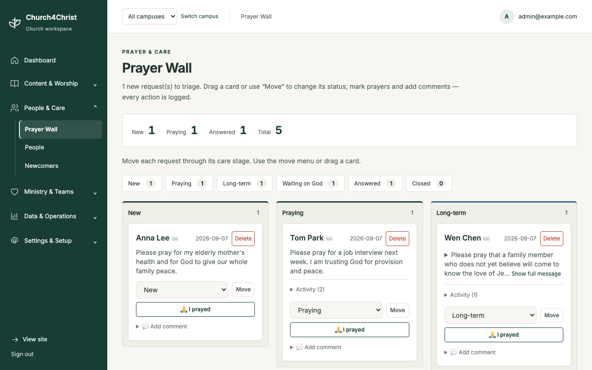
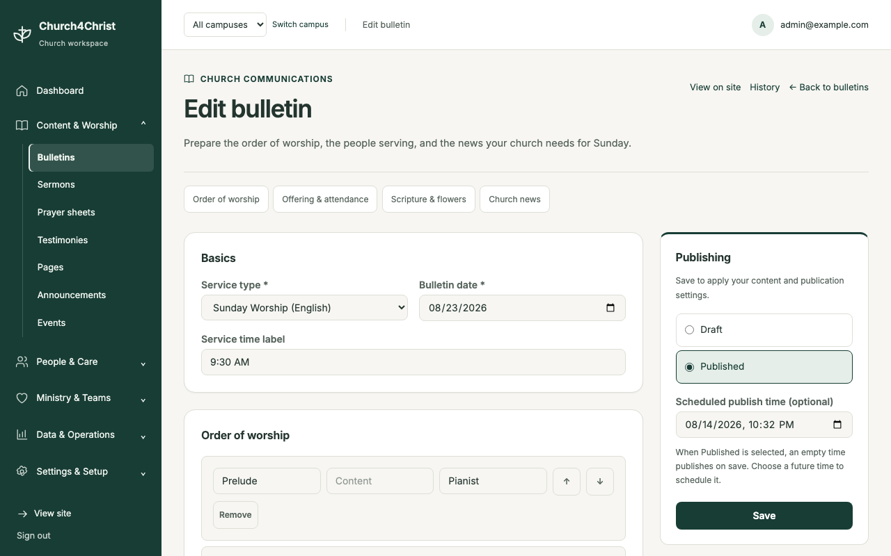
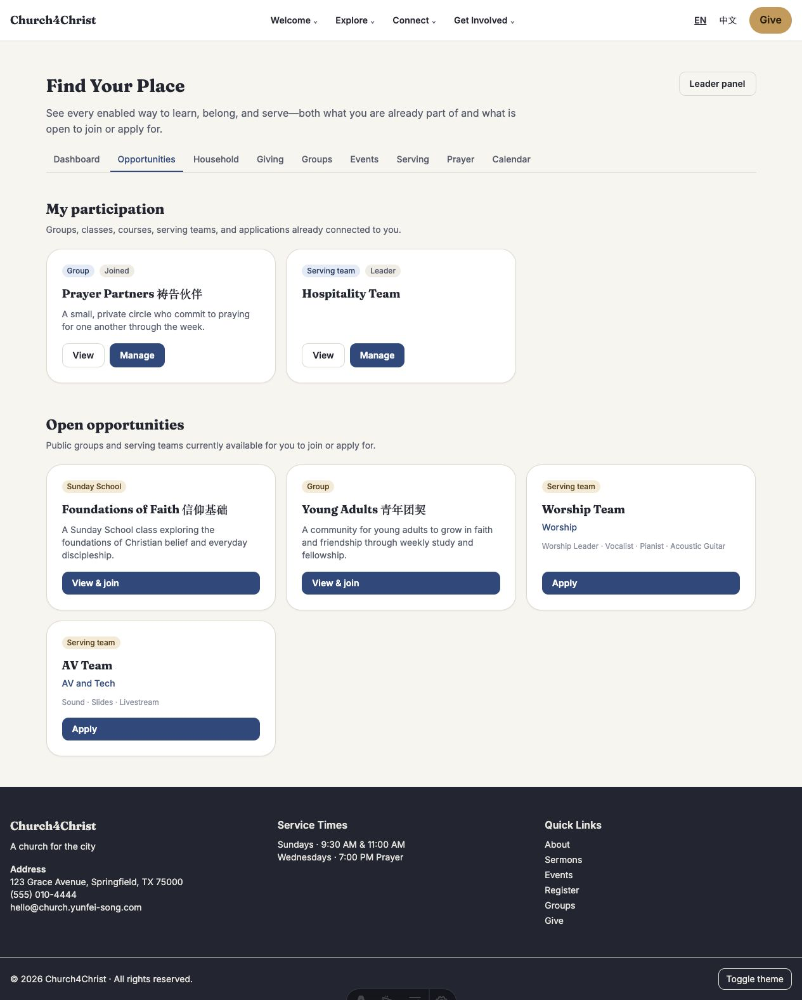

# Church4Christ: perangkat lunak manajemen gereja sumber terbuka dan situs web gereja

<p align="center"></p>

<p align="center"><a href="README.md">English</a> · <a href="README.zh.md">简体中文</a> · <a href="README.es.md">Español</a> · <a href="README.pt.md">Português (Brasil)</a> · <a href="README.fr.md">Français</a> · <a href="README.de.md">Deutsch</a> · <a href="README.ja.md">日本語</a> · <a href="README.ko.md">한국어</a> · <a href="README.ms.md">Bahasa Melayu</a> · <b>Bahasa Indonesia</b> · <a href="README.vi.md">Tiếng Việt</a> · <a href="README.hi.md">हिन्दी</a></p>

*Ini adalah terjemahan dari [README.md](README.md), yang merupakan versi bahasa Inggris yang menjadi acuan resmi. Dibantu AI; koreksi dari penutur asli sangat kami harapkan.*

[](https://github.com/leveo/church4christ/actions/workflows/ci.yml)
[](https://github.com/leveo/church4christ/releases)
[](LICENSE)
[](https://astro.build/)
[](https://workers.cloudflare.com/)
[](docs/i18n.md)

**Sistem manajemen gereja (ChMS) dan CMS gereja sumber terbuka yang dirancang berbasis AI, dengan
situs web gereja multibahasa dalam 12 bahasa antarmuka, termasuk bahasa Inggris dan Mandarin. Alternatif Planning Center yang di-hosting sendiri dan
modular untuk gereja kecil dan menengah, persekutuan, dan organisasi nirlaba, dibangun di atas Astro
dan Cloudflare Workers.**

Orang dan keluarga, kelompok, penjadwalan relawan, check-in anak, kehadiran,
tindak lanjut pendatang baru, penggembalaan doa, khotbah, warta jemaat, acara, serta portal anggota,
buku besar pemberian, dan pendaftaran acara yang bersifat opsional, dalam satu basis kode yang dapat Anda baca, ubah,
dan hosting sendiri.

**Situs web: [church4christ.org](https://church4christ.org) · Demo langsung: [demo.church4christ.org](https://demo.church4christ.org).**

[](https://church4christ.yunfei-song.com/C4C-modular-Voice.mp4)

Tonton **[Built Around Your Ministry](https://church4christ.yunfei-song.com/C4C-modular-Voice.mp4)**,
video promosi situs demo (MP4).

**Mulai dari sini: [Penyiapan untuk manusia dan agen AI](docs/setup.md).** Jalankan `npm run onboard`
untuk memilih identitas, warna, logo, dan fitur awal organisasi Anda di halaman peramban lokal,
lalu teruskan preferensi yang tersimpan ke penginstal yang sudah ada. Agen pengodean memulai dengan
[AGENTS.md](AGENTS.md); Claude juga membaca [CLAUDE.md](CLAUDE.md).

Church4Christ memadukan situs publik multibahasa dengan sistem admin untuk konten,
penggembalaan doa, penjadwalan relawan, orang, dan keluarga. Modul opsional menambahkan
portal anggota dan alur kerja manajemen gereja lainnya. Proyek ini bertujuan menurunkan
biaya awal dan biaya pemeliharaan berkelanjutan dari implementasi yang disesuaikan, sambil menjaga
kode dan konfigurasi deployment tetap dapat diakses oleh para operatornya.

**Rilis sumber saat ini adalah 1.7**. Church4Christ adalah fondasi sumber terbuka,
bukan layanan terkelola yang siap pakai. Evaluasi lokal gratis, dan beberapa deployment
dapat masuk dalam kuota gratis penyedia, tetapi hosting produksi, email, basis data, domain, cadangan, dan layanan lain
dapat dikenai biaya tergantung konfigurasi dan penggunaan. Lihat [Profil penerapan dan biaya](#profil-penerapan-dan-biaya)
sebelum memilih penyiapan produksi.

|  |  |  |
|---|---|---|
|  |  |  |
|  |  |  |
|  |  |  |

**Ruang kerja tersendiri untuk setiap modul inti.** Desain Sanctuary bawaan memadukan
permukaan gading yang hangat dan navigasi hijau hutan dengan tata letak yang sesuai untuk setiap tugas:
editor penerbitan dengan pratinjau lokal, catatan orang dan keluarga, antrean penggembalaan,
matriks pelayanan, check-in anak yang ramah layar sentuh, pemutar kursus, dan buku besar
keuangan. Menu untuk publik, anggota, pemimpin, dan administrator mengikuti modul yang diaktifkan
serta izin masing-masing orang. Harvest dan Midnight tetap tersedia, dengan mode terang dan
gelap. Lihat [inventaris desain 21 modul](docs/design/module-coverage.md).

Tangkapan layar menggunakan konten demo fiktif milik repositori. Penyiapan pertama memungkinkan Anda
menyertakan contoh tersebut atau memulai tanpa contoh; kedua pilihan tetap memakai tata letak,
tema, dan gambar bawaan yang sama. Halaman bahasa Inggris memakai antarmuka dan teks demo berbahasa Inggris;
halaman bahasa Mandarin mendukung konten berbahasa Mandarin dan dwibahasa. Seluruh 29 tangkapan layar antarmuka
diambil ulang dari aplikasi yang sedang berjalan; lihat [inventaris pengambilan dan perintah
untuk membuatnya ulang](docs/design/readme-screenshot-inventory.md).

**Navigasi berkelompok.** Situs yang seluruh fiturnya aktif meringkas tujuan publiknya menjadi
Selamat Datang, Jelajahi, Terhubung, dan Terlibat. Tautan bawaan tetap berada di kelompok audiensnya,
sedangkan halaman kustom dan tautan eksternal muncul di bawah Lainnya. Urutan yang disimpan di
Admin → Navigasi dipertahankan di dalam setiap kelompok, dan kelompok yang kosong akan hilang.


Dua belas bahasa antarmuka disertakan: bahasa Inggris dan Mandarin, serta Spanyol, Portugis
Brasil, Prancis, Jerman, Jepang, Korea, Melayu, Indonesia, Vietnam, dan Hindi. Setiap
gereja memilih bahasa yang ditawarkan situsnya beserta bahasa bawaan saat penyiapan atau nanti di
Pengaturan → Bahasa. Sepuluh terjemahan yang lebih baru dibantu AI; koreksi dari penutur
asli sangat kami harapkan. Tiga tampilan siap pakai dan titik awal modular untuk
penyesuaian lebih lanjut juga disertakan.

---

## Untuk siapa ini?

Church4Christ ditujukan bagi gereja kecil dan menengah, persekutuan, dan organisasi nirlaba —
terutama jemaat multibahasa dan jemaat perantau — yang membutuhkan situs web publik dan fondasi
manajemen gereja yang dapat disesuaikan. Ini paling cocok jika seorang staf, relawan, atau mitra implementasi yang
cukup paham teknologi dapat memegang deployment dan pemeliharaan. Platform
terkelola mungkin lebih sesuai jika organisasi lebih memilih penyiapan, dukungan,
pembaruan, dan tanggung jawab operasional ditangani vendor, ketimbang penyesuaian di tingkat kode sumber.

## Bagaimana pendekatan ini dibandingkan?

Kategori produk yang berbeda melayani kebutuhan yang berbeda, dan ketentuan penyedia bervariasi. Tabel ini
membandingkan model operasi, bukan menjanjikan harga, portabilitas, atau hak atas data yang berlaku universal.

| | **Church4Christ** | **CMS plugin kelola mandiri** | **Pembuat situs ter-hosting** | **Platform gereja terkelola** |
|---|---|---|---|---|
| **Kecocokan utama** | Situs web multibahasa yang disesuaikan plus alur kerja gereja yang modular | Situs konten yang dapat diperluas, dirakit dari plugin | Situs publik yang dikelola penyedia | Alur kerja gereja yang dikelola penyedia |
| **Model biaya** | Biaya infrastruktur dan penggunaan layanan; beberapa profil mungkin masuk dalam kuota gratis | Hosting, ekstensi, dan pemeliharaan | Langganan dan add-on | Langganan, sering berdasarkan paket atau modul |
| **Kustomisasi** | Perubahan di tingkat kode sumber dan modul opsional | Tema, plugin, dan perubahan kode sumber jika tersedia | Templat dan ekstensi yang didukung penyedia | Konfigurasi dan integrasi yang didukung penyedia |
| **Operasi** | Tim Anda atau mitra implementasi men-deploy, memperbarui, memantau, dan mencadangkan | Tim Anda atau penyedia hosting mengurus pemeliharaan inti dan plugin | Penyedia mengelola sebagian besar operasi platform | Penyedia mengelola sebagian besar operasi platform |
| **Portabilitas** | Akses kode dan basis data mendukung migrasi, tetapi migrasinya manual | Bergantung pada hosting, plugin, dan format | Bergantung pada ekspor dan ketentuan penyedia | Bergantung pada ekspor, API, dan ketentuan penyedia |
| **Titik awal bahasa** | Dua belas bahasa antarmuka disertakan; setiap gereja memilih set bahasanya sendiri | Bergantung pada ekstensi yang dipilih | Bergantung pada layanan dan paket | Bergantung pada layanan dan paket |

**Konsekuensinya.** Church4Christ dioptimalkan untuk Cloudflare Workers dan binding-nya;
berpindah ke stack hosting lain memang mungkin dengan pekerjaan di kode sumber, tetapi bukan jalur satu klik yang didukung.
Selain itu tidak ada migrasi konten otomatis dari D1 ke Supabase. Halaman bawaan
dibentuk oleh tema, sedangkan penyuntingan seret-dan-lepas hanya berlaku untuk halaman kustom. Proyek ini
sudah diberi versi, tetapi pengguna tetap perlu mengantisipasi pekerjaan implementasi dan peningkatan versi yang ditinjau dengan cermat.

Mengoperasikan proyek ini juga berarti memeliharanya. Pemilik teknis Anda tetap bertanggung jawab
atas pembaruan dependensi, tinjauan dan konfigurasi keamanan, pemantauan, cadangan dan
uji pemulihan, serta men-deploy perbaikan. Arsitektur ini mengurangi sebagian pekerjaan infrastruktur, tetapi
tidak menghilangkan pemeliharaan keamanan dan operasional. Lihat
[**`docs/why-this-stack.md`**](docs/why-this-stack.md) untuk alasan di balik desainnya.

## Mencari alternatif sumber terbuka untuk Planning Center?

Banyak gereja yang mencari alternatif gratis atau yang di-hosting sendiri untuk Planning Center,
Breeze, Church Community Builder, atau perangkat lunak manajemen gereja ter-hosting sejenis menginginkan dua
hal: kendali atas data mereka sendiri dan situs web yang berbagi catatan yang sama.
Church4Christ mencakup sebagian besar kebutuhan manajemen gereja sehari-hari dalam satu
aplikasi yang di-hosting sendiri:

| Kebutuhan ChMS yang umum | Church4Christ |
|---|---|
| Direktori orang dan keluarga | [Orang & keluarga](docs/features/people-households.md) dengan impor CSV, pemetaan kolom sumber yang tersimpan, dan ekspor |
| Kelompok kecil | [Kelompok](docs/features/groups.md) dengan direktori publik, permintaan bergabung, acara, dan kehadiran |
| Penjadwalan relawan | [Penjadwalan relawan](docs/features/volunteer-serve.md) dengan matriks bulanan dan konfirmasi email, tanpa perlu login |
| Perencanaan ibadah | [Rundown, latihan, ketersediaan, dan kalender](docs/features/service-planning.md) untuk ibadah dan acara |
| Check-in anak | [Check-in kios](docs/features/children-checkin.md) dengan kode penjemputan dan grafik kehadiran |
| Kehadiran dan keterlibatan | [Kehadiran ibadah](docs/features/service-attendance.md) dan [skor aktivitas](docs/features/activity-score.md) |
| Tindak lanjut pendatang baru dan penggembalaan | [Antrean pendatang baru](docs/features/newcomers.md), [dinding doa](docs/features/prayer-wall.md), dan [alur kerja komunitas](docs/features/community-workflows.md) |
| Situs web gereja dan CMS | [Situs publik, tema, khotbah, warta jemaat, dan pembuat halaman](docs/features/public-site-and-themes.md) |
| Layanan mandiri anggota | [Portal anggota](docs/features/member-portal.md) (keluarga, kelompok, doa; berjalan di D1 atau Supabase) |
| Banyak kampus | [Multi-kampus](docs/features/multi-campus.md) dengan data dan peran yang terisolasi per kampus |

**Pindah dari Planning Center secara bertahap.** [Sinkronisasi Planning Center People](docs/deploy.md#9-optional-configure-planning-center-synchronization)
yang opsional dan bersifat hanya-baca menautkan catatan orang di Planning Center dengan orang yang sudah ada di Church4Christ, dan mengirim
kecocokan yang meragukan ke peninjauan manual, sehingga kedua sistem dapat berjalan berdampingan selama
masa transisi. Orang dibawa masuk dengan pengimpor CSV dan pemetaan kolomnya yang dapat dipakai ulang.

**Yang belum digantikannya.** Tidak ada aplikasi seluler native, tidak ada pesan SMS, dan
tidak ada pustaka lagu atau perencanaan lagu pujian (Perencanaan Ibadah mencakup rundown dan
latihan). Pemberian online lewat Stripe (kartu dan debit bank)
berjalan dalam mode uji sampai Anda menyelesaikan daftar periksa go-live; pendaftaran acara berbayar
memakai mode Stripe yang sama. Modul pemberian juga mencatat cek dan uang tunai dalam buku besar offline
serta menghasilkan laporan pemberian tahunan. Church4Christ adalah fondasi yang dijalankan dan dipelihara tim Anda, bukan
layanan ter-hosting dengan dukungan vendor.

Planning Center dan nama produk lain di atas adalah merek dagang dari pemiliknya masing-masing.
Church4Christ adalah proyek independen dan tidak berafiliasi dengan mereka.

---

## Hanya butuh satu bagian?

Mulailah dari yang kecil dan berkembanglah nanti. Setiap edisi satu fitur menginstal repositori ini dengan hanya
satu area yang diaktifkan, memakai basis data Cloudflare D1 bawaan:

| Jika Anda membutuhkan | Mulai dengan | Preset |
|---|---|---|
| Kios check-in anak | [church-checkin](https://github.com/leveo/church-checkin) | `checkin` |
| Penjadwalan relawan | [church-volunteer-scheduling](https://github.com/leveo/church-volunteer-scheduling) | `volunteer-scheduling` |
| Manajemen kelompok kecil | [church-small-groups](https://github.com/leveo/church-small-groups) | `small-groups` |
| Situs web gereja dan CMS | [church-website-cms](https://github.com/leveo/church-website-cms) | `website` |

Edisi-edisi ini tidak memuat kode terpisah, jadi tidak ada tambahan yang perlu dipelihara. Anda juga bisa
melewatinya dan menjalankan `npm run onboard -- --preset checkin` di sini. Aktifkan fitur lain kapan saja
di **Pengaturan → Modul**. Lihat [edisi satu fitur](docs/editions.md).

---

## Bangun dengan asisten AI

Manusia dan agen memakai onboarding peramban, penginstal, katalog fitur, dan pemeriksaan
kesiapan yang sama. [AGENTS.md](AGENTS.md) dan [CLAUDE.md](CLAUDE.md) menyuruh asisten memeriksa
instalasi terlebih dahulu, menjalankan `npm run onboard` untuk penyiapan baru tanpa preferensi,
dan membiarkan Anda mengisi formulirnya. Jawaban Anda tersimpan di
`.church/preferences.json` yang diabaikan Git; sesi berikutnya membaca berkas itu untuk mengikuti identitas, merek,
dan pilihan fitur Anda. [Panduan penyiapan](docs/setup.md) memuat perintah dan langkah pemulihan.
Mulai asisten dengan:

> "Baca AGENTS.md dan docs/setup.md. Mulai onboarding peramban agar saya bisa memilih merek
> dan fitur awal organisasi kami. Gunakan preferensi tersimpan saya untuk menyiapkan pratinjau
> lokal, verifikasi halaman situs dan administrator, lalu laporkan URL dan pemeriksaan yang tersisa."

Anda tidak perlu melakukan setiap perubahan secara manual. Repositori ini disusun agar asisten pengodean AI
dapat mengikuti panduan berbahasa sederhana di [`docs/features/`](docs/features/) dan
bekerja dengan dukungan cakupan uji otomatis yang luas. Ini dapat menurunkan upaya kustomisasi dan
pemeliharaan, tetapi seorang maintainer tetap harus meninjau perubahannya, menjalankan
uji yang relevan, dan men-deploy-nya dengan sengaja.

Idenya: buka proyek ini dengan asisten AI, jelaskan apa yang Anda inginkan dalam bahasa
sehari-hari, dan biarkan ia yang menyunting. Beberapa contoh nyata yang bisa Anda tempel:

> "Baca `docs/features/public-site-and-themes.md`, lalu ubah warna utama kami menjadi
> biru royal dan tunjukkan beranda."

> "Tambahkan locale Italia (`it`) mengikuti `docs/i18n.md`."

> "Ikuti docs/setup.md untuk mengonfigurasi gereja kami tanpa konten demo. Tunjukkan rencana penyiapan
> dan hasil kesiapan, lalu siapkan deployment menggunakan docs/deploy.md."

Alur kerja yang sama dapat membantu pemeliharaan: jelaskan perubahan, periksa diff
yang diusulkan, uji secara lokal, dan deploy hanya setelah hasilnya ditinjau. Bantuan AI
tidak menggantikan keputusan keamanan, cadangan, pengujian produksi, atau kepemilikan operasional.

---

## Misi kami

**Menurunkan biaya dan upaya untuk memulai sistem manajemen gereja yang disesuaikan dan
situs web multibahasa.** Church4Christ menyediakan fondasi modular yang telah diuji dan dapat disesuaikan oleh gereja atau
mitra implementasi, tanpa harus memulai dari nol. Ia tidak menjanjikan layanan produksi
tanpa langganan atau tanpa anggaran: pilihan infrastruktur, email, basis data,
domain, dukungan, dan pemeliharaan menentukan biaya operasional yang sebenarnya.

---

## Isinya

Setiap fitur memiliki panduan berbahasa sederhananya sendiri. Mulailah dengan salah satu berikut:


| | Fitur | Fungsinya |
|---|---|---|
| [](docs/features/public-site-and-themes.md) | **[Situs publik & tema](docs/features/public-site-and-themes.md)** | Pintu depan gereja Anda — beranda, khotbah, acara, staf — dalam salah satu dari tiga tampilan siap pakai. |
| [](docs/features/cms-admin.md) | **[Area admin](docs/features/cms-admin.md)** | Masuk tanpa kata sandi, peran, dan pemulihan satu klik untuk konten editorial berversi yang didukung. |
| [](docs/features/admin-permissions.md) | **[Izin admin](docs/features/admin-permissions.md)** | Beri setiap admin hanya area yang dibutuhkannya — dinding doa dan direktori anggota gratis, sisanya sesuai pilihan. |
| [](docs/features/multi-campus.md) | **[Multi-kampus](docs/features/multi-campus.md)** | Jalankan beberapa kampus pada satu backend dengan data, pengaturan, fitur, dan peran lokal kampus yang terisolasi; hanya admin utama yang dapat melihat semua kampus. |
| [](docs/features/bulletins.md) | **[Warta jemaat mingguan](docs/features/bulletins.md)** | Susun lembar ibadah hari Minggu dan jadwalkan agar terbit sendiri. |
| [](docs/features/sermons.md) | **[Arsip khotbah](docs/features/sermons.md)** | Tempel tautan YouTube; dapatkan pustaka pesan terdahulu yang dapat dicari dan cepat dimuat. |
| [](docs/features/prayer-wall.md) | **[Dinding doa](docs/features/prayer-wall.md)** | Terima pokok doa dan tangani secara privat di papan yang sederhana. |
| [](docs/features/volunteer-serve.md) | **[Penjadwalan relawan](docs/features/volunteer-serve.md)** | Rencanakan pelayanan sebulan sekilas pandang; relawan mengonfirmasi lewat email, tanpa login. |
| [](docs/features/people-households.md) | **[Orang & keluarga](docs/features/people-households.md)** | Profil dan keluarga plus ekspor CSV kanonis khusus-buat-baru dan pemetaan kolom sumber yang dapat dipakai ulang untuk migrasi. |
| [](docs/features/member-identity.md) | **[Keamanan identitas anggota](docs/features/member-identity.md)** | Identitas terikat bukti lintas Pemberian, Pendaftaran, Kelompok, Tim, Pendatang Baru, dan impor; duplikat yang meragukan masuk peninjauan alih-alih digabung hanya berdasarkan nama, dengan persetujuan terikat OTP dan rollback 24 jam yang terjaga. |
| [](docs/features/groups.md) | **[Kelompok](docs/features/groups.md)** | Kelompok kecil dengan direktori publik, daftar periksa anggota, permintaan bergabung, acara, dan kehadiran lewat tautan email per orang. |
| [](docs/features/children-checkin.md) | **[Check-in anak](docs/features/children-checkin.md)** | Kios ramah layar sentuh tempat orang tua melakukan check-in dan check-out anak dengan kode penjemputan, plus grafik kehadiran mingguan. |
| [](docs/features/service-attendance.md) | **[Kehadiran ibadah](docs/features/service-attendance.md)** | Catat total dewasa agregat, turunkan total anak opsional dari check-in, koreksi riwayat, dan unduh laporan CSV tanpa identitas. |
| [](docs/features/newcomers.md) | **[Tindak lanjut pendatang baru](docs/features/newcomers.md)** | Terima kartu publik dwibahasa yang disertai persetujuan, pilah antrean staf yang dibatasi, dan serahkan kecocokan yang tepat ke Orang tanpa membocorkan catatan atau jawaban. |
| [](docs/features/onboarding-readiness.md) | **[Kesiapan peluncuran](docs/features/onboarding-readiness.md)** | Satu daftar periksa dwibahasa yang dipakai bersama oleh penyiapan, doctor, dan setiap administrator sungguhan, dengan pengakuan super-admin untuk pemeriksaan manual. |
|  | **[Perencanaan ibadah](docs/features/service-planning.md)** | Susun rundown berwaktu, latihan bersama orang yang dipanggil, ketersediaan anggota, pencarian waktu yang cocok, kalender, dan email otomatis. |
|  | **[Skor aktivitas](docs/features/activity-score.md)** | Gabungkan aktivitas terpilih yang terkait dengan orang menjadi skor anggota yang dapat dijelaskan dan ringkasan keterlibatan seluruh gereja. |
| [](docs/features/learning.md) | **[Pembelajaran](docs/features/learning.md)** | Lanjutkan Sekolah Minggu dan pemuridan di antara pertemuan dengan video dwibahasa, berkas, tugas, kuis, dan status yang disinkronkan penyedia. |
| [](docs/features/page-builder.md) | **[Pembuat halaman](docs/features/page-builder.md)** | Susun halaman kustom Anda sendiri dengan seret dan lepas — multibahasa, selalu sesuai tema, dan halaman yang diterbitkan dimuat tanpa JavaScript. Opsional; mematikannya tidak akan merusak halaman yang sudah Anda buat. |
| [](docs/features/giving.md) | **[Pemberian](docs/features/giving.md)** | Sudah diimplementasikan: pemberian online lewat Stripe (mode uji secara bawaan, mode langsung setelah daftar periksa go-live), buku besar offline untuk cek dan uang tunai, serta laporan pemberian tahunan. |
| [](docs/features/registration.md) | **[Pendaftaran](docs/features/registration.md)** | Sudah diimplementasikan: pendaftaran acara gratis di D1 atau Supabase, pertanyaan kustom, daftar tunggu, tahapan acara, dan ekspor daftar peserta, plus checkout Stripe berbayar di Supabase dalam mode Stripe yang sama dengan Pemberian (verifikasi dengan pendaftaran langsung kecil sebelum mengandalkannya). |
|  | **[Logistik acara](docs/features/event-logistics.md)** | Tambahan opsional untuk Pendaftaran: tempatkan orang di kamar, dudukkan mereka di meja dengan pratinjau Atur duduk otomatis, bagi mereka ke dalam kelompok kecil, dan cetak daftar kamar, papan nama pintu, serta kartu meja. |
| [](docs/features/member-portal.md) | **[Portal anggota](docs/features/member-portal.md)** | Satu hub setelah masuk untuk keterlibatan saat ini dan kesempatan yang terbuka, plus profil keluarga, acara, pelayanan, kalender, pemberian, dan doa yang dibatasi cakupannya. |
| [](docs/features/i18n.md) | **[Dua belas bahasa](docs/features/i18n.md)** | Pilih dari 12 bahasa antarmuka untuk setiap situs, dengan cadangan bahasa Inggris dan konversi satu klik dari Mandarin Sederhana ke Tradisional. |
| [](docs/features/email-automation.md) | **[Email & otomatisasi](docs/features/email-automation.md)** | Tautan masuk, pengingat, dan rangkuman, dengan pencatatan log lokal dan konfigurasi produksi yang dapat berbayar. |
| [](docs/features/modules.md) | **[Modul](docs/features/modules.md)** | Matikan fitur yang tidak Anda pakai; tidak ada yang dihapus, aktifkan kembali kapan saja. |

**Pilih modul Anda.** Sebagian besar kemampuan domain yang opsional adalah **modul** yang dapat Anda matikan
dari satu panel di Pengaturan — warta jemaat, khotbah, dinding doa, penjadwalan relawan,
dan lainnya. Instalasi baru menulis setiap pengaturan modul secara eksplisit dari pilihan saat penyiapan;
demo Full Church memilih ke-21 modulnya (Perencanaan Ibadah dan Logistik Acara diaktifkan secara terpisah). Hanya pada instalasi lama, baris modul yang tidak ada mempertahankan
perilaku warisan yaitu aktif secara bawaan. Gereja yang hanya menginginkan jadwal ibadah dan khotbah dapat
menyembunyikan sisanya dengan satu klik: halaman, tautan, dan email modul itu hilang bersamaan, dan tidak ada
yang dihapus. Lihat [**`docs/features/modules.md`**](docs/features/modules.md).

| Key | English | 中文 | Required database |
|---|---|---|---|
| `bulletins` | Bulletins | 周报 | Either |
| `sermons` | Sermons | 讲道 | Either |
| `prayer-sheets` | Prayer Sheets | 祷告单 | Either |
| `prayer-wall` | Prayer Wall | 祷告墙 | Either |
| `events` | Events | 活动 | Either |
| `serve` | Volunteer Scheduling | 服事排班 | Either |
| `gifts` | Spiritual Gifts | 恩赐探索 | Either |
| `testimonies` | Testimonies | 见证 | Either |
| `articles` | Articles | 文章 | Either |
| `fellowships` | Fellowships | 团契 | Either |
| `groups` | Groups | 小组 | Either |
| `people` | People & Households | 会友与家庭 | Either |
| `children` | Children Check-in | 儿童报到 | Either |
| `attendance` | Service Attendance | 崇拜出席 | Either |
| `newcomers` | Newcomer Follow-up | 新朋友跟进 | Either |
| `activity-score` | Activity Score | 活跃度评分 | Either |
| `page-builder` | Page Builder | 页面编辑器 | Either |
| `portal` | Member Portal | 会友平台 | Either |
| `giving` | Giving | 奉献 | Supabase |
| `registration` | Registration | 活动报名 | Either |
| `learning` | Learning | 学习 | Either |
| `planning` | Service Planning | 服事流程 | Either |
| `event-logistics` | Event Logistics | 活动后勤 | Either |

### Manajemen komunitas dan alur kerja

Kampus dapat mengelola kelompok dan tindak lanjut anggota secara langsung. Persekutuan opsional menambahkan lapisan komunitas dengan keanggotaan independen dan kelompok turunan. Alur kerja yang dapat dipakai ulang menyediakan langkah yang ditugaskan, tenggat waktu, pelacakan penyelesaian, dan pengingat email Cloudflare. Lihat [panduan alur kerja komunitas](docs/features/community-workflows.md) untuk penyiapan, izin, dan kontrol pengiriman.

### Pembelajaran melampaui hari Minggu

Versi 1.1 menambahkan modul opsional **Pembelajaran** untuk Sekolah Minggu,
pemuridan, dan pelayanan lain yang berlanjut di antara pertemuan. Para pembelajar mendapatkan
tampilan kursus dwibahasa yang dibatasi demi privasi untuk video YouTube tidak terdaftar, berkas, tugas,
dan kuis. Pengumpulan tetap menjadi wewenang penyedia: situs ini
mengarahkan pembelajar ke penyedia yang dikonfigurasi dan tidak mengumpulkan sendiri pekerjaan rumah,
jawaban, komentar, nilai, atau isi berkas.

Administrator dapat menghubungkan Google Classroom melalui API resminya atau turunan Canvas dari Church4Christ
yang dioperasikan secara terpisah. Pemetaan kursus, kredensial OAuth terenkripsi,
notifikasi penyedia bertanda tangan, sinkronisasi manual, dan rekonsiliasi terjadwal yang terbatas
hanya memasok metadata aktivitas yang dibutuhkan Church4Christ.


| Tampilan pembelajar bahasa Inggris | Tampilan pembelajar bahasa Mandarin | Administrasi penyedia |
|---|---|---|
| [](docs/images/learning/genesis-1-en.png) | [](docs/images/learning/genesis-1-zh.png) | [](docs/images/learning/admin-overview.png) |

Lihat **[panduan fitur Pembelajaran](docs/features/learning.md)** untuk penyiapan
penyedia, batas privasi, anggaran sinkronisasi, demo Kejadian 1, serta persyaratan
operasional Canvas yang terpisah dan persyaratan corresponding source.

### Rumah bagi anggota Anda

**Portal Anggota** yang opsional mengubah catatan yang sudah dipelihara gereja Anda menjadi
pengalaman setelah masuk yang berguna. Halaman awal kesempatannya menampilkan setiap cara yang diaktifkan untuk
belajar, bertumbuh dalam persekutuan, dan melayani di satu tempat: baik kelompok, kelas, dan tim yang sudah
terhubung dengan anggota maupun kesempatan yang saat ini terbuka untuk diikuti atau dilamar. Anggota
juga dapat memperbarui data keluarga, melihat pemberian mereka, mendaftar acara, meninjau komitmen
pelayanan, berlangganan kalender pribadi, dan membagikan doa dengan cakupan tertentu. Portal ini memakai tautan masuk
tanpa kata sandi yang sama seperti bagian Church4Christ lainnya — tidak ada akun atau kata sandi baru
yang perlu diingat.


Pemimpin pelayanan, kelompok, Sekolah Minggu, dan tim pelayan mendapatkan panel dengan cakupan sumber daya di
`/<locale>/manage`. Login aplikasi gereja melindunginya, dan setiap operasi memeriksa
wewenang pemimpin atas sumber daya tertentu itu. Dengan demikian, Cloudflare Zero Trust dapat tetap
terbatas pada seluruh area `/admin`.


Portal ini berjalan di backend D1 bawaan maupun backend **Supabase (Postgres)** yang opsional.
Keluarga, kelompok, berkas kelompok yang dilindungi, dan moderasi doa gereja/kelompok/privat
berfungsi di D1. Doa lingkup acara, administrator acara, dan "Pendaftaran saya"
memerlukan Pendaftaran, yang berjalan di D1 untuk acara gratis setelah diaktifkan. Pelajari lebih lanjut di
[**`docs/features/member-portal.md`**](docs/features/member-portal.md).

---

## Coba dalam 5 menit (di komputer Anda sendiri)

Anda dapat menjalankan situs ini secara lokal, dengan konten contoh fiktif yang opsional, sebelum memilih
deployment. Anda memerlukan [Node.js](https://nodejs.org/) 22.22.1 atau yang lebih baru terpasang. Onboarding
peramban merekomendasikan **Website + Community** dengan **Cloudflare D1** untuk peluncuran pertama.


```bash
# 1. Get the code and install it
git clone https://github.com/leveo/church4christ.git
cd church4christ
npm ci

# 2. Open the local browser form, complete it, and save your preferences
npm run onboard

# 3. Review the plan, then initialize with those same preferences
node scripts/setup/index.mjs --preferences .church/preferences.json --yes --dry-run --json
node scripts/setup/index.mjs --preferences .church/preferences.json --yes --json

# 4. For D1, start it (always follow the exact handoff setup prints)
npm run dev
```

Formulir ini menanyakan apakah ini gereja, organisasi nirlaba, atau kampus, dan mengumpulkan nama,
slogan, alamat, zona waktu, warna utama dan sekunder, logo PNG/JPEG/WebP yang opsional
(hingga 2 MiB), bahasa, administrator pertama, dan pilihan konten demo. Centang hanya
fitur yang Anda butuhkan.
Pilihan yang direkomendasikan memakai D1 sebagai basis datanya; aplikasi tetap berjalan di
Cloudflare Workers dan menyimpan media di R2. **Pemberian dan Pendaftaran berbayar**
adalah opsi lanjutan yang memerlukan peralihan eksplisit ke PostgreSQL yang kompatibel dengan Supabase.

Menyimpan akan menulis `.church/preferences.json` dan logo yang diunggah di bawah `.church/`, yang
diabaikan Git. Ini tidak membuat basis data atau men-deploy situs. Jalankan `npm run onboard` lagi untuk
memuat ulang dan menyunting preferensi yang tersimpan. Biarkan terminal tetap berjalan selama Anda mengisi
formulir; hentikan dengan Ctrl+C setelah selesai. Untuk membuka URL yang dicetak sendiri, gunakan
`npm run onboard -- --no-open`; untuk memilih port, tambahkan `--port 4310`. Titik masuk langsungnya
adalah `node scripts/onboard/index.mjs`. Lihat [panduan penyiapan](docs/setup.md) untuk mengetahui apa yang
diterapkan penginstal dan bagaimana agen memakai preferensi lainnya.

Jika Anda menginstal dengan `npm ci --ignore-scripts`, jalankan `npm run tokens` secara manual sebelum
penginstal atau `npm run dev`.

Untuk Supabase lokal, serah terima justru mengekspor
`CLOUDFLARE_HYPERDRIVE_LOCAL_CONNECTION_STRING_HYPERDRIVE` di shell host sebelum
`npm run dev`; URL koneksi itu tidak boleh dimasukkan ke `.dev.vars`.

Saat penyiapan pertama, pilih **Include demo content** atau **No demo content**. Keduanya mempertahankan
desain bawaan, gambar dekoratif lokal, fitur yang diaktifkan, dan alat administrator yang sama.
Konten demo menambahkan orang, khotbah, warta jemaat, acara, pelayanan, dan contoh lain yang fiktif.
Langkah medianya menyalin paket gambar hasil generate dari `seed/media/` ke R2 lokal.
Tanpa konten demo, penyiapan membuat skema basis data, bawaan operasional, pengaturan gereja, pilihan
modul, dan administrator pertama tanpa catatan bisnis contoh.

Berkas preferensi mencatat pilihan konten demo dari formulir. Untuk penyiapan dengan jawaban CLI eksplisit,
sertakan `--demo-data` atau `--no-demo-data`; jika keduanya dihilangkan pada penyiapan noninteraktif, bawaan
tanpa demo yang ada tetap dipakai. Kedua flag tidak dapat digabungkan. Mengulang
penyiapan yang sama mempertahankan pilihan konten yang tercatat dan catatan yang ada. `--no-demo-data` tidak
mengosongkan basis data yang sudah ada, dan penyiapan menolak menambahkan data demo di atas orang yang sudah ada.
Gunakan workspace/basis data baru yang terpisah untuk mencoba mode awal yang lain.

Buka alamat yang dicetak penyiapan (biasanya `http://localhost:4321`).

**Masuk ke area admin.** Tidak ada kata sandi. Di halaman masuk, masukkan
email admin pertama dari jawaban penyiapan Anda, yang diulang dalam serah terima penyiapan, dan minta
tautan. Karena email lokal diatur untuk dicetak dan tidak dikirim, **URL tautan ajaib muncul
langsung di terminal Anda**. Tempel ke peramban dan Anda sudah masuk. (Untuk pengujian lokal
yang lebih cepat, penyiapan menulis alamat yang sama sebagai `AUTH_DEV_BYPASS_EMAIL` di `.dev.vars`, yang
memasukkan Anda secara otomatis. Hapus baris itu untuk menguji alur masuk yang sebenarnya.)

Pada kedua mode konten, penyiapan membuat administrator baru beserta identitas masuk mereka yang diaudit
sekaligus. Eksekusi ulang mempertahankan kepemilikan kontak yang ada; tidak memverifikasi email
yang sudah ada dan tidak memulihkan akses yang telah dicabut. Jika penyiapan melaporkan masalah identitas, selesaikan
[alur peninjauan atau pemulihan identitas](docs/features/member-identity.md) sebelum menjalankannya ulang.

`npm run setup` khusus terminal tetap tersedia. Penyiapan menawarkan **Website** (8 modul
penerbitan yang terfokus), **Website + Community** (18 modul; Portal Anggota dapat ditambahkan di D1), dan
**Full Church** (21 modul; Perencanaan Ibadah diaktifkan secara terpisah). Pemberian
memilih Supabase secara otomatis (Pendaftaran gratis berjalan di D1); pilihan yang kompatibel dengan D1 memilih D1 kecuali Anda
menimpa backend secara eksplisit. Persyaratan akun bergantung pada mode Local atau Deploy,
sebagaimana dirinci di bawah. Untuk otomatisasi, berikan semua jawaban dengan `--yes`; tambahkan `--json` untuk satu
hasil yang dapat dibaca mesin. Untuk eksekusi noninteraktif yang dapat dibaca manusia, gunakan flag lengkap yang sama
dengan `npm run setup -- ... --yes` dan hilangkan `--json`. Agar stdout tetap murni JSON
melalui npm, gunakan bentuk senyap:

```bash
npm run --silent setup -- --mode local --preset website --site-slug my-church \
  --church-name "My Church" --locale en --admin-email admin@example.com \
  --admin-name "First Admin" --app-origin http://localhost:4321 \
  --email-from admin@example.com --demo-data --yes --json
```

---

## Profil penerapan dan biaya

Ini adalah profil perencanaan, bukan jaminan harga. Harga di bawah ini berlaku per
**Agustus 2026**, dapat berubah, dan harus dikonfirmasi di halaman harga resmi yang ditautkan
sebelum deployment.

| Profil | Cakupan yang disertakan | Catatan biaya dan kesiapan |
|---|---|---|
| **Evaluasi lokal** | Modul situs web atau komunitas dengan D1 lokal; modul lengkap dengan Postgres lokal yang kompatibel | Tidak ada biaya layanan ter-hosting untuk evaluasi D1 lokal. Anda tetap menyediakan komputer, waktu pengembangan, dan layanan eksternal opsional apa pun. |
| **D1 situs web/komunitas** | Cloudflare Worker, D1, dan R2 untuk hingga 22 modul yang kompatibel dengan D1 | Deployment yang sederhana dapat masuk dalam kuota gratis Cloudflare. Lalu lintas, penyimpanan, operasi di atas kuota, domain, dan layanan lain dapat berbiaya; periksa [harga Workers](https://developers.cloudflare.com/workers/platform/pricing/). Email produksi terpisah. |
| **Email produksi** | Tautan masuk transaksional, pengingat, permintaan, dan rangkuman ke penerima mana pun | Repositori ini mendukung konfigurasi email Cloudflare yang dapat berbayar. Pengiriman ke penerima mana pun memerlukan Workers Paid, saat ini minimum **$5/bulan** termasuk **3.000 email**, lalu **$0,35 per 1.000 email**. Jumlah ini dapat berubah; periksa [harga Cloudflare Email Service](https://developers.cloudflare.com/email-service/platform/pricing/). |
| **Supabase/modul lengkap** | Deployment Cloudflare plus Supabase/Postgres untuk 21 modul Full Church, termasuk Portal Anggota, Pemberian, dan Pendaftaran | Biaya Cloudflare tetap berlaku, dan [paket Supabase](https://supabase.com/pricing) yang dipilih dapat menambah biaya langganan atau penggunaan. Per Agustus 2026, Supabase Free tidak memiliki cadangan harian otomatis, dan proyek Free yang aktivitasnya rendah dapat [dijeda secara otomatis](https://supabase.com/docs/guides/platform/free-project-pausing) berdasarkan aktivitas selama periode tujuh hari. Untuk produksi, lakukan dump basis data di luar lokasi secara berkala dan latihan pemulihan, atau pilih paket berbayar yang [opsi cadangannya](https://supabase.com/docs/guides/platform/backups) memenuhi kebutuhan kesinambungan Anda. Harga dan kebijakan layanan dapat berubah. Stripe dimulai dalam mode uji; pembayaran langsung adalah pilihan eksplisit setelah daftar periksa go-live di [`docs/supabase-setup.md`](docs/supabase-setup.md). |

Kuota gratis penyedia dapat berguna untuk evaluasi atau deployment sederhana, tetapi itu
bukan janji bahwa layanan produksi akan tetap gratis. Anggarkan untuk kepemilikan teknis,
pemeliharaan dependensi dan keamanan, pemantauan, cadangan, uji pemulihan, dan pertumbuhan
penggunaan di masa depan, selain layanan yang tercantum di atas.

---

## Menayangkannya secara online

Baru dalam hal ini? Mulailah dengan [**`docs/cloudflare-setup.md`**](docs/cloudflare-setup.md) — panduan
berbahasa sederhana yang menjelaskan apa itu Cloudflare, model biayanya, dan dua
cara untuk tayang online (termasuk membiarkan asisten AI mengerjakannya untuk Anda). Saat Anda menginginkan
perintah yang persis, [**`docs/deploy.md`**](docs/deploy.md) adalah panduan langkah demi langkah
yang lengkap.

Mulai dengan `npm run setup`, pilih **Deploy**, dan jawab pertanyaan tentang fitur dan gereja.
Penyiapan membuat atau mengimpor sumber daya yang diperlukan, menulis konfigurasi hasil generate, menerapkan
migrasi, mencatat semua 23 pengaturan modul, dan menyiapkan admin pertama. Setelah itu penyiapan menyerahkan
ke `npm run deploy`. Jalankan `npm run doctor` untuk laporan kesiapan schema-v2, dan gunakan
daftar periksa `/admin/onboarding` yang selalu aktif untuk identitas pemeriksaan stabil yang sama.
Pemberian, Pendaftaran, Kelompok, Tim, Pendatang Baru, impor, dan integrasi Planning
Center opsional yang hanya-baca berbagi gerbang identitas terikat bukti yang mengutamakan peninjauan. Gerbang ini tidak pernah
menggabungkan orang secara otomatis berdasarkan nama atau kontak yang belum terverifikasi. Lihat [Identitas anggota](docs/features/member-identity.md)
untuk alur kerja, kontrol penipuan, batas migrasi saat ini, dan celah verifikasi penyedia;
aturan penyiapan dan rotasi rahasia tetap ada di [runbook deployment](docs/deploy.md#stable-identity-source-key).
Deployment sengaja dibuat manual: otomatisasi repositori menguji perubahan tetapi tidak
menerbitkannya atau memigrasikan data produksi untuk Anda.

**Deployment pertama dan peningkatan versi adalah operasi yang berbeda.** Penyiapan terpandu menyediakan atau
mengimpor sumber daya dan menyiapkan instalasi yang telah ditinjau. Ini bukan peningkatan versi satu klik tanpa pengawasan
untuk situs yang sudah menyimpan data gereja. Operator yang sudah ada sebaiknya memulai dengan
[runbook peningkatan versi](docs/upgrade.md), mencadangkan basis data, media R2, konfigurasi, dan inventaris
rahasia, berlatih di staging, dan meninjau [changelog `Unreleased`](CHANGELOG.md) sebelum
menerapkan migrasi maju. Maintainer yang menyiapkan rilis sebaiknya mengikuti
[proses rilis](docs/release-process.md).

**Memilih basis data Anda.** 22 modul yang kompatibel dengan D1 tidak mencakup
**Pemberian**, yang memerlukan Postgres, dan **Pendaftaran berbayar**, yang juga memerlukannya. Persyaratan akun mengikuti
mode: D1 lokal tidak memerlukan akun eksternal; D1 yang di-deploy memerlukan akun Cloudflare; Supabase
lokal memerlukan akun Supabase atau basis data Postgres lokal yang kompatibel; Supabase yang di-deploy
memerlukan Cloudflare dan Supabase. Belum ada migrasi konten otomatis D1↔Supabase,
jadi pilihlah basis data produksi sebelum memasukkan konten sungguhan. Lihat
[**`docs/supabase-setup.md`**](docs/supabase-setup.md).

**Stripe dimulai dalam mode uji; mode langsung adalah pilihan eksplisit.** Stripe meng-hosting halaman pembayaran,
tanda terima, Billing Portal, pengembalian dana, dan sengketa; aplikasi ini hanya menyimpan jumlah,
dana, tanggal, status, dan id Stripe. Pemberian dan Pendaftaran berbayar hanya untuk Supabase; D1 tidak
mendukungnya. Saat penyiapan menanyakan salah satu modul itu, impor kunci `sk_test_…` dan
rahasia penandatanganan `whsec_…` dengan variabel lingkungan sekali pakai `CHURCH_SETUP_STRIPE_SECRET_KEY` dan
`CHURCH_SETUP_STRIPE_WEBHOOK_SECRET`; penyiapan menyimpan rahasia runtime
dan menulis `STRIPE_MODE=test`. Untuk menerima donasi sungguhan, ikuti daftar periksa go-live di
panduan Supabase (kunci langsung, webhook pada versi API `2025-03-31.basil`, `STRIPE_MODE=live`
plus `STRIPE_LIVE_CONFIRMED=1`). Event yang modenya tidak cocok dengan mode yang dikonfigurasi
akan ditolak, dan Worker berbasis Supabase menjalankan pemulihan tahan lama setiap lima menit. Uji
lokal tidak membuktikan pengiriman Stripe secara langsung.

---

## Apa yang ada di balik layar

Bagi yang penasaran: Church4Christ dibangun dengan **[Astro](https://astro.build/)** yang merender
halaman di server, berjalan sebagai satu **Cloudflare Worker**. Data aplikasi berada di
backend yang dipilih — Cloudflare **D1** atau **Supabase/Postgres** — dan media yang diunggah berada
di Cloudflare **R2** (penyimpanan objek); email dikirim melalui binding email Cloudflare.
Halaman untuk pengunjung **tidak memuat framework JavaScript sisi klien** — halaman itu berupa HTML
biasa yang cepat dengan sedikit skrip vanilla —
dan itu sebagian besar alasan situs ini dimuat dengan cepat dan murah dioperasikan. (Satu-satunya
pengecualian ada di balik login staf: pembuat halaman seret-dan-lepas adalah editor React
kecil yang hanya diunduh tim Anda; halaman yang diterbitkannya tetap berupa HTML biasa.)

Seluruh tampilannya berasal dari **[design token](design/README.md)**: sekumpulan nilai warna dan
tipografi yang dikompilasi menjadi tiga tema siap pakai (Sanctuary, Harvest, Midnight),
masing-masing dengan mode terang dan gelap. Proyek ini memiliki **cakupan otomatis yang luas** di seluruh
alur kerja intinya agar maintainer dapat memverifikasi perubahan sebelum deployment.

**Mengapa pilihan-pilihan ini?** Alasan di balik deployment yang dioptimalkan untuk Cloudflare, stack
Astro + Tailwind + TypeScript, dan kasus-kasus ketika platform terkelola mungkin menjadi
model operasi yang lebih baik diuraikan di
[**`docs/why-this-stack.md`**](docs/why-this-stack.md). Untuk gambaran teknisnya, lihat
[`docs/architecture.md`](docs/architecture.md),
[`docs/design-system.md`](docs/design-system.md), dan [`docs/i18n.md`](docs/i18n.md).

---

## FAQ

**Apa itu Church4Christ?**
Sistem manajemen gereja (ChMS) dan CMS gereja sumber terbuka. Ini memadukan situs web
gereja multibahasa (12 bahasa antarmuka) dengan alat staf untuk orang dan keluarga, kelompok,
penjadwalan relawan, check-in anak, kehadiran, tindak lanjut pendatang baru, dan penggembalaan doa.

**Apakah ada alternatif sumber terbuka yang gratis untuk Planning Center?**
Church4Christ adalah salah satu pilihan. Kode sumbernya gratis di bawah GPL-3.0 dan Anda meng-hosting-nya
sendiri di Cloudflare Workers. Ini mencakup orang, kelompok, check-in, penjadwalan relawan,
kehadiran, dan situs web gereja, serta dapat membaca Planning Center People melalui
sinkronisasi hanya-baca yang opsional selama masa transisi. Ini tidak memiliki aplikasi seluler,
SMS, atau perencanaan lagu pujian milik Planning Center. Lihat
[Mencari alternatif sumber terbuka untuk Planning Center?](#mencari-alternatif-sumber-terbuka-untuk-planning-center)

**Apakah gratis?**
Perangkat lunaknya gratis. Layanan hosting, email, basis data, dan domain dapat berbiaya
tergantung penyiapan dan penggunaan Anda; beberapa deployment kecil masuk dalam kuota
gratis penyedia. Lihat [Profil penerapan dan biaya](#profil-penerapan-dan-biaya).

**Bahasa apa saja yang didukung?**
Dua belas bahasa antarmuka: Inggris, Mandarin, Spanyol, Portugis Brasil, Prancis, Jerman,
Jepang, Korea, Melayu, Indonesia, Vietnam, dan Hindi. Setiap gereja memilih bahasa mana yang
ditawarkan situsnya beserta bahasa bawaan; halaman Mandarin juga mendapatkan konversi satu klik dari
Mandarin Sederhana ke Tradisional. Bahasa lain dapat ditambahkan; lihat [docs/i18n.md](docs/i18n.md).

**Bisakah gereja kecil tanpa pengembang menjalankannya?**
Ini paling cocok jika seorang staf, relawan, atau mitra yang paham teknologi memegang
deployment dan pembaruan. Onboarding peramban dan panduan asisten AI menurunkan upaya itu,
tetapi tetap harus ada yang meninjau perubahan, mencadangkan data, dan men-deploy.

**Dibangun dengan apa?**
Astro di Cloudflare Workers, dengan Cloudflare D1 atau Supabase/PostgreSQL untuk data dan
Cloudflare R2 untuk media. Halaman publik tidak memuat framework sisi klien.

---

## Lisensi

Church4Christ adalah perangkat lunak bebas dan sumber terbuka di bawah **[GNU General Public License
v3](LICENSE)** (GPL-3.0). Anda boleh menggunakan dan mempelajarinya, memodifikasinya secara privat, membagikan salinan, dan
menarik biaya untuk salinan, pengembangan kustom, hosting, dukungan, atau layanan komersial lainnya.

Jika Anda mendistribusikan versi modifikasi yang tercakup, ketentuan GPL berlaku: penerima harus
memperoleh kebebasan GPL yang berlaku, dan kode sumber yang bersesuaian harus disediakan di bawah
GPL sebagaimana disyaratkan lisensi. Modifikasi privat tidak wajib dipublikasikan. Sekadar
menjalankan versi modifikasi sebagai layanan jaringan, tanpa mendistribusikan salinan, tidak dengan
sendirinya memicu kewajiban berbagi kode sumber ala AGPL di bawah GPLv3.

[`LICENSE`](LICENSE) adalah acuan resmi. Ringkasan ini disediakan sebagai orientasi dan bukan
nasihat hukum.

---

## Berkontribusi & peta jalan

Kontribusi sangat disambut — laporan bug, terjemahan, fitur baru. Mulailah dengan
[`CONTRIBUTING.md`](CONTRIBUTING.md) untuk penyiapan pengembangan dan lima aturan proyek, serta
[`SECURITY.md`](SECURITY.md) jika Anda menemukan masalah keamanan.

**Di cakrawala (belum dibangun):** "pasar pertukaran" antargereja untuk berbagi
tema dan konten adalah gagasan yang sedang kami pertimbangkan, bukan janji. Jika hal itu penting bagi
gereja Anda, buka sebuah issue dan mari kita bicarakan.

---

Dibangun dengan penuh perhatian, dan dengan bantuan AI, untuk gereja dan organisasi nirlaba di mana pun.
