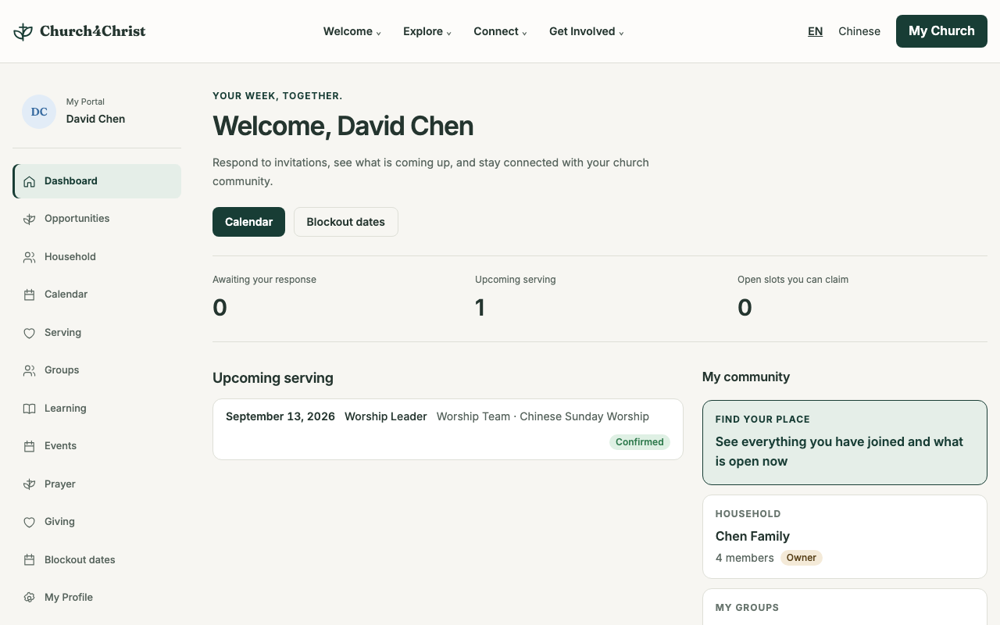
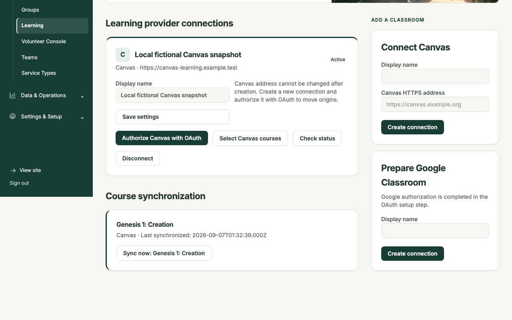

# Church4Christ：オープンソースの教会管理ソフトウェアと教会ウェブサイト

<p align="center"></p>

<p align="center"><a href="README.md">English</a> · <a href="README.zh.md">简体中文</a> · <a href="README.es.md">Español</a> · <a href="README.pt.md">Português (Brasil)</a> · <a href="README.fr.md">Français</a> · <a href="README.de.md">Deutsch</a> · <b>日本語</b> · <a href="README.ko.md">한국어</a> · <a href="README.ms.md">Bahasa Melayu</a> · <a href="README.id.md">Bahasa Indonesia</a> · <a href="README.vi.md">Tiếng Việt</a> · <a href="README.hi.md">हिन्दी</a></p>

*これは [README.md](README.md) の翻訳です。正式版は英語の README.md です。AI の支援による翻訳です。ネイティブの方からの修正を歓迎します。*

[](https://github.com/leveo/church4christ/actions/workflows/ci.yml)
[](https://github.com/leveo/church4christ/releases)
[](LICENSE)
[](https://astro.build/)
[](https://workers.cloudflare.com/)
[](docs/i18n.md)

**AI ネイティブなオープンソースの教会管理システム（ChMS）兼教会 CMS です。英語と中国語を含む 12 の表示言語に対応した多言語の教会ウェブサイトを備えています。自分たちでホストできるモジュール式の Planning Center 代替として、小規模から中規模の教会、フェローシップ、非営利団体向けに、Astro と Cloudflare Workers の上に構築されています。**

人と家庭、小グループ、奉仕スケジュール、子どものチェックイン、出席、新来者のフォローアップ、祈りのケア、説教、週報、イベント、さらにオプションの教会員ポータル、献金台帳、イベント申込までを、読んで、変更して、自分たちでホストできる 1 つのコードベースにまとめています。

**ウェブサイト：[church4christ.org](https://church4christ.org) · ライブデモ：[demo.church4christ.org](https://demo.church4christ.org)。**

[](https://church4christ.yunfei-song.com/C4C-modular-Voice.mp4)

デモサイトのプロモーション動画 **[Built Around Your Ministry](https://church4christ.yunfei-song.com/C4C-modular-Voice.mp4)**（MP4）をご覧ください。

**まずはこちらから：[人と AI エージェントのためのセットアップ](docs/setup.md)。** `npm run onboard` を実行すると、ローカルのブラウザページで団体の名称、色、ロゴ、最初に使う機能を選べます。保存された設定を既存のインストーラーに渡します。コーディングエージェントは [AGENTS.md](AGENTS.md) から読み始めてください。Claude は [CLAUDE.md](CLAUDE.md) も読み込みます。

Church4Christ は、多言語の公開サイトと、コンテンツ、祈りのケア、奉仕スケジュール、人と家庭のための管理システムを組み合わせたものです。オプションのモジュールで、教会員ポータルやその他の教会管理ワークフローを追加できます。このプロジェクトは、カスタマイズした導入の初期費用と継続的な保守費用を抑えつつ、コードとデプロイ設定を運用者の手元に残すことを目指しています。

**現在のソースリリースは 1.6 です**。Church4Christ はオープンソースの基盤であり、すぐに使えるマネージドサービスではありません。ローカルでの評価は無料で、デプロイによってはプロバイダーの無料枠に収まる場合もありますが、本番環境のホスティング、メール、データベース、ドメイン、バックアップなどのサービスには、構成や利用量に応じて料金がかかることがあります。本番環境の構成を選ぶ前に、[導入形態と費用](#導入形態と費用)をご確認ください。

|  |  |  |
|---|---|---|
|  |  |  |
|  |  |  |
|  |  |  |

**コアモジュールごとに専用のワークスペースがあります。** 既定の Sanctuary デザインは、温かみのあるアイボリーの面とフォレストグリーンのナビゲーションに、作業ごとに合わせたレイアウトを組み合わせています。ローカルプレビュー付きの公開用エディター、人と家庭の記録、ケアのキュー、奉仕マトリクス、タッチ操作向けの子どものチェックイン、コースプレーヤー、献金台帳などです。公開用、教会員用、リーダー用、管理者用のメニューは、有効なモジュールと各自の権限に応じて変わります。Harvest と Midnight も利用でき、ライトモードとダークモードがあります。[21 モジュールのデザイン一覧](docs/design/module-coverage.md)をご覧ください。

スクリーンショットには、リポジトリに含まれる架空のデモコンテンツを使っています。初回セットアップでは、これらのサンプルを含めるか、含めずに始めるかを選べます。どちらを選んでも、レイアウト、テーマ、同梱の既定画像は同じです。英語のページでは英語の表示とデモ文面を使い、中国語のページは中国語とバイリンガルのコンテンツに対応します。29 枚すべての画面スクリーンショットは、動作中のアプリケーションから撮り直したものです。[撮影一覧と再生成コマンド](docs/design/readme-screenshot-inventory.md)をご覧ください。

**グループ化されたナビゲーション。** すべての機能を有効にしたサイトでは、公開ページへの導線が「ようこそ」「知る」「つながる」「参加する」の 4 つにまとまります。組み込みのリンクは対象となる利用者のグループに残り、カスタムページや外部リンクは「その他」の下に表示されます。管理 → ナビゲーションで保存した順序は各グループ内で保たれ、空のグループは表示されなくなります。


12 の表示言語を搭載しています。英語と中国語に加えて、スペイン語、ブラジルのポルトガル語、フランス語、ドイツ語、日本語、韓国語、マレー語、インドネシア語、ベトナム語、ヒンディー語です。各教会は、セットアップ時、または後から設定 → 言語で、サイトで提供する言語と既定の言語を選べます。後から加わった 10 言語の翻訳は AI の支援によるものです。ネイティブの方からの修正を歓迎します。すぐに使える 3 種類のデザインと、さらにカスタマイズするためのモジュール式の出発点も含まれています。

---

## 対象となるのは？

Church4Christ は、小規模から中規模の教会、フェローシップ、非営利団体を対象としています。特に、多言語の会衆や移民の会衆で、公開ウェブサイトと、カスタマイズできる教会管理の基盤が必要な場合に向いています。技術に慣れたスタッフ、ボランティア、または導入パートナーがデプロイと保守を担当できる場合に最も適しています。ソースレベルのカスタマイズよりも、ベンダーによるセットアップ、サポート、アップグレード、運用の責任を求める団体には、マネージド型のプラットフォームのほうが合うかもしれません。

## 他の方法との比較は？

製品の種類によって対応できるニーズは異なり、プロバイダーの条件もさまざまです。次の表は、運用モデルを比較したもので、価格、移行のしやすさ、データに関する権利を一律に保証するものではありません。

| | **Church4Christ** | **自己管理するプラグイン型 CMS** | **ホスト型サイトビルダー** | **マネージド型の教会プラットフォーム** |
|---|---|---|---|---|
| **主な適合先** | カスタマイズした多言語ウェブサイトと、モジュール式の教会ワークフロー | プラグインで組み立てる拡張可能なコンテンツサイト | プロバイダーが管理する公開ウェブサイト | プロバイダーが管理する教会ワークフロー |
| **費用モデル** | インフラとサービスの利用料。無料枠に収まる構成もあり | ホスティング、拡張機能、保守 | サブスクリプションとアドオン | サブスクリプション。多くはプランやモジュールごと |
| **カスタマイズ** | ソースレベルの変更とオプションのモジュール | テーマ、プラグイン、可能な場合はソースの変更 | プロバイダーが提供するテンプレートと拡張機能 | プロバイダーが提供する設定と連携 |
| **運用** | 自分たちのチームまたは導入パートナーが、デプロイ、更新、監視、バックアップを行う | 自分たちのチームまたはホストが、本体とプラグインの維持管理を行う | プロバイダーがプラットフォーム運用の大部分を担う | プロバイダーがプラットフォーム運用の大部分を担う |
| **移植性** | コードとデータベースへのアクセスにより移行できるが、移行は手作業 | ホスティング、プラグイン、形式による | プロバイダーのエクスポートと条件による | プロバイダーのエクスポート、API、条件による |
| **言語の出発点** | 12 の表示言語を搭載。各教会が使う言語を選ぶ | 選んだ拡張機能による | サービスとプランによる | サービスとプランによる |

**トレードオフ。** Church4Christ は Cloudflare Workers とそのバインディングに最適化されています。別のホスティング構成に移すことはソースを変更すれば可能ですが、サポートされたワンクリックの手順ではありません。D1 から Supabase へのコンテンツの自動移行もありません。組み込みのページはテーマによって形が決まり、ドラッグ＆ドロップの編集はカスタムページにのみ使えます。プロジェクトにはバージョンがありますが、導入する側は、実装作業と、慎重に確認したアップグレードが必要になることを見込んでおいてください。

プロジェクトを運用することは、保守することでもあります。技術担当者は、依存関係の更新、セキュリティの確認と設定、監視、バックアップと復元テスト、修正のデプロイに引き続き責任を持ちます。このアーキテクチャはインフラ作業の一部を減らしますが、セキュリティや運用の保守をなくすものではありません。設計の考え方は [**`docs/why-this-stack.md`**](docs/why-this-stack.md) をご覧ください。

## オープンソースの Planning Center 代替をお探しですか？

Planning Center、Breeze、Church Community Builder、またはそれらに似たホスト型の教会管理ソフトウェアの、無料または自己ホスト型の代替を探している教会の多くは、2 つのことを求めています。自分たちのデータを自分たちで管理できること、そして同じ記録を共有するウェブサイトです。Church4Christ は、日常の教会管理の多くの分野を、自分たちでホストできる 1 つのアプリケーションでカバーします。

| よくある ChMS のニーズ | Church4Christ |
|---|---|
| 人と家庭の名簿 | [人と家庭](docs/features/people-households.md)。CSV のインポート、保存できる元の列のマッピング、エクスポートに対応 |
| 小グループ | [グループ](docs/features/groups.md)。公開名簿、参加リクエスト、イベント、出席に対応 |
| ボランティアのスケジュール管理 | [奉仕スケジュール](docs/features/volunteer-serve.md)。月間マトリクスとメールでの確認に対応し、ログインは不要 |
| 礼拝プランニング | 礼拝やイベントのための[進行表、リハーサル、奉仕可能日、カレンダー](docs/features/service-planning.md) |
| 子どものチェックイン | [キオスク式チェックイン](docs/features/children-checkin.md)。お迎えコードと出席グラフに対応 |
| 出席とエンゲージメント | [礼拝出席](docs/features/service-attendance.md)と[活動スコア](docs/features/activity-score.md) |
| 新来者とケアのフォローアップ | [新来者キュー](docs/features/newcomers.md)、[祈りの壁](docs/features/prayer-wall.md)、[コミュニティのワークフロー](docs/features/community-workflows.md) |
| 教会ウェブサイトと CMS | [公開サイト、テーマ、説教、週報、ページビルダー](docs/features/public-site-and-themes.md) |
| 教会員のセルフサービス | [教会員ポータル](docs/features/member-portal.md)（家庭、グループ、祈り。D1 または Supabase で動作） |
| 複数のキャンパス | [マルチキャンパス](docs/features/multi-campus.md)。キャンパスごとに分離されたデータと役割 |

**Planning Center から段階的に移行する。** オプションの読み取り専用の [Planning Center People 同期](docs/deploy.md#9-optional-configure-planning-center-synchronization)は、Planning Center の人物記録を Church4Christ に既にいる人と関連付け、あいまいな一致は人による確認に回します。そのため、移行期間中は両方のシステムを並行して運用できます。人の情報は、CSV インポーターと再利用できる列のマッピングで取り込みます。

**まだ代替できないもの。** ネイティブのモバイルアプリ、SMS メッセージ、賛美歌ライブラリ、賛美の曲の計画（奉仕フローは進行表とリハーサルをカバーします）はありません。Stripe（カードと銀行引き落とし）によるオンライン献金は、公開前チェックリストを完了するまでテストモードで動作します。有料のイベント申込も同じ Stripe のモードを使います。献金モジュールは、小切手と現金もオフラインの台帳に記録し、年間の献金明細書を作成します。Church4Christ は、自分たちのチームが運用し保守する基盤であり、ベンダーのサポートが付くホスト型サービスではありません。

Planning Center および上記のその他の製品名は、それぞれの所有者の商標です。Church4Christ は独立したプロジェクトであり、これらとは提携していません。

---

## 一部の機能だけが必要ですか？

小さく始めて、後から広げられます。単一機能のエディションは、いずれもこのリポジトリを、1 つの分野だけを有効にして、既定の Cloudflare D1 データベースでインストールするものです。

| 必要なもの | 最初に使うもの | プリセット |
|---|---|---|
| 子どものチェックイン用キオスク | [church-checkin](https://github.com/leveo/church-checkin) | `checkin` |
| 奉仕スケジュール | [church-volunteer-scheduling](https://github.com/leveo/church-volunteer-scheduling) | `volunteer-scheduling` |
| 小グループの管理 | [church-small-groups](https://github.com/leveo/church-small-groups) | `small-groups` |
| 教会ウェブサイトと CMS | [church-website-cms](https://github.com/leveo/church-website-cms) | `website` |

これらのエディションに独自のコードはないので、余分に保守するものはありません。エディションを使わずに、ここで `npm run onboard -- --preset checkin` を実行することもできます。**設定 → モジュール**で、いつでも機能を追加できます。[単一機能のエディション](docs/editions.md)をご覧ください。

---

## AI アシスタントと一緒に構築する

人もエージェントも、同じブラウザでのオンボーディング、インストーラー、機能カタログ、準備状況のチェックを使います。[AGENTS.md](AGENTS.md) と [CLAUDE.md](CLAUDE.md) は、アシスタントに、まず既存のインストールを調べ、設定のない新規セットアップでは `npm run onboard` を起動し、フォームの入力はあなたに任せるよう指示しています。回答は Git の管理対象外の `.church/preferences.json` に保存され、以後のセッションはこのファイルを読んで、あなたの団体名、ブランド、機能の選択に沿って作業します。[セットアップガイド](docs/setup.md)に、コマンドと復旧の手順があります。アシスタントは次のように起動します。

> 「AGENTS.md と docs/setup.md を読んでください。ブラウザでのオンボーディングを起動して、私たちの団体のブランドと最初の機能を選べるようにしてください。保存した設定を使ってローカルのプレビューを用意し、サイトと管理者ページを確認して、URL と残りのチェック項目を報告してください。」

すべての変更を手作業で行う必要はありません。このリポジトリは、AI コーディングアシスタントが [`docs/features/`](docs/features/) にあるやさしい言葉のガイドに従い、充実した自動テストを足場に作業できるように整えられています。これでカスタマイズや保守の手間を減らせますが、保守担当者が変更を確認し、関連するテストを実行し、慎重にデプロイする必要があることに変わりはありません。

考え方はこうです。AI アシスタントでこのプロジェクトを開き、してほしいことを普段の言葉で説明して、編集を任せます。そのまま貼り付けられる実際の例をいくつか挙げます。

> 「`docs/features/public-site-and-themes.md` を読んでから、メインカラーをロイヤルブルーに変更して、ホームページを見せてください。」

> 「`docs/i18n.md` に従って、イタリア語（`it`）のロケールを追加してください。」

> 「docs/setup.md に従って、デモコンテンツなしでうちの教会を設定してください。セットアップの計画と準備状況の結果を見せてから、docs/deploy.md を使ってデプロイを準備してください。」

同じ流れは保守にも使えます。変更を説明し、提案された差分を確認し、ローカルでテストして、結果を確認してからデプロイします。AI の支援は、セキュリティに関する判断、バックアップ、本番環境でのテスト、運用の責任の代わりにはなりません。

---

## 私たちのミッション

**カスタマイズした教会管理システムと多言語ウェブサイトを始めるための費用と労力を減らすこと。** Church4Christ は、教会や導入パートナーがゼロから始める代わりに手を加えて使える、テスト済みのモジュール式の基盤を提供します。サブスクリプション不要、予算ゼロの本番サービスを約束するものではありません。インフラ、メール、データベース、ドメイン、サポート、保守の選択によって、実際の運用費用が決まります。

---

## 含まれる機能

どの機能にも、やさしい言葉で書かれた専用のガイドがあります。次のどれからでも始められます。


| | 機能 | できること |
|---|---|---|
| [](docs/features/public-site-and-themes.md) | **[公開サイトとテーマ](docs/features/public-site-and-themes.md)** | 教会の玄関口となるホーム、説教、イベント、スタッフを、すぐに使える 3 種類のデザインのいずれかで提供します。 |
| [](docs/features/cms-admin.md) | **[管理エリア](docs/features/cms-admin.md)** | パスワード不要のログイン、役割、対応するバージョン管理された編集コンテンツのワンクリック復元。 |
| [](docs/features/admin-permissions.md) | **[管理者の権限](docs/features/admin-permissions.md)** | 各管理者に必要な範囲だけを付与します。祈りの壁と教会員名簿は標準で使え、そのほかは選んで付与します。 |
| [](docs/features/multi-campus.md) | **[マルチキャンパス](docs/features/multi-campus.md)** | 1 つのバックエンドで複数のキャンパスを運用します。データ、設定、機能、キャンパス内の役割は分離され、すべてのキャンパスを見られるのはマスター管理者だけです。 |
| [](docs/features/bulletins.md) | **[週報](docs/features/bulletins.md)** | 日曜礼拝の週報を作成し、自動で公開されるよう予約します。 |
| [](docs/features/sermons.md) | **[説教アーカイブ](docs/features/sermons.md)** | YouTube のリンクを貼るだけで、検索でき、読み込みの速い過去のメッセージのライブラリができます。 |
| [](docs/features/prayer-wall.md) | **[祈りの壁](docs/features/prayer-wall.md)** | 祈りの課題を受け取り、シンプルなボードで非公開のまま対応します。 |
| [](docs/features/volunteer-serve.md) | **[奉仕スケジュール](docs/features/volunteer-serve.md)** | 1 か月分の奉仕を一目で計画します。ボランティアはログインなしで、メールで確認します。 |
| [](docs/features/people-households.md) | **[人と家庭](docs/features/people-households.md)** | プロフィールと家庭に加え、移行のための正規の作成専用 CSV エクスポートと、再利用できる元の列のマッピング。 |
| [](docs/features/member-identity.md) | **[教会員の本人確認の安全性](docs/features/member-identity.md)** | 献金、イベント申込、グループ、チーム、新来者、インポートをまたぐ、証明に基づく本人確認。あいまいな重複は名前だけで統合せず確認に回し、ワンタイムパスワード（OTP）に紐づく承認と、保護された 24 時間のロールバックを備えます。 |
| [](docs/features/groups.md) | **[グループ](docs/features/groups.md)** | 公開名簿、メンバーのチェックリスト、参加リクエスト、イベント、メールのリンクによる個人ごとの出席を備えた小グループ。 |
| [](docs/features/children-checkin.md) | **[子どものチェックイン](docs/features/children-checkin.md)** | 保護者がお迎えコードで子どもの受付と引き取りを行う、タッチ操作向けのキオスクと、週ごとの出席グラフ。 |
| [](docs/features/service-attendance.md) | **[礼拝出席](docs/features/service-attendance.md)** | 大人の合計人数を記録し、チェックインから子どもの人数を任意で算出し、履歴を訂正し、個人を特定できない CSV レポートをダウンロードできます。 |
| [](docs/features/newcomers.md) | **[新来者のフォローアップ](docs/features/newcomers.md)** | 同意を得たバイリンガルの公開カードを受け取り、範囲を絞ったスタッフ用キューで振り分け、完全に一致した人を、メモや回答を漏らすことなく「人」に引き継ぎます。 |
| [](docs/features/onboarding-readiness.md) | **[公開準備](docs/features/onboarding-readiness.md)** | セットアップ、doctor、すべての実際の管理者が共有する 1 つのバイリンガルのチェックリストで、手動のチェックはスーパー管理者が確認済みにします。 |
|  | **[奉仕フロー](docs/features/service-planning.md)** | 時間付きの進行表、呼ばれた人を含むリハーサル、教会員の奉仕可能日、日程の検索、カレンダー、自動メールを計画します。 |
|  | **[活動スコア](docs/features/activity-score.md)** | 選んだ、個人に紐づく活動を組み合わせて、根拠を説明できる教会員のスコアと、教会全体のエンゲージメントの概要を作ります。 |
| [](docs/features/learning.md) | **[学び](docs/features/learning.md)** | バイリンガルの動画、ファイル、課題、クイズ、プロバイダーと同期した状況で、教会学校や弟子訓練を集会と集会の間も続けられます。 |
| [](docs/features/page-builder.md) | **[ページビルダー](docs/features/page-builder.md)** | ドラッグ＆ドロップで独自のカスタムページを組み立てます。多言語対応で、常にテーマに沿い、公開されたページは JavaScript なしで読み込まれます。オプションで、オフにしても作成済みのページが壊れることはありません。 |
| [](docs/features/giving.md) | **[献金](docs/features/giving.md)** | 実装済み：Stripe によるオンライン献金（既定はテストモードで、公開前チェックリストの後に本番）、小切手と現金のためのオフライン台帳、年間の献金明細書。 |
| [](docs/features/registration.md) | **[イベント申込](docs/features/registration.md)** | 実装済み：無料のイベント申込、独自の質問、名簿のエクスポートに加え、献金と同じ Stripe のモードでの Stripe 有料決済（本番で頼る前に、少額の本番申込で確認してください）。 |
| [](docs/features/member-portal.md) | **[教会員ポータル](docs/features/member-portal.md)** | 現在の参加状況と参加できる機会を 1 つにまとめたログイン後のハブ。家庭のプロフィール、イベント、奉仕、カレンダー、献金、範囲を絞った祈りもあります。 |
| [](docs/features/i18n.md) | **[12 の言語](docs/features/i18n.md)** | サイトごとに 12 の表示言語から選べ、英語へのフォールバックと、簡体字から繁体字へのワンクリック変換があります。 |
| [](docs/features/email-automation.md) | **[メールと自動化](docs/features/email-automation.md)** | ログインリンク、リマインダー、ダイジェスト。ローカルではログに記録し、有料サービスにも対応した本番構成を備えます。 |
| [](docs/features/modules.md) | **[モジュール](docs/features/modules.md)** | 使わない機能をオフにできます。何も削除されず、いつでも元に戻せます。 |

**モジュールを選ぶ。** オプションの機能分野の多くは**モジュール**で、設定の 1 つのパネルからオフにできます。週報、説教、祈りの壁、奉仕スケジュールなどです。新規インストールでは、セットアップでの選択に基づいて、すべてのモジュール設定を明示的に書き込みます。Full Church のデモでは、その 21 個を選びます（奉仕フローは別にオンにします）。古いインストールに限り、モジュールの行がない場合は、従来の既定でオンの動作が維持されます。礼拝の時間と説教だけが必要な教会は、ワンクリックでそれ以外を隠せます。そのモジュールのページ、リンク、メールはまとめて消え、何も削除されません。[**`docs/features/modules.md`**](docs/features/modules.md) をご覧ください。

| Key | English | 中文 | Required database |
|---|---|---|---|
| `bulletins` | Bulletins | 周报 | Either |
| `sermons` | Sermons | 讲道 | Either |
| `prayer-sheets` | Prayer Sheets | 祷告单 | Either |
| `prayer-wall` | Prayer Wall | 祷告墙 | Either |
| `events` | Events | 活动 | Either |
| `serve` | Volunteer Scheduling | 服事排班 | Either |
| `gifts` | Spiritual Gifts | 恩赐探索 | Either |
| `testimonies` | Testimonies | 见证 | Either |
| `articles` | Articles | 文章 | Either |
| `fellowships` | Fellowships | 团契 | Either |
| `groups` | Groups | 小组 | Either |
| `people` | People & Households | 会友与家庭 | Either |
| `children` | Children Check-in | 儿童报到 | Either |
| `attendance` | Service Attendance | 崇拜出席 | Either |
| `newcomers` | Newcomer Follow-up | 新朋友跟进 | Either |
| `activity-score` | Activity Score | 活跃度评分 | Either |
| `page-builder` | Page Builder | 页面编辑器 | Either |
| `portal` | Member Portal | 会友平台 | Either |
| `giving` | Giving | 奉献 | Supabase |
| `registration` | Registration | 活动报名 | Supabase |
| `learning` | Learning | 学习 | Either |
| `planning` | Service Planning | 服事流程 | Either |

### コミュニティの管理とワークフロー

キャンパスは、グループと教会員のフォローアップを直接管理できます。オプションのフェローシップは、独立したメンバーシップと子グループを持つコミュニティの層を加えます。再利用できるワークフローには、担当者が割り当てられたステップ、期限、完了の追跡、Cloudflare を使ったメールのリマインダーがあります。設定、権限、配信の制御については、[コミュニティワークフローのガイド](docs/features/community-workflows.md)をご覧ください。

### 日曜日の先へ広がる学び

バージョン 1.1 では、教会学校、弟子訓練、そのほか集会と集会の間も続く奉仕のための、オプションの**学び**モジュールが加わりました。学習者は、限定公開の YouTube 動画、ファイル、課題、クイズを含む、バイリンガルでプライバシーの範囲が限られたコース画面を利用できます。提出はあくまでプロバイダーが正とします。サイト自身が宿題、答え、コメント、成績、ファイルの内容を集めることはなく、設定されたプロバイダーに学習者を案内します。

管理者は、公式の API を通じて Google Classroom を接続することも、別に運用される Church4Christ の Canvas 派生版を接続することもできます。コースのマッピング、暗号化された OAuth 認証情報、署名付きのプロバイダー通知、手動の同期、上限のある定期的な突き合わせによって、Church4Christ が必要とする活動のメタデータだけが取り込まれます。


| 英語の学習者ビュー | 中国語の学習者ビュー | プロバイダーの管理 |
|---|---|---|
| [](docs/images/learning/genesis-1-en.png) | [](docs/images/learning/genesis-1-zh.png) | [](docs/images/learning/admin-overview.png) |

プロバイダーの設定、プライバシーの境界、同期の上限、創世記 1 章のデモ、そして別に運用する Canvas の運用と対応するソースの要件については、**[学びの機能ガイド](docs/features/learning.md)**をご覧ください。

### 教会員のための居場所

オプションの**教会員ポータル**は、教会がすでに管理している記録を、ログイン後の便利な体験に変えます。機会の一覧ページには、有効になっている学び、所属、奉仕のあらゆる方法が 1 か所にまとまります。その教会員がすでに関わっているグループ、クラス、チームと、現在参加や申し込みができる機会の両方です。教会員は、家庭の情報の更新、自分の献金の確認、イベントへの申込、奉仕の予定の確認、個人用カレンダーの購読、範囲を絞った祈りの共有もできます。Church4Christ のほかの部分と同じパスワード不要のログインリンクを使うので、新しいアカウントやパスワードを覚える必要はありません。


ミニストリー、グループ、教会学校、奉仕チームのリーダーは、`/<locale>/manage` でリソースごとに範囲を絞ったパネルを使えます。保護しているのは教会アプリのログインで、すべての操作で、そのリソースに対するリーダーの権限が確認されます。そのため、Cloudflare Zero Trust は `/admin` 全体だけに限定しておけます。


ポータルは、既定の D1 バックエンドでも、オプションの **Supabase（Postgres）**バックエンドでも動作します。家庭、グループ、保護されたグループのファイル、教会・グループ・個人の祈りの承認管理は D1 で動作します。イベント単位の祈り、イベント管理者、「自分の申込」には、Supabase 専用のイベント申込が必要です。詳しくは [**`docs/features/member-portal.md`**](docs/features/member-portal.md) をご覧ください。

---

## 5 分で試す（自分のコンピューターで）

デプロイ方法を選ぶ前に、架空のサンプルコンテンツを加えるかどうかを選びながら、サイトをローカルで動かせます。[Node.js](https://nodejs.org/) 22.22.1 以降のインストールが必要です。ブラウザでのオンボーディングでは、最初の公開に **Website + Community** と **Cloudflare D1** の組み合わせをおすすめします。


```bash
# 1. Get the code and install it
git clone https://github.com/leveo/church4christ.git
cd church4christ
npm ci

# 2. Open the local browser form, complete it, and save your preferences
npm run onboard

# 3. Review the plan, then initialize with those same preferences
node scripts/setup/index.mjs --preferences .church/preferences.json --yes --dry-run --json
node scripts/setup/index.mjs --preferences .church/preferences.json --yes --json

# 4. For D1, start it (always follow the exact handoff setup prints)
npm run dev
```

フォームでは、教会、非営利団体、キャンパスのどれかを尋ね、名称、キャッチフレーズ、住所、タイムゾーン、メインカラーとサブカラー、任意の PNG/JPEG/WebP のロゴ（最大 2 MiB）、言語、最初の管理者、デモコンテンツの選択を入力します。必要な機能にだけチェックを入れてください。おすすめの選択では、データベースに D1 を使います。アプリケーションは引き続き Cloudflare Workers で動作し、メディアは R2 に保存されます。**献金とイベント申込**は上級者向けのオプションで、Supabase 互換の PostgreSQL への明示的な切り替えが必要です。

保存すると、`.church/preferences.json` と、アップロードしたロゴが `.church/` に書き込まれます。このディレクトリは Git の管理対象外です。データベースの作成やサイトのデプロイは行いません。`npm run onboard` をもう一度実行すると、保存した設定を読み込み直して編集できます。フォームに入力している間はターミナルを起動したままにして、終わったら Ctrl+C で止めてください。表示された URL を自分で開く場合は `npm run onboard -- --no-open` を使い、ポートを選ぶには `--port 4310` を加えます。直接のエントリーポイントは `node scripts/onboard/index.mjs` です。インストーラーが何を適用するか、またエージェントが残りの設定をどう使うかは、[セットアップガイド](docs/setup.md)をご覧ください。

`npm ci --ignore-scripts` でインストールした場合は、インストーラーまたは `npm run dev` の前に、`npm run tokens` を手動で実行してください。

ローカルの Supabase の場合、ハンドオフでは代わりに、`npm run dev` の前にホストのシェルで `CLOUDFLARE_HYPERDRIVE_LOCAL_CONNECTION_STRING_HYPERDRIVE` を export するよう案内されます。この接続 URL を `.dev.vars` に入れてはいけません。

初回セットアップでは、**デモコンテンツを含める**か**デモコンテンツなし**かを選びます。どちらも、同梱のデザイン、ローカルの装飾用画像、有効な機能、管理者向けツールは同じです。デモコンテンツでは、架空の人物、説教、週報、イベント、ミニストリーなどのサンプルが加わります。そのメディアの手順では、生成された画像パックを `seed/media/` からローカルの R2 にコピーします。デモコンテンツなしでは、サンプルの業務記録を持たずに、データベースのスキーマ、運用の既定値、教会の設定、モジュールの選択、最初の管理者が作成されます。

設定ファイルには、フォームでのデモコンテンツの選択が記録されます。明示的な CLI の回答でセットアップする場合は、`--demo-data` または `--no-demo-data` を渡してください。非対話式のセットアップで両方を省略した場合は、既存の既定であるデモなしになります。この 2 つのフラグは同時に使えません。同じセットアップを繰り返しても、記録されたコンテンツの選択と既存の記録は保たれます。`--no-demo-data` は既存のデータベースを消去せず、すでに人がいる状態でデモデータを追加することをセットアップは拒否します。もう一方の開始モードを試すには、別の新しいワークスペースとデータベースを使ってください。

セットアップが表示するアドレス（通常は `http://localhost:4321`）を開きます。

**管理エリアへのログイン。** パスワードはありません。ログインページで、セットアップの回答にあった最初の管理者のメールアドレス（セットアップのハンドオフにも繰り返し表示されます）を入力し、リンクをリクエストします。ローカルのメールは送信せずに表示する設定のため、**マジックリンクの URL がそのままターミナルに表示されます**。それをブラウザに貼り付ければログインできます。（ローカルでより手早くテストできるよう、セットアップは同じアドレスを `.dev.vars` に `AUTH_DEV_BYPASS_EMAIL` として書き込みます。これにより自動でログインされます。本物のログインの流れをテストするには、その行を削除してください。）

どちらのコンテンツモードでも、セットアップは新しい管理者と、監査対象のログイン用 ID を一緒に作成します。再実行しても、既存の連絡先の所有関係は保たれます。既存のメールアドレスの確認や、取り消されたアクセスの復元は行いません。セットアップが ID に関する問題を報告した場合は、再実行する前に[本人確認の確認・復旧ワークフロー](docs/features/member-identity.md)を完了してください。

ターミナル専用の `npm run setup` も引き続き使えます。セットアップでは、**Website**（公開に絞った 8 モジュール）、**Website + Community**（18 モジュール。D1 では教会員ポータルを追加可能）、**Full Church**（21 モジュール。奉仕フローは別にオンにします）が選べます。献金とイベント申込を選ぶと自動で Supabase になり、D1 互換の選択では、バックエンドを明示的に上書きしない限り D1 が選ばれます。必要なアカウントは、ローカルかデプロイかのモードによって異なり、詳しくは下で説明します。自動化するには、`--yes` ですべての回答を渡します。機械で読める結果を 1 つにまとめるには `--json` を加えます。人が読める形式で非対話式に実行するには、同じ完全なフラグで `npm run setup -- ... --yes` を使い、`--json` を省きます。npm を通しても stdout を厳密な JSON のままにするには、サイレント形式を使います。

```bash
npm run --silent setup -- --mode local --preset website --site-slug my-church \
  --church-name "My Church" --locale en --admin-email admin@example.com \
  --admin-name "First Admin" --app-origin http://localhost:4321 \
  --email-from admin@example.com --demo-data --yes --json
```

---

## 導入形態と費用

これらは計画のための形態であり、価格を保証するものではありません。以下の価格は **2026 年 8 月**時点のもので、変更されることがあります。デプロイの前に、リンク先の公式の料金ページで確認してください。

| 形態 | 含まれる範囲 | 費用と準備状況のメモ |
|---|---|---|
| **ローカルでの評価** | ローカルの D1 によるウェブサイトまたはコミュニティのモジュール、互換性のあるローカルの Postgres によるすべてのモジュール | ローカルの D1 での評価には、ホスティングサービスの料金は必要ありません。コンピューター、開発の時間、任意の外部サービスは、ご自身で用意する必要があります。 |
| **D1 のウェブサイト/コミュニティ** | D1 互換の最大 20 モジュールのための Cloudflare Worker、D1、R2 | ささやかなデプロイであれば、Cloudflare の無料枠に収まる場合があります。トラフィック、ストレージ、無料枠を超える操作、ドメイン、そのほかのサービスには費用がかかることがあります。[Workers の料金](https://developers.cloudflare.com/workers/platform/pricing/)をご確認ください。本番のメールは別になります。 |
| **本番のメール** | 任意の宛先への、ログインリンク、リマインダー、リクエスト、ダイジェストなどのトランザクションメール | このリポジトリは、有料サービスにも対応した Cloudflare のメール構成をサポートしています。任意の宛先への送信には Workers Paid が必要で、現在は最低 **月 5 ドル**（**3,000 通**を含む）、それを超えると **1,000 通あたり 0.35 ドル**です。これらの金額は変更されることがあります。[Cloudflare Email Service の料金](https://developers.cloudflare.com/email-service/platform/pricing/)をご確認ください。 |
| **Supabase/すべてのモジュール** | 教会員ポータル、献金、イベント申込を含む、Full Church の 21 モジュールのための、Cloudflare のデプロイと Supabase/Postgres | Cloudflare の費用は引き続きかかり、選んだ [Supabase のプラン](https://supabase.com/pricing)によって、サブスクリプションや利用料が加わることがあります。2026 年 8 月時点で、Supabase の Free には自動の毎日のバックアップがなく、利用の少ない Free プロジェクトは、7 日間の利用状況に基づいて[自動的に一時停止される](https://supabase.com/docs/guides/platform/free-project-pausing)ことがあります。本番では、定期的にオフサイトでデータベースのダンプを取り、復元の訓練を行うか、[バックアップのオプション](https://supabase.com/docs/guides/platform/backups)が事業継続の要件を満たす有料プランを選んでください。料金とサービスのポリシーは変更されることがあります。Stripe はテストモードから始まります。本番の決済は、[`docs/supabase-setup.md`](docs/supabase-setup.md) の公開前チェックリストの後に、明示的にオプトインして有効にします。 |

プロバイダーの無料枠は、評価やささやかなデプロイには役立ちますが、本番サービスがずっと無料であることを約束するものではありません。上記のサービスに加えて、技術担当者、依存関係とセキュリティの保守、監視、バックアップ、復元テスト、今後の利用の増加も、予算に含めてください。

---

## オンラインに公開する

初めての方は、[**`docs/cloudflare-setup.md`**](docs/cloudflare-setup.md) から始めてください。Cloudflare とは何か、費用の仕組み、オンラインにする 2 つの方法（AI アシスタントに任せる方法を含む）を、やさしい言葉で説明するガイドです。正確なコマンドが必要になったら、[**`docs/deploy.md`**](docs/deploy.md) に完全な手順の解説があります。

まず `npm run setup` を実行し、**Deploy** を選んで、機能と教会についての質問に答えます。必要なリソースを作成またはインポートし、生成された設定を書き込み、マイグレーションを適用し、22 個すべてのモジュール設定を記録して、最初の管理者を用意します。その後 `npm run deploy` に引き継ぎます。`npm run doctor` を実行すると、schema-v2 の準備状況レポートが得られます。また、常に有効な `/admin/onboarding` のチェックリストでも、同じ安定したチェック ID を確認できます。献金、イベント申込、グループ、チーム、新来者、インポート、オプションの読み取り専用の Planning Center 連携は、証明に基づき、確認を優先する ID ゲートウェイを共有しています。名前や未確認の連絡先だけで、人を自動的に統合することは決してありません。ワークフロー、不正対策、現在のマイグレーションの境界、プロバイダーによる検証の不足については、[教会員の本人確認](docs/features/member-identity.md)をご覧ください。シークレットの設定とローテーションのルールは、引き続き[デプロイのランブック](docs/deploy.md#stable-identity-source-key)にあります。デプロイは意図的に手動です。リポジトリの自動化は変更をテストしますが、公開したり、本番データを移行したりはしません。

**初回のデプロイとアップグレードは別の操作です。** ガイド付きのセットアップは、リソースを作成またはインポートし、確認済みのインストールを用意します。すでに教会のデータがあるサイトに対する、無人のワンクリックのアップグレードではありません。既存の運用者は、まず[アップグレードのランブック](docs/upgrade.md)を読み、データベース、R2 のメディア、設定、シークレットの一覧をバックアップし、ステージング環境でリハーサルを行い、前方向のマイグレーションを適用する前に [`Unreleased` の変更履歴](CHANGELOG.md)を確認してください。リリースを準備するメンテナーは、[リリースプロセス](docs/release-process.md)に従ってください。

**データベースを選ぶ。** D1 互換の 20 モジュールには、Postgres が必要な**献金**と**イベント申込**は含まれません。必要なアカウントはモードによって決まります。ローカルの D1 では外部アカウントは不要で、デプロイした D1 には Cloudflare アカウントが、ローカルの Supabase には Supabase アカウントまたは互換性のあるローカルの Postgres データベースが、デプロイした Supabase には Cloudflare と Supabase の両方が必要です。D1 と Supabase の間でコンテンツを自動で移行する機能はまだないため、実際のコンテンツを入力する前に、本番のデータベースを選んでください。[**`docs/supabase-setup.md`**](docs/supabase-setup.md) をご覧ください。

**Stripe はテストモードから始まり、本番モードは明示的なオプトインです。** Stripe が決済ページ、領収書、Billing Portal、返金、不正請求への異議申し立てをホストします。このアプリケーションが保存するのは、金額、献金項目、日付、状態、Stripe の ID だけです。献金とイベント申込は Supabase 専用で、D1 ではこれらのモジュールをサポートしません。セットアップがどちらかのモジュールについて尋ねたら、一度限りの `CHURCH_SETUP_STRIPE_SECRET_KEY` と `CHURCH_SETUP_STRIPE_WEBHOOK_SECRET` の環境変数で、`sk_test_…` キーと `whsec_…` の署名シークレットをインポートします。セットアップが実行時のシークレットを保存し、`STRIPE_MODE=test` を書き込みます。実際の献金を受け付けるには、Supabase ガイドの公開前チェックリストに従います（本番キー、API バージョン `2025-03-31.basil` の webhook、`STRIPE_MODE=live` と `STRIPE_LIVE_CONFIRMED=1`）。設定されたモードと一致しないイベントは拒否され、Supabase を使う Worker は 5 分ごとに耐久性のあるリカバリを実行します。ローカルでのテストは、Stripe の本番での配信を証明するものではありません。

---

## 内部の仕組み

興味のある方へ。Church4Christ は、サーバー側でページを描画する **[Astro](https://astro.build/)** で構築され、1 つの **Cloudflare Worker** として動作します。アプリケーションのデータは選んだバックエンド、つまり Cloudflare **D1** または **Supabase/Postgres** に置かれ、アップロードされたメディアは Cloudflare **R2**（オブジェクトストレージ）に置かれます。メールは Cloudflare のメールバインディングから送信されます。訪問者向けのページには**クライアント側の JavaScript フレームワークがなく**、素のままの高速な HTML に、少しのバニラのスクリプトを加えただけです。これが、サイトの読み込みが速く、運用費用がとても小さい大きな理由です。（唯一の例外はスタッフのログインの内側にあります。ドラッグ＆ドロップのページビルダーは小さな React エディターで、ダウンロードするのはあなたのチームだけです。それが公開するページは、やはり素の HTML です。）

見た目はすべて**[デザイントークン](design/README.md)**から生まれます。色と書体の値のセットが、すぐに使える 3 つのテーマ（Sanctuary、Harvest、Midnight）にコンパイルされ、それぞれにライトモードとダークモードがあります。このプロジェクトには、コアのワークフロー全体にわたる**充実した自動テスト**があり、メンテナーはデプロイの前に変更を検証できます。

**なぜこの選択なのか。** Cloudflare に最適化したデプロイ、Astro + Tailwind + TypeScript のスタック、そしてマネージド型のプラットフォームのほうが適した運用モデルになる場合について、その理由を [**`docs/why-this-stack.md`**](docs/why-this-stack.md) にまとめています。技術的な全体像は、[`docs/architecture.md`](docs/architecture.md)、[`docs/design-system.md`](docs/design-system.md)、[`docs/i18n.md`](docs/i18n.md) をご覧ください。

---

## よくある質問

**Church4Christ とは何ですか？**
オープンソースの教会管理システム（ChMS）兼教会 CMS です。多言語の教会ウェブサイト（12 の表示言語）と、人と家庭、グループ、奉仕スケジュール、子どものチェックイン、出席、新来者のフォローアップ、祈りのケアのためのスタッフ用ツールを組み合わせています。

**無料で使えるオープンソースの Planning Center 代替はありますか？**
Church4Christ はその選択肢の 1 つです。ソースコードは GPL-3.0 のもとで無料で、Cloudflare Workers 上で自分たちでホストします。人、グループ、チェックイン、奉仕スケジュール、出席、教会ウェブサイトをカバーし、移行の間は、オプションの読み取り専用の同期で Planning Center People を読み取ることもできます。Planning Center のモバイルアプリ、SMS、賛美の曲の計画にあたるものはありません。[オープンソースの Planning Center 代替をお探しですか？](#オープンソースの-planning-center-代替をお探しですか)をご覧ください。

**無料ですか？**
ソフトウェアは無料です。ホスティング、メール、データベース、ドメインのサービスには、構成や利用量によって費用がかかることがあります。小規模なデプロイであれば、プロバイダーの無料枠に収まる場合もあります。[導入形態と費用](#導入形態と費用)をご覧ください。

**対応している言語は？**
12 の表示言語です。英語、中国語、スペイン語、ブラジルのポルトガル語、フランス語、ドイツ語、日本語、韓国語、マレー語、インドネシア語、ベトナム語、ヒンディー語です。各教会が、サイトで提供する言語と既定の言語を選びます。中国語のページには、簡体字から繁体字へのワンクリック変換もあります。言語はさらに追加できます。[docs/i18n.md](docs/i18n.md) をご覧ください。

**開発者のいない小さな教会でも運用できますか？**
技術に慣れたスタッフ、ボランティア、またはパートナーが、デプロイと更新を担当できる場合に、最もうまくいきます。ブラウザでのオンボーディングと AI アシスタント向けのガイドで手間は減りますが、変更を確認し、データをバックアップし、デプロイする人は、やはり必要です。

**何で作られていますか？**
Cloudflare Workers 上の Astro で、データには Cloudflare D1 または Supabase/PostgreSQL、メディアには Cloudflare R2 を使います。公開ページにクライアント側のフレームワークはありません。

---

## ライセンス

Church4Christ は、**[GNU 一般公衆利用許諾書第 3 版](LICENSE)**（GPL-3.0）のもとで公開されている、自由でオープンソースのソフトウェアです。使用、研究、個人的な改変、コピーの共有ができ、コピー、カスタム開発、ホスティング、サポート、そのほかの商用サービスに対して料金を請求することもできます。

対象となる改変版を配布する場合は、GPL の条件が適用されます。受け取った人は GPL で定められた自由を得なければならず、対応するソースを、ライセンスの求めるとおり GPL のもとで利用できるようにしなければなりません。個人的な改変を公開する必要はありません。改変版を、コピーを配布せずにネットワークサービスとして動かすだけでは、それ自体が GPLv3 のもとで AGPL のようなソース共有の義務を生じさせることはありません。

[`LICENSE`](LICENSE) が正式なものです。この要約は全体像を知るためのもので、法的な助言ではありません。

---

## コントリビューションとロードマップ

コントリビューションを歓迎します。バグ報告、翻訳、新機能など何でも構いません。開発環境のセットアップとプロジェクトの 5 つのルールについては、まず [`CONTRIBUTING.md`](CONTRIBUTING.md) をお読みください。セキュリティ上の問題を見つけた場合は [`SECURITY.md`](SECURITY.md) をお読みください。

**これから（まだ作っていません）：** テーマやコンテンツを共有するための、教会同士の「交換マーケットプレイス」は、検討しているアイデアであって、約束ではありません。あなたの教会にとって大切なものであれば、issue を開いて話し合いましょう。

---

世界中の教会と非営利団体のために、心を込めて、そして AI の助けも借りて作られています。
