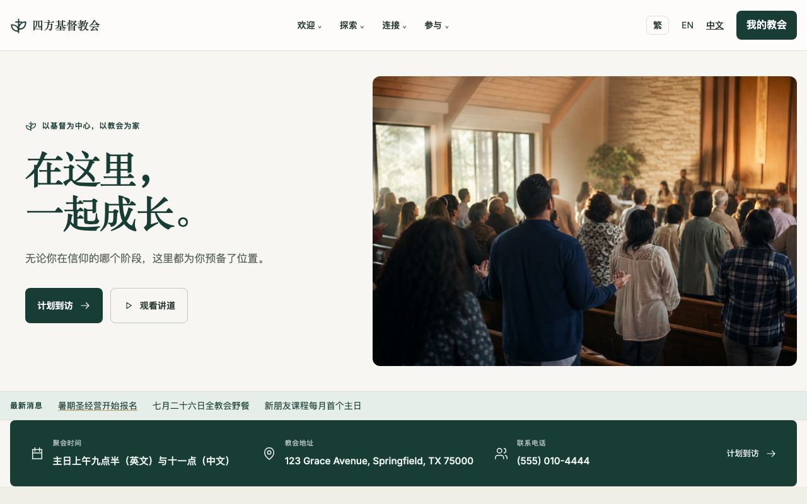
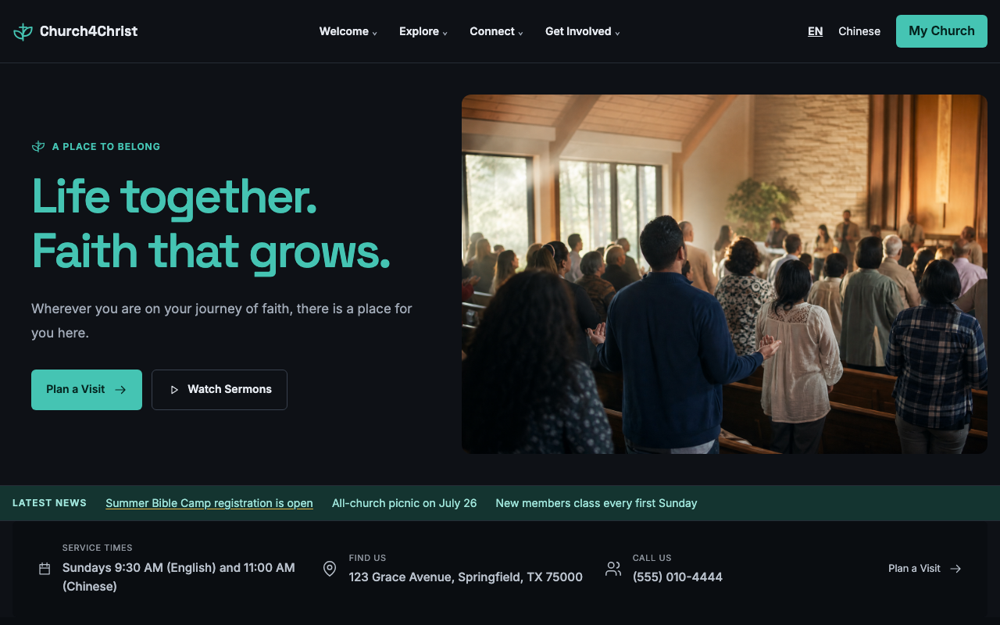
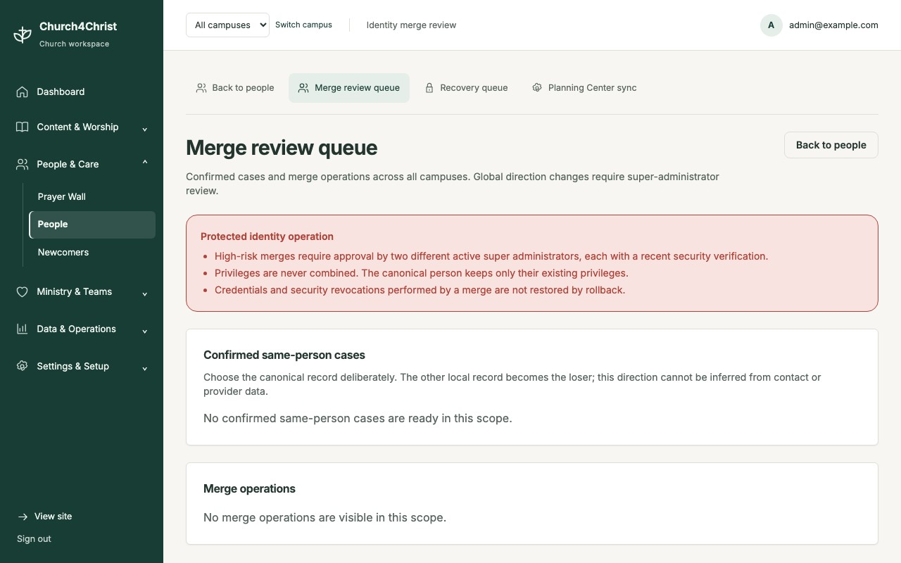
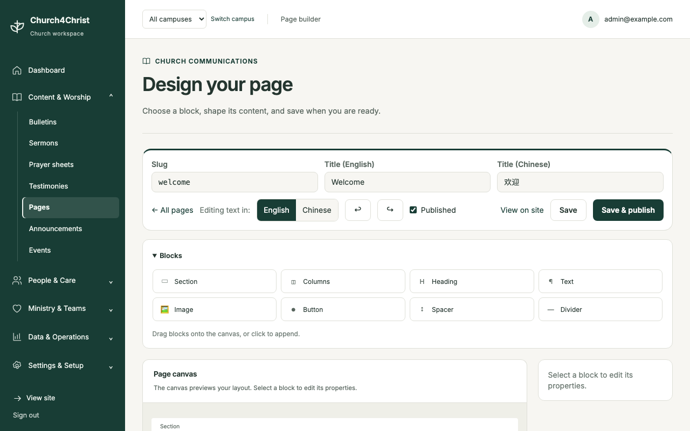

# Church4Christ: 오픈소스 교회 관리 소프트웨어와 교회 웹사이트

<p align="center"></p>

<p align="center"><a href="README.md">English</a> · <a href="README.zh.md">简体中文</a> · <a href="README.es.md">Español</a> · <a href="README.pt.md">Português (Brasil)</a> · <a href="README.fr.md">Français</a> · <a href="README.de.md">Deutsch</a> · <a href="README.ja.md">日本語</a> · <b>한국어</b> · <a href="README.ms.md">Bahasa Melayu</a> · <a href="README.id.md">Bahasa Indonesia</a> · <a href="README.vi.md">Tiếng Việt</a> · <a href="README.hi.md">हिन्दी</a></p>

*이 문서는 [README.md](README.md)의 번역본이며, 공식 기준은 영어 README.md입니다. AI의 도움으로 번역했으며, 원어민의 수정 제안을 환영합니다.*

[](https://github.com/leveo/church4christ/actions/workflows/ci.yml)
[](https://github.com/leveo/church4christ/releases)
[](LICENSE)
[](https://astro.build/)
[](https://workers.cloudflare.com/)
[](docs/i18n.md)

**AI 네이티브 오픈소스 교회 관리 시스템(ChMS)이자 교회 CMS입니다. 영어와 중국어를 포함한 12개 화면 언어로 제공되는 다국어 교회 웹사이트를 갖추고 있습니다. 직접 호스팅할 수 있는 모듈형 Planning Center 대안으로, 소규모·중규모 교회, 교제 모임, 비영리 단체를 위해 Astro와 Cloudflare Workers 위에 만들었습니다.**

사람과 가정, 소그룹, 봉사 일정, 어린이 체크인, 출석, 새가족 후속 돌봄, 기도 돌봄, 설교, 주보, 행사, 그리고 선택 사항인 교인 포털, 헌금 장부, 행사 등록까지, 직접 읽고 바꾸고 호스팅할 수 있는 하나의 코드베이스에 담았습니다.

**웹사이트: [church4christ.org](https://church4christ.org) · 라이브 데모: [demo.church4christ.org](https://demo.church4christ.org).**

[](https://church4christ.yunfei-song.com/C4C-modular-Voice.mp4)

데모 사이트의 홍보 영상 **[Built Around Your Ministry](https://church4christ.yunfei-song.com/C4C-modular-Voice.mp4)**(MP4)를 보세요.

**여기서 시작하세요: [사람과 AI 에이전트를 위한 설치 안내](docs/setup.md).** `npm run onboard`를 실행하면 로컬 브라우저 페이지에서 단체의 이름, 색상, 로고, 처음 사용할 기능을 고를 수 있습니다. 저장된 설정은 기존 설치 프로그램에 그대로 전달됩니다. 코딩 에이전트는 [AGENTS.md](AGENTS.md)부터 읽고, Claude는 [CLAUDE.md](CLAUDE.md)도 읽습니다.

Church4Christ는 다국어 공개 사이트와, 콘텐츠·기도 돌봄·봉사 일정·사람과 가정을 위한 관리 시스템을 하나로 합쳤습니다. 선택 모듈을 더하면 교인 포털과 그 밖의 교회 관리 업무 흐름을 쓸 수 있습니다. 이 프로젝트는 맞춤형 도입에 드는 초기 비용과 지속적인 유지 관리 비용을 낮추면서, 코드와 배포 설정은 운영하는 쪽에서 계속 가지고 있게 하는 것을 목표로 합니다.

**현재 소스 릴리스는 1.7입니다**. Church4Christ는 오픈소스 기반일 뿐, 바로 쓸 수 있는 관리형 서비스가 아닙니다. 로컬에서 평가하는 것은 무료이고, 일부 배포는 제공업체의 무료 한도 안에서 운영할 수 있습니다. 하지만 운영 환경의 호스팅, 이메일, 데이터베이스, 도메인, 백업 등의 서비스는 구성과 사용량에 따라 요금이 청구될 수 있습니다. 운영 환경을 정하기 전에 [배포 유형과 비용](#배포-유형과-비용)을 확인하세요.

|  |  |  |
|---|---|---|
|  |  |  |
|  |  |  |
|  |  |  |

**핵심 모듈마다 전용 작업 공간이 있습니다.** 기본 Sanctuary 디자인은 따뜻한 아이보리 바탕과 숲 녹색 내비게이션에, 작업마다 어울리는 레이아웃을 더했습니다. 로컬 미리보기가 있는 게시 편집기, 사람과 가정 기록, 돌봄 대기열, 봉사 매트릭스, 터치에 알맞은 어린이 체크인, 과정 재생기, 헌금 장부가 그 예입니다. 공개용, 교인용, 리더용, 관리자용 메뉴는 활성화된 모듈과 각 사람의 권한에 따라 달라집니다. Harvest와 Midnight 테마도 쓸 수 있으며, 라이트 모드와 다크 모드를 지원합니다. [21개 모듈 디자인 목록](docs/design/module-coverage.md)을 참고하세요.

스크린샷에는 저장소에 들어 있는 가상의 데모 콘텐츠를 썼습니다. 처음 설치할 때 이 예시를 포함할지, 빼고 시작할지 고를 수 있으며, 어느 쪽을 골라도 레이아웃, 테마, 기본으로 들어 있는 이미지는 같습니다. 영어 페이지는 영어 화면과 데모 문구를 쓰고, 중국어 페이지는 중국어와 이중 언어 콘텐츠를 지원합니다. 화면 스크린샷 29장은 모두 실행 중인 애플리케이션에서 다시 캡처했습니다. [캡처 목록과 재생성 명령](docs/design/readme-screenshot-inventory.md)을 참고하세요.

**묶음 내비게이션.** 모든 기능을 켠 사이트는 공개 메뉴를 환영, 둘러보기, 연결, 참여하기의 네 묶음으로 정리합니다. 기본 제공 링크는 대상 묶음에 그대로 있고, 사용자 지정 페이지와 외부 링크는 더 보기 아래에 나타납니다. 관리 → 탐색 메뉴에서 저장한 순서는 각 묶음 안에서 유지되고, 비어 있는 묶음은 사라집니다.


12개 화면 언어를 기본으로 제공합니다. 영어와 중국어에 더해 스페인어, 브라질 포르투갈어, 프랑스어, 독일어, 일본어, 한국어, 말레이어, 인도네시아어, 베트남어, 힌디어입니다. 각 교회는 설치할 때, 또는 나중에 설정 → 언어에서 사이트가 제공할 언어와 기본 언어를 고릅니다. 나중에 추가된 10개 언어 번역은 AI의 도움으로 만들었으며, 원어민의 수정 제안을 환영합니다. 바로 쓸 수 있는 세 가지 디자인과, 더 맞춤화하기 위한 모듈형 출발점도 함께 들어 있습니다.

---

## 누구를 위한 것인가요?

Church4Christ는 소규모·중규모 교회, 교제 모임, 비영리 단체를 위한 것입니다. 특히 공개 웹사이트와 맞춤 설정이 가능한 교회 관리 기반이 필요한 다국어 회중과 이민자 회중에 알맞습니다. 기술에 익숙한 교역자, 봉사자, 또는 구축 파트너가 배포와 유지 관리를 맡을 수 있을 때 가장 잘 맞습니다. 소스 수준의 맞춤 설정보다 업체가 설치, 지원, 업그레이드, 운영 책임을 맡아 주는 쪽을 원하는 단체라면, 관리형 플랫폼이 더 나을 수 있습니다.

## 이 방식은 다른 방식과 어떻게 다른가요?

제품 종류마다 충족하는 필요가 다르고, 제공업체의 약관도 제각각입니다. 아래 표는 운영 방식을 비교한 것이며, 모든 경우에 통하는 가격, 이식성, 데이터 권리를 약속하는 것이 아닙니다.

| | **Church4Christ** | **직접 관리하는 플러그인형 CMS** | **호스팅형 사이트 빌더** | **관리형 교회 플랫폼** |
|---|---|---|---|---|
| **주된 용도** | 맞춤형 다국어 웹사이트와 모듈형 교회 업무 흐름 | 플러그인으로 조립하는 확장형 콘텐츠 웹사이트 | 제공업체가 관리하는 공개 웹사이트 | 제공업체가 관리하는 교회 업무 흐름 |
| **비용 구조** | 인프라와 서비스 사용료이며, 일부 유형은 무료 한도 안에 들어갈 수 있음 | 호스팅, 확장 기능, 유지 관리 | 구독료와 부가 기능 | 구독료이며, 흔히 요금제나 모듈별로 부과 |
| **맞춤 설정** | 소스 수준의 변경과 선택 모듈 | 테마, 플러그인, 가능한 경우 소스 변경 | 제공업체가 지원하는 템플릿과 확장 기능 | 제공업체가 지원하는 설정과 연동 |
| **운영** | 우리 팀이나 구축 파트너가 배포, 업데이트, 모니터링, 백업을 맡음 | 우리 팀이나 호스팅 업체가 코어와 플러그인 관리를 맡음 | 제공업체가 플랫폼 운영 대부분을 맡음 | 제공업체가 플랫폼 운영 대부분을 맡음 |
| **이식성** | 코드와 데이터베이스에 접근할 수 있어 이전은 가능하지만, 이전 작업은 수동 | 호스팅, 플러그인, 형식에 따라 다름 | 제공업체의 내보내기 기능과 약관에 따라 다름 | 제공업체의 내보내기 기능, API, 약관에 따라 다름 |
| **언어 출발점** | 12개 화면 언어를 기본 제공하며, 교회마다 필요한 언어를 선택 | 선택한 확장 기능에 따라 다름 | 서비스와 요금제에 따라 다름 | 서비스와 요금제에 따라 다름 |

**감수해야 할 점.** Church4Christ는 Cloudflare Workers와 그 바인딩에 맞춰 최적화되어 있습니다. 다른 호스팅 환경으로 옮기는 것은 소스를 고치면 가능하지만, 공식 지원하는 원클릭 방식은 아닙니다. D1에서 Supabase로 콘텐츠를 자동 이전하는 기능도 없습니다. 기본 제공 페이지의 모양은 테마가 정하며, 드래그 앤 드롭 편집은 사용자 지정 페이지에만 적용됩니다. 프로젝트에 버전이 있기는 하지만, 도입하는 쪽은 구현 작업과 신중하게 검토한 업그레이드가 필요하다고 보아야 합니다.

프로젝트를 운영한다는 것은 곧 유지 관리한다는 뜻입니다. 기술 담당자는 의존성 업데이트, 보안 검토와 설정, 모니터링, 백업과 복원 테스트, 수정 사항 배포를 계속 책임져야 합니다. 이 아키텍처가 인프라 작업을 일부 줄여 주기는 하지만, 보안과 운영 관리까지 없애 주지는 않습니다. 설계 배경은 [**`docs/why-this-stack.md`**](docs/why-this-stack.md)를 참고하세요.

## 오픈소스 Planning Center 대안을 찾고 계신가요?

Planning Center, Breeze, Church Community Builder 같은 호스팅형 교회 관리 소프트웨어의 무료 또는 직접 호스팅 대안을 찾는 교회 대부분은 두 가지를 원합니다. 자기 데이터를 스스로 통제하는 것, 그리고 같은 기록을 함께 쓰는 웹사이트입니다. Church4Christ는 직접 호스팅하는 하나의 애플리케이션으로 일상적인 교회 관리의 상당 부분을 다룹니다.

| 흔한 ChMS 필요 | Church4Christ |
|---|---|
| 사람과 가정 명부 | CSV 가져오기, 저장 가능한 원본 열 매핑, 내보내기를 지원하는 [사람과 가정](docs/features/people-households.md) |
| 소그룹 | 공개 명부, 가입 요청, 행사, 출석을 갖춘 [그룹](docs/features/groups.md) |
| 봉사자 일정 관리 | 월간 매트릭스와 이메일 확인을 지원하며 로그인이 필요 없는 [봉사 일정](docs/features/volunteer-serve.md) |
| 예배 계획 | 예배와 행사를 위한 [예배 순서지, 리허설, 가능 시간, 캘린더](docs/features/service-planning.md) |
| 어린이 체크인 | 픽업 코드와 출석 차트를 갖춘 [키오스크 체크인](docs/features/children-checkin.md) |
| 출석과 참여도 | [예배 출석](docs/features/service-attendance.md)과 [활동 점수](docs/features/activity-score.md) |
| 새가족과 돌봄 후속 조치 | [새가족 대기열](docs/features/newcomers.md), [기도 게시판](docs/features/prayer-wall.md), [공동체 업무 흐름](docs/features/community-workflows.md) |
| 교회 웹사이트와 CMS | [공개 사이트, 테마, 설교, 주보, 페이지 빌더](docs/features/public-site-and-themes.md) |
| 교인 셀프서비스 | [교인 포털](docs/features/member-portal.md)(가정, 그룹, 기도. D1 또는 Supabase에서 실행) |
| 여러 캠퍼스 | 캠퍼스별로 데이터와 역할이 분리되는 [다중 캠퍼스](docs/features/multi-campus.md) |

**Planning Center에서 점진적으로 옮겨 오기.** 선택 사항인 읽기 전용 [Planning Center People 동기화](docs/deploy.md#9-optional-configure-planning-center-synchronization)는 Planning Center의 인물 기록을 Church4Christ에 이미 있는 사람과 연결하고, 모호한 일치는 사람이 검토하도록 넘깁니다. 그래서 전환 기간에 두 시스템을 나란히 운영할 수 있습니다. 사람 정보는 CSV 가져오기 도구와 재사용 가능한 열 매핑으로 옮겨 옵니다.

**아직 대체하지 못하는 부분.** 네이티브 모바일 앱, 문자 메시지, 찬양곡 라이브러리, 예배 찬양곡 계획은 없습니다(예배 흐름 모듈은 예배 순서지와 리허설을 다룹니다). Stripe를 통한 온라인 헌금(카드와 계좌 이체)은 서비스 시작 체크리스트를 마칠 때까지 테스트 모드로 실행되며, 유료 행사 등록도 같은 Stripe 모드를 씁니다. 헌금 모듈은 수표와 현금도 오프라인 장부에 기록하고 연간 헌금 내역서를 만들어 줍니다. Church4Christ는 우리 팀이 직접 운영하고 유지 관리하는 기반이며, 업체의 지원이 따르는 호스팅형 서비스가 아닙니다.

Planning Center를 비롯해 위에서 언급한 다른 제품 이름은 각 소유자의 상표입니다. Church4Christ는 독립된 프로젝트이며 이들과 제휴 관계가 없습니다.

---

## 일부 기능만 필요하신가요?

작게 시작해서 나중에 키우세요. 단일 기능 에디션은 모두 이 저장소를 설치하되 한 영역만 켜고, 기본 Cloudflare D1 데이터베이스를 쓰는 방식입니다.

| 필요한 것 | 시작할 곳 | 프리셋 |
|---|---|---|
| 어린이 체크인 키오스크 | [church-checkin](https://github.com/leveo/church-checkin) | `checkin` |
| 봉사 일정 | [church-volunteer-scheduling](https://github.com/leveo/church-volunteer-scheduling) | `volunteer-scheduling` |
| 소그룹 관리 | [church-small-groups](https://github.com/leveo/church-small-groups) | `small-groups` |
| 행사 등록과 체크인 | [church-event-registration](https://github.com/leveo/church-event-registration) | `event-registration` |
| 교회 웹사이트와 CMS | [church-website-cms](https://github.com/leveo/church-website-cms) | `website` |

이 에디션들에는 별도의 코드가 없으므로 따로 유지 관리할 것이 없습니다. 에디션을 건너뛰고 여기서 바로 `npm run onboard -- --preset checkin`을 실행해도 됩니다. **설정 → 모듈**에서 언제든 기능을 더 켤 수 있습니다. [단일 기능 에디션](docs/editions.md)을 참고하세요.

---

## AI 어시스턴트와 함께 만들기

사람과 에이전트는 같은 브라우저 온보딩, 설치 프로그램, 기능 카탈로그, 준비 상태 점검을 함께 씁니다. [AGENTS.md](AGENTS.md)와 [CLAUDE.md](CLAUDE.md)는 어시스턴트가 먼저 기존 설치 상태를 살펴보고, 설정이 없는 새 설치에서는 `npm run onboard`를 실행해 양식 작성을 사용자에게 맡기도록 안내합니다. 답변은 Git이 무시하는 `.church/preferences.json`에 저장되며, 이후 세션에서는 이 파일을 읽고 단체의 이름, 브랜드, 기능 선택을 그대로 따릅니다. [설치 안내](docs/setup.md)에 명령어와 복구 절차가 있습니다. 어시스턴트는 이렇게 시작하세요.

> "AGENTS.md와 docs/setup.md를 읽어 주세요. 우리 단체의 브랜드와 처음 쓸 기능을 제가 고를 수 있도록 브라우저 온보딩을 시작해 주세요. 제가 저장한 설정으로 로컬 미리보기를 만들고, 사이트와 관리자 페이지를 확인한 다음, URL과 남은 점검 사항을 알려 주세요."

모든 변경을 손으로 직접 할 필요는 없습니다. 이 저장소는 AI 코딩 어시스턴트가 [`docs/features/`](docs/features/)의 쉬운 말로 쓴 안내서를 따르고, 폭넓은 자동 테스트를 바탕으로 작업할 수 있게 구성되어 있습니다. 그러면 맞춤 설정과 유지 관리의 수고를 줄일 수 있지만, 유지 관리자가 변경 사항을 검토하고, 관련 테스트를 실행하고, 신중하게 배포해야 한다는 점은 그대로입니다.

생각은 이렇습니다. AI 어시스턴트로 이 프로젝트를 열고, 원하는 것을 평소 말투로 설명한 다음, 편집은 맡기는 것입니다. 그대로 붙여 넣을 수 있는 실제 예시를 몇 가지 소개합니다.

> "`docs/features/public-site-and-themes.md`를 읽고, 우리 대표 색상을 로열 블루로 바꾼 다음 홈페이지를 보여 주세요."

> "`docs/i18n.md`를 따라 이탈리아어(`it`) 로케일을 추가해 주세요."

> "docs/setup.md를 따라 데모 콘텐츠 없이 우리 교회를 설정해 주세요. 설치 계획과 준비 상태 결과를 보여 준 다음, docs/deploy.md를 써서 배포를 준비해 주세요."

같은 방식을 유지 관리에도 쓸 수 있습니다. 변경할 내용을 설명하고, 제안된 diff를 살펴보고, 로컬에서 테스트한 뒤, 결과를 검토하고 나서 배포하세요. AI의 도움이 보안 판단, 백업, 운영 환경 테스트, 운영 책임을 대신해 주지는 않습니다.

---

## 우리의 사명

**맞춤형 교회 관리 시스템과 다국어 웹사이트를 시작하는 데 드는 비용과 수고를 줄이는 것.** Church4Christ는 교회나 구축 파트너가 처음부터 시작하는 대신 가져다 고쳐 쓸 수 있는, 검증된 모듈형 기반을 제공합니다. 구독료가 없거나 예산이 전혀 들지 않는 운영 서비스를 약속하지는 않습니다. 인프라, 이메일, 데이터베이스, 도메인, 지원, 유지 관리를 어떻게 선택하느냐가 실제 운영 비용을 결정합니다.

---

## 들어 있는 기능

모든 기능에는 쉬운 말로 쓴 전용 안내서가 있습니다. 아래 어느 것으로든 시작해 보세요.


| | 기능 | 하는 일 |
|---|---|---|
| [](docs/features/public-site-and-themes.md) | **[공개 사이트와 테마](docs/features/public-site-and-themes.md)** | 교회의 얼굴이 되는 홈, 설교, 행사, 교역자 소개를 바로 쓸 수 있는 세 가지 디자인 중 하나로 보여 줍니다. |
| [](docs/features/cms-admin.md) | **[관리 영역](docs/features/cms-admin.md)** | 비밀번호 없는 로그인, 역할, 그리고 지원되는 버전 관리 편집 콘텐츠의 원클릭 복원. |
| [](docs/features/admin-permissions.md) | **[관리자 권한](docs/features/admin-permissions.md)** | 각 관리자에게 필요한 영역만 부여합니다. 기도 게시판과 교인 명부는 기본으로 쓸 수 있고, 나머지는 선택해서 부여합니다. |
| [](docs/features/multi-campus.md) | **[다중 캠퍼스](docs/features/multi-campus.md)** | 하나의 백엔드에서 여러 캠퍼스를 운영하며, 데이터, 설정, 기능, 캠퍼스 내 역할이 분리됩니다. 모든 캠퍼스를 볼 수 있는 것은 마스터 관리자뿐입니다. |
| [](docs/features/bulletins.md) | **[주간 주보](docs/features/bulletins.md)** | 주일 예배 주보를 만들고, 알아서 게시되도록 예약합니다. |
| [](docs/features/sermons.md) | **[설교 아카이브](docs/features/sermons.md)** | YouTube 링크를 붙여 넣으면, 검색할 수 있고 빠르게 열리는 지난 설교 라이브러리가 만들어집니다. |
| [](docs/features/prayer-wall.md) | **[기도 게시판](docs/features/prayer-wall.md)** | 기도 제목을 받아 간단한 보드에서 비공개로 다룹니다. |
| [](docs/features/volunteer-serve.md) | **[봉사 일정](docs/features/volunteer-serve.md)** | 한 달 치 봉사를 한눈에 계획합니다. 봉사자는 로그인 없이 이메일로 확인합니다. |
| [](docs/features/people-households.md) | **[사람과 가정](docs/features/people-households.md)** | 프로필과 가정에 더해, 이전을 위한 표준 생성 전용 CSV 내보내기와 재사용 가능한 원본 열 매핑을 제공합니다. |
| [](docs/features/member-identity.md) | **[교인 신원 안전](docs/features/member-identity.md)** | 헌금, 행사 등록, 그룹, 팀, 새가족, 가져오기 전반에 걸친 증빙 기반 신원 확인. 모호한 중복은 이름만으로 합치지 않고 검토로 넘기며, 일회용 비밀번호(OTP)에 묶인 승인과 보호된 24시간 롤백을 갖췄습니다. |
| [](docs/features/groups.md) | **[그룹](docs/features/groups.md)** | 공개 명부, 구성원 체크리스트, 가입 요청, 행사, 사람별 이메일 링크 출석을 갖춘 소그룹. |
| [](docs/features/children-checkin.md) | **[어린이 체크인](docs/features/children-checkin.md)** | 부모가 픽업 코드로 아이를 맡기고 데려가는 터치 친화적 키오스크와 주간 출석 차트. |
| [](docs/features/service-attendance.md) | **[예배 출석](docs/features/service-attendance.md)** | 성인 합계를 기록하고, 체크인에서 어린이 수를 선택적으로 산출하며, 지난 기록을 바로잡고, 신원 정보가 없는 CSV 보고서를 내려받습니다. |
| [](docs/features/newcomers.md) | **[새가족 후속 돌봄](docs/features/newcomers.md)** | 동의를 받은 이중 언어 공개 카드를 접수하고, 범위가 제한된 교역자 대기열에서 분류하며, 정확히 일치하는 사람을 메모나 답변이 새어 나가지 않게 사람 관리로 넘깁니다. |
| [](docs/features/onboarding-readiness.md) | **[서비스 시작 준비](docs/features/onboarding-readiness.md)** | 설치 프로그램, doctor, 실제 관리자 모두가 함께 쓰는 하나의 이중 언어 체크리스트이며, 수동 점검 항목은 최고 관리자가 확인 처리합니다. |
|  | **[예배 흐름](docs/features/service-planning.md)** | 시간이 있는 예배 순서지, 호출된 사람이 참여하는 리허설, 교인의 가능 시간, 시간 찾기 검색, 캘린더, 자동 이메일을 계획합니다. |
|  | **[활동 점수](docs/features/activity-score.md)** | 선택한 개인 연동 활동을 합쳐 근거를 설명할 수 있는 교인 점수와 교회 전체의 참여도 요약을 만듭니다. |
| [](docs/features/learning.md) | **[학습](docs/features/learning.md)** | 이중 언어 영상, 파일, 과제, 퀴즈, 제공업체와 동기화된 상태로 주일학교와 제자훈련을 모임과 모임 사이에도 이어 갑니다. |
| [](docs/features/page-builder.md) | **[페이지 빌더](docs/features/page-builder.md)** | 드래그 앤 드롭으로 나만의 사용자 지정 페이지를 만듭니다. 다국어를 지원하고, 늘 테마에 맞으며, 게시된 페이지는 JavaScript 없이 로드됩니다. 선택 사항이며, 끄더라도 이미 만든 페이지는 망가지지 않습니다. |
| [](docs/features/giving.md) | **[헌금](docs/features/giving.md)** | 구현됨: Stripe를 통한 온라인 헌금(기본은 테스트 모드이고, 서비스 시작 체크리스트를 마친 뒤 실제 모드), 수표와 현금을 위한 오프라인 장부, 연간 헌금 내역서. |
| [](docs/features/registration.md) | **[행사 등록](docs/features/registration.md)** | 구현됨: D1이나 Supabase에서 동작하는 무료 행사 신청, 사용자 지정 질문, 대기자 명단, 행사 단계, 명단 내보내기, 그리고 Supabase에서 헌금과 같은 Stripe 모드를 쓰는 Stripe 유료 결제(의존하기 전에 소액으로 실제 등록을 해 보며 확인하세요). |
|  | **[행사 배정](docs/features/event-logistics.md)** | 행사 등록의 선택 추가 기능: 사람들을 방에 배정하고, "자동 좌석 배정" 미리 보기로 테이블 좌석을 정하고, 소그룹으로 나누고, 방 명단, 문 안내판, 테이블 카드를 인쇄합니다. |
| [](docs/features/member-portal.md) | **[교인 포털](docs/features/member-portal.md)** | 현재 참여 중인 활동과 참여할 수 있는 기회를 한곳에 모은 로그인 허브이며, 가정 프로필, 행사, 봉사, 캘린더, 헌금, 범위가 제한된 기도도 함께 제공합니다. |
| [](docs/features/i18n.md) | **[열두 개 언어](docs/features/i18n.md)** | 사이트마다 12개 화면 언어 중에서 고를 수 있고, 영어로 대체되며, 중국어 간체를 번체로 바꾸는 원클릭 변환도 있습니다. |
| [](docs/features/email-automation.md) | **[이메일과 자동화](docs/features/email-automation.md)** | 로그인 링크, 알림, 요약 메일을 제공하며, 로컬에서는 기록만 남기고 유료 서비스도 쓸 수 있는 운영 환경 구성을 갖췄습니다. |
| [](docs/features/modules.md) | **[모듈](docs/features/modules.md)** | 쓰지 않는 기능은 끕니다. 아무것도 삭제되지 않으며 언제든 다시 켤 수 있습니다. |

**모듈을 고르세요.** 선택 가능한 업무 영역 대부분은 설정의 한 패널에서 끌 수 있는 **모듈**입니다. 주보, 설교, 기도 게시판, 봉사 일정 등이 그렇습니다. 새로 설치하면 설치할 때 고른 내용에 따라 모든 모듈 설정이 명시적으로 기록됩니다. Full Church 데모는 그중 21개를 선택합니다(예배 흐름과 행사 배정은 따로 켭니다). 오래된 설치에서만, 빠져 있는 모듈 행은 예전처럼 기본으로 켜진 상태가 유지됩니다. 예배 시간과 설교만 필요한 교회는 클릭 한 번으로 나머지를 숨길 수 있습니다. 해당 모듈의 페이지, 링크, 이메일이 함께 사라지며, 아무것도 삭제되지 않습니다. [**`docs/features/modules.md`**](docs/features/modules.md)를 참고하세요.

| Key | English | 中文 | Required database |
|---|---|---|---|
| `bulletins` | Bulletins | 周报 | Either |
| `sermons` | Sermons | 讲道 | Either |
| `prayer-sheets` | Prayer Sheets | 祷告单 | Either |
| `prayer-wall` | Prayer Wall | 祷告墙 | Either |
| `events` | Events | 活动 | Either |
| `serve` | Volunteer Scheduling | 服事排班 | Either |
| `gifts` | Spiritual Gifts | 恩赐探索 | Either |
| `testimonies` | Testimonies | 见证 | Either |
| `articles` | Articles | 文章 | Either |
| `fellowships` | Fellowships | 团契 | Either |
| `groups` | Groups | 小组 | Either |
| `people` | People & Households | 会友与家庭 | Either |
| `children` | Children Check-in | 儿童报到 | Either |
| `attendance` | Service Attendance | 崇拜出席 | Either |
| `newcomers` | Newcomer Follow-up | 新朋友跟进 | Either |
| `activity-score` | Activity Score | 活跃度评分 | Either |
| `page-builder` | Page Builder | 页面编辑器 | Either |
| `portal` | Member Portal | 会友平台 | Either |
| `giving` | Giving | 奉献 | Supabase |
| `registration` | Registration | 活动报名 | Either |
| `learning` | Learning | 学习 | Either |
| `planning` | Service Planning | 服事流程 | Either |
| `event-logistics` | Event Logistics | 活动后勤 | Either |

### 공동체 관리와 업무 흐름

캠퍼스는 그룹과 교인 후속 돌봄을 직접 관리할 수 있습니다. 선택 사항인 교제 모임은 독립된 구성원 관계와 하위 그룹을 가진 공동체 계층을 더해 줍니다. 재사용 가능한 업무 흐름에는 담당자가 지정된 단계, 기한, 완료 추적, Cloudflare 이메일 알림이 있습니다. 설정, 권한, 발송 제어는 [공동체 업무 흐름 안내](docs/features/community-workflows.md)를 참고하세요.

### 주일 너머의 학습

버전 1.1에는 주일학교, 제자훈련, 그 밖에 모임과 모임 사이에도 이어지는 사역을 위한 선택 모듈 **학습**이 추가되었습니다. 학습자는 비공개 YouTube 영상, 파일, 과제, 퀴즈를 담은 이중 언어 과정 화면을 볼 수 있으며, 개인정보 범위가 제한됩니다. 제출은 여전히 제공업체가 기준입니다. 사이트가 숙제, 답안, 댓글, 성적, 파일 내용을 직접 모으지 않고, 학습자를 설정된 제공업체로 안내합니다.

관리자는 공식 API를 통해 Google Classroom을 연결하거나, 별도로 운영하는 Church4Christ Canvas 파생판을 연결할 수 있습니다. 과정 매핑, 암호화된 OAuth 자격 증명, 서명된 제공업체 알림, 수동 동기화, 한도가 있는 정기 대조를 통해 Church4Christ에 필요한 활동 메타데이터만 들어옵니다.


| 영어 학습자 화면 | 중국어 학습자 화면 | 제공업체 관리 |
|---|---|---|
| [](docs/images/learning/genesis-1-en.png) | [](docs/images/learning/genesis-1-zh.png) | [](docs/images/learning/admin-overview.png) |

제공업체 설정, 개인정보 경계, 동기화 한도, 창세기 1장 데모, 그리고 별도로 운영하는 Canvas의 운영 방식과 해당 소스 요건은 **[학습 기능 안내](docs/features/learning.md)**를 참고하세요.

### 교인을 위한 공간

선택 모듈인 **교인 포털**은 교회가 이미 관리하고 있는 기록을 로그인 후에 쓸 수 있는 유용한 경험으로 바꿔 줍니다. 기회 안내 페이지는 활성화된 모든 배움, 소속, 봉사의 길을 한곳에 보여 줍니다. 그 교인이 이미 속한 그룹, 반, 팀과, 지금 가입하거나 지원할 수 있는 기회를 모두 보여 줍니다. 교인은 가정 정보를 수정하고, 자신의 헌금 내역을 확인하고, 행사에 등록하고, 봉사 일정을 살펴보고, 개인 캘린더를 구독하고, 범위가 제한된 기도를 나눌 수도 있습니다. Church4Christ의 다른 부분과 같은 비밀번호 없는 로그인 링크를 쓰므로, 새 계정이나 비밀번호를 기억할 필요가 없습니다.


사역, 그룹, 주일학교, 봉사팀의 리더는 `/<locale>/manage`에서 리소스 범위가 제한된 패널을 씁니다. 교회 앱 로그인이 이를 보호하며, 모든 작업은 해당 리소스에 대한 리더의 권한을 확인합니다. 그래서 Cloudflare Zero Trust는 전체 `/admin` 영역에만 적용해 두면 됩니다.


포털은 기본 D1 백엔드와 선택 사항인 **Supabase(Postgres)** 백엔드 모두에서 실행됩니다. 가정, 그룹, 보호된 그룹 파일, 교회·그룹·비공개 기도의 중재는 D1에서 동작합니다. 행사 단위 기도, 행사 관리자, "내 등록"에는 행사 등록이 필요하며, 행사 등록을 켜면 무료 행사는 D1에서 동작합니다. 자세한 내용은 [**`docs/features/member-portal.md`**](docs/features/member-portal.md)를 참고하세요.

---

## 5분 만에 체험하기 (내 컴퓨터에서)

배포 방식을 정하기 전에, 가상의 샘플 콘텐츠를 넣을지 선택하면서 사이트를 로컬에서 실행해 볼 수 있습니다. [Node.js](https://nodejs.org/) 22.22.1 이상이 설치되어 있어야 합니다. 브라우저 온보딩은 첫 서비스 시작에 **Cloudflare D1**을 쓰는 **Website + Community**를 권장합니다.


```bash
# 1. Get the code and install it
git clone https://github.com/leveo/church4christ.git
cd church4christ
npm ci

# 2. Open the local browser form, complete it, and save your preferences
npm run onboard

# 3. Review the plan, then initialize with those same preferences
node scripts/setup/index.mjs --preferences .church/preferences.json --yes --dry-run --json
node scripts/setup/index.mjs --preferences .church/preferences.json --yes --json

# 4. For D1, start it (always follow the exact handoff setup prints)
npm run dev
```

양식은 교회인지, 비영리 단체인지, 캠퍼스인지 묻고, 이름, 한 줄 소개, 주소, 시간대, 대표 색상과 보조 색상, 선택 사항인 PNG/JPEG/WebP 로고(최대 2 MiB), 언어, 첫 번째 관리자, 데모 콘텐츠 선택을 받습니다. 필요한 기능에만 체크하세요. 권장 선택은 데이터베이스로 D1을 씁니다. 애플리케이션은 계속 Cloudflare Workers에서 실행되고 미디어는 R2에 저장됩니다. **헌금과 유료 행사 등록**은 고급 옵션으로, Supabase 호환 PostgreSQL로 명시적으로 전환해야 합니다.

저장하면 `.church/preferences.json`과 업로드한 로고가 `.church/` 아래에 기록되며, Git은 이 폴더를 무시합니다. 데이터베이스를 만들거나 사이트를 배포하지는 않습니다. `npm run onboard`를 다시 실행하면 저장된 설정을 불러와 수정할 수 있습니다. 양식을 작성하는 동안 터미널을 계속 켜 두고, 끝나면 Ctrl+C로 멈추세요. 출력된 URL을 직접 열려면 `npm run onboard -- --no-open`을 쓰고, 포트를 고르려면 `--port 4310`을 덧붙입니다. 직접 진입점은 `node scripts/onboard/index.mjs`입니다. 설치 프로그램이 무엇을 적용하는지, 그리고 에이전트가 나머지 설정을 어떻게 쓰는지는 [설치 안내](docs/setup.md)를 참고하세요.

`npm ci --ignore-scripts`로 설치했다면, 설치 프로그램이나 `npm run dev`를 실행하기 전에 `npm run tokens`를 직접 실행하세요.

로컬 Supabase의 경우, 인계 안내는 대신 `npm run dev` 전에 호스트 셸에서 `CLOUDFLARE_HYPERDRIVE_LOCAL_CONNECTION_STRING_HYPERDRIVE`를 export하도록 알려 줍니다. 이 연결 URL은 `.dev.vars`에 넣으면 안 됩니다.

처음 설치할 때 **데모 콘텐츠 포함** 또는 **데모 콘텐츠 없음**을 고르세요. 어느 쪽이든 기본 제공 디자인, 로컬 장식용 이미지, 활성화된 기능, 관리자 도구는 같습니다. 데모 콘텐츠를 고르면 가상의 사람, 설교, 주보, 행사, 사역 등의 예시가 추가됩니다. 미디어 단계에서는 `seed/media/`에서 생성된 이미지 묶음을 로컬 R2로 복사합니다. 데모 콘텐츠 없음을 고르면 샘플 업무 기록 없이 데이터베이스 스키마, 운영 기본값, 교회 설정, 모듈 선택, 첫 번째 관리자가 만들어집니다.

설정 파일에는 양식에서 고른 데모 콘텐츠 선택이 기록됩니다. 명시적인 CLI 답변으로 설치하려면 `--demo-data` 또는 `--no-demo-data`를 전달하세요. 비대화형 설치에서 둘 다 생략하면 기존 기본값인 데모 없음이 유지됩니다. 이 두 플래그는 함께 쓸 수 없습니다. 같은 설치를 반복해도 기록된 콘텐츠 선택과 기존 기록은 그대로 유지됩니다. `--no-demo-data`는 기존 데이터베이스를 지우지 않으며, 이미 사람이 있는 상태에서 데모 데이터를 추가하는 것을 설치 프로그램이 거부합니다. 다른 시작 모드를 시험하려면 별도의 새 작업 공간과 데이터베이스를 쓰세요.

설치 프로그램이 출력하는 주소(보통 `http://localhost:4321`)를 여세요.

**관리 영역에 로그인하기.** 비밀번호는 없습니다. 로그인 페이지에서 설치 답변에 적은 첫 번째 관리자 이메일(설치 인계 안내에도 다시 나옵니다)을 입력하고 링크를 요청하세요. 로컬 이메일은 발송하지 않고 출력하도록 설정되어 있으므로 **매직 링크 URL이 터미널에 바로 나타납니다**. 그것을 브라우저에 붙여 넣으면 로그인됩니다. (로컬에서 더 빠르게 테스트할 수 있도록, 설치 프로그램은 같은 주소를 `.dev.vars`에 `AUTH_DEV_BYPASS_EMAIL`로 기록하며, 그러면 자동으로 로그인됩니다. 실제 로그인 흐름을 테스트하려면 그 줄을 지우세요.)

두 콘텐츠 모드 모두에서 설치 프로그램은 새 관리자와 감사 대상이 되는 로그인 신원을 함께 만듭니다. 다시 실행해도 기존 연락처 소유 관계는 유지되며, 기존 이메일을 인증하거나 취소된 접근 권한을 되살리지는 않습니다. 설치 프로그램이 신원 문제를 알려 오면, 다시 실행하기 전에 [신원 검토 또는 복구 절차](docs/features/member-identity.md)를 마치세요.

터미널 전용 `npm run setup`도 계속 쓸 수 있습니다. 설치에서는 **Website**(게시에 집중한 8개 모듈), **Website + Community**(18개 모듈. D1에서는 교인 포털을 추가할 수 있음), **Full Church**(21개 모듈. 예배 흐름은 따로 켬)를 고를 수 있습니다. 헌금을 고르면 Supabase가 자동으로 선택되고(무료 행사 등록은 D1에서 동작합니다), D1 호환 선택은 백엔드를 명시적으로 바꾸지 않는 한 D1을 택합니다. 필요한 계정은 로컬 모드인지 배포 모드인지에 따라 다르며, 아래에서 자세히 설명합니다. 자동화하려면 `--yes`로 모든 답변을 전달하고, 기계가 읽을 수 있는 결과를 하나 받으려면 `--json`을 덧붙이세요. 사람이 읽을 수 있는 형태로 비대화형 실행을 하려면 같은 전체 플래그에 `npm run setup -- ... --yes`를 쓰고 `--json`은 생략하세요. npm을 거치면서도 stdout을 엄격한 JSON으로 유지하려면 조용한 형식을 쓰세요.

```bash
npm run --silent setup -- --mode local --preset website --site-slug my-church \
  --church-name "My Church" --locale en --admin-email admin@example.com \
  --admin-name "First Admin" --app-origin http://localhost:4321 \
  --email-from admin@example.com --demo-data --yes --json
```

---

## 배포 유형과 비용

이것은 계획을 세우기 위한 유형이며 가격을 보장하는 것이 아닙니다. 아래 가격은 **2026년 8월** 기준이고 바뀔 수 있으므로, 배포 전에 링크된 공식 가격 페이지에서 확인하세요.

| 유형 | 포함 범위 | 비용과 준비 상태 메모 |
|---|---|---|
| **로컬 평가** | 로컬 D1을 쓰는 웹사이트 또는 공동체 모듈, 호환되는 로컬 Postgres를 쓰는 전체 모듈 | 로컬 D1 평가에는 호스팅 서비스 요금이 필요하지 않습니다. 컴퓨터, 개발 시간, 선택적인 외부 서비스는 직접 준비해야 합니다. |
| **D1 웹사이트/공동체** | D1 호환 모듈 최대 22개를 위한 Cloudflare Worker, D1, R2 | 소규모 배포는 Cloudflare 무료 한도 안에 들어갈 수 있습니다. 트래픽, 저장 공간, 한도를 넘는 작업, 도메인, 그 밖의 서비스에는 비용이 들 수 있으니 [Workers 가격](https://developers.cloudflare.com/workers/platform/pricing/)을 확인하세요. 운영 환경 이메일은 별도입니다. |
| **운영 환경 이메일** | 임의의 수신자에게 보내는 로그인 링크, 알림, 요청, 요약 메일 같은 거래성 메일 | 이 저장소는 유료 서비스도 쓸 수 있는 Cloudflare 이메일 구성을 지원합니다. 임의의 수신자에게 보내려면 Workers Paid가 필요하며, 현재 최소 **월 $5**에 **3,000통**이 포함되고, 그 이후에는 **1,000통당 $0.35**입니다. 이 금액은 바뀔 수 있으니 [Cloudflare Email Service 가격](https://developers.cloudflare.com/email-service/platform/pricing/)을 확인하세요. |
| **Supabase/전체 모듈** | 교인 포털, 헌금, 행사 등록을 포함한 Full Church 모듈 21개를 위한 Cloudflare 배포와 Supabase/Postgres | Cloudflare 비용은 그대로 들며, 선택한 [Supabase 요금제](https://supabase.com/pricing)에 따라 구독료나 사용료가 더해질 수 있습니다. 2026년 8월 기준으로 Supabase Free에는 자동 일일 백업이 없고, 활동이 적은 Free 프로젝트는 7일간의 활동에 따라 [자동으로 일시 중지](https://supabase.com/docs/guides/platform/free-project-pausing)될 수 있습니다. 운영 환경에서는 정기적으로 외부에 데이터베이스 덤프를 보관하고 복원 훈련을 하거나, [백업 옵션](https://supabase.com/docs/guides/platform/backups)이 업무 연속성 요건을 충족하는 유료 요금제를 고르세요. 가격과 서비스 정책은 바뀔 수 있습니다. Stripe는 테스트 모드로 시작하며, 실제 결제는 [`docs/supabase-setup.md`](docs/supabase-setup.md)의 서비스 시작 체크리스트를 마친 뒤 명시적으로 선택해서 켭니다. |

제공업체의 무료 한도는 평가나 소규모 배포에 유용할 수 있지만, 운영 서비스가 계속 무료일 것이라는 약속은 아닙니다. 위에 나열한 서비스뿐 아니라 기술 담당자, 의존성과 보안 유지 관리, 모니터링, 백업, 복원 테스트, 앞으로의 사용량 증가까지 예산에 넣으세요.

---

## 온라인에 올리기

처음이라면 [**`docs/cloudflare-setup.md`**](docs/cloudflare-setup.md)부터 시작하세요. Cloudflare가 무엇인지, 비용 구조는 어떤지, 온라인에 올리는 두 가지 방법(AI 어시스턴트에게 맡기는 방법 포함)을 쉬운 말로 설명한 안내서입니다. 정확한 명령어가 필요할 때는 [**`docs/deploy.md`**](docs/deploy.md)에 전체 단계별 안내가 있습니다.

먼저 `npm run setup`을 실행하고 **Deploy**를 고른 다음, 기능과 교회에 관한 질문에 답하세요. 필요한 리소스를 만들거나 가져오고, 생성된 설정을 쓰고, 마이그레이션을 적용하고, 23개 모듈 설정을 모두 기록하고, 첫 번째 관리자를 만듭니다. 그런 다음 `npm run deploy`로 넘어갑니다. `npm run doctor`를 실행하면 schema-v2 준비 상태 보고서를 볼 수 있고, 항상 켜져 있는 `/admin/onboarding` 체크리스트에서도 같은 고정 점검 식별자를 확인할 수 있습니다. 헌금, 행사 등록, 그룹, 팀, 새가족, 가져오기, 그리고 선택 사항인 읽기 전용 Planning Center 연동은 증빙에 기반해 검토를 우선하는 신원 게이트웨이를 함께 씁니다. 이름이나 확인되지 않은 연락처만으로 사람을 자동으로 합치는 일은 결코 없습니다. 업무 흐름, 사기 방지 장치, 현재의 마이그레이션 경계, 제공업체 검증의 공백은 [교인 신원](docs/features/member-identity.md)을 참고하세요. 시크릿 설정과 교체 규칙은 여전히 [배포 런북](docs/deploy.md#stable-identity-source-key)에 있습니다. 배포는 일부러 수동으로 하도록 했습니다. 저장소의 자동화는 변경 사항을 테스트할 뿐, 게시하거나 운영 데이터를 대신 마이그레이션하지 않습니다.

**첫 배포와 업그레이드는 서로 다른 작업입니다.** 안내형 설치는 리소스를 만들거나 가져오고, 검토를 거친 설치를 구성합니다. 이미 교회 데이터가 있는 사이트를 무인으로 한 번에 업그레이드하는 방법이 아닙니다. 기존 운영자는 먼저 [업그레이드 런북](docs/upgrade.md)을 읽고, 데이터베이스, R2 미디어, 설정, 시크릿 목록을 백업하고, 스테이징 환경에서 리허설을 한 다음, 순방향 마이그레이션을 적용하기 전에 [`Unreleased` 변경 기록](CHANGELOG.md)을 살펴보세요. 릴리스를 준비하는 유지 관리자는 [릴리스 절차](docs/release-process.md)를 따르세요.

**데이터베이스 고르기.** D1 호환 모듈 22개에는 둘 다 Postgres가 필요한 **헌금**과 **유료 행사 등록**이 포함되지 않습니다. 필요한 계정은 모드에 따라 달라집니다. 로컬 D1은 외부 계정이 필요 없고, 배포한 D1은 Cloudflare 계정이 필요하며, 로컬 Supabase는 Supabase 계정이나 호환되는 로컬 Postgres 데이터베이스가 필요하고, 배포한 Supabase는 Cloudflare와 Supabase가 모두 필요합니다. D1과 Supabase 사이에서 콘텐츠를 자동 이전하는 기능은 아직 없으므로, 실제 콘텐츠를 입력하기 전에 운영 환경의 데이터베이스를 정하세요. [**`docs/supabase-setup.md`**](docs/supabase-setup.md)를 참고하세요.

**Stripe는 테스트 모드로 시작하며, 실제 모드는 명시적으로 선택해야 합니다.** Stripe가 결제 페이지, 영수증, Billing Portal, 환불, 분쟁을 호스팅하고, 이 애플리케이션은 금액, 헌금 항목, 날짜, 상태, Stripe ID만 저장합니다. 헌금과 유료 행사 등록은 Supabase 전용이며, D1은 이를 지원하지 않습니다. 설치 프로그램이 이 두 모듈 중 하나를 물어 오면, 일회성 환경 변수 `CHURCH_SETUP_STRIPE_SECRET_KEY`와 `CHURCH_SETUP_STRIPE_WEBHOOK_SECRET`으로 `sk_test_…` 키와 `whsec_…` 서명 시크릿을 가져옵니다. 설치 프로그램이 런타임 시크릿을 저장하고 `STRIPE_MODE=test`를 기록합니다. 실제 후원을 받으려면 Supabase 안내서의 서비스 시작 체크리스트(실제 키, API 버전 `2025-03-31.basil`의 webhook, `STRIPE_MODE=live`와 `STRIPE_LIVE_CONFIRMED=1`)를 따르세요. 설정된 모드와 맞지 않는 이벤트는 거부되며, Supabase를 쓰는 Worker는 5분마다 지속적인 복구를 실행합니다. 로컬 테스트로는 Stripe의 실제 전달이 되는지 증명할 수 없습니다.

---

## 내부 구조

궁금한 분을 위해 설명합니다. Church4Christ는 서버에서 페이지를 렌더링하는 **[Astro](https://astro.build/)**로 만들었고, 하나의 **Cloudflare Worker**로 실행됩니다. 애플리케이션 데이터는 선택한 백엔드, 곧 Cloudflare **D1** 또는 **Supabase/Postgres**에 저장되고, 업로드한 미디어는 Cloudflare **R2**(오브젝트 스토리지)에 저장되며, 이메일은 Cloudflare의 이메일 바인딩을 통해 나갑니다. 방문자에게 보이는 페이지에는 **클라이언트 측 JavaScript 프레임워크가 없습니다**. 가볍고 빠른 HTML에 바닐라 스크립트를 조금 얹었을 뿐인데, 이것이 사이트가 빠르게 로드되고 운영 비용이 아주 적게 드는 큰 이유입니다. (유일한 예외는 교역자 로그인 뒤에 있습니다. 드래그 앤 드롭 페이지 빌더는 작은 React 편집기로, 우리 팀만 내려받습니다. 이 편집기가 게시하는 페이지는 여전히 평범한 HTML입니다.)

모든 외형은 **[디자인 토큰](design/README.md)**에서 나옵니다. 색상과 서체 값의 모음이 바로 쓸 수 있는 세 가지 테마(Sanctuary, Harvest, Midnight)로 컴파일되며, 각각 라이트 모드와 다크 모드가 있습니다. 이 프로젝트는 핵심 업무 흐름 전반에 **폭넓은 자동 테스트**를 갖추고 있어, 유지 관리자가 배포하기 전에 변경 사항을 검증할 수 있습니다.

**왜 이런 선택을 했을까요?** Cloudflare에 최적화한 배포, Astro + Tailwind + TypeScript 스택, 그리고 관리형 플랫폼이 더 나은 운영 방식일 수 있는 경우에 대한 이유는 [**`docs/why-this-stack.md`**](docs/why-this-stack.md)에 정리해 두었습니다. 기술적인 전체 그림은 [`docs/architecture.md`](docs/architecture.md), [`docs/design-system.md`](docs/design-system.md), [`docs/i18n.md`](docs/i18n.md)를 참고하세요.

---

## 자주 묻는 질문

**Church4Christ는 무엇인가요?**
오픈소스 교회 관리 시스템(ChMS)이자 교회 CMS입니다. 다국어 교회 웹사이트(12개 화면 언어)와, 사람과 가정, 그룹, 봉사 일정, 어린이 체크인, 출석, 새가족 후속 돌봄, 기도 돌봄을 위한 교역자용 도구를 하나로 합쳤습니다.

**무료 오픈소스 Planning Center 대안이 있나요?**
Church4Christ가 그 한 가지 선택지입니다. 소스 코드는 GPL-3.0에 따라 무료이며, Cloudflare Workers에서 직접 호스팅합니다. 사람, 그룹, 체크인, 봉사 일정, 출석, 교회 웹사이트를 다루고, 전환하는 동안에는 선택 사항인 읽기 전용 동기화로 Planning Center People를 읽어 올 수 있습니다. Planning Center의 모바일 앱, 문자 메시지, 예배 찬양곡 계획 기능은 없습니다. [오픈소스 Planning Center 대안을 찾고 계신가요?](#오픈소스-planning-center-대안을-찾고-계신가요)를 참고하세요.

**무료인가요?**
소프트웨어는 무료입니다. 호스팅, 이메일, 데이터베이스, 도메인 서비스는 구성과 사용량에 따라 비용이 들 수 있으며, 일부 소규모 배포는 제공업체의 무료 한도 안에 들어갑니다. [배포 유형과 비용](#배포-유형과-비용)을 참고하세요.

**어떤 언어를 지원하나요?**
12개 화면 언어를 지원합니다. 영어, 중국어, 스페인어, 브라질 포르투갈어, 프랑스어, 독일어, 일본어, 한국어, 말레이어, 인도네시아어, 베트남어, 힌디어입니다. 각 교회는 사이트가 제공할 언어와 기본 언어를 고릅니다. 중국어 페이지에는 간체를 번체로 바꾸는 원클릭 변환도 있습니다. 언어는 더 추가할 수 있습니다. [docs/i18n.md](docs/i18n.md)를 참고하세요.

**개발자가 없는 작은 교회도 운영할 수 있나요?**
기술에 익숙한 교역자, 봉사자, 또는 파트너가 배포와 업데이트를 맡을 때 가장 잘 맞습니다. 브라우저 온보딩과 AI 어시스턴트 안내서가 그 수고를 줄여 주지만, 변경 사항을 검토하고, 데이터를 백업하고, 배포할 사람은 여전히 필요합니다.

**무엇으로 만들었나요?**
Cloudflare Workers 위의 Astro이며, 데이터는 Cloudflare D1 또는 Supabase/PostgreSQL에, 미디어는 Cloudflare R2에 저장합니다. 공개 페이지에는 클라이언트 측 프레임워크가 없습니다.

---

## 라이선스

Church4Christ는 **[GNU 일반 공중 사용 허가서 3판](LICENSE)**(GPL-3.0)에 따른 자유 오픈소스 소프트웨어입니다. 사용하고 연구하고, 비공개로 수정하고, 사본을 공유할 수 있으며, 사본, 맞춤 개발, 호스팅, 지원, 그 밖의 상업적 서비스에 대해 요금을 받을 수도 있습니다.

적용 대상인 수정 버전을 배포하는 경우에는 GPL의 조건이 적용됩니다. 받는 사람은 해당 GPL의 자유를 누릴 수 있어야 하고, 라이선스가 요구하는 대로 대응하는 소스를 GPL에 따라 공개해야 합니다. 비공개 수정 사항은 공개하지 않아도 됩니다. 수정한 버전을 사본을 배포하지 않고 네트워크 서비스로만 실행하는 것은, 그 자체만으로는 GPLv3에 따라 AGPL 방식의 소스 공유 의무를 발생시키지 않습니다.

[`LICENSE`](LICENSE)가 공식 기준입니다. 이 요약은 이해를 돕기 위한 것이며 법률 자문이 아닙니다.

---

## 기여와 로드맵

기여를 환영합니다. 버그 제보, 번역, 새 기능 모두 좋습니다. 개발 환경 설정과 프로젝트의 다섯 가지 규칙은 [`CONTRIBUTING.md`](CONTRIBUTING.md)에서 시작하고, 보안 문제를 발견했다면 [`SECURITY.md`](SECURITY.md)를 참고하세요.

**앞으로의 계획(아직 만들지 않았습니다):** 교회 사이에서 테마와 콘텐츠를 공유하는 '교환 마켓플레이스'는 검토 중인 아이디어일 뿐, 약속이 아닙니다. 여러분의 교회에 중요하다면 issue를 열어 이야기를 나눠 보세요.

---

전 세계의 교회와 비영리 단체를 위해, 정성을 담아 AI의 도움을 받아 만들었습니다.
