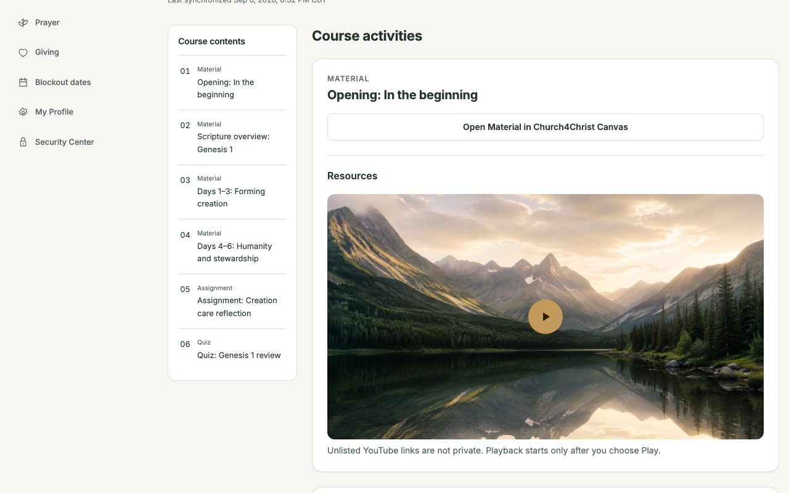
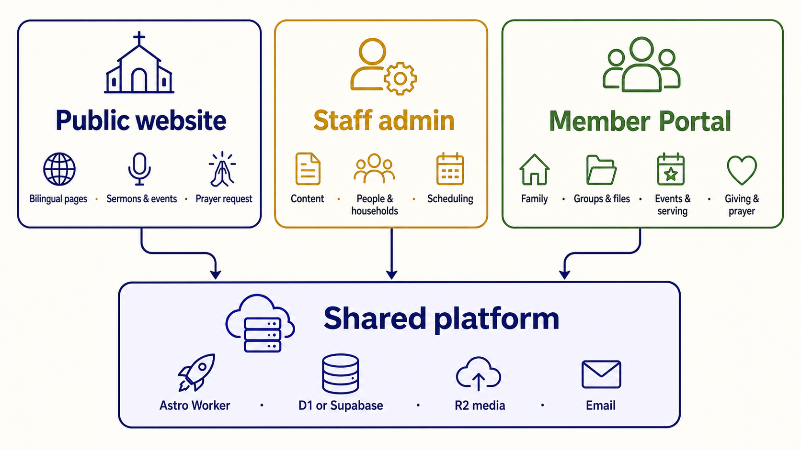
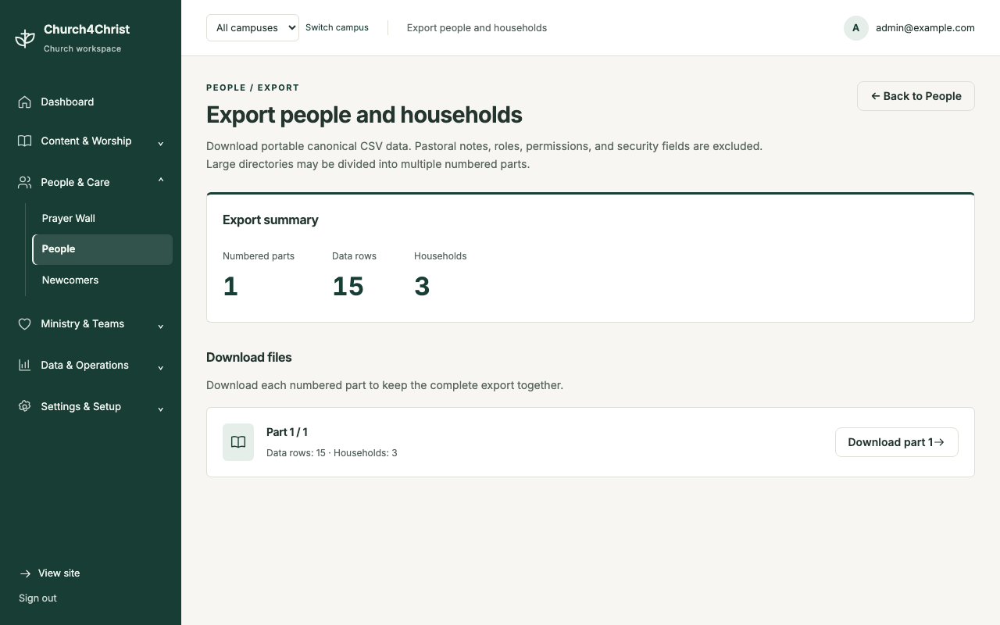
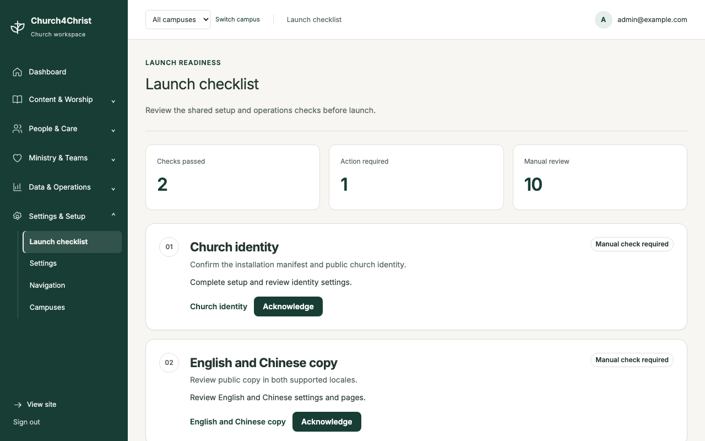

# Church4Christ: perisian pengurusan gereja sumber terbuka dan laman web gereja

<p align="center"></p>

<p align="center"><a href="README.md">English</a> · <a href="README.zh.md">简体中文</a> · <a href="README.es.md">Español</a> · <a href="README.pt.md">Português (Brasil)</a> · <a href="README.fr.md">Français</a> · <a href="README.de.md">Deutsch</a> · <a href="README.ja.md">日本語</a> · <a href="README.ko.md">한국어</a> · <b>Bahasa Melayu</b> · <a href="README.id.md">Bahasa Indonesia</a> · <a href="README.vi.md">Tiếng Việt</a> · <a href="README.hi.md">हिन्दी</a></p>

*Ini ialah terjemahan [README.md](README.md), iaitu versi bahasa Inggeris yang menjadi rujukan sah. Dibantu AI; pembetulan daripada penutur asli amat dialu-alukan.*

[](https://github.com/leveo/church4christ/actions/workflows/ci.yml)
[](https://github.com/leveo/church4christ/releases)
[](LICENSE)
[](https://astro.build/)
[](https://workers.cloudflare.com/)
[](docs/i18n.md)

**Sistem pengurusan gereja (ChMS) dan CMS gereja sumber terbuka yang berteraskan AI, dengan
laman web gereja berbilang bahasa dalam 12 bahasa antara muka, termasuk bahasa Inggeris dan Cina. Alternatif Planning Center yang dihoskan sendiri dan
modular untuk gereja kecil dan sederhana, persekutuan, dan organisasi bukan untung, dibina di atas Astro
dan Cloudflare Workers.**

Individu dan isi rumah, kumpulan, jadual sukarelawan, daftar masuk kanak-kanak, kehadiran,
susulan pengunjung baharu, penjagaan doa, khutbah, buletin, acara, serta portal ahli, lejar pemberian dan
pendaftaran acara yang pilihan, dalam satu pangkalan kod yang boleh anda baca, ubah,
dan hoskan sendiri.

**Laman web: [church4christ.org](https://church4christ.org) · Demo langsung: [demo.church4christ.org](https://demo.church4christ.org).**

[](https://church4christ.yunfei-song.com/C4C-modular-Voice.mp4)

Tonton **[Built Around Your Ministry](https://church4christ.yunfei-song.com/C4C-modular-Voice.mp4)**,
video promosi laman demo (MP4).

**Mulakan di sini: [Persediaan untuk manusia dan ejen AI](docs/setup.md).** Jalankan `npm run onboard`
untuk memilih identiti organisasi anda, warna, logo, dan ciri pertama pada halaman pelayar setempat,
kemudian serahkan pilihan yang disimpan itu kepada pemasang sedia ada. Ejen pengekodan bermula dengan
[AGENTS.md](AGENTS.md); Claude juga membaca [CLAUDE.md](CLAUDE.md).

Church4Christ menggabungkan laman awam berbilang bahasa dengan sistem pentadbiran untuk kandungan,
penjagaan doa, jadual sukarelawan, individu, dan isi rumah. Modul pilihan menambah
portal ahli dan aliran kerja pengurusan gereja yang lain. Projek ini bertujuan merendahkan kos
permulaan dan penyelenggaraan berterusan bagi pelaksanaan yang disesuaikan, sambil memastikan
kod dan konfigurasi penempatan kekal tersedia kepada para pengendalinya.

**Keluaran sumber semasa ialah 1.7**. Church4Christ ialah asas sumber terbuka,
bukan perkhidmatan terurus siap pakai. Penilaian setempat adalah percuma, dan sesetengah penempatan
boleh muat dalam peruntukan percuma pembekal, tetapi pengehosan pengeluaran, e-mel, pangkalan data, domain, sandaran, dan perkhidmatan lain
mungkin dikenakan bayaran bergantung pada konfigurasi dan penggunaan. Lihat [Profil penempatan dan kos](#profil-penempatan-dan-kos)
sebelum memilih persediaan pengeluaran.

|  |  |  |
|---|---|---|
|  |  |  |
|  |  |  |
|  |  |  |

**Ruang kerja tersendiri untuk setiap modul teras.** Reka bentuk Sanctuary yang lalai memadankan
permukaan gading yang hangat dan navigasi hijau hutan dengan reka letak yang sesuai bagi setiap tugas:
penyunting penerbitan dengan pratonton setempat, rekod individu dan isi rumah, baris gilir penjagaan,
matriks pelayanan, daftar masuk kanak-kanak yang mesra sentuhan, pemain kursus, dan lejar
kewangan. Menu awam, ahli, pemimpin, dan pentadbir mengikut modul yang diaktifkan
dan kebenaran setiap orang. Harvest dan Midnight kekal tersedia, dengan mod cerah dan
gelap. Lihat [inventori reka bentuk 21 modul](docs/design/module-coverage.md).

Tangkapan skrin menggunakan kandungan demo fiksyen repositori ini. Persediaan pertama membolehkan anda
menyertakan contoh itu atau bermula tanpanya; kedua-dua pilihan mengekalkan reka letak, tema,
dan imej lalai terbina dalam yang sama. Halaman bahasa Inggeris menggunakan antara muka dan teks demo bahasa Inggeris;
halaman bahasa Cina menyokong kandungan bahasa Cina dan dwibahasa. Kesemua 29 tangkapan skrin antara muka
dirakam semula daripada aplikasi yang sedang berjalan; lihat [inventori tangkapan dan arahan
penjanaan semula](docs/design/readme-screenshot-inventory.md).

**Navigasi berkumpulan.** Laman yang sepenuhnya diaktifkan meringkaskan destinasi awamnya kepada
Selamat Datang, Teroka, Berhubung, dan Terlibat. Pautan terbina dalam kekal dalam kumpulan khalayaknya,
manakala halaman tersuai dan pautan luar muncul di bawah Lagi. Susunan yang disimpan dalam
Admin → Navigasi dikekalkan dalam setiap kumpulan, dan kumpulan kosong akan hilang.


Dua belas bahasa antara muka disertakan: bahasa Inggeris dan Cina, serta Sepanyol, Portugis
Brazil, Perancis, Jerman, Jepun, Korea, Melayu, Indonesia, Vietnam, dan Hindi. Setiap
gereja memilih bahasa yang ditawarkan lamannya dan satu bahasa lalai semasa persediaan atau kemudian dalam
Tetapan → Bahasa. Sepuluh terjemahan yang lebih baharu dibantu AI; pembetulan daripada penutur
asli amat dialu-alukan. Tiga rupa siap pakai dan titik permulaan modular untuk penyesuaian
lanjut turut disertakan.

---

## Untuk siapa?

Church4Christ ditujukan kepada gereja kecil dan sederhana, persekutuan, dan organisasi bukan untung —
terutamanya jemaah berbilang bahasa dan perantau — yang memerlukan laman web awam dan asas
pengurusan gereja yang boleh disesuaikan. Ia paling sesuai apabila seorang kakitangan, sukarelawan, atau rakan pelaksana yang
selesa dengan teknologi boleh memiliki tugas penempatan dan penyelenggaraan. Platform
terurus mungkin lebih sesuai jika organisasi lebih suka pembekal mengendalikan persediaan,
sokongan, peningkatan, dan tanggungjawab operasi berbanding penyesuaian di peringkat kod sumber.

## Bagaimana pendekatan ini dibandingkan?

Kategori produk yang berbeza memenuhi keperluan yang berbeza, dan syarat pembekal berbeza-beza. Jadual ini
membandingkan model operasi, bukan menjanjikan harga, kebolehpindahan, atau hak data yang sejagat.

| | **Church4Christ** | **CMS pemalam urus sendiri** | **Pembina laman dihoskan** | **Platform gereja terurus** |
|---|---|---|---|---|
| **Kesesuaian utama** | Laman web berbilang bahasa yang disesuaikan serta aliran kerja gereja yang modular | Laman kandungan boleh dilanjutkan yang dihimpun daripada pemalam | Laman awam yang diurus pembekal | Aliran kerja gereja yang diurus pembekal |
| **Model kos** | Penggunaan infrastruktur dan perkhidmatan; sesetengah profil mungkin muat dalam peruntukan percuma | Pengehosan, sambungan, dan penyelenggaraan | Langganan dan tambahan | Langganan, selalunya mengikut peringkat atau modul |
| **Penyesuaian** | Perubahan di peringkat kod sumber dan modul pilihan | Tema, pemalam, dan perubahan kod sumber jika ada | Templat dan sambungan yang disokong pembekal | Konfigurasi dan integrasi yang disokong pembekal |
| **Operasi** | Pasukan anda atau rakan pelaksana menempatkan, mengemas kini, memantau, dan membuat sandaran | Pasukan anda atau hos mengurus penyelenggaraan teras dan pemalam | Pembekal mengurus kebanyakan operasi platform | Pembekal mengurus kebanyakan operasi platform |
| **Kebolehpindahan** | Akses kepada kod dan pangkalan data menyokong migrasi, tetapi migrasi dibuat secara manual | Bergantung pada pengehosan, pemalam, dan format | Bergantung pada eksport dan syarat pembekal | Bergantung pada eksport, API, dan syarat pembekal |
| **Titik permulaan bahasa** | Dua belas bahasa antara muka disertakan; setiap gereja memilih set bahasanya sendiri | Bergantung pada sambungan yang dipilih | Bergantung pada perkhidmatan dan pelan | Bergantung pada perkhidmatan dan pelan |

**Pertukaran yang perlu diterima.** Church4Christ dioptimumkan untuk Cloudflare Workers dan bindingnya;
berpindah ke tindanan pengehosan lain boleh dilakukan dengan kerja kod sumber, tetapi bukan laluan satu klik yang disokong.
Tiada juga migrasi kandungan automatik daripada D1 ke Supabase. Halaman terbina dalam
dibentuk oleh tema, manakala penyuntingan seret-dan-lepas hanya terpakai untuk halaman tersuai. Projek ini
berversi, tetapi pengguna masih perlu menjangka kerja pelaksanaan dan peningkatan yang disemak dengan teliti.

Mengendalikan projek ini juga bermakna menyelenggarakannya. Pemilik teknikal anda kekal bertanggungjawab
atas kemas kini kebergantungan, semakan dan konfigurasi keselamatan, pemantauan, sandaran dan
ujian pemulihan, serta menempatkan pembetulan. Seni bina ini mengurangkan sebahagian kerja infrastruktur, tetapi
tidak menghapuskan penyelenggaraan keselamatan dan operasi. Lihat
[**`docs/why-this-stack.md`**](docs/why-this-stack.md) untuk rasional reka bentuk.

## Mencari alternatif Planning Center yang sumber terbuka?

Ramai gereja yang mencari alternatif percuma atau dihoskan sendiri bagi Planning Center,
Breeze, Church Community Builder, atau perisian pengurusan gereja terhos yang serupa mahukan dua
perkara: kawalan ke atas data sendiri dan laman web yang berkongsi rekod yang sama.
Church4Christ meliputi sebahagian besar keperluan pengurusan gereja harian dalam satu
aplikasi yang dihoskan sendiri:

| Keperluan ChMS lazim | Church4Christ |
|---|---|
| Direktori individu dan isi rumah | [Individu & isi rumah](docs/features/people-households.md) dengan import CSV, pemetaan lajur sumber yang disimpan, dan eksport |
| Kumpulan kecil | [Kumpulan](docs/features/groups.md) dengan direktori awam, permohonan menyertai, acara, dan kehadiran |
| Jadual sukarelawan | [Jadual sukarelawan](docs/features/volunteer-serve.md) dengan matriks bulanan dan pengesahan e-mel, tanpa perlu log masuk |
| Perancangan kebaktian | [Lembaran aturan acara, latihan, kesediaan, dan kalendar](docs/features/service-planning.md) untuk kebaktian dan acara |
| Daftar masuk kanak-kanak | [Daftar masuk kiosk](docs/features/children-checkin.md) dengan kod pengambilan dan carta kehadiran |
| Kehadiran dan penglibatan | [Kehadiran kebaktian](docs/features/service-attendance.md) dan [skor aktiviti](docs/features/activity-score.md) |
| Susulan pengunjung baharu dan penjagaan | [Baris gilir pengunjung baharu](docs/features/newcomers.md), [dinding doa](docs/features/prayer-wall.md), dan [aliran kerja komuniti](docs/features/community-workflows.md) |
| Laman web gereja dan CMS | [Laman awam, tema, khutbah, buletin, dan pembina halaman](docs/features/public-site-and-themes.md) |
| Layan diri ahli | [Portal ahli](docs/features/member-portal.md) (isi rumah, kumpulan, doa; berjalan di D1 atau Supabase) |
| Berbilang kampus | [Berbilang kampus](docs/features/multi-campus.md) dengan data dan peranan yang diasingkan mengikut kampus |

**Berpindah daripada Planning Center secara beransur-ansur.** [Penyegerakan Planning Center People](docs/deploy.md#9-optional-configure-planning-center-synchronization)
yang pilihan dan baca sahaja memaut rekod individu Planning Center kepada individu Church4Christ yang sedia ada, dan menghantar
padanan yang kabur untuk semakan manusia, supaya kedua-dua sistem boleh berjalan seiring semasa
peralihan. Individu dibawa masuk dengan pengimport CSV dan pemetaan lajurnya yang boleh digunakan semula.

**Apa yang belum digantikannya.** Tiada aplikasi mudah alih asli, tiada pesanan SMS, dan
tiada pustaka lagu atau perancangan lagu penyembahan (Perancangan Kebaktian meliputi lembaran aturan acara dan
latihan). Pemberian dalam talian melalui Stripe (kad dan debit bank)
berjalan dalam mod ujian sehingga anda melengkapkan senarai semak pelancaran; pendaftaran acara berbayar
menggunakan mod Stripe yang sama. Modul pemberian juga merekodkan cek dan tunai dalam lejar luar talian
serta menghasilkan penyata pemberian tahunan. Church4Christ ialah asas yang dijalankan dan diselenggara oleh pasukan anda, bukan
perkhidmatan terhos dengan sokongan pembekal.

Planning Center dan nama produk lain di atas ialah tanda dagangan pemilik masing-masing.
Church4Christ ialah projek bebas dan tidak bersekutu dengan mereka.

---

## Perlukan satu bahagian sahaja?

Mulakan kecil dan berkembang kemudian. Setiap edisi satu ciri memasang repositori ini dengan hanya
satu bidang diaktifkan, menggunakan pangkalan data Cloudflare D1 lalai:

| Jika anda perlukan | Mulakan dengan | Pratetap |
|---|---|---|
| Kiosk daftar masuk kanak-kanak | [church-checkin](https://github.com/leveo/church-checkin) | `checkin` |
| Jadual sukarelawan | [church-volunteer-scheduling](https://github.com/leveo/church-volunteer-scheduling) | `volunteer-scheduling` |
| Pengurusan kumpulan kecil | [church-small-groups](https://github.com/leveo/church-small-groups) | `small-groups` |
| Pendaftaran dan daftar masuk acara | [church-event-registration](https://github.com/leveo/church-event-registration) | `event-registration` |
| Laman web gereja dan CMS | [church-website-cms](https://github.com/leveo/church-website-cms) | `website` |

Edisi ini tidak mengandungi kod berasingan, jadi tiada apa-apa tambahan yang perlu diselenggara. Anda juga boleh
melangkaunya dan menjalankan `npm run onboard -- --preset checkin` di sini. Aktifkan ciri lain bila-bila masa
dalam **Tetapan → Modul**. Lihat [edisi satu ciri](docs/editions.md).

---

## Bina dengan pembantu AI

Manusia dan ejen berkongsi onboarding pelayar, pemasang, katalog ciri, dan semakan
kesediaan yang sama. [AGENTS.md](AGENTS.md) dan [CLAUDE.md](CLAUDE.md) mengarahkan pembantu memeriksa
pemasangan terlebih dahulu, melancarkan `npm run onboard` untuk persediaan baharu tanpa pilihan tersimpan,
dan membiarkan anda melengkapkan borang. Jawapan anda kekal dalam
`.church/preferences.json` yang diabaikan Git; sesi kemudian membaca fail itu untuk mengikut identiti, jenama,
dan pilihan ciri anda. [Panduan persediaan](docs/setup.md) mengandungi arahan dan langkah pemulihan.
Mulakan pembantu dengan:

> "Baca AGENTS.md dan docs/setup.md. Mulakan onboarding pelayar supaya saya boleh memilih jenama
> dan ciri pertama organisasi kami. Gunakan pilihan tersimpan saya untuk menyediakan pratonton setempat,
> sahkan halaman laman dan pentadbir, kemudian laporkan URL dan semakan yang tinggal."

Anda tidak perlu membuat setiap perubahan secara manual. Repositori ini disusun supaya pembantu pengekodan AI
boleh mengikut panduan bahasa mudah dalam [`docs/features/`](docs/features/) dan
bekerja berpandukan liputan ujian automatik yang luas. Ini boleh mengurangkan usaha penyesuaian dan
penyelenggaraan, tetapi seorang penyelenggara tetap mesti menyemak perubahan, menjalankan ujian
yang berkaitan, dan menempatkannya dengan sengaja.

Idea asasnya: buka projek ini dengan pembantu AI, terangkan apa yang anda mahu dalam bahasa
biasa, dan biarkan ia menyunting. Beberapa contoh sebenar yang boleh anda tampal:

> "Baca `docs/features/public-site-and-themes.md`, kemudian tukar warna utama kami kepada
> biru diraja dan tunjukkan halaman utama kepada saya."

> "Tambahkan locale Itali (`it`) mengikut `docs/i18n.md`."

> "Ikut docs/setup.md untuk mengkonfigurasi gereja kami tanpa kandungan demo. Tunjukkan pelan persediaan
> dan keputusan kesediaan, kemudian sediakan penempatan menggunakan docs/deploy.md."

Aliran kerja yang sama boleh membantu penyelenggaraan: terangkan perubahan, periksa diff
yang dicadangkan, uji secara setempat, dan tempatkan hanya selepas hasilnya disemak. Bantuan AI
tidak menggantikan keputusan keselamatan, sandaran, ujian pengeluaran, atau pemilikan operasi.

---

## Misi kami

**Merendahkan kos dan usaha untuk memulakan sistem pengurusan gereja yang disesuaikan dan
laman web berbilang bahasa.** Church4Christ menyediakan asas modular yang telah diuji dan boleh disesuaikan oleh gereja atau
rakan pelaksana, tanpa perlu bermula dari kosong. Ia tidak menjanjikan perkhidmatan
pengeluaran tanpa langganan atau tanpa belanjawan: pilihan infrastruktur, e-mel, pangkalan data,
domain, sokongan, dan penyelenggaraan menentukan kos operasi sebenar.

---

## Apa yang ada di dalamnya

Setiap ciri mempunyai panduan bahasa mudahnya sendiri. Mulakan dengan mana-mana daripada ini:



| | Ciri | Fungsinya |
|---|---|---|
| [](docs/features/public-site-and-themes.md) | **[Laman awam & tema](docs/features/public-site-and-themes.md)** | Pintu depan gereja anda — halaman utama, khutbah, acara, kakitangan — dalam salah satu daripada tiga rupa siap pakai. |
| [](docs/features/cms-admin.md) | **[Kawasan pentadbiran](docs/features/cms-admin.md)** | Log masuk tanpa kata laluan, peranan, dan pemulihan satu klik untuk kandungan suntingan berversi yang disokong. |
| [](docs/features/admin-permissions.md) | **[Kebenaran pentadbir](docs/features/admin-permissions.md)** | Beri setiap pentadbir hanya bidang yang diperlukannya — dinding doa dan direktori ahli disertakan percuma, selebihnya mengikut pilihan. |
| [](docs/features/multi-campus.md) | **[Berbilang kampus](docs/features/multi-campus.md)** | Jalankan beberapa kampus pada satu bahagian belakang dengan data, tetapan, ciri, dan peranan setempat kampus yang diasingkan; hanya pentadbir induk yang dapat melihat semua kampus. |
| [](docs/features/bulletins.md) | **[Buletin mingguan](docs/features/bulletins.md)** | Bina lembaran kebaktian hari Ahad dan jadualkan ia diterbitkan sendiri. |
| [](docs/features/sermons.md) | **[Arkib khutbah](docs/features/sermons.md)** | Tampal pautan YouTube; dapatkan pustaka mesej lalu yang boleh dicari dan dimuatkan dengan pantas. |
| [](docs/features/prayer-wall.md) | **[Dinding doa](docs/features/prayer-wall.md)** | Terima permohonan doa dan uruskannya secara peribadi pada papan yang ringkas. |
| [](docs/features/volunteer-serve.md) | **[Jadual sukarelawan](docs/features/volunteer-serve.md)** | Rancang sebulan pelayanan sekali pandang; sukarelawan mengesahkan melalui e-mel, tanpa log masuk. |
| [](docs/features/people-households.md) | **[Individu & isi rumah](docs/features/people-households.md)** | Profil dan isi rumah serta eksport CSV kanonik cipta-sahaja dan pemetaan lajur sumber yang boleh digunakan semula untuk migrasi. |
| [](docs/features/member-identity.md) | **[Keselamatan identiti ahli](docs/features/member-identity.md)** | Identiti terikat bukti merentas Pemberian, Pendaftaran, Kumpulan, Pasukan, Pengunjung Baharu, dan import; pendua yang kabur dihantar untuk semakan dan bukan digabungkan berdasarkan nama sahaja, dengan kelulusan terikat OTP dan penggulungan semula 24 jam yang dikawal. |
| [](docs/features/groups.md) | **[Kumpulan](docs/features/groups.md)** | Kumpulan kecil dengan direktori awam, senarai semak ahli, permohonan menyertai, acara, dan kehadiran melalui pautan e-mel bagi setiap orang. |
| [](docs/features/children-checkin.md) | **[Daftar masuk kanak-kanak](docs/features/children-checkin.md)** | Kiosk mesra sentuhan tempat ibu bapa mendaftar masuk dan keluar anak dengan kod pengambilan, serta carta kehadiran mingguan. |
| [](docs/features/service-attendance.md) | **[Kehadiran kebaktian](docs/features/service-attendance.md)** | Rekod jumlah agregat orang dewasa, terbitkan jumlah kanak-kanak pilihan daripada daftar masuk, betulkan sejarah, dan muat turun laporan CSV tanpa identiti. |
| [](docs/features/newcomers.md) | **[Susulan pengunjung baharu](docs/features/newcomers.md)** | Terima kad awam dwibahasa yang diberi persetujuan, triaj baris gilir kakitangan yang berskop, dan serahkan padanan tepat kepada Individu tanpa membocorkan nota atau jawapan. |
| [](docs/features/onboarding-readiness.md) | **[Kesediaan pelancaran](docs/features/onboarding-readiness.md)** | Satu senarai semak dwibahasa yang dikongsi oleh persediaan, doctor, dan setiap pentadbir sebenar, dengan akuan pentadbir super untuk semakan manual. |
|  | **[Perancangan kebaktian](docs/features/service-planning.md)** | Rancang lembaran aturan acara berwaktu, latihan bersama orang yang dipanggil, kesediaan ahli, carian masa yang sesuai, kalendar, dan e-mel automatik. |
|  | **[Skor aktiviti](docs/features/activity-score.md)** | Gabungkan aktiviti terpilih yang dipaut kepada individu menjadi skor ahli yang boleh dijelaskan dan ringkasan penglibatan seluruh gereja. |
| [](docs/features/learning.md) | **[Pembelajaran](docs/features/learning.md)** | Teruskan Sekolah Minggu dan pemuridan di antara perjumpaan dengan video dwibahasa, fail, tugasan, kuiz, dan status yang diselaraskan pembekal. |
| [](docs/features/page-builder.md) | **[Pembina halaman](docs/features/page-builder.md)** | Seret dan lepas untuk menyusun halaman tersuai anda — berbilang bahasa, sentiasa selaras tema, dan halaman yang diterbitkan dimuatkan tanpa JavaScript. Pilihan; mematikannya tidak akan merosakkan halaman yang telah anda bina. |
| [](docs/features/giving.md) | **[Pemberian](docs/features/giving.md)** | Dilaksanakan: pemberian dalam talian melalui Stripe (mod ujian secara lalai, mod langsung selepas senarai semak pelancaran), lejar luar talian untuk cek dan tunai, serta penyata pemberian tahunan. |
| [](docs/features/registration.md) | **[Pendaftaran](docs/features/registration.md)** | Dilaksanakan: pendaftaran acara percuma di D1 atau Supabase, soalan tersuai, senarai menunggu, peringkat acara, dan eksport senarai peserta, serta pembayaran Stripe berbayar di Supabase dalam mod Stripe yang sama dengan Pemberian (sahkan dengan pendaftaran langsung yang kecil sebelum bergantung padanya). |
|  | **[Logistik acara](docs/features/event-logistics.md)** | Tambahan pilihan untuk Pendaftaran: tempatkan orang dalam bilik, susun mereka di meja dengan pratonton Tempat duduk automatik, bahagikan mereka kepada kumpulan kecil, dan cetak senarai bilik, papan tanda pintu, serta kad meja. |
| [](docs/features/member-portal.md) | **[Portal ahli](docs/features/member-portal.md)** | Satu hab log masuk untuk penyertaan semasa dan peluang terbuka, serta profil isi rumah, acara, pelayanan, kalendar, pemberian, dan doa yang berskop. |
| [](docs/features/i18n.md) | **[Dua belas bahasa](docs/features/i18n.md)** | Pilih daripada 12 bahasa antara muka bagi setiap laman, dengan sandaran bahasa Inggeris dan penukaran satu klik daripada Cina Ringkas kepada Cina Tradisional. |
| [](docs/features/email-automation.md) | **[E-mel & automasi](docs/features/email-automation.md)** | Pautan log masuk, peringatan, dan ringkasan, dengan pengelogan setempat dan konfigurasi pengeluaran yang boleh berbayar. |
| [](docs/features/modules.md) | **[Modul](docs/features/modules.md)** | Matikan ciri yang tidak anda gunakan; tiada apa dipadam, hidupkan semula bila-bila masa. |

**Pilih modul anda.** Kebanyakan keupayaan domain pilihan ialah **modul** yang boleh anda matikan
daripada satu panel dalam Tetapan — buletin, khutbah, dinding doa, jadual sukarelawan,
dan banyak lagi. Pemasangan baharu menulis setiap tetapan modul secara jelas daripada pilihan persediaan;
demo Full Church memilih 21 modulnya (Perancangan Kebaktian dan Logistik Acara dihidupkan secara berasingan). Hanya pada pemasangan lama, baris modul yang tiada mengekalkan
tingkah laku lalai-hidup yang lama. Gereja yang hanya mahukan waktu kebaktian dan khutbah boleh
menyembunyikan selebihnya dengan satu klik: halaman, pautan, dan e-mel modul itu hilang bersama, dan tiada apa
dipadam. Lihat [**`docs/features/modules.md`**](docs/features/modules.md).

| Key | English | 中文 | Required database |
|---|---|---|---|
| `bulletins` | Bulletins | 周报 | Either |
| `sermons` | Sermons | 讲道 | Either |
| `prayer-sheets` | Prayer Sheets | 祷告单 | Either |
| `prayer-wall` | Prayer Wall | 祷告墙 | Either |
| `events` | Events | 活动 | Either |
| `serve` | Volunteer Scheduling | 服事排班 | Either |
| `gifts` | Spiritual Gifts | 恩赐探索 | Either |
| `testimonies` | Testimonies | 见证 | Either |
| `articles` | Articles | 文章 | Either |
| `fellowships` | Fellowships | 团契 | Either |
| `groups` | Groups | 小组 | Either |
| `people` | People & Households | 会友与家庭 | Either |
| `children` | Children Check-in | 儿童报到 | Either |
| `attendance` | Service Attendance | 崇拜出席 | Either |
| `newcomers` | Newcomer Follow-up | 新朋友跟进 | Either |
| `activity-score` | Activity Score | 活跃度评分 | Either |
| `page-builder` | Page Builder | 页面编辑器 | Either |
| `portal` | Member Portal | 会友平台 | Either |
| `giving` | Giving | 奉献 | Supabase |
| `registration` | Registration | 活动报名 | Either |
| `learning` | Learning | 学习 | Either |
| `planning` | Service Planning | 服事流程 | Either |
| `event-logistics` | Event Logistics | 活动后勤 | Either |

### Pengurusan komuniti dan aliran kerja

Kampus boleh mengurus kumpulan dan susulan ahli secara langsung. Persekutuan pilihan menambah lapisan komuniti dengan keahlian bebas dan kumpulan anak. Aliran kerja yang boleh digunakan semula menyediakan langkah yang ditugaskan, tarikh akhir, penjejakan penyiapan, dan peringatan e-mel Cloudflare. Lihat [panduan aliran kerja komuniti](docs/features/community-workflows.md) untuk persediaan, kebenaran, dan kawalan penghantaran.

### Pembelajaran melangkaui hari Ahad

Versi 1.1 menambah modul pilihan **Pembelajaran** untuk Sekolah Minggu,
pemuridan, dan pelayanan lain yang berterusan di antara perjumpaan. Pelajar mendapat
paparan kursus dwibahasa yang dihadkan privasi untuk video YouTube tidak tersenarai, fail, tugasan,
dan kuiz. Penyerahan kekal tertakluk pada pembekal: laman ini
memaut pelajar ke pembekal yang dikonfigurasi dan tidak mengumpul kerja rumah,
jawapan, komen, gred, atau kandungan fail sendiri.

Pentadbir boleh menyambungkan Google Classroom melalui API rasminya atau terbitan Canvas Church4Christ
yang dikendalikan secara berasingan. Pemetaan kursus, bukti kelayakan OAuth yang disulitkan,
pemberitahuan pembekal yang ditandatangani, penyegerakan manual, dan pendamaian berjadual yang terhad
hanya menyuap metadata aktiviti yang diperlukan Church4Christ.


| Paparan pelajar bahasa Inggeris | Paparan pelajar bahasa Cina | Pentadbiran pembekal |
|---|---|---|
| [](docs/images/learning/genesis-1-en.png) | [](docs/images/learning/genesis-1-zh.png) | [](docs/images/learning/admin-overview.png) |

Lihat **[panduan ciri Pembelajaran](docs/features/learning.md)** untuk persediaan
pembekal, sempadan privasi, belanjawan penyegerakan, demo Kejadian 1, dan keperluan
operasi Canvas yang berasingan serta keperluan corresponding source.

### Rumah bagi ahli anda

**Portal Ahli** pilihan mengubah rekod yang sedia diselenggara gereja anda menjadi
pengalaman log masuk yang berguna. Halaman pendaratan peluangnya memaparkan setiap cara yang diaktifkan untuk
belajar, bergabung, dan melayani di satu tempat: kedua-dua kumpulan, kelas, dan pasukan yang sudah
dihubungkan dengan ahli itu serta peluang yang kini terbuka untuk disertai atau dipohon. Ahli
juga boleh mengemas kini butiran isi rumah, melihat pemberian mereka, mendaftar untuk acara, menyemak komitmen
pelayanan, melanggan kalendar peribadi, dan berkongsi doa yang berskop. Ia menggunakan pautan log masuk
tanpa kata laluan yang sama seperti bahagian lain Church4Christ — tiada akaun atau kata laluan baharu
untuk diingat.


Pemimpin pelayanan, kumpulan, Sekolah Minggu, dan pasukan pelayan mendapat panel berskop sumber di
`/<locale>/manage`. Log masuk aplikasi gereja melindunginya, dan setiap operasi menyemak
kuasa pemimpin ke atas sumber tertentu itu. Cloudflare Zero Trust dengan itu boleh kekal
terhad kepada kawasan `/admin` sepenuhnya.


Portal ini berjalan pada bahagian belakang D1 lalai dan juga bahagian belakang **Supabase (Postgres)** yang pilihan.
Isi rumah, kumpulan, fail kumpulan yang dilindungi, dan penyederhanaan doa gereja/kumpulan/peribadi
berfungsi di D1. Doa skop acara, pentadbir acara, dan "Pendaftaran saya"
memerlukan Pendaftaran, yang berjalan di D1 untuk acara percuma setelah dihidupkan. Ketahui lebih lanjut dalam
[**`docs/features/member-portal.md`**](docs/features/member-portal.md).

---

## Cuba dalam 5 minit (pada komputer anda sendiri)

Anda boleh menjalankan laman ini secara setempat, dengan kandungan contoh fiksyen yang pilihan, sebelum memilih
penempatan. Anda memerlukan [Node.js](https://nodejs.org/) 22.22.1 atau lebih baharu terpasang. Onboarding
pelayar mengesyorkan **Website + Community** dengan **Cloudflare D1** untuk pelancaran pertama.


```bash
# 1. Get the code and install it
git clone https://github.com/leveo/church4christ.git
cd church4christ
npm ci

# 2. Open the local browser form, complete it, and save your preferences
npm run onboard

# 3. Review the plan, then initialize with those same preferences
node scripts/setup/index.mjs --preferences .church/preferences.json --yes --dry-run --json
node scripts/setup/index.mjs --preferences .church/preferences.json --yes --json

# 4. For D1, start it (always follow the exact handoff setup prints)
npm run dev
```

Borang ini bertanya sama ada ini gereja, organisasi bukan untung, atau kampus, dan mengumpulkan nama,
slogan, alamat, zon waktu, warna utama dan sekunder, logo PNG/JPEG/WebP yang pilihan
(sehingga 2 MiB), bahasa, pentadbir pertama, dan pilihan kandungan demo. Tandakan hanya
ciri yang anda perlukan.
Pilihan yang disyorkan menggunakan D1 sebagai pangkalan datanya; aplikasi masih berjalan di
Cloudflare Workers dan menyimpan media dalam R2. **Pemberian dan Pendaftaran berbayar**
ialah pilihan lanjutan yang memerlukan penukaran secara jelas kepada PostgreSQL yang serasi dengan Supabase.

Penyimpanan menulis `.church/preferences.json` dan sebarang logo yang dimuat naik di bawah `.church/`, yang
diabaikan oleh Git. Ia tidak mencipta pangkalan data atau menempatkan laman. Jalankan `npm run onboard` sekali lagi untuk
memuatkan semula dan menyunting pilihan yang disimpan. Biarkan terminal berjalan semasa mengisi
borang; hentikannya dengan Ctrl+C apabila selesai. Untuk membuka URL yang dicetak sendiri, gunakan
`npm run onboard -- --no-open`; untuk memilih port, tambah `--port 4310`. Titik masuk langsung
ialah `node scripts/onboard/index.mjs`. Lihat [panduan persediaan](docs/setup.md) untuk apa yang
dilaksanakan pemasang dan cara ejen menggunakan pilihan yang selebihnya.

Jika anda memasang dengan `npm ci --ignore-scripts`, jalankan `npm run tokens` secara manual sebelum
pemasang atau `npm run dev`.

Untuk Supabase setempat, serahan sebaliknya mengeksport
`CLOUDFLARE_HYPERDRIVE_LOCAL_CONNECTION_STRING_HYPERDRIVE` dalam shell hos sebelum
`npm run dev`; URL sambungan itu tidak boleh diletakkan dalam `.dev.vars`.

Semasa persediaan pertama, pilih **Include demo content** atau **No demo content**. Kedua-duanya mengekalkan
reka bentuk terbina dalam, imej hiasan setempat, ciri yang diaktifkan, dan alat pentadbir yang sama.
Kandungan demo menambah individu fiksyen, khutbah, buletin, acara, pelayanan, dan contoh lain.
Langkah medianya menyalin pek imej yang dijana daripada `seed/media/` ke R2 setempat.
Tanpa kandungan demo, ia mencipta skema pangkalan data, lalai operasi, tetapan gereja, pilihan
modul, dan pentadbir pertama tanpa rekod perniagaan contoh.

Fail pilihan merekodkan pilihan kandungan demo daripada borang. Untuk persediaan dengan jawapan CLI yang jelas,
berikan `--demo-data` atau `--no-demo-data`; jika kedua-duanya ditinggalkan dalam persediaan tanpa interaksi, lalai
tanpa demo yang sedia ada dikekalkan. Bendera ini tidak boleh digabungkan. Mengulang
persediaan yang sama mengekalkan pilihan kandungan yang direkodkan dan rekod sedia ada. `--no-demo-data` tidak
mengosongkan pangkalan data sedia ada, dan persediaan enggan menambah data demo pada individu yang sudah ada.
Gunakan ruang kerja/pangkalan data baharu yang berasingan untuk mencuba mod permulaan yang lain.

Buka alamat yang dicetak oleh persediaan (biasanya `http://localhost:4321`).

**Log masuk ke kawasan pentadbiran.** Tiada kata laluan. Pada halaman log masuk, masukkan
e-mel pentadbir pertama daripada jawapan persediaan anda, yang diulang dalam serahan persediaan, dan minta
pautan. Oleh sebab e-mel setempat ditetapkan untuk dicetak dan bukan dihantar, **URL pautan ajaib muncul
terus dalam terminal anda**. Tampalkannya dalam pelayar dan anda sudah masuk. (Untuk ujian setempat
yang lebih pantas, persediaan menulis alamat yang sama sebagai `AUTH_DEV_BYPASS_EMAIL` dalam `.dev.vars`, yang
melog masuk anda secara automatik. Buang baris itu untuk menguji aliran log masuk sebenar.)

Dalam kedua-dua mod kandungan, persediaan mencipta pentadbir baharu dan identiti log masuk beraudit mereka
bersama-sama. Larian berulang mengekalkan pemilikan kenalan sedia ada; ia tidak mengesahkan e-mel
yang sedia ada dan tidak memulihkan akses yang telah dibatalkan. Jika persediaan melaporkan masalah identiti, lengkapkan
[aliran semakan atau pemulihan identiti](docs/features/member-identity.md) sebelum menjalankannya semula.

`npm run setup` yang hanya menggunakan terminal kekal tersedia. Persediaan menawarkan **Website** (8 modul
penerbitan yang fokus), **Website + Community** (18 modul; Portal Ahli boleh ditambah pada D1), dan
**Full Church** (21 modul; Perancangan Kebaktian dihidupkan secara berasingan). Pemberian
memilih Supabase secara automatik (Pendaftaran percuma berjalan di D1); pilihan yang serasi dengan D1 memilih D1 melainkan anda
mengatasi bahagian belakang secara jelas. Keperluan akaun bergantung pada mod Local berbanding Deploy,
seperti dihuraikan di bawah. Untuk automasi, berikan semua jawapan dengan `--yes`; tambah `--json` untuk satu
hasil yang boleh dibaca mesin. Untuk larian tanpa interaksi yang boleh dibaca manusia, gunakan bendera lengkap yang sama
dengan `npm run setup -- ... --yes` dan tinggalkan `--json`. Untuk memastikan stdout kekal JSON semata-mata
melalui npm, gunakan bentuk senyap:

```bash
npm run --silent setup -- --mode local --preset website --site-slug my-church \
  --church-name "My Church" --locale en --admin-email admin@example.com \
  --admin-name "First Admin" --app-origin http://localhost:4321 \
  --email-from admin@example.com --demo-data --yes --json
```

---

## Profil penempatan dan kos

Ini ialah profil perancangan, bukan jaminan harga. Harga di bawah adalah terkini setakat
**Ogos 2026**, tertakluk kepada perubahan, dan perlu disahkan pada halaman harga rasmi yang dipautkan
sebelum penempatan.

| Profil | Skop yang disertakan | Nota kos dan kesediaan |
|---|---|---|
| **Penilaian setempat** | Modul laman web atau komuniti dengan D1 setempat; semua modul dengan Postgres setempat yang serasi | Tiada caj perkhidmatan terhos diperlukan untuk penilaian D1 setempat. Anda masih perlu menyediakan komputer, masa pembangunan, dan sebarang perkhidmatan luaran pilihan. |
| **D1 laman web/komuniti** | Cloudflare Worker, D1, dan R2 untuk sehingga 22 modul yang serasi dengan D1 | Penempatan yang sederhana boleh muat dalam peruntukan percuma Cloudflare. Trafik, storan, operasi melebihi peruntukan, domain, dan perkhidmatan lain boleh dikenakan bayaran; semak [harga Workers](https://developers.cloudflare.com/workers/platform/pricing/). E-mel pengeluaran adalah berasingan. |
| **E-mel pengeluaran** | Pautan log masuk transaksi, peringatan, permintaan, dan ringkasan kepada penerima sewenang-wenangnya | Repositori ini menyokong konfigurasi e-mel Cloudflare yang boleh berbayar. Penghantaran kepada penerima sewenang-wenangnya memerlukan Workers Paid, kini minimum **$5/bulan** termasuk **3,000 e-mel**, kemudian **$0.35 bagi setiap 1,000 e-mel**. Jumlah ini tertakluk kepada perubahan; semak [harga Cloudflare Email Service](https://developers.cloudflare.com/email-service/platform/pricing/). |
| **Supabase/semua modul** | Penempatan Cloudflare serta Supabase/Postgres untuk 21 modul Full Church, termasuk Portal Ahli, Pemberian, dan Pendaftaran | Kos Cloudflare masih terpakai, dan [pelan Supabase](https://supabase.com/pricing) yang dipilih mungkin menambah caj langganan atau penggunaan. Setakat Ogos 2026, Supabase Free tidak mempunyai sandaran harian automatik, dan projek Free yang kurang aktif mungkin [dijeda secara automatik](https://supabase.com/docs/guides/platform/free-project-pausing) berdasarkan aktiviti sepanjang tempoh tujuh hari. Untuk pengeluaran, ambil dump pangkalan data luar tapak secara berkala dan lakukan latihan pemulihan, atau pilih pelan berbayar yang [pilihan sandarannya](https://supabase.com/docs/guides/platform/backups) memenuhi keperluan kesinambungan anda. Harga dan dasar perkhidmatan tertakluk kepada perubahan. Stripe bermula dalam mod ujian; pembayaran langsung ialah pilihan yang dibuat secara jelas selepas senarai semak pelancaran dalam [`docs/supabase-setup.md`](docs/supabase-setup.md). |

Peruntukan percuma pembekal berguna untuk penilaian atau penempatan sederhana, tetapi ia
bukan janji bahawa perkhidmatan pengeluaran akan kekal percuma. Peruntukkan belanjawan untuk pemilikan teknikal,
penyelenggaraan kebergantungan dan keselamatan, pemantauan, sandaran, ujian pemulihan, dan pertumbuhan
penggunaan pada masa depan, di samping perkhidmatan yang disenaraikan di atas.

---

## Menayangkannya dalam talian

Baharu dalam hal ini? Mulakan dengan [**`docs/cloudflare-setup.md`**](docs/cloudflare-setup.md) — panduan
bahasa mudah yang menerangkan apa itu Cloudflare, model kosnya, dan dua
cara untuk beroperasi dalam talian (termasuk membiarkan pembantu AI melakukannya untuk anda). Apabila anda mahukan
arahan yang tepat, [**`docs/deploy.md`**](docs/deploy.md) ialah panduan langkah demi langkah yang
lengkap.

Mulakan dengan `npm run setup`, pilih **Deploy**, dan jawab soalan tentang ciri dan gereja.
Ia mencipta atau mengimport sumber yang diperlukan, menulis konfigurasi yang dijana, menjalankan
migrasi, merekodkan kesemua 23 tetapan modul, dan menyediakan pentadbir pertama. Kemudian ia menyerahkan
kepada `npm run deploy`. Jalankan `npm run doctor` untuk laporan kesediaan schema-v2, dan gunakan
senarai semak `/admin/onboarding` yang sentiasa aktif untuk identiti semakan stabil yang sama.
Pemberian, Pendaftaran, Kumpulan, Pasukan, Pengunjung Baharu, import, dan integrasi Planning
Center baca sahaja yang pilihan berkongsi gerbang identiti terikat bukti yang mengutamakan semakan. Ia tidak pernah
menggabungkan individu secara automatik berdasarkan nama atau kenalan yang tidak disahkan. Lihat [Identiti ahli](docs/features/member-identity.md)
untuk aliran kerja, kawalan penipuan, sempadan migrasi semasa, dan jurang pengesahan pembekal;
peraturan persediaan dan pemutaran rahsia kekal dalam [buku panduan penempatan](docs/deploy.md#stable-identity-source-key).
Penempatan sengaja dibuat secara manual: automasi repositori menguji perubahan tetapi tidak
menerbitkannya atau memigrasikan data pengeluaran untuk anda.

**Penempatan pertama dan peningkatan ialah operasi yang berbeza.** Persediaan berpandu menyediakan atau
mengimport sumber dan menyediakan pemasangan yang telah disemak. Ia bukan peningkatan satu klik tanpa pengawasan
bagi laman yang sudah menyimpan data gereja. Pengendali sedia ada harus bermula dengan
[buku panduan peningkatan](docs/upgrade.md), membuat sandaran pangkalan data, media R2, konfigurasi, dan inventori
rahsia, berlatih dalam persekitaran staging, dan menyemak [changelog `Unreleased`](CHANGELOG.md) sebelum
menjalankan migrasi ke hadapan. Penyelenggara yang menyediakan keluaran harus mengikut
[proses keluaran](docs/release-process.md).

**Memilih pangkalan data anda.** 22 modul yang serasi dengan D1 tidak termasuk
**Pemberian**, yang memerlukan Postgres, dan **Pendaftaran berbayar**, yang juga memerlukannya. Keperluan akaun mengikut
mod: D1 setempat tidak memerlukan akaun luaran; D1 yang ditempatkan memerlukan akaun Cloudflare; Supabase
setempat memerlukan akaun Supabase atau pangkalan data Postgres setempat yang serasi; Supabase yang ditempatkan
memerlukan kedua-dua Cloudflare dan Supabase. Belum ada migrasi kandungan D1↔Supabase yang automatik,
jadi pilih pangkalan data pengeluaran sebelum memasukkan kandungan sebenar. Lihat
[**`docs/supabase-setup.md`**](docs/supabase-setup.md).

**Stripe bermula dalam mod ujian; mod langsung ialah pilihan yang dibuat secara jelas.** Stripe menghoskan halaman pembayaran,
resit, Billing Portal, bayaran balik, dan pertikaian; aplikasi ini hanya menyimpan jumlah,
dana, tarikh, status, dan id Stripe. Pemberian dan Pendaftaran berbayar hanya untuk Supabase; D1 tidak
menyokongnya. Apabila persediaan menanyakan salah satu modul itu, import kunci `sk_test_…` dan
rahsia penandatanganan `whsec_…` dengan pemboleh ubah persekitaran sekali guna `CHURCH_SETUP_STRIPE_SECRET_KEY` dan
`CHURCH_SETUP_STRIPE_WEBHOOK_SECRET`; persediaan menyimpan rahsia runtime
dan menulis `STRIPE_MODE=test`. Untuk menerima pemberian sebenar, ikut senarai semak pelancaran dalam
panduan Supabase (kunci langsung, webhook pada versi API `2025-03-31.basil`, `STRIPE_MODE=live`
serta `STRIPE_LIVE_CONFIRMED=1`). Acara yang modnya tidak sepadan dengan mod yang dikonfigurasi
ditolak, dan Worker berasaskan Supabase menjalankan pemulihan tahan lama setiap lima minit. Ujian
setempat tidak membuktikan penghantaran Stripe secara langsung.

---

## Apa yang ada di bawah tudung

Bagi yang ingin tahu: Church4Christ dibina dengan **[Astro](https://astro.build/)** yang merender
halaman di pelayan dan berjalan sebagai satu **Cloudflare Worker**. Data aplikasi berada dalam
bahagian belakang yang dipilih — Cloudflare **D1** atau **Supabase/Postgres** — dan media yang dimuat naik berada
dalam Cloudflare **R2** (storan objek); e-mel dihantar melalui binding e-mel Cloudflare.
Halaman untuk pengunjung **tidak menghantar rangka kerja JavaScript sisi klien** — ia ialah HTML
biasa yang pantas dengan sedikit skrip vanila —
dan inilah sebahagian besar sebab laman dimuatkan dengan pantas dan murah untuk dikendalikan. (Satu-satunya
pengecualian terletak di sebalik log masuk kakitangan: pembina halaman seret-dan-lepas ialah penyunting React
yang kecil dan hanya pasukan anda yang memuat turunnya; halaman yang diterbitkannya masih HTML biasa.)

Keseluruhan rupa datang daripada **[token reka bentuk](design/README.md)**: sekumpulan nilai warna dan
jenis huruf yang dikompil menjadi tiga tema siap pakai (Sanctuary, Harvest, Midnight),
masing-masing dengan mod cerah dan gelap. Projek ini mempunyai **liputan automatik yang luas** merentas
aliran kerja terasnya supaya penyelenggara dapat mengesahkan perubahan sebelum penempatan.

**Mengapa pilihan ini?** Sebab-sebab bagi penempatan yang dioptimumkan untuk Cloudflare, tindanan
Astro + Tailwind + TypeScript, dan kes-kes yang platform terurus mungkin menjadi
model operasi yang lebih baik dihuraikan dalam
[**`docs/why-this-stack.md`**](docs/why-this-stack.md). Untuk gambaran teknikal, lihat
[`docs/architecture.md`](docs/architecture.md),
[`docs/design-system.md`](docs/design-system.md), dan [`docs/i18n.md`](docs/i18n.md).

---

## Soalan Lazim

**Apakah Church4Christ?**
Sistem pengurusan gereja (ChMS) dan CMS gereja sumber terbuka. Ia menggabungkan laman web
gereja berbilang bahasa (12 bahasa antara muka) dengan alat kakitangan untuk individu dan isi rumah, kumpulan,
jadual sukarelawan, daftar masuk kanak-kanak, kehadiran, susulan pengunjung baharu, dan penjagaan doa.

**Adakah alternatif sumber terbuka yang percuma bagi Planning Center?**
Church4Christ ialah satu pilihan. Kod sumbernya percuma di bawah GPL-3.0 dan anda menghoskannya
sendiri di Cloudflare Workers. Ia meliputi individu, kumpulan, daftar masuk, jadual sukarelawan,
kehadiran, dan laman web gereja, serta boleh membaca Planning Center People melalui
penyegerakan baca sahaja yang pilihan semasa anda beralih. Ia tidak mempunyai aplikasi mudah alih,
SMS, atau perancangan lagu penyembahan milik Planning Center. Lihat
[Mencari alternatif Planning Center yang sumber terbuka?](#mencari-alternatif-planning-center-yang-sumber-terbuka)

**Adakah ia percuma?**
Perisiannya percuma. Perkhidmatan pengehosan, e-mel, pangkalan data, dan domain mungkin berbayar
bergantung pada persediaan dan penggunaan anda; sesetengah penempatan kecil muat dalam peruntukan
percuma pembekal. Lihat [Profil penempatan dan kos](#profil-penempatan-dan-kos).

**Bahasa apakah yang disokongnya?**
Dua belas bahasa antara muka: Inggeris, Cina, Sepanyol, Portugis Brazil, Perancis, Jerman,
Jepun, Korea, Melayu, Indonesia, Vietnam, dan Hindi. Setiap gereja memilih bahasa yang
ditawarkan lamannya dan satu bahasa lalai; halaman Cina juga mendapat penukaran satu klik daripada
Cina Ringkas kepada Cina Tradisional. Lebih banyak bahasa boleh ditambah; lihat [docs/i18n.md](docs/i18n.md).

**Bolehkah gereja kecil tanpa pembangun menjalankannya?**
Ia paling sesuai apabila seorang kakitangan, sukarelawan, atau rakan yang selesa dengan teknologi memiliki
penempatan dan kemas kini. Onboarding pelayar dan panduan pembantu AI mengurangkan usaha itu,
tetapi seseorang masih perlu menyemak perubahan, membuat sandaran data, dan menempatkan.

**Dengan apakah ia dibina?**
Astro di Cloudflare Workers, dengan Cloudflare D1 atau Supabase/PostgreSQL untuk data dan
Cloudflare R2 untuk media. Halaman awam tidak menghantar rangka kerja sisi klien.

---

## Lesen

Church4Christ ialah perisian bebas dan sumber terbuka di bawah **[GNU General Public License
v3](LICENSE)** (GPL-3.0). Anda boleh menggunakan dan mempelajarinya, mengubahnya secara peribadi, berkongsi salinan, dan
mengenakan bayaran untuk salinan, pembangunan tersuai, pengehosan, sokongan, atau perkhidmatan komersial lain.

Jika anda mengedarkan versi terubah suai yang dilindungi, syarat GPL terpakai: penerima mesti
mendapat kebebasan GPL yang berkenaan, dan sumber sepadan mesti disediakan di bawah
GPL seperti yang dikehendaki lesen. Pengubahsuaian peribadi tidak perlu diterbitkan. Sekadar
menjalankan versi terubah suai sebagai perkhidmatan rangkaian, tanpa mengedarkan salinan, tidak dengan
sendirinya mencetuskan obligasi perkongsian sumber ala AGPL di bawah GPLv3.

[`LICENSE`](LICENSE) ialah rujukan sah. Ringkasan ini disediakan sebagai panduan awal dan bukan
nasihat undang-undang.

---

## Menyumbang & pelan hala tuju

Sumbangan dialu-alukan — laporan pepijat, terjemahan, ciri baharu. Mulakan dengan
[`CONTRIBUTING.md`](CONTRIBUTING.md) untuk persediaan pembangunan dan lima peraturan projek, dan
[`SECURITY.md`](SECURITY.md) jika anda menemui isu keselamatan.

**Di ufuk (belum dibina):** "pasar pertukaran" antara gereja untuk berkongsi
tema dan kandungan ialah idea yang sedang kami pertimbangkan, bukan janji. Jika ia penting bagi
gereja anda, bukalah isu dan mari kita berbincang.

---

Dibina dengan penuh perhatian, dan dengan bantuan AI, untuk gereja dan organisasi bukan untung di mana-mana.
