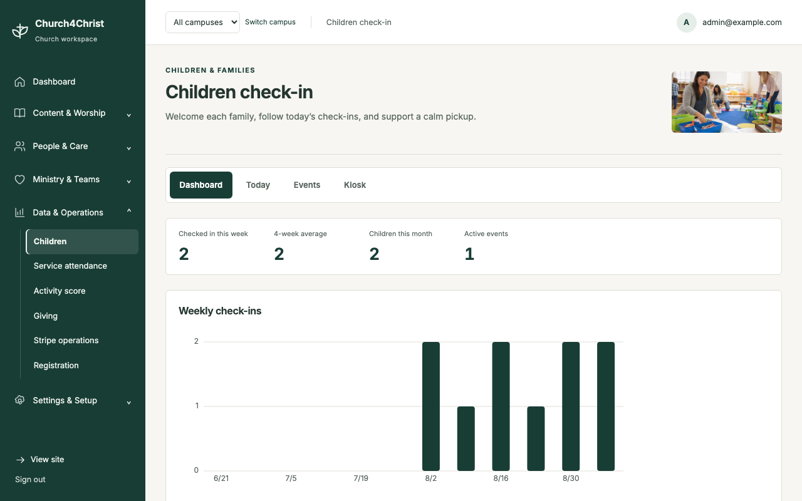

# Church4Christ: software de código aberto para gestão de igrejas e site da igreja

<p align="center"></p>

<p align="center"><a href="README.md">English</a> · <a href="README.zh.md">简体中文</a> · <a href="README.es.md">Español</a> · <b>Português (Brasil)</b> · <a href="README.fr.md">Français</a> · <a href="README.de.md">Deutsch</a> · <a href="README.ja.md">日本語</a> · <a href="README.ko.md">한국어</a> · <a href="README.ms.md">Bahasa Melayu</a> · <a href="README.id.md">Bahasa Indonesia</a> · <a href="README.vi.md">Tiếng Việt</a> · <a href="README.hi.md">हिन्दी</a></p>

*Esta é uma tradução do [README.md](README.md), que é a versão oficial em inglês. Feita com auxílio de IA; correções de falantes nativos são bem-vindas.*

[](https://github.com/leveo/church4christ/actions/workflows/ci.yml)
[](https://github.com/leveo/church4christ/releases)
[](LICENSE)
[](https://astro.build/)
[](https://workers.cloudflare.com/)
[](docs/i18n.md)

**Um sistema de gestão de igrejas (ChMS) e CMS para igrejas de código aberto, concebido
para a era da IA, com um site multilíngue em 12 idiomas de interface, incluindo inglês e chinês. Uma alternativa modular e auto-hospedada ao Planning Center
para igrejas pequenas e médias, comunidades de fé e organizações sem fins lucrativos, construída sobre Astro
e Cloudflare Workers.**

Pessoas e famílias, grupos, escalas de voluntários, check-in infantil, presença,
acompanhamento de visitantes, cuidado em oração, mensagens, boletins, eventos e, opcionalmente, um portal
do membro, um registro de contribuições e inscrição em eventos, tudo em um único código que você pode ler, alterar
e hospedar por conta própria.

**Site: [church4christ.org](https://church4christ.org) · Demonstração ao vivo: [demo.church4christ.org](https://demo.church4christ.org).**

[](https://church4christ.yunfei-song.com/C4C-modular-Voice.mp4)

Assista a **[Built Around Your Ministry](https://church4christ.yunfei-song.com/C4C-modular-Voice.mp4)**,
o vídeo promocional do site de demonstração (MP4).

**Comece aqui: [Configuração para pessoas e agentes de IA](docs/setup.md).** Execute `npm run onboard`
para escolher a identidade da sua organização, as cores, o logo e os primeiros recursos em uma página local
do navegador e, em seguida, passe as preferências salvas para o instalador existente. Agentes de programação começam pelo
[AGENTS.md](AGENTS.md); o Claude também lê o [CLAUDE.md](CLAUDE.md).

O Church4Christ combina um site público multilíngue com um sistema de administração para conteúdo,
cuidado em oração, escalas de voluntários, pessoas e famílias. Módulos opcionais acrescentam um
portal do membro e outros fluxos de trabalho de gestão da igreja. O projeto busca reduzir o
custo inicial e o de manutenção contínua de uma implantação personalizada, mantendo o
código e a configuração de implantação à disposição de quem o opera.

A **versão atual do código-fonte é a 1.7**. O Church4Christ é uma base de código aberto,
não um serviço gerenciado pronto para uso. A avaliação local é gratuita e algumas implantações
podem caber nas cotas gratuitas dos provedores, mas hospedagem de produção,
e-mail, bancos de dados, domínios, backups e outros serviços podem gerar cobranças conforme a
configuração e o uso. Veja [Perfis de implantação e custos](#perfis-de-implantação-e-custos)
antes de escolher uma configuração de produção.

|  |  |  |
|---|---|---|
|  |  |  |
|  |  |  |
|  |  |  |

**Um espaço de trabalho próprio para cada módulo principal.** O design Sanctuary, que vem por padrão,
combina superfícies em marfim quente e navegação em verde-floresta com layouts adequados a cada tarefa:
editores de publicação com pré-visualizações locais, cadastros de pessoas e famílias, filas de cuidado,
matrizes de escala, check-in infantil próprio para telas sensíveis ao toque, players de cursos e livros-caixa
financeiros. Os menus públicos, de membros, de líderes e de administradores acompanham os módulos habilitados
e as permissões de cada pessoa. Harvest e Midnight continuam disponíveis, com modos claro e
escuro. Veja o [inventário de design dos 21 módulos](docs/design/module-coverage.md).

As capturas de tela usam o conteúdo de demonstração fictício do repositório. Na primeira configuração, você pode
incluir esses exemplos ou começar sem eles; as duas opções mantêm os mesmos layouts,
o mesmo tema e as mesmas imagens padrão incluídas. As páginas em inglês usam interface e textos de demonstração em inglês;
as páginas em chinês aceitam conteúdo em chinês e bilíngue. As 29 capturas de tela da interface foram
refeitas a partir do aplicativo em execução; veja o [inventário de capturas e o comando de
regeneração](docs/design/readme-screenshot-inventory.md).

**Navegação agrupada.** Um site com tudo habilitado condensa seus destinos públicos em
Boas-vindas, Explorar, Conectar e Participar. Os links integrados ficam no grupo do seu público,
enquanto páginas personalizadas e links externos aparecem em Mais. A ordem salva em
Admin → Navegação é preservada dentro de cada grupo, e os grupos vazios desaparecem.


Doze idiomas de interface estão incluídos: inglês e chinês, além de espanhol, português do Brasil,
francês, alemão, japonês, coreano, malaio, indonésio, vietnamita e híndi. Cada
igreja escolhe quais idiomas o seu site oferece e um idioma padrão durante a configuração ou depois em
Configurações → Idiomas. As dez traduções mais recentes foram feitas com auxílio de IA; correções de falantes
nativos são bem-vindas. Três visuais prontos e um ponto de partida modular para personalização
adicional também estão incluídos.

---

## Para quem é?

O Church4Christ é destinado a igrejas pequenas e médias, comunidades de fé e organizações sem fins lucrativos —
especialmente congregações multilíngues e de imigrantes — que precisam de um site público e de uma
base personalizável para a gestão da igreja. Funciona melhor quando um membro da equipe, um voluntário
ou um parceiro de implementação com boa familiaridade técnica pode assumir a implantação e a manutenção. Uma
plataforma gerenciada pode ser mais adequada se a organização preferir que o fornecedor cuide da configuração,
do suporte, das atualizações e da responsabilidade operacional, em vez da personalização no nível do código-fonte.

## Como esta abordagem se compara?

Categorias de produto diferentes atendem a necessidades diferentes, e os termos dos provedores variam. Esta tabela
compara modelos de operação, sem prometer preços, portabilidade ou direitos sobre os dados que valham em todos os casos.

| | **Church4Christ** | **CMS com plugins autogerenciado** | **Construtor de sites hospedado** | **Plataforma de igreja gerenciada** |
|---|---|---|---|---|
| **Principal adequação** | Site multilíngue personalizado e fluxos de trabalho modulares da igreja | Site de conteúdo extensível montado com plugins | Site público gerenciado pelo provedor | Fluxos de trabalho da igreja gerenciados pelo provedor |
| **Modelo de custo** | Uso de infraestrutura e serviços; alguns perfis podem caber nas cotas gratuitas | Hospedagem, extensões e manutenção | Assinatura e complementos | Assinatura, muitas vezes por plano ou módulo |
| **Personalização** | Alterações no nível do código-fonte e módulos opcionais | Temas, plugins e alterações no código-fonte, quando disponíveis | Modelos e extensões com suporte do provedor | Configuração e integrações com suporte do provedor |
| **Operação** | Sua equipe ou um parceiro de implementação implanta, atualiza, monitora e faz backup | Sua equipe ou a hospedagem cuida do núcleo e dos plugins | O provedor gerencia a maior parte da operação da plataforma | O provedor gerencia a maior parte da operação da plataforma |
| **Portabilidade** | O acesso ao código e ao banco de dados permite migrar, mas a migração é manual | Depende da hospedagem, dos plugins e dos formatos | Depende das exportações e dos termos do provedor | Depende das exportações, das APIs e dos termos do provedor |
| **Ponto de partida de idiomas** | Doze idiomas de interface incluídos; cada igreja escolhe o seu conjunto | Depende das extensões escolhidas | Depende do serviço e do plano | Depende do serviço e do plano |

**As contrapartidas.** O Church4Christ é otimizado para Cloudflare Workers e seus bindings;
migrar para outra pilha de hospedagem é possível como trabalho no código-fonte, mas não é um caminho de um clique com suporte.
Também não há migração automatizada de conteúdo do D1 para o Supabase. As páginas integradas são definidas
pelos temas, enquanto a edição com arrastar e soltar se aplica apenas às páginas personalizadas. O projeto
tem versões, mas quem o adota deve esperar trabalho de implementação e atualizações revisadas com cuidado.

Operar o projeto também significa mantê-lo. Seu responsável técnico continua sendo responsável
pelas atualizações de dependências, pela revisão e configuração de segurança, pelo monitoramento, pelos backups e testes
de restauração, e pela implantação de correções. A arquitetura reduz parte do trabalho de infraestrutura, mas
não elimina a manutenção de segurança nem a operacional. Veja
[**`docs/why-this-stack.md`**](docs/why-this-stack.md) para conhecer as razões do design.

## Procurando uma alternativa de código aberto ao Planning Center?

Muitas igrejas que buscam uma alternativa gratuita ou auto-hospedada ao Planning Center,
Breeze, Church Community Builder ou a software de gestão de igrejas hospedado semelhante querem duas
coisas: controle sobre os próprios dados e um site que compartilhe os mesmos registros.
O Church4Christ cobre boa parte da gestão cotidiana da igreja em um único aplicativo
auto-hospedado:

| Necessidade comum de um ChMS | Church4Christ |
|---|---|
| Diretório de pessoas e famílias | [Pessoas e famílias](docs/features/people-households.md) com importação de CSV, mapeamentos salvos de colunas de origem e exportação |
| Pequenos grupos | [Grupos](docs/features/groups.md) com diretório público, pedidos de participação, eventos e presença |
| Escalas de voluntários | [Escalas de voluntários](docs/features/volunteer-serve.md) com matriz mensal e confirmação por e-mail, sem precisar de login |
| Planejamento de cultos | [Roteiros, ensaios, disponibilidade e calendários](docs/features/service-planning.md) para cultos e eventos |
| Check-in infantil | [Check-in em totem](docs/features/children-checkin.md) com códigos de retirada e gráficos de presença |
| Presença e engajamento | [Presença nos cultos](docs/features/service-attendance.md) e [pontuações de atividade](docs/features/activity-score.md) |
| Acompanhamento de visitantes e cuidado | [Fila de visitantes](docs/features/newcomers.md), [mural de oração](docs/features/prayer-wall.md) e [fluxos de trabalho da comunidade](docs/features/community-workflows.md) |
| Site da igreja e CMS | [Site público, temas, mensagens, boletins e editor de páginas](docs/features/public-site-and-themes.md) |
| Autoatendimento para membros | [Portal do membro](docs/features/member-portal.md) (família, grupos, oração; roda em D1 ou Supabase) |
| Vários campi | [Multicampus](docs/features/multi-campus.md) com dados e funções isolados por campus |

**Saindo do Planning Center aos poucos.** Uma
[sincronização do Planning Center People](docs/deploy.md#9-optional-configure-planning-center-synchronization)
opcional e somente leitura vincula os registros de pessoas do Planning Center às pessoas já existentes no Church4Christ e envia
as correspondências ambíguas para revisão humana, de modo que os dois sistemas possam funcionar lado a lado durante a
transição. As pessoas são trazidas com o importador de CSV e seus mapeamentos de colunas reutilizáveis.

**O que ele ainda não substitui.** Não há aplicativo móvel nativo, nem mensagens por SMS, nem
biblioteca de músicas ou planejamento de músicas de louvor (o Service Planning cobre roteiros e
ensaios). As contribuições on-line pelo Stripe (cartões e débitos bancários)
funcionam em modo de teste até que você conclua a lista de verificação de entrada em produção; a inscrição paga em eventos
usa o mesmo modo do Stripe. O módulo de contribuições também registra cheques e dinheiro em um livro-caixa
offline e gera extratos anuais de contribuições. O Church4Christ é uma base que a sua equipe opera e mantém, não um
serviço hospedado com suporte do fornecedor.

Planning Center e os demais nomes de produtos acima são marcas registradas dos seus respectivos
proprietários. O Church4Christ é um projeto independente e não é afiliado a eles.

---

## Precisa de apenas uma parte?

Comece pequeno e cresça depois. Cada edição de recurso único instala este repositório com apenas
uma área ativada, usando o banco de dados Cloudflare D1 padrão:

| Se você precisa de | Comece com | Predefinição |
|---|---|---|
| Um totem de check-in infantil | [church-checkin](https://github.com/leveo/church-checkin) | `checkin` |
| Escalas de voluntários | [church-volunteer-scheduling](https://github.com/leveo/church-volunteer-scheduling) | `volunteer-scheduling` |
| Gestão de pequenos grupos | [church-small-groups](https://github.com/leveo/church-small-groups) | `small-groups` |
| Inscrições e check-in de eventos | [church-event-registration](https://github.com/leveo/church-event-registration) | `event-registration` |
| Um site e CMS para a igreja | [church-website-cms](https://github.com/leveo/church-website-cms) | `website` |

As edições não têm código separado, então não há nada extra para manter. Você também pode
pulá-las e executar `npm run onboard -- --preset checkin` aqui. Ative mais recursos a qualquer momento
em **Configurações → Módulos**. Veja as [edições de recurso único](docs/editions.md).

---

## Monte com um assistente de IA

Pessoas e agentes compartilham a mesma integração no navegador, o mesmo instalador, o mesmo catálogo de recursos e as mesmas
verificações de prontidão. O [AGENTS.md](AGENTS.md) e o [CLAUDE.md](CLAUDE.md) instruem o assistente a inspecionar
primeiro a instalação, a executar `npm run onboard` em uma configuração nova sem preferências
e a deixar que você preencha o formulário. Suas respostas ficam no arquivo
`.church/preferences.json`, ignorado pelo Git; as sessões seguintes leem esse arquivo para respeitar sua identidade, sua marca
e os recursos escolhidos. O [guia de configuração](docs/setup.md) inclui os comandos e os passos de recuperação.
Inicie um assistente com:

> "Leia o AGENTS.md e o docs/setup.md. Inicie a integração no navegador para que eu escolha a marca
> da nossa organização e os primeiros recursos. Use minhas preferências salvas para montar uma
> pré-visualização local, verifique as páginas do site e de administração e depois informe a URL e as verificações pendentes."

Você não precisa fazer cada alteração à mão. Este repositório é organizado para que um assistente de programação
com IA possa seguir os guias em linguagem simples em [`docs/features/`](docs/features/) e
trabalhar com ampla cobertura de testes automatizados. Isso pode reduzir o esforço de personalização e
manutenção, mas um mantenedor ainda precisa revisar as alterações, executar os testes
relevantes e implantá-las de forma deliberada.

A ideia: abra este projeto com um assistente de IA, descreva o que você quer em linguagem
natural e deixe que ele faça a edição. Alguns exemplos reais que você pode colar:

> "Leia `docs/features/public-site-and-themes.md`, depois mude nossa cor principal para
> azul-royal e mostre a página inicial."

> "Adicione o idioma italiano (`it`) seguindo `docs/i18n.md`."

> "Siga o docs/setup.md para configurar nossa igreja sem conteúdo de demonstração. Mostre o plano de
> configuração e os resultados de prontidão e depois prepare a implantação usando o docs/deploy.md."

O mesmo fluxo de trabalho ajuda na manutenção: descreva uma alteração, inspecione o diff proposto,
teste localmente e implante somente depois de revisar o resultado. A ajuda da IA
não substitui decisões de segurança, backups, testes em produção nem a responsabilidade operacional.

---

## Nossa missão

**Reduzir o custo e o esforço de começar com um sistema de gestão de igrejas personalizado e um
site multilíngue.** O Church4Christ oferece uma base modular e testada que uma igreja ou um
parceiro de implementação pode adaptar em vez de começar do zero. Ele não promete um
serviço de produção sem assinatura ou sem orçamento: as escolhas de infraestrutura, e-mail, banco de dados,
domínio, suporte e manutenção determinam o custo real de operação.

---

## O que há dentro

Cada recurso tem seu próprio guia em linguagem simples. Comece por qualquer um destes:


| | Recurso | O que faz |
|---|---|---|
| [](docs/features/public-site-and-themes.md) | **[Site público e temas](docs/features/public-site-and-themes.md)** | A porta de entrada da sua igreja — início, mensagens, eventos, equipe — em um de três visuais prontos. |
| [](docs/features/cms-admin.md) | **[A área de administração](docs/features/cms-admin.md)** | Login sem senha, funções e restauração com um clique para o conteúdo editorial versionado que a suporta. |
| [](docs/features/admin-permissions.md) | **[Permissões de administração](docs/features/admin-permissions.md)** | Dê a cada administrador apenas as áreas de que ele precisa — o mural de oração e o diretório de membros vêm incluídos, o restante por escolha. |
| [](docs/features/multi-campus.md) | **[Multicampus](docs/features/multi-campus.md)** | Gerencie vários campi em um único backend, com dados, configurações, recursos e funções locais isolados por campus; somente o administrador mestre vê todos os campi. |
| [](docs/features/bulletins.md) | **[Boletins semanais](docs/features/bulletins.md)** | Monte a folha do culto de domingo e programe a publicação automática. |
| [](docs/features/sermons.md) | **[Arquivo de mensagens](docs/features/sermons.md)** | Cole um link do YouTube e tenha uma biblioteca pesquisável e de carregamento rápido de mensagens anteriores. |
| [](docs/features/prayer-wall.md) | **[Mural de oração](docs/features/prayer-wall.md)** | Receba pedidos de oração e acompanhe-os em um quadro simples, de forma privada. |
| [](docs/features/volunteer-serve.md) | **[Escalas de voluntários](docs/features/volunteer-serve.md)** | Planeje um mês de serviço de relance; os voluntários confirmam por e-mail, sem login. |
| [](docs/features/people-households.md) | **[Pessoas e famílias](docs/features/people-households.md)** | Perfis e famílias, além de exportação CSV canônica somente para criação e mapeamento reutilizável de colunas de origem para migrações. |
| [](docs/features/member-identity.md) | **[Segurança de identidade de membros](docs/features/member-identity.md)** | Identidade vinculada a comprovação em Contribuições, Inscrições, Grupos, Equipes, Visitantes e importações; duplicatas ambíguas vão para revisão em vez de serem mescladas apenas pelo nome, com aprovação vinculada a OTP e uma reversão protegida de 24 horas. |
| [](docs/features/groups.md) | **[Grupos](docs/features/groups.md)** | Pequenos grupos com diretório público, lista de verificação de membros, pedidos de participação, eventos e presença por pessoa por link de e-mail. |
| [](docs/features/children-checkin.md) | **[Check-in infantil](docs/features/children-checkin.md)** | Um totem sensível ao toque em que os pais fazem a entrada e a saída das crianças com um código de retirada, além de gráficos semanais de presença. |
| [](docs/features/service-attendance.md) | **[Presença nos cultos](docs/features/service-attendance.md)** | Registre totais agregados de adultos, obtenha totais opcionais de crianças a partir dos check-ins, corrija o histórico e baixe relatórios CSV sem identidades. |
| [](docs/features/newcomers.md) | **[Acompanhamento de visitantes](docs/features/newcomers.md)** | Receba cartões públicos bilíngues com consentimento, faça a triagem de uma fila da equipe com escopo limitado e encaminhe correspondências exatas para Pessoas sem vazar anotações ou respostas. |
| [](docs/features/onboarding-readiness.md) | **[Prontidão para o lançamento](docs/features/onboarding-readiness.md)** | Uma lista de verificação bilíngue compartilhada pela configuração, pelo doctor e por cada administrador real, com confirmações do superadministrador para verificações manuais. |
|  | **[Planejamento de cultos](docs/features/service-planning.md)** | Planeje um roteiro cronometrado, ensaios com as pessoas convocadas, disponibilidade dos membros, uma busca de horário em comum, calendários e e-mail automático. |
|  | **[Pontuação de atividade](docs/features/activity-score.md)** | Combine atividades selecionadas ligadas a pessoas em pontuações de membros explicáveis e em um resumo de engajamento de toda a igreja. |
| [](docs/features/learning.md) | **[Aprendizado](docs/features/learning.md)** | Continue a escola bíblica dominical e o discipulado entre os encontros com vídeos bilíngues, arquivos, tarefas, questionários e status sincronizado com o provedor. |
| [](docs/features/page-builder.md) | **[Editor de páginas](docs/features/page-builder.md)** | Monte suas próprias páginas personalizadas arrastando e soltando — multilíngues, sempre no tema, e as páginas publicadas carregam sem nenhum JavaScript. Opcional; desativá-lo nunca quebra uma página que você já criou. |
| [](docs/features/giving.md) | **[Contribuições](docs/features/giving.md)** | Implementado: contribuições on-line pelo Stripe (modo de teste por padrão, ao vivo após a lista de verificação de entrada em produção), um livro-caixa offline para cheques e dinheiro e extratos anuais de contribuições. |
| [](docs/features/registration.md) | **[Inscrições](docs/features/registration.md)** | Implementado: inscrição gratuita em eventos no D1 ou no Supabase, perguntas personalizadas, lista de espera, etapas do evento e exportação da lista de participantes, além de pagamento pelo Stripe no Supabase, no mesmo modo do Stripe das Contribuições (verifique com uma pequena inscrição real antes de depender dele). |
|  | **[Logística de eventos](docs/features/event-logistics.md)** | Complemento opcional das Inscrições: coloque as pessoas em quartos, distribua-as em mesas com uma prévia da Distribuição automática, separe-as em pequenos grupos e imprima listas de quartos, placas de porta e cartões de mesa. |
| [](docs/features/member-portal.md) | **[Portal do membro](docs/features/member-portal.md)** | Um único centro com login para a participação atual e as oportunidades abertas, além de perfis de família, eventos, serviço, calendário, contribuições e oração com escopo limitado. |
| [](docs/features/i18n.md) | **[Doze idiomas](docs/features/i18n.md)** | Escolha entre 12 idiomas de interface por site, com inglês como alternativa e conversão com um clique de chinês simplificado para tradicional. |
| [](docs/features/email-automation.md) | **[E-mail e automação](docs/features/email-automation.md)** | Links de login, lembretes e resumos, com registro local e uma configuração de produção compatível com planos pagos. |
| [](docs/features/modules.md) | **[Módulos](docs/features/modules.md)** | Desative os recursos que você não usa; nada é excluído, e você pode reativá-los quando quiser. |

**Escolha seus módulos.** A maioria dos recursos opcionais são **módulos** que você pode desativar
em um único painel em Configurações — boletins, mensagens, o mural de oração, escalas de voluntários
e mais. As instalações novas gravam cada configuração de módulo de forma explícita a partir da seleção de configuração;
a demonstração Full Church seleciona os seus 21 (o Service Planning e o Event Logistics são ativados separadamente). Somente em instalações antigas, as linhas de módulos ausentes mantêm
o comportamento legado de ativado por padrão. Uma igreja que quer apenas horários de culto e mensagens pode ocultar
o resto com um clique: as páginas, os links e os e-mails do módulo desaparecem juntos, e nada
é excluído. Veja [**`docs/features/modules.md`**](docs/features/modules.md).

| Key | English | 中文 | Required database |
|---|---|---|---|
| `bulletins` | Bulletins | 周报 | Either |
| `sermons` | Sermons | 讲道 | Either |
| `prayer-sheets` | Prayer Sheets | 祷告单 | Either |
| `prayer-wall` | Prayer Wall | 祷告墙 | Either |
| `events` | Events | 活动 | Either |
| `serve` | Volunteer Scheduling | 服事排班 | Either |
| `gifts` | Spiritual Gifts | 恩赐探索 | Either |
| `testimonies` | Testimonies | 见证 | Either |
| `articles` | Articles | 文章 | Either |
| `fellowships` | Fellowships | 团契 | Either |
| `groups` | Groups | 小组 | Either |
| `people` | People & Households | 会友与家庭 | Either |
| `children` | Children Check-in | 儿童报到 | Either |
| `attendance` | Service Attendance | 崇拜出席 | Either |
| `newcomers` | Newcomer Follow-up | 新朋友跟进 | Either |
| `activity-score` | Activity Score | 活跃度评分 | Either |
| `page-builder` | Page Builder | 页面编辑器 | Either |
| `portal` | Member Portal | 会友平台 | Either |
| `giving` | Giving | 奉献 | Supabase |
| `registration` | Registration | 活动报名 | Either |
| `learning` | Learning | 学习 | Either |
| `planning` | Service Planning | 服事流程 | Either |
| `event-logistics` | Event Logistics | 活动后勤 | Either |

### Gestão da comunidade e fluxos de trabalho

Os campi podem gerenciar diretamente os grupos e o acompanhamento dos membros. As comunhões opcionais acrescentam uma camada comunitária com participação independente e grupos subordinados. Os fluxos de trabalho reutilizáveis oferecem passos atribuídos, prazos, acompanhamento da conclusão e lembretes por e-mail da Cloudflare. Veja o [guia de fluxos de trabalho da comunidade](docs/features/community-workflows.md) para configuração, permissões e controles de envio.

### Aprendizado além do domingo

A versão 1.1 acrescenta o módulo opcional **Aprendizado** para a escola bíblica dominical,
o discipulado e outros ministérios que continuam entre os encontros. Os alunos têm
uma visão de curso bilíngue e com privacidade delimitada para vídeos não listados do YouTube, arquivos,
tarefas e questionários. A entrega continua sendo de responsabilidade do provedor: o site
direciona os alunos ao provedor configurado em vez de coletar ele mesmo tarefas,
respostas, comentários, notas ou o conteúdo dos arquivos.

Os administradores podem conectar o Google Classroom pelas suas APIs oficiais ou por um derivado
do Church4Christ Canvas operado separadamente. O mapeamento de cursos, as credenciais OAuth criptografadas, as notificações assinadas do provedor, a sincronização manual e a reconciliação
agendada e limitada alimentam apenas os metadados de atividade de que o Church4Christ precisa.


| Visão do aluno em inglês | Visão do aluno em chinês | Administração do provedor |
|---|---|---|
| [](docs/images/learning/genesis-1-en.png) | [](docs/images/learning/genesis-1-zh.png) | [](docs/images/learning/admin-overview.png) |

Veja o **[guia do recurso Aprendizado](docs/features/learning.md)** para a configuração
do provedor, os limites de privacidade, os orçamentos de sincronização, a demonstração de Gênesis 1 e os
requisitos separados de operação do Canvas e de código-fonte correspondente.

### Um lar para os seus membros

O **Portal do Membro** opcional transforma os registros que a sua igreja já mantém em uma
experiência útil com login. Sua página de oportunidades mostra em um só lugar todas as formas habilitadas de
aprender, pertencer e servir: tanto os grupos, as turmas e as equipes já
ligados ao membro quanto as oportunidades abertas para participar ou se candidatar. Os membros
também podem atualizar os dados da família, ver suas contribuições, inscrever-se em eventos, revisar seus compromissos
de serviço, assinar um calendário pessoal e compartilhar orações com escopo limitado. Ele usa os mesmos
links de login sem senha do restante do Church4Christ — sem conta nova nem senha
para lembrar.


Os líderes de ministérios, grupos, escola bíblica dominical e equipes de serviço têm um painel com escopo limitado aos seus recursos em
`/<locale>/manage`. O login do aplicativo da igreja o protege, e cada operação verifica
a autoridade do líder sobre aquele recurso específico. Assim, o Cloudflare Zero Trust pode ficar
limitado à área `/admin` completa.


O portal funciona tanto no backend D1 padrão quanto no backend opcional **Supabase (Postgres)**.
Famílias, grupos, arquivos protegidos de grupos e a moderação de orações da igreja, do grupo e privadas
funcionam no D1. As orações no escopo de evento, os administradores de eventos e "Minhas inscrições"
precisam de Inscrições, que funciona no D1 para eventos gratuitos depois de ativado. Saiba mais em
[**`docs/features/member-portal.md`**](docs/features/member-portal.md).

---

## Experimente em 5 minutos (no seu próprio computador)

Você pode executar o site localmente, com conteúdo de exemplo fictício opcional, antes de escolher uma
implantação. Você precisará ter o [Node.js](https://nodejs.org/) 22.22.1 ou mais recente instalado. A integração
no navegador recomenda **Website + Community** com **Cloudflare D1** para o primeiro lançamento.


```bash
# 1. Get the code and install it
git clone https://github.com/leveo/church4christ.git
cd church4christ
npm ci

# 2. Open the local browser form, complete it, and save your preferences
npm run onboard

# 3. Review the plan, then initialize with those same preferences
node scripts/setup/index.mjs --preferences .church/preferences.json --yes --dry-run --json
node scripts/setup/index.mjs --preferences .church/preferences.json --yes --json

# 4. For D1, start it (always follow the exact handoff setup prints)
npm run dev
```

O formulário pergunta se é uma igreja, uma organização sem fins lucrativos ou um campus e coleta o nome,
o lema, o endereço, o fuso horário, as cores primária e secundária, um logo opcional em PNG/JPEG/WebP
(de até 2 MiB), o idioma, o primeiro administrador e a escolha de conteúdo de demonstração. Marque apenas os
recursos de que você precisa.
A seleção recomendada usa o D1 como banco de dados; o aplicativo continua rodando no
Cloudflare Workers e guarda a mídia no R2. **Contribuições e Inscrições pagas**
são opções avançadas que exigem a troca explícita para um PostgreSQL compatível com o Supabase.

Ao salvar, são gravados o `.church/preferences.json` e qualquer logo enviado em `.church/`, que o
Git ignora. Isso não cria bancos de dados nem implanta um site. Execute `npm run onboard` novamente para
recarregar e editar as preferências salvas. Mantenha o terminal em execução enquanto preenche o
formulário; interrompa-o com Ctrl+C ao terminar. Para abrir você mesmo a URL exibida, use
`npm run onboard -- --no-open`; para escolher uma porta, acrescente `--port 4310`. O ponto de entrada direto
é `node scripts/onboard/index.mjs`. Veja [o guia de configuração](docs/setup.md) para saber o que o
instalador aplica e como os agentes usam as demais preferências.

Se você instalar com `npm ci --ignore-scripts`, execute `npm run tokens` manualmente antes do
instalador ou do `npm run dev`.

Para o Supabase local, o handoff, em vez disso, exporta
`CLOUDFLARE_HYPERDRIVE_LOCAL_CONNECTION_STRING_HYPERDRIVE` no shell do host antes do
`npm run dev`; essa URL de conexão não deve ir no `.dev.vars`.

Durante a primeira configuração, escolha **Include demo content** ou **No demo content**. As duas opções mantêm o
mesmo design incluído, as mesmas imagens decorativas locais, os mesmos recursos habilitados e as mesmas ferramentas de administração.
O conteúdo de demonstração acrescenta pessoas, mensagens, boletins, eventos, ministérios e outros
exemplos fictícios. A etapa de mídia copia o pacote de imagens geradas de `seed/media/` para o R2 local.
Sem conteúdo de demonstração, são criados o esquema do banco de dados, os padrões operacionais, as configurações da igreja, a seleção
de módulos e o primeiro administrador, sem registros de exemplo.

O arquivo de preferências registra a escolha de conteúdo de demonstração do formulário. Para uma configuração com respostas
explícitas por CLI, passe `--demo-data` ou `--no-demo-data`; omitir os dois em uma configuração não interativa mantém
o padrão atual de não incluir demonstração. As opções não podem ser combinadas. Repetir a mesma
configuração preserva a escolha de conteúdo registrada e os registros existentes. `--no-demo-data` não
limpa um banco de dados existente, e a configuração se recusa a adicionar dados de demonstração sobre pessoas já existentes.
Use um espaço de trabalho e um banco de dados novos e separados para experimentar o outro modo inicial.

Abra o endereço que a configuração exibe (geralmente `http://localhost:4321`).

**Entrando na área de administração.** Não há senha. Na página de login, informe o
e-mail do primeiro administrador das suas respostas de configuração, repetido no handoff, e solicite um
link. Como o e-mail local está configurado para ser impresso em vez de enviado, a **URL do link mágico aparece
direto no seu terminal**. Cole-a no navegador e pronto, você entrou. (Para testes locais mais rápidos,
a configuração grava esse mesmo endereço como `AUTH_DEV_BYPASS_EMAIL` no `.dev.vars`, o que
faz o login automaticamente. Remova essa linha para testar o fluxo real de login.)

Nos dois modos de conteúdo, a configuração cria ao mesmo tempo um novo administrador e a sua identidade de login
auditada. Reexecuções preservam a propriedade dos contatos existentes; elas não verificam
um e-mail existente nem restauram um acesso revogado. Se a configuração relatar um problema de identidade, conclua
o [fluxo de revisão ou recuperação de identidade](docs/features/member-identity.md) antes de executá-la de novo.

O comando `npm run setup`, apenas para terminal, continua disponível. A configuração oferece **Website** (8 módulos de
publicação focados), **Website + Community** (18 módulos; o Portal do Membro pode ser adicionado no D1) e
**Full Church** (21 módulos; o Service Planning é ativado separadamente). Contribuições
seleciona o Supabase automaticamente (as Inscrições gratuitas funcionam no D1); as seleções compatíveis com o D1 escolhem o D1, a menos que você
substitua o backend explicitamente. Os requisitos de conta dependem do modo Local ou Deploy,
como detalhado abaixo. Para automação, passe todas as respostas com `--yes`; acrescente `--json` para obter um único resultado
legível por máquina. Para uma execução não interativa legível por pessoas, use as mesmas flags completas
com `npm run setup -- ... --yes` e omita `--json`. Para manter o stdout estritamente em JSON
pelo npm, use a forma silenciosa:

```bash
npm run --silent setup -- --mode local --preset website --site-slug my-church \
  --church-name "My Church" --locale en --admin-email admin@example.com \
  --admin-name "First Admin" --app-origin http://localhost:4321 \
  --email-from admin@example.com --demo-data --yes --json
```

---

## Perfis de implantação e custos

Estes são perfis de planejamento, não garantias de preço. Os preços abaixo estão atualizados em
**agosto de 2026**, estão sujeitos a mudança e devem ser confirmados nas páginas oficiais de preços indicadas antes da implantação.

| Perfil | Escopo incluído | Observações sobre custo e prontidão |
|---|---|---|
| **Avaliação local** | Módulos de site ou comunidade com D1 local; módulos completos com Postgres local compatível | Não há cobrança de serviço hospedado para avaliar com D1 local. Você ainda fornece o computador, o tempo de desenvolvimento e quaisquer serviços externos opcionais. |
| **D1 site/comunidade** | Worker da Cloudflare, D1 e R2 para até 22 módulos compatíveis com D1 | Uma implantação modesta pode caber nas cotas gratuitas da Cloudflare. Tráfego, armazenamento, operações além das cotas, um domínio e outros serviços podem gerar custos; consulte os [preços do Workers](https://developers.cloudflare.com/workers/platform/pricing/). O e-mail de produção é separado. |
| **E-mail de produção** | Links de login, lembretes, solicitações e resumos transacionais para destinatários arbitrários | O repositório oferece suporte a uma configuração de e-mail da Cloudflare compatível com planos pagos. O envio a destinatários arbitrários exige o Workers Paid, atualmente com mínimo de **US$ 5/mês**, incluindo **3.000 e-mails**, e depois **US$ 0,35 por 1.000 e-mails**. Esses valores estão sujeitos a mudança; consulte os [preços do Cloudflare Email Service](https://developers.cloudflare.com/email-service/platform/pricing/). |
| **Supabase/módulos completos** | Implantação na Cloudflare mais Supabase/Postgres para os 21 módulos do Full Church, incluindo Portal do Membro, Contribuições e Inscrições | Os custos da Cloudflare continuam valendo, e o [plano do Supabase](https://supabase.com/pricing) escolhido pode acrescentar assinatura ou cobrança por uso. Em agosto de 2026, o Supabase Free não tem backups diários automáticos, e projetos Free com pouca atividade podem ser [pausados automaticamente](https://supabase.com/docs/guides/platform/free-project-pausing) conforme a atividade em um período de sete dias. Em produção, faça dumps regulares do banco de dados em local externo e ensaios de restauração, ou escolha um plano pago cujas [opções de backup](https://supabase.com/docs/guides/platform/backups) atendam aos seus requisitos de continuidade. Preços e políticas de serviço estão sujeitos a mudança. O Stripe começa em modo de teste; pagamentos reais são uma adesão explícita após a lista de verificação de entrada em produção em [`docs/supabase-setup.md`](docs/supabase-setup.md). |

As cotas gratuitas dos provedores podem ser úteis para avaliação ou para implantações modestas, mas
não são uma promessa de que um serviço de produção continuará gratuito. Reserve orçamento para a responsabilidade técnica,
a manutenção de dependências e de segurança, o monitoramento, os backups, os testes de restauração e o crescimento
futuro de uso, além dos serviços listados acima.

---

## Colocando no ar

Novo nisso? Comece pelo [**`docs/cloudflare-setup.md`**](docs/cloudflare-setup.md) — um
guia em linguagem simples que explica o que é a Cloudflare, o modelo de custos e as duas
formas de colocar no ar (incluindo deixar um assistente de IA fazer isso por você). Quando quiser os
comandos exatos, o [**`docs/deploy.md`**](docs/deploy.md) é o passo a passo
completo.

Comece com `npm run setup`, escolha **Deploy** e responda às perguntas sobre recursos e sobre a igreja.
Ele cria ou importa os recursos necessários, grava a configuração gerada, aplica as
migrações, registra as 23 configurações de módulos e prepara o primeiro administrador. Depois passa
para `npm run deploy`. Execute `npm run doctor` para obter o relatório de prontidão schema-v2 e use
a lista de verificação sempre ativa em `/admin/onboarding` para as mesmas identidades de verificação estáveis.
Contribuições, Inscrições, Grupos, Equipes, Visitantes, importações e a integração opcional somente leitura com o Planning
Center compartilham uma porta de identidade vinculada a comprovação e com revisão prévia. Ela nunca mescla
pessoas automaticamente por nome ou por um contato não verificado. Veja [Identidade de membros](docs/features/member-identity.md)
para o fluxo de trabalho, os controles contra fraude, o limite atual de migração e a lacuna de verificação do provedor;
as regras de configuração e rotação de segredos continuam no [manual de implantação](docs/deploy.md#stable-identity-source-key).
A implantação é manual de propósito: a automação do repositório testa as alterações, mas não
as publica nem migra os dados de produção por você.

**A primeira implantação e as atualizações são operações diferentes.** A configuração guiada provisiona ou
importa recursos e prepara uma instalação revisada. Não é uma atualização automática de um clique
para um site que já contém dados da igreja. Quem já opera um site deve começar pelo
[manual de atualização](docs/upgrade.md), fazer backup do banco de dados, da mídia do R2, da configuração e do inventário de
segredos, ensaiar em um ambiente de staging e revisar o [changelog `Unreleased`](CHANGELOG.md) antes de
aplicar migrações para a frente. Quem prepara uma versão deve seguir
o [processo de lançamento](docs/release-process.md).

**Escolhendo seu banco de dados.** Os 22 módulos compatíveis com D1 excluem
**Contribuições**, que exige Postgres, e as **Inscrições pagas**, que também exigem. Os requisitos de conta seguem o
modo: D1 local não precisa de conta externa; D1 implantado precisa de uma conta Cloudflare; Supabase
local precisa de uma conta Supabase ou de um banco Postgres local compatível; Supabase implantado
precisa de Cloudflare e Supabase. Ainda não há migração automatizada de conteúdo entre D1 e Supabase,
então escolha o banco de dados de produção antes de inserir conteúdo real. Veja
[**`docs/supabase-setup.md`**](docs/supabase-setup.md).

**O Stripe começa em modo de teste; o modo ao vivo é uma adesão explícita.** O Stripe hospeda as páginas de pagamento,
os recibos, o Billing Portal, os reembolsos e as contestações; este aplicativo guarda apenas valores,
fundos, datas, status e IDs do Stripe. Contribuições e as Inscrições pagas funcionam somente com Supabase; o D1 não
oferece suporte a elas. Quando a configuração pedir um dos dois módulos, importe uma chave `sk_test_…` e
um segredo de assinatura `whsec_…` com as variáveis de ambiente de uso único `CHURCH_SETUP_STRIPE_SECRET_KEY` e
`CHURCH_SETUP_STRIPE_WEBHOOK_SECRET`; a configuração guarda os segredos de execução
e grava `STRIPE_MODE=test`. Para receber contribuições reais, siga a lista de verificação de entrada em produção do
guia do Supabase (chave live, webhook na versão de API `2025-03-31.basil`, `STRIPE_MODE=live`
mais `STRIPE_LIVE_CONFIRMED=1`). Um evento cujo modo não corresponde ao modo configurado é
rejeitado, e o Worker com Supabase executa uma recuperação durável a cada cinco minutos. Testes
locais não comprovam a entrega real do Stripe.

---

## Como funciona por dentro

Para os curiosos: o Church4Christ é construído com o **[Astro](https://astro.build/)**, que renderiza
as páginas no servidor, rodando como um único **Worker da Cloudflare**. Os dados do aplicativo ficam no
backend escolhido — **D1** da Cloudflare ou **Supabase/Postgres** — e a mídia enviada fica
no **R2** da Cloudflare (armazenamento de objetos); o e-mail sai pelo binding de e-mail da Cloudflare.
As páginas voltadas ao visitante **não carregam nenhum framework JavaScript no cliente** — são HTML
simples e rápido com um toque de script vanilla —
o que explica em boa parte por que o site carrega rápido e custa tão pouco para operar. (A única
exceção fica atrás do login da equipe: o editor de páginas de arrastar e soltar é um pequeno editor
em React que só a sua equipe baixa; as páginas que ele publica continuam sendo HTML simples.)

Todo o visual vem dos **[design tokens](design/README.md)**: um conjunto de valores de cor e tipografia
que são compilados em três temas prontos (Sanctuary, Harvest, Midnight),
cada um com modo claro e escuro. O projeto tem **ampla cobertura automatizada** em
seus fluxos de trabalho principais, para que os mantenedores possam verificar as alterações antes da implantação.

**Por que essas escolhas?** As razões da implantação otimizada para a Cloudflare, da
pilha Astro + Tailwind + TypeScript e dos casos em que uma plataforma gerenciada pode ser o
melhor modelo de operação estão descritas em
[**`docs/why-this-stack.md`**](docs/why-this-stack.md). Para o quadro técnico, veja
[`docs/architecture.md`](docs/architecture.md),
[`docs/design-system.md`](docs/design-system.md) e [`docs/i18n.md`](docs/i18n.md).

---

## Perguntas frequentes

**O que é o Church4Christ?**
Um sistema de gestão de igrejas (ChMS) e CMS para igrejas de código aberto. Ele combina um site
multilíngue da igreja (12 idiomas de interface) com ferramentas para a equipe de pessoas e famílias, grupos,
escalas de voluntários, check-in infantil, presença, acompanhamento de visitantes e cuidado em oração.

**Existe uma alternativa gratuita e de código aberto ao Planning Center?**
O Church4Christ é uma opção. O código-fonte é gratuito sob a GPL-3.0 e você o hospeda
por conta própria no Cloudflare Workers. Ele cobre pessoas, grupos, check-in, escalas de voluntários,
presença e um site da igreja, e pode ler o Planning Center People por meio de uma
sincronização opcional somente leitura durante a transição. Ele não tem os aplicativos móveis,
o SMS nem o planejamento de músicas de louvor do Planning Center. Veja
[Procurando uma alternativa de código aberto ao Planning Center?](#procurando-uma-alternativa-de-código-aberto-ao-planning-center)

**É gratuito?**
O software é gratuito. Hospedagem, e-mail, banco de dados e domínio podem gerar custos
conforme a sua configuração e o seu uso; algumas implantações pequenas cabem nas cotas gratuitas
dos provedores. Veja [Perfis de implantação e custos](#perfis-de-implantação-e-custos).

**Quais idiomas ele suporta?**
Doze idiomas de interface: inglês, chinês, espanhol, português do Brasil, francês, alemão,
japonês, coreano, malaio, indonésio, vietnamita e híndi. Cada igreja escolhe quais o seu
site oferece e um idioma padrão; as páginas em chinês também têm conversão com um clique de chinês simplificado
para tradicional. Mais idiomas podem ser adicionados; veja [docs/i18n.md](docs/i18n.md).

**Uma igreja pequena, sem desenvolvedor, consegue operá-lo?**
Funciona melhor quando um membro da equipe, um voluntário ou um parceiro com boa familiaridade técnica assume
a implantação e as atualizações. A integração no navegador e os guias para assistentes de IA reduzem esse esforço,
mas alguém ainda precisa revisar as alterações, fazer backup dos dados e implantar.

**Com o que ele é construído?**
Astro no Cloudflare Workers, com Cloudflare D1 ou Supabase/PostgreSQL para os dados e
Cloudflare R2 para a mídia. As páginas públicas não carregam nenhum framework no cliente.

---

## Licença

O Church4Christ é software livre e de código aberto sob a **[Licença Pública Geral GNU
v3](LICENSE)** (GPL-3.0). Você pode usá-lo e estudá-lo, modificá-lo em particular, compartilhar cópias e
cobrar por cópias, desenvolvimento sob medida, hospedagem, suporte ou outros serviços comerciais.

Se você distribuir uma versão modificada coberta pela licença, aplicam-se as condições da GPL: os destinatários devem
receber as liberdades da GPL aplicáveis, e o código-fonte correspondente deve ser disponibilizado sob
a GPL, como a licença exige. Modificações privadas não precisam ser publicadas. O simples fato de
executar uma versão modificada como serviço de rede, sem distribuir uma cópia, não aciona
por si só uma obrigação de compartilhar o código-fonte no estilo da AGPL sob a GPLv3.

O arquivo [`LICENSE`](LICENSE) é o que tem validade. Este resumo é oferecido para orientação e
não constitui aconselhamento jurídico.

---

## Contribuindo e roteiro

Contribuições são bem-vindas — relatos de bugs, traduções, novos recursos. Comece pelo
[`CONTRIBUTING.md`](CONTRIBUTING.md) para a configuração de desenvolvimento e as cinco regras do projeto, e pelo
[`SECURITY.md`](SECURITY.md) se você encontrou um problema de segurança.

**No horizonte (ainda não construído):** um "mercado de trocas" entre igrejas para compartilhar
temas e conteúdo é uma ideia que estamos considerando, não uma promessa. Se isso for importante para a sua
igreja, abra uma issue e vamos conversar.

---

Feito com carinho, e com a ajuda da IA, para igrejas e organizações sem fins lucrativos do mundo todo.
