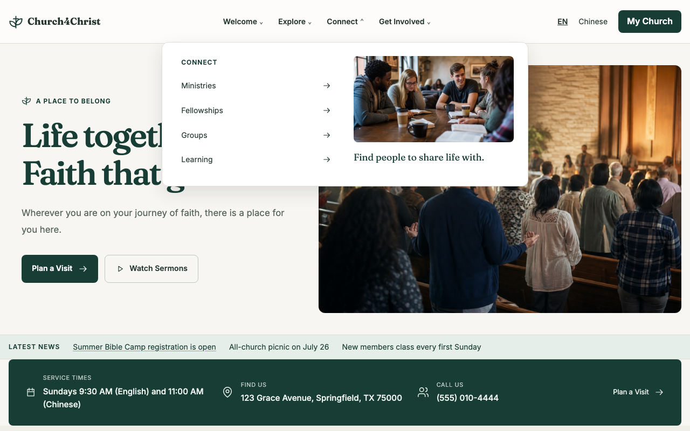
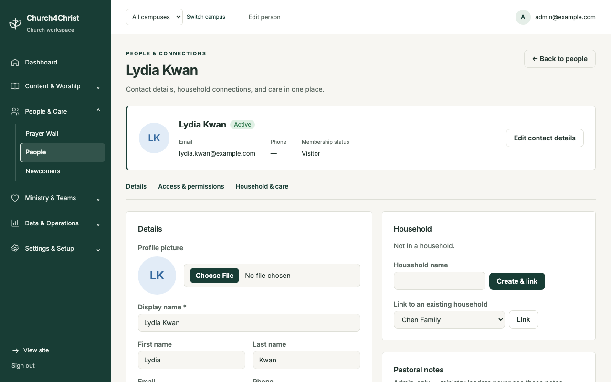
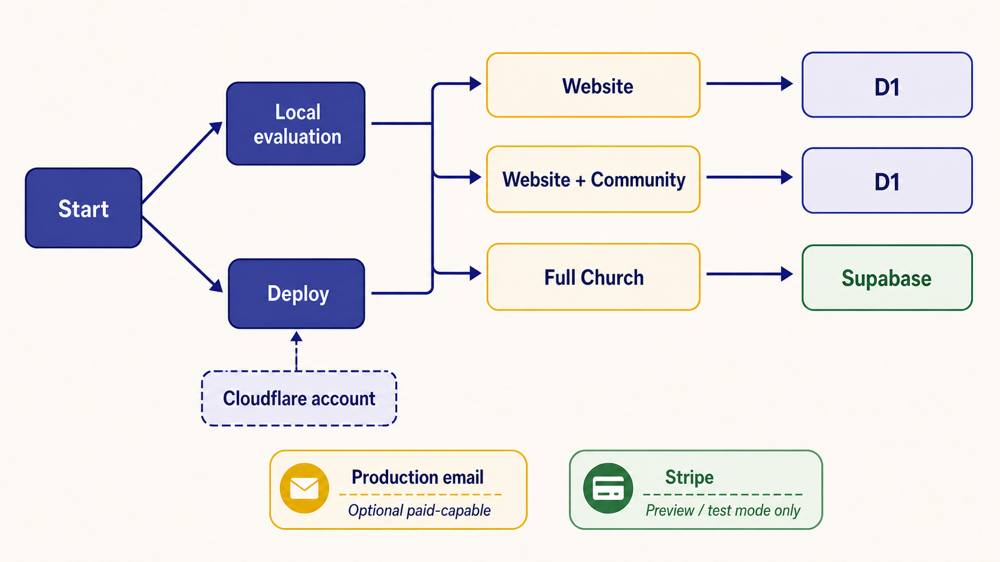

# Church4Christ: phần mềm quản lý Hội Thánh mã nguồn mở và website Hội Thánh

<p align="center"></p>

<p align="center"><a href="README.md">English</a> · <a href="README.zh.md">简体中文</a> · <a href="README.es.md">Español</a> · <a href="README.pt.md">Português (Brasil)</a> · <a href="README.fr.md">Français</a> · <a href="README.de.md">Deutsch</a> · <a href="README.ja.md">日本語</a> · <a href="README.ko.md">한국어</a> · <a href="README.ms.md">Bahasa Melayu</a> · <a href="README.id.md">Bahasa Indonesia</a> · <b>Tiếng Việt</b> · <a href="README.hi.md">हिन्दी</a></p>

*Đây là bản dịch của [README.md](README.md), bản tiếng Anh là bản chính thức. Bản dịch có sự hỗ trợ của AI; rất hoan nghênh những góp ý sửa lỗi từ người bản ngữ.*

[](https://github.com/leveo/church4christ/actions/workflows/ci.yml)
[](https://github.com/leveo/church4christ/releases)
[](LICENSE)
[](https://astro.build/)
[](https://workers.cloudflare.com/)
[](docs/i18n.md)

**Hệ thống quản lý Hội Thánh (ChMS) và CMS cho Hội Thánh mã nguồn mở, ưu tiên AI, với
website Hội Thánh đa ngôn ngữ có 12 ngôn ngữ giao diện, trong đó có tiếng Anh và tiếng Trung. Một giải pháp thay thế Planning Center
tự lưu trữ, dạng mô-đun, dành cho các Hội Thánh nhỏ và vừa, các đoàn thể và tổ chức phi lợi nhuận, xây dựng trên Astro
và Cloudflare Workers.**

Danh bạ cá nhân và gia đình, nhóm, xếp lịch tình nguyện viên, điểm danh trẻ em, điểm danh tham dự,
chăm sóc người mới, chăm sóc cầu nguyện, bài giảng, bản tin, sự kiện, cùng cổng thông tin thành viên,
sổ cái dâng hiến và đăng ký sự kiện (tùy chọn), tất cả trong một mã nguồn mà bạn có thể đọc, chỉnh sửa
và tự lưu trữ.

**Website: [church4christ.org](https://church4christ.org) · Bản demo trực tuyến: [demo.church4christ.org](https://demo.church4christ.org).**

[](https://church4christ.yunfei-song.com/C4C-modular-Voice.mp4)

Hãy xem **[Built Around Your Ministry](https://church4christ.yunfei-song.com/C4C-modular-Voice.mp4)**,
video giới thiệu của trang demo (MP4).

**Bắt đầu tại đây: [Hướng dẫn cài đặt cho con người và tác nhân AI](docs/setup.md).** Chạy `npm run onboard`
để chọn danh tính tổ chức, màu sắc, logo và các tính năng đầu tiên trên một trang web cục bộ
trong trình duyệt, rồi chuyển các tùy chọn đã lưu cho trình cài đặt hiện có. Các tác nhân lập trình bắt đầu từ
[AGENTS.md](AGENTS.md); Claude cũng đọc [CLAUDE.md](CLAUDE.md).

Church4Christ kết hợp một website công khai đa ngôn ngữ với hệ thống quản trị cho nội dung,
chăm sóc cầu nguyện, xếp lịch tình nguyện viên, danh bạ cá nhân và gia đình. Các mô-đun tùy chọn bổ sung
cổng thông tin thành viên và những quy trình quản lý Hội Thánh khác. Dự án nhằm giảm chi phí
khởi đầu và bảo trì lâu dài của một hệ thống được tùy biến riêng, đồng thời để mã nguồn và
cấu hình triển khai luôn nằm trong tay người vận hành.

**Bản phát hành mã nguồn hiện tại là 1.6**. Church4Christ là một nền tảng mã nguồn mở,
không phải một dịch vụ được vận hành trọn gói. Việc dùng thử trên máy cục bộ là miễn phí, và một số cấu hình triển khai
có thể nằm trong hạn mức miễn phí của nhà cung cấp, nhưng khi chạy thật, máy chủ,
email, cơ sở dữ liệu, tên miền, sao lưu và các dịch vụ khác có thể tính phí tùy theo
cấu hình và mức sử dụng. Hãy xem [Các mô hình triển khai và chi phí](#các-mô-hình-triển-khai-và-chi-phí)
trước khi chọn cấu hình chạy thật.

|  |  |  |
|---|---|---|
|  |  |  |
|  |  |  |
|  |  |  |

**Một không gian làm việc riêng cho mỗi mô-đun cốt lõi.** Thiết kế Sanctuary mặc định kết hợp
nền màu ngà ấm với thanh điều hướng xanh rừng, cùng bố cục phù hợp cho từng công việc:
trình soạn thảo xuất bản có xem trước cục bộ, hồ sơ cá nhân và gia đình, hàng chờ chăm sóc,
ma trận hầu việc, điểm danh trẻ em thân thiện với màn hình cảm ứng, trình phát khóa học và sổ cái
tài chính. Menu dành cho công chúng, thành viên, người phụ trách và quản trị viên thay đổi theo các mô-đun được bật
và quyền hạn của từng người. Giao diện Harvest và Midnight vẫn được cung cấp, với chế độ sáng và
tối. Xem [bảng kiểm kê thiết kế của 21 mô-đun](docs/design/module-coverage.md).

Các ảnh chụp màn hình dùng nội dung demo hư cấu của kho mã. Khi cài đặt lần đầu, bạn có thể
đưa các ví dụ đó vào hoặc bắt đầu mà không có chúng; cả hai lựa chọn đều giữ nguyên bố cục,
giao diện và các hình ảnh mặc định đi kèm. Các trang tiếng Anh dùng giao diện và nội dung demo tiếng Anh;
các trang tiếng Trung hỗ trợ nội dung tiếng Trung và song ngữ. Cả 29 ảnh chụp màn hình giao diện đều được
chụp lại từ ứng dụng đang chạy; xem [bảng kiểm kê ảnh chụp và lệnh
tạo lại](docs/design/readme-screenshot-inventory.md).

**Điều hướng theo nhóm.** Một website bật đầy đủ tính năng sẽ gom các điểm đến công khai thành
Chào đón, Khám phá, Kết nối và Tham gia. Các liên kết có sẵn nằm trong nhóm đối tượng của chúng, còn
các trang tùy chỉnh và liên kết bên ngoài xuất hiện dưới mục Thêm. Thứ tự đã lưu trong
Admin → Navigation được giữ nguyên trong từng nhóm, và các nhóm trống sẽ biến mất.



Có sẵn mười hai ngôn ngữ giao diện: tiếng Anh và tiếng Trung, cùng tiếng Tây Ban Nha, tiếng Bồ Đào Nha
(Brazil), tiếng Pháp, tiếng Đức, tiếng Nhật, tiếng Hàn, tiếng Mã Lai, tiếng Indonesia, tiếng Việt và tiếng Hindi. Mỗi
Hội Thánh chọn những ngôn ngữ mà website của mình cung cấp và một ngôn ngữ mặc định khi cài đặt hoặc sau đó trong
Settings → Languages. Mười bản dịch mới hơn có sự hỗ trợ của AI; rất hoan nghênh góp ý sửa lỗi từ
người bản ngữ. Ba giao diện làm sẵn và một điểm khởi đầu dạng mô-đun để tiếp tục
tùy biến cũng được kèm theo.

---

## Dành cho ai?

Church4Christ dành cho các Hội Thánh nhỏ và vừa, các đoàn thể và tổ chức phi lợi nhuận —
đặc biệt là các hội chúng đa ngôn ngữ và người nhập cư — cần một website công khai và một nền tảng
quản lý Hội Thánh có thể tùy biến. Nó phù hợp nhất khi có một nhân sự, tình nguyện viên hoặc đối tác triển khai
am hiểu kỹ thuật đảm nhận việc triển khai và bảo trì. Một nền tảng được vận hành sẵn có thể phù hợp hơn
nếu tổ chức muốn nhà cung cấp lo việc cài đặt, hỗ trợ, nâng cấp và trách nhiệm vận hành
thay vì tùy biến ở cấp mã nguồn.

## So sánh cách tiếp cận này với các lựa chọn khác như thế nào?

Các loại sản phẩm khác nhau phục vụ những nhu cầu khác nhau, và điều khoản của nhà cung cấp cũng khác nhau. Bảng này
so sánh các mô hình vận hành chứ không hứa hẹn giá cả, khả năng chuyển đổi hay quyền
đối với dữ liệu một cách chung chung.

| | **Church4Christ** | **CMS tự quản lý dùng plugin** | **Công cụ dựng website trọn gói** | **Nền tảng Hội Thánh được quản lý** |
|---|---|---|---|---|
| **Phù hợp chính** | Website đa ngôn ngữ được tùy biến cùng các quy trình Hội Thánh dạng mô-đun | Website nội dung mở rộng được, ghép từ các plugin | Website công khai do nhà cung cấp quản lý | Quy trình Hội Thánh do nhà cung cấp quản lý |
| **Mô hình chi phí** | Chi phí hạ tầng và mức sử dụng dịch vụ; một số cấu hình có thể nằm trong hạn mức miễn phí | Lưu trữ, tiện ích mở rộng và bảo trì | Đăng ký thuê bao và tiện ích bổ sung | Đăng ký thuê bao, thường theo gói hoặc mô-đun |
| **Tùy biến** | Thay đổi ở cấp mã nguồn và các mô-đun tùy chọn | Giao diện, plugin và thay đổi mã nguồn nếu có | Mẫu và tiện ích mở rộng do nhà cung cấp hỗ trợ | Cấu hình và tích hợp do nhà cung cấp hỗ trợ |
| **Vận hành** | Nhóm của bạn hoặc đối tác triển khai tự triển khai, cập nhật, giám sát và sao lưu | Nhóm của bạn hoặc nhà cung cấp lưu trữ lo bảo trì phần lõi và plugin | Nhà cung cấp lo phần lớn việc vận hành nền tảng | Nhà cung cấp lo phần lớn việc vận hành nền tảng |
| **Khả năng chuyển đổi** | Quyền truy cập mã nguồn và cơ sở dữ liệu giúp việc chuyển đổi khả thi, nhưng phải làm thủ công | Tùy vào nơi lưu trữ, plugin và định dạng | Tùy vào khả năng xuất dữ liệu và điều khoản của nhà cung cấp | Tùy vào khả năng xuất dữ liệu, API và điều khoản của nhà cung cấp |
| **Điểm khởi đầu về ngôn ngữ** | Có sẵn mười hai ngôn ngữ giao diện; mỗi Hội Thánh tự chọn bộ ngôn ngữ của mình | Tùy vào các tiện ích mở rộng được chọn | Tùy vào dịch vụ và gói | Tùy vào dịch vụ và gói |

**Những đánh đổi.** Church4Christ được tối ưu cho Cloudflare Workers và các binding của nó;
chuyển sang một nền tảng lưu trữ khác là việc có thể làm ở cấp mã nguồn, chứ không phải một con đường một-cú-nhấp được hỗ trợ.
Cũng không có công cụ tự động chuyển nội dung từ D1 sang Supabase. Các trang có sẵn được định hình
bởi giao diện, còn việc chỉnh sửa kéo-thả chỉ áp dụng cho các trang tùy chỉnh. Dự án có đánh số phiên bản,
nhưng người sử dụng vẫn nên dự tính có công việc triển khai và cần xem xét kỹ khi nâng cấp.

Vận hành dự án cũng đồng nghĩa với việc phải bảo trì nó. Người phụ trách kỹ thuật của bạn vẫn chịu trách nhiệm
cập nhật các thư viện phụ thuộc, rà soát và cấu hình bảo mật, giám sát, sao lưu và kiểm thử khôi phục,
cũng như triển khai các bản sửa lỗi. Kiến trúc này giảm bớt một phần công việc hạ tầng, nhưng
không loại bỏ việc bảo trì về bảo mật và vận hành. Xem
[**`docs/why-this-stack.md`**](docs/why-this-stack.md) để biết lý do thiết kế.

## Bạn đang tìm giải pháp mã nguồn mở thay thế Planning Center?

Nhiều Hội Thánh tìm một giải pháp miễn phí hoặc tự lưu trữ để thay thế Planning Center,
Breeze, Church Community Builder hay các phần mềm quản lý Hội Thánh trực tuyến tương tự thường muốn hai
điều: quyền kiểm soát dữ liệu của mình và một website dùng chung các hồ sơ đó.
Church4Christ bao quát phần lớn các nhu cầu quản lý Hội Thánh hằng ngày trong một
ứng dụng tự lưu trữ:

| Nhu cầu ChMS thường gặp | Church4Christ |
|---|---|
| Danh bạ cá nhân và gia đình | [Cá nhân & gia đình](docs/features/people-households.md) với nhập CSV, ánh xạ cột nguồn đã lưu và xuất dữ liệu |
| Nhóm nhỏ | [Nhóm](docs/features/groups.md) với danh bạ công khai, yêu cầu tham gia, sự kiện và điểm danh |
| Xếp lịch tình nguyện viên | [Xếp lịch tình nguyện viên](docs/features/volunteer-serve.md) với ma trận theo tháng và xác nhận qua email, không cần đăng nhập |
| Lên chương trình thờ phượng | [Chương trình chi tiết, tập dượt, thời gian có thể phục vụ và lịch](docs/features/service-planning.md) cho các buổi thờ phượng và sự kiện |
| Điểm danh trẻ em | [Điểm danh bằng máy kiosk](docs/features/children-checkin.md) với mã đón và biểu đồ tham dự |
| Tham dự và mức độ gắn bó | [Sự tham dự buổi thờ phượng](docs/features/service-attendance.md) và [điểm hoạt động](docs/features/activity-score.md) |
| Theo dõi người mới và chăm sóc | [Hàng chờ người mới](docs/features/newcomers.md), [bảng cầu nguyện](docs/features/prayer-wall.md) và [quy trình cộng đồng](docs/features/community-workflows.md) |
| Website Hội Thánh và CMS | [Website công khai, giao diện, bài giảng, bản tin và trình dựng trang](docs/features/public-site-and-themes.md) |
| Thành viên tự phục vụ | [Cổng thông tin thành viên](docs/features/member-portal.md) (gia đình, nhóm, cầu nguyện; chạy trên D1 hoặc Supabase) |
| Nhiều cơ sở | [Nhiều cơ sở](docs/features/multi-campus.md) với dữ liệu và vai trò tách biệt theo từng cơ sở |

**Chuyển đổi từ Planning Center một cách dần dần.** Một
[đồng bộ hóa Planning Center People](docs/deploy.md#9-optional-configure-planning-center-synchronization)
tùy chọn, chỉ đọc, liên kết các hồ sơ cá nhân của Planning Center với những người đã có trong Church4Christ, chuyển
các trường hợp khớp chưa rõ ràng cho con người xem xét, để cả hai hệ thống có thể chạy song song trong
thời gian chuyển đổi. Danh sách người được đưa sang bằng công cụ nhập CSV và các ánh xạ
cột có thể dùng lại.

**Những gì nó chưa thay thế được.** Chưa có ứng dụng di động gốc, chưa có tin nhắn SMS, và
chưa có thư viện bài hát hay việc lên danh sách bài hát thờ phượng (Service Planning bao gồm chương trình chi tiết
và tập dượt). Dâng hiến trực tuyến qua Stripe (thẻ và ghi nợ ngân hàng)
chạy ở chế độ thử nghiệm cho đến khi bạn hoàn tất danh sách kiểm tra đưa vào hoạt động; đăng ký sự kiện có thu phí
dùng chung chế độ Stripe đó. Mô-đun dâng hiến cũng ghi lại séc và tiền mặt trong một sổ cái
ngoại tuyến và lập bản kê dâng hiến hằng năm. Church4Christ là một nền tảng do nhóm của bạn vận hành và bảo trì, không phải một
dịch vụ trực tuyến có nhà cung cấp hỗ trợ.

Planning Center và các tên sản phẩm khác ở trên là nhãn hiệu của chủ sở hữu tương ứng.
Church4Christ là một dự án độc lập và không có liên kết với họ.

---

## Chỉ cần một phần thôi?

Hãy bắt đầu nhỏ rồi mở rộng sau. Mỗi phiên bản một-tính-năng cài đặt kho mã này với chỉ
một mảng được bật, dùng cơ sở dữ liệu Cloudflare D1 mặc định:

| Nếu bạn cần | Hãy bắt đầu với | Preset |
|---|---|---|
| Máy kiosk điểm danh cho trẻ em | [church-checkin](https://github.com/leveo/church-checkin) | `checkin` |
| Xếp lịch tình nguyện viên | [church-volunteer-scheduling](https://github.com/leveo/church-volunteer-scheduling) | `volunteer-scheduling` |
| Quản lý nhóm nhỏ | [church-small-groups](https://github.com/leveo/church-small-groups) | `small-groups` |
| Website Hội Thánh và CMS | [church-website-cms](https://github.com/leveo/church-website-cms) | `website` |

Các phiên bản này không chứa mã riêng, nên không có gì thêm phải bảo trì. Bạn cũng có thể
bỏ qua chúng và chạy `npm run onboard -- --preset checkin` ngay tại đây. Hãy bật thêm tính năng bất cứ lúc nào
trong **Settings → Modules**. Xem [các phiên bản một-tính-năng](docs/editions.md).

---

## Xây dựng cùng trợ lý AI

Con người và các tác nhân dùng chung một quy trình onboarding trên trình duyệt, trình cài đặt, danh mục tính năng và
các bước kiểm tra sẵn sàng. [AGENTS.md](AGENTS.md) và [CLAUDE.md](CLAUDE.md) hướng dẫn trợ lý kiểm tra
bản cài đặt trước, chạy `npm run onboard` cho một bản cài đặt mới chưa có tùy chọn,
và để bạn tự hoàn tất biểu mẫu. Các câu trả lời của bạn được lưu trong tệp
`.church/preferences.json` mà Git bỏ qua; các phiên làm việc sau sẽ đọc tệp đó để theo đúng danh tính, thương hiệu
và các tính năng bạn đã chọn. [Hướng dẫn cài đặt](docs/setup.md) có các lệnh và bước khôi phục.
Hãy khởi động một trợ lý bằng:

> "Hãy đọc AGENTS.md và docs/setup.md. Bắt đầu quy trình onboarding trên trình duyệt để tôi chọn
> thương hiệu và các tính năng đầu tiên cho tổ chức của chúng tôi. Dùng các tùy chọn đã lưu của tôi để thiết lập một bản
> xem trước cục bộ, kiểm tra website và các trang quản trị, rồi báo cáo URL và những mục còn phải kiểm tra."

Bạn không cần tự tay thực hiện mọi thay đổi. Kho mã này được tổ chức để một trợ lý lập trình
AI có thể làm theo các hướng dẫn bằng ngôn ngữ đơn giản trong [`docs/features/`](docs/features/) và
làm việc dựa trên hệ thống kiểm thử tự động phong phú. Điều đó có thể giảm công sức tùy biến và
bảo trì, nhưng người bảo trì vẫn phải xem xét các thay đổi, chạy các
bài kiểm thử liên quan và triển khai một cách có chủ đích.

Ý tưởng là: mở dự án này bằng một trợ lý AI, mô tả điều bạn muốn bằng ngôn ngữ thông thường,
rồi để nó thực hiện việc chỉnh sửa. Một số ví dụ thực tế bạn có thể dán vào:

> "Hãy đọc `docs/features/public-site-and-themes.md`, rồi đổi màu chính của chúng tôi thành
> xanh hoàng gia và cho tôi xem trang chủ."

> "Thêm ngôn ngữ tiếng Ý (`it`) theo `docs/i18n.md`."

> "Làm theo docs/setup.md để cấu hình Hội Thánh của chúng tôi mà không có nội dung demo. Cho tôi xem kế hoạch
> cài đặt và kết quả kiểm tra sẵn sàng, rồi chuẩn bị triển khai theo docs/deploy.md."

Quy trình này cũng giúp ích cho việc bảo trì: mô tả một thay đổi, xem xét bản diff được đề xuất,
kiểm thử cục bộ, và chỉ triển khai sau khi kết quả đã được xem xét. Sự hỗ trợ của AI
không thay thế các quyết định về bảo mật, sao lưu, kiểm thử khi chạy thật hay trách nhiệm vận hành.

---

## Sứ mạng của chúng tôi

**Giảm chi phí và công sức để bắt đầu một hệ thống quản lý Hội Thánh được tùy biến và
website đa ngôn ngữ.** Church4Christ cung cấp một nền tảng dạng mô-đun đã được kiểm thử để một Hội Thánh hoặc
đối tác triển khai có thể điều chỉnh thay vì bắt đầu từ con số không. Dự án không hứa hẹn một
dịch vụ chạy thật không tốn phí đăng ký hay ngân sách: các lựa chọn về hạ tầng, email, cơ sở dữ liệu,
tên miền, hỗ trợ và bảo trì sẽ quyết định chi phí vận hành thực tế.

---

## Bên trong có gì

Mỗi tính năng đều có một hướng dẫn riêng bằng ngôn ngữ đơn giản. Hãy bắt đầu với bất kỳ mục nào sau đây:


| | Tính năng | Chức năng |
|---|---|---|
| [](docs/features/public-site-and-themes.md) | **[Website công khai & giao diện](docs/features/public-site-and-themes.md)** | Cánh cửa trước của Hội Thánh bạn — trang chủ, bài giảng, sự kiện, đội ngũ đồng công — trong một trong ba giao diện làm sẵn. |
| [](docs/features/cms-admin.md) | **[Khu vực quản trị](docs/features/cms-admin.md)** | Đăng nhập không mật khẩu, phân vai trò, và khôi phục bằng một cú nhấp cho nội dung biên tập có lưu phiên bản được hỗ trợ. |
| [](docs/features/admin-permissions.md) | **[Quyền quản trị](docs/features/admin-permissions.md)** | Chỉ cấp cho mỗi quản trị viên những mảng họ cần — bảng cầu nguyện và danh bạ thành viên có sẵn, các phần còn lại tùy chọn. |
| [](docs/features/multi-campus.md) | **[Nhiều cơ sở](docs/features/multi-campus.md)** | Vận hành nhiều cơ sở trên một hệ thống với dữ liệu, thiết lập, tính năng tách biệt và các vai trò riêng của từng cơ sở; chỉ quản trị viên chính mới xem được tất cả các cơ sở. |
| [](docs/features/bulletins.md) | **[Bản tin hằng tuần](docs/features/bulletins.md)** | Soạn tờ chương trình thờ phượng Chúa Nhật và hẹn giờ để tự động đăng. |
| [](docs/features/sermons.md) | **[Kho bài giảng](docs/features/sermons.md)** | Dán một liên kết YouTube; có ngay thư viện các bài giảng đã qua, tìm kiếm được và tải nhanh. |
| [](docs/features/prayer-wall.md) | **[Bảng cầu nguyện](docs/features/prayer-wall.md)** | Nhận các nhu cầu cầu nguyện và xử lý chúng trên một bảng đơn giản, một cách riêng tư. |
| [](docs/features/volunteer-serve.md) | **[Xếp lịch tình nguyện viên](docs/features/volunteer-serve.md)** | Lên kế hoạch hầu việc cả tháng trong một cái nhìn; tình nguyện viên xác nhận qua email, không cần đăng nhập. |
| [](docs/features/people-households.md) | **[Cá nhân & gia đình](docs/features/people-households.md)** | Hồ sơ và gia đình, cùng xuất CSV chuẩn chỉ-tạo-mới và ánh xạ cột nguồn có thể dùng lại khi chuyển dữ liệu. |
| [](docs/features/member-identity.md) | **[An toàn danh tính thành viên](docs/features/member-identity.md)** | Danh tính dựa trên bằng chứng xuyên suốt Giving, Registration, Groups, Teams, Newcomer và các lần nhập dữ liệu; các bản trùng chưa rõ ràng được chuyển sang xem xét thay vì gộp chỉ dựa vào tên, kèm phê duyệt gắn với OTP và khả năng hoàn tác có kiểm soát trong 24 giờ. |
| [](docs/features/groups.md) | **[Nhóm](docs/features/groups.md)** | Nhóm nhỏ với danh bạ công khai, danh sách kiểm tra thành viên, yêu cầu tham gia, sự kiện và điểm danh qua liên kết email cho từng người. |
| [](docs/features/children-checkin.md) | **[Điểm danh trẻ em](docs/features/children-checkin.md)** | Một máy kiosk thân thiện với màn hình cảm ứng để phụ huynh điểm danh cho con vào và ra bằng mã đón, kèm biểu đồ tham dự hằng tuần. |
| [](docs/features/service-attendance.md) | **[Sự tham dự buổi thờ phượng](docs/features/service-attendance.md)** | Ghi tổng số người lớn, suy ra tổng số trẻ em tùy chọn từ dữ liệu điểm danh, chỉnh sửa lịch sử và tải xuống báo cáo CSV không chứa danh tính. |
| [](docs/features/newcomers.md) | **[Theo dõi người mới](docs/features/newcomers.md)** | Nhận các thẻ công khai song ngữ có sự đồng ý, phân loại trong một hàng chờ nhân sự theo phạm vi, và chuyển các trường hợp khớp chính xác vào People mà không làm lộ ghi chú hay câu trả lời. |
| [](docs/features/onboarding-readiness.md) | **[Sẵn sàng vận hành](docs/features/onboarding-readiness.md)** | Một danh sách kiểm tra song ngữ dùng chung cho cài đặt, doctor và mọi quản trị viên thực tế, kèm xác nhận của siêu quản trị viên cho các bước kiểm tra thủ công. |
|  | **[Lên chương trình thờ phượng](docs/features/service-planning.md)** | Lên chương trình chi tiết theo thời gian, buổi tập dượt cùng những người được mời, thời gian có thể phục vụ của thành viên, tìm giờ phù hợp, lịch và email tự động. |
|  | **[Điểm hoạt động](docs/features/activity-score.md)** | Kết hợp các hoạt động được chọn gắn với từng người thành điểm thành viên có thể giải thích được và bản tóm tắt mức độ gắn bó của toàn Hội Thánh. |
| [](docs/features/learning.md) | **[Học tập](docs/features/learning.md)** | Tiếp tục Trường Chúa Nhật và việc môn đệ hóa giữa các buổi nhóm với video, tệp, bài tập, bài kiểm tra song ngữ và trạng thái được đồng bộ từ nhà cung cấp. |
| [](docs/features/page-builder.md) | **[Trình dựng trang](docs/features/page-builder.md)** | Kéo thả để tự dựng các trang tùy chỉnh — đa ngôn ngữ, luôn hợp giao diện, và các trang đã đăng tải không cần JavaScript. Tùy chọn; tắt đi không làm hỏng trang bạn đã dựng. |
| [](docs/features/giving.md) | **[Dâng hiến](docs/features/giving.md)** | Đã triển khai: dâng hiến trực tuyến qua Stripe (mặc định ở chế độ thử nghiệm, chạy thật sau khi hoàn tất danh sách kiểm tra đưa vào hoạt động), sổ cái ngoại tuyến cho séc và tiền mặt, và bản kê dâng hiến hằng năm. |
| [](docs/features/registration.md) | **[Đăng ký](docs/features/registration.md)** | Đã triển khai: đăng ký sự kiện miễn phí, câu hỏi tùy chỉnh và xuất danh sách, cùng thanh toán Stripe có thu phí dùng chung chế độ Stripe với Giving (hãy kiểm tra bằng một lượt đăng ký thật nhỏ trước khi tin cậy dùng). |
| [](docs/features/member-portal.md) | **[Cổng thông tin thành viên](docs/features/member-portal.md)** | Một trung tâm đăng nhập duy nhất cho việc tham gia hiện tại và các cơ hội đang mở, cùng hồ sơ gia đình, sự kiện, hầu việc, lịch, dâng hiến và cầu nguyện theo phạm vi. |
| [](docs/features/i18n.md) | **[Mười hai ngôn ngữ](docs/features/i18n.md)** | Chọn trong 12 ngôn ngữ giao diện cho từng website, có dự phòng tiếng Anh và chuyển đổi một cú nhấp từ tiếng Trung giản thể sang phồn thể. |
| [](docs/features/email-automation.md) | **[Email & tự động hóa](docs/features/email-automation.md)** | Liên kết đăng nhập, lời nhắc và bản tóm tắt, với ghi nhật ký cục bộ và cấu hình chạy thật có thể dùng gói trả phí. |
| [](docs/features/modules.md) | **[Mô-đun](docs/features/modules.md)** | Tắt những tính năng bạn không dùng; không có gì bị xóa, bật lại bất cứ lúc nào. |

**Chọn các mô-đun của bạn.** Hầu hết các khả năng nghiệp vụ tùy chọn là **mô-đun** mà bạn có thể tắt
từ một bảng điều khiển trong Settings — bản tin, bài giảng, bảng cầu nguyện, xếp lịch tình nguyện viên,
và nhiều mục khác. Các bản cài đặt mới ghi rõ từng thiết lập mô-đun dựa trên lựa chọn khi cài đặt;
bản demo Full Church chọn cả 21 mô-đun (Service Planning được bật riêng). Chỉ với các bản cài đặt cũ, những dòng mô-đun còn thiếu giữ
hành vi mặc định là bật như trước. Một Hội Thánh chỉ muốn giờ thờ phượng và bài giảng có thể ẩn
phần còn lại chỉ với một cú nhấp: các trang, liên kết và email của mô-đun biến mất cùng lúc, và không có gì
bị xóa. Xem [**`docs/features/modules.md`**](docs/features/modules.md).

| Key | English | 中文 | Required database |
|---|---|---|---|
| `bulletins` | Bulletins | 周报 | Either |
| `sermons` | Sermons | 讲道 | Either |
| `prayer-sheets` | Prayer Sheets | 祷告单 | Either |
| `prayer-wall` | Prayer Wall | 祷告墙 | Either |
| `events` | Events | 活动 | Either |
| `serve` | Volunteer Scheduling | 服事排班 | Either |
| `gifts` | Spiritual Gifts | 恩赐探索 | Either |
| `testimonies` | Testimonies | 见证 | Either |
| `articles` | Articles | 文章 | Either |
| `fellowships` | Fellowships | 团契 | Either |
| `groups` | Groups | 小组 | Either |
| `people` | People & Households | 会友与家庭 | Either |
| `children` | Children Check-in | 儿童报到 | Either |
| `attendance` | Service Attendance | 崇拜出席 | Either |
| `newcomers` | Newcomer Follow-up | 新朋友跟进 | Either |
| `activity-score` | Activity Score | 活跃度评分 | Either |
| `page-builder` | Page Builder | 页面编辑器 | Either |
| `portal` | Member Portal | 会友平台 | Either |
| `giving` | Giving | 奉献 | Supabase |
| `registration` | Registration | 活动报名 | Supabase |
| `learning` | Learning | 学习 | Either |
| `planning` | Service Planning | 服事流程 | Either |

### Quản lý cộng đồng và quy trình

Các cơ sở có thể trực tiếp quản lý nhóm và việc theo dõi thành viên. Các đoàn thể tùy chọn bổ sung một lớp cộng đồng với tư cách thành viên độc lập và các nhóm con. Các quy trình có thể dùng lại cung cấp các bước được giao, hạn hoàn thành, theo dõi tiến độ và lời nhắc qua email của Cloudflare. Xem [hướng dẫn quy trình cộng đồng](docs/features/community-workflows.md) để biết cách thiết lập, phân quyền và kiểm soát việc gửi.

### Học tập vượt ra ngoài Chúa Nhật

Phiên bản 1.1 bổ sung mô-đun **Học tập** tùy chọn cho Trường Chúa Nhật,
môn đệ hóa và các mục vụ khác tiếp diễn giữa các buổi nhóm. Người học có
giao diện khóa học song ngữ, giới hạn quyền riêng tư cho các video YouTube không công khai, tệp,
bài tập và bài kiểm tra. Việc nộp bài vẫn do nhà cung cấp quyết định: website
dẫn người học đến nhà cung cấp đã cấu hình thay vì tự thu thập bài tập về nhà,
câu trả lời, nhận xét, điểm số hay nội dung tệp.

Quản trị viên có thể kết nối Google Classroom qua các API chính thức hoặc một bản phái sinh
Church4Christ Canvas được vận hành riêng. Việc ánh xạ khóa học, thông tin xác thực OAuth được mã hóa,
thông báo của nhà cung cấp có chữ ký, đồng bộ thủ công và đối soát theo lịch có giới hạn chỉ cung cấp
những siêu dữ liệu hoạt động mà Church4Christ cần.


| Giao diện người học tiếng Anh | Giao diện người học tiếng Trung | Quản trị nhà cung cấp |
|---|---|---|
| [](docs/images/learning/genesis-1-en.png) | [](docs/images/learning/genesis-1-zh.png) | [](docs/images/learning/admin-overview.png) |

Xem **[hướng dẫn tính năng Học tập](docs/features/learning.md)** để biết cách thiết lập nhà cung cấp,
ranh giới quyền riêng tư, ngân sách đồng bộ, bản demo Sáng Thế Ký 1, cùng
các yêu cầu vận hành Canvas riêng và yêu cầu về mã nguồn tương ứng.

### Một mái nhà cho các thành viên của bạn

**Cổng thông tin thành viên** tùy chọn biến những hồ sơ mà Hội Thánh bạn vốn đã duy trì thành một
trải nghiệm đăng nhập hữu ích. Trang cơ hội của nó hiển thị mọi cách đang được bật để
học hỏi, thuộc về và hầu việc ở cùng một nơi: cả các nhóm, lớp và đội đã
liên kết với thành viên lẫn các cơ hội đang mở để tham gia hoặc đăng ký. Thành viên
cũng có thể cập nhật thông tin gia đình, xem lịch sử dâng hiến của mình, đăng ký sự kiện, xem lại các cam kết
hầu việc, đăng ký một lịch cá nhân và chia sẻ các lời cầu nguyện theo phạm vi. Cổng này dùng cùng
các liên kết đăng nhập không mật khẩu như phần còn lại của Church4Christ — không cần tài khoản hay mật khẩu mới để
ghi nhớ.


Những người phụ trách mục vụ, nhóm, Trường Chúa Nhật và đội hầu việc có một bảng điều khiển theo phạm vi tài nguyên tại
`/<locale>/manage`. Việc đăng nhập vào ứng dụng của Hội Thánh bảo vệ trang này, và mọi thao tác đều kiểm tra
thẩm quyền của người phụ trách đối với đúng tài nguyên đó. Nhờ vậy Cloudflare Zero Trust có thể chỉ
giới hạn ở khu vực `/admin` đầy đủ.


Cổng thông tin chạy được trên cả hệ thống D1 mặc định và hệ thống tùy chọn **Supabase (Postgres)**.
Gia đình, nhóm, tệp nhóm được bảo vệ, và việc kiểm duyệt cầu nguyện cấp Hội Thánh/nhóm/riêng tư
hoạt động trên D1. Các lời cầu nguyện theo phạm vi sự kiện, quản trị viên sự kiện và "Các lượt đăng ký của tôi"
cần Registration, vốn chỉ chạy trên Supabase. Xem thêm tại
[**`docs/features/member-portal.md`**](docs/features/member-portal.md).

---

## Thử trong 5 phút (trên máy tính của bạn)

Bạn có thể chạy website cục bộ, kèm nội dung mẫu hư cấu tùy chọn, trước khi chọn một
cách triển khai. Bạn cần cài [Node.js](https://nodejs.org/) 22.22.1 trở lên. Quy trình
onboarding trên trình duyệt khuyến nghị **Website + Community** với **Cloudflare D1** cho lần khởi chạy đầu tiên.



```bash
# 1. Get the code and install it
git clone https://github.com/leveo/church4christ.git
cd church4christ
npm ci

# 2. Open the local browser form, complete it, and save your preferences
npm run onboard

# 3. Review the plan, then initialize with those same preferences
node scripts/setup/index.mjs --preferences .church/preferences.json --yes --dry-run --json
node scripts/setup/index.mjs --preferences .church/preferences.json --yes --json

# 4. For D1, start it (always follow the exact handoff setup prints)
npm run dev
```

Biểu mẫu hỏi đây là Hội Thánh, tổ chức phi lợi nhuận hay cơ sở, và thu thập tên,
khẩu hiệu, địa chỉ, múi giờ, màu chính và màu phụ, logo PNG/JPEG/WebP tùy chọn
(tối đa 2 MiB), ngôn ngữ, quản trị viên đầu tiên và lựa chọn về nội dung demo. Chỉ đánh dấu
những tính năng bạn cần.
Lựa chọn được khuyến nghị dùng D1 làm cơ sở dữ liệu; ứng dụng vẫn chạy trên
Cloudflare Workers và lưu phương tiện trong R2. **Giving và Registration**
là các tùy chọn nâng cao, đòi hỏi phải chủ động chuyển sang PostgreSQL tương thích Supabase.

Việc lưu sẽ ghi `.church/preferences.json` và mọi logo đã tải lên vào `.church/`, thư mục
mà Git bỏ qua. Nó không tạo cơ sở dữ liệu hay triển khai website. Chạy lại `npm run onboard` để
nạp và chỉnh sửa các tùy chọn đã lưu. Hãy giữ cửa sổ terminal chạy trong lúc điền
biểu mẫu; dừng bằng Ctrl+C khi xong. Để tự mở URL được in ra, dùng
`npm run onboard -- --no-open`; để chọn cổng, thêm `--port 4310`. Điểm vào trực tiếp
là `node scripts/onboard/index.mjs`. Xem [hướng dẫn cài đặt](docs/setup.md) để biết trình cài đặt
áp dụng những gì và cách các tác nhân dùng các tùy chọn còn lại.

Nếu bạn cài bằng `npm ci --ignore-scripts`, hãy chạy `npm run tokens` thủ công trước
trình cài đặt hoặc `npm run dev`.

Với Supabase cục bộ, phần bàn giao sẽ xuất
`CLOUDFLARE_HYPERDRIVE_LOCAL_CONNECTION_STRING_HYPERDRIVE` trong shell của máy chủ trước
`npm run dev`; URL kết nối đó không được đặt trong `.dev.vars`.

Trong lần cài đặt đầu tiên, hãy chọn **Include demo content** hoặc **No demo content**. Cả hai đều giữ
cùng thiết kế đi kèm, hình ảnh trang trí cục bộ, các tính năng đã bật và công cụ quản trị.
Nội dung demo bổ sung những người, bài giảng, bản tin, sự kiện, mục vụ hư cấu và các
ví dụ khác. Bước phương tiện của nó sao chép bộ hình ảnh được tạo từ `seed/media/` vào R2 cục bộ.
No demo content tạo lược đồ cơ sở dữ liệu, các giá trị mặc định vận hành, thiết lập Hội Thánh, lựa chọn
mô-đun và quản trị viên đầu tiên mà không có các bản ghi nghiệp vụ mẫu.

Tệp tùy chọn ghi lại lựa chọn nội dung demo của biểu mẫu. Với cài đặt bằng các câu trả lời CLI tường minh,
hãy truyền `--demo-data` hoặc `--no-demo-data`; bỏ cả hai trong cài đặt không tương tác sẽ giữ
mặc định không có demo như hiện nay. Hai cờ này không thể dùng cùng nhau. Lặp lại cùng một
lần cài đặt sẽ giữ nguyên lựa chọn nội dung đã ghi và các bản ghi hiện có. `--no-demo-data` không
xóa cơ sở dữ liệu hiện có, và quá trình cài đặt từ chối thêm dữ liệu demo lên trên những người đã có.
Hãy dùng một không gian làm việc/cơ sở dữ liệu mới riêng để thử chế độ khởi đầu còn lại.

Mở địa chỉ mà quá trình cài đặt in ra (thường là `http://localhost:4321`).

**Đăng nhập vào khu vực quản trị.** Không có mật khẩu. Trên trang đăng nhập, nhập
email của quản trị viên đầu tiên trong các câu trả lời cài đặt của bạn, cũng được lặp lại trong phần bàn giao cài đặt, và yêu cầu một
liên kết. Vì email cục bộ được đặt ở chế độ in ra thay vì gửi, nên **URL liên kết đăng nhập hiện
ngay trong terminal của bạn**. Dán nó vào trình duyệt là bạn vào được. (Để kiểm thử cục bộ nhanh hơn, quá trình cài đặt ghi
chính địa chỉ đó thành `AUTH_DEV_BYPASS_EMAIL` trong `.dev.vars`, giúp
bạn tự động đăng nhập. Hãy xóa dòng đó để kiểm thử quy trình đăng nhập thật.)

Ở cả hai chế độ nội dung, quá trình cài đặt tạo một quản trị viên mới cùng danh tính đăng nhập
có kiểm toán của họ. Các lần chạy lại giữ nguyên quyền sở hữu thông tin liên hệ hiện có; chúng không xác minh một
email đã có hay khôi phục quyền truy cập bị thu hồi. Nếu quá trình cài đặt báo có vấn đề về danh tính, hãy hoàn tất
[quy trình xem xét hoặc khôi phục danh tính](docs/features/member-identity.md) trước khi chạy lại.

Lệnh `npm run setup` chỉ dùng terminal vẫn còn. Quá trình cài đặt cung cấp **Website** (8 mô-đun
xuất bản tập trung), **Website + Community** (18 mô-đun; có thể thêm Cổng thông tin thành viên trên D1) và
**Full Church** (21 mô-đun; Service Planning được bật riêng). Giving và
Registration tự động chọn Supabase; các lựa chọn tương thích D1 chọn D1 trừ khi bạn
chủ động ghi đè hệ thống lưu trữ. Yêu cầu về tài khoản phụ thuộc vào chế độ Local hay Deploy,
như trình bày chi tiết bên dưới. Để tự động hóa, hãy truyền mọi câu trả lời cùng `--yes`; thêm `--json` để có một
kết quả máy đọc được. Với lần chạy không tương tác mà người đọc được, dùng cùng các
cờ đầy đủ với `npm run setup -- ... --yes` và bỏ `--json`. Để giữ stdout hoàn toàn là JSON
qua npm, hãy dùng dạng im lặng:

```bash
npm run --silent setup -- --mode local --preset website --site-slug my-church \
  --church-name "My Church" --locale en --admin-email admin@example.com \
  --admin-name "First Admin" --app-origin http://localhost:4321 \
  --email-from admin@example.com --demo-data --yes --json
```

---

## Các mô hình triển khai và chi phí

Đây là các mô hình để lập kế hoạch, không phải cam kết về giá. Giá dưới đây được cập nhật đến
**tháng 8 năm 2026**, có thể thay đổi, và nên được xác nhận trên các trang giá chính thức được liên kết
trước khi triển khai.

| Mô hình | Phạm vi bao gồm | Ghi chú về chi phí và mức độ sẵn sàng |
|---|---|---|
| **Đánh giá cục bộ** | Các mô-đun website hoặc cộng đồng với D1 cục bộ; đầy đủ mô-đun với Postgres cục bộ tương thích | Không phát sinh phí dịch vụ trực tuyến khi đánh giá với D1 cục bộ. Bạn vẫn tự lo máy tính, thời gian phát triển và các dịch vụ bên ngoài tùy chọn. |
| **D1 website/cộng đồng** | Cloudflare Worker, D1 và R2 cho tối đa 20 mô-đun tương thích D1 | Một bản triển khai khiêm tốn có thể nằm trong hạn mức miễn phí của Cloudflare. Lưu lượng, dung lượng lưu trữ, các thao tác vượt hạn mức, tên miền và dịch vụ khác có thể phát sinh chi phí; xem [giá Workers](https://developers.cloudflare.com/workers/platform/pricing/). Email khi chạy thật được tính riêng. |
| **Email khi chạy thật** | Liên kết đăng nhập, lời nhắc, yêu cầu và bản tóm tắt dạng giao dịch gửi đến người nhận bất kỳ | Kho mã hỗ trợ một cấu hình email Cloudflare có thể dùng gói trả phí. Việc gửi đến người nhận bất kỳ đòi hỏi Workers Paid, hiện tối thiểu **$5/tháng** gồm **3.000 email**, sau đó **$0,35 cho mỗi 1.000 email**. Các mức này có thể thay đổi; xem [giá Cloudflare Email Service](https://developers.cloudflare.com/email-service/platform/pricing/). |
| **Supabase/đầy đủ mô-đun** | Triển khai Cloudflare cùng Supabase/Postgres cho 21 mô-đun Full Church, gồm Cổng thông tin thành viên, Giving và Registration | Chi phí Cloudflare vẫn áp dụng, và [gói Supabase](https://supabase.com/pricing) được chọn có thể phát sinh phí đăng ký hoặc phí theo mức sử dụng. Tính đến tháng 8 năm 2026, Supabase Free không có sao lưu hằng ngày tự động, và các dự án Free ít hoạt động có thể [bị tự động tạm dừng](https://supabase.com/docs/guides/platform/free-project-pausing) dựa trên hoạt động trong khoảng bảy ngày. Khi chạy thật, hãy thường xuyên xuất bản sao cơ sở dữ liệu lưu ngoài hệ thống và thực hành khôi phục, hoặc chọn một gói trả phí có [tùy chọn sao lưu](https://supabase.com/docs/guides/platform/backups) đáp ứng yêu cầu về tính liên tục của bạn. Giá và chính sách dịch vụ có thể thay đổi. Stripe bắt đầu ở chế độ thử nghiệm; thanh toán thật là lựa chọn chủ động sau danh sách kiểm tra đưa vào hoạt động trong [`docs/supabase-setup.md`](docs/supabase-setup.md). |

Hạn mức miễn phí của nhà cung cấp có thể hữu ích khi đánh giá hoặc cho các bản triển khai nhỏ, nhưng
không phải lời hứa rằng một dịch vụ chạy thật sẽ mãi miễn phí. Hãy dự trù ngân sách cho người phụ trách kỹ thuật,
bảo trì thư viện phụ thuộc và bảo mật, giám sát, sao lưu, kiểm thử khôi phục và sự tăng trưởng
mức sử dụng trong tương lai, cùng với các dịch vụ đã nêu ở trên.

---

## Đưa lên mạng

Mới làm quen? Hãy bắt đầu với [**`docs/cloudflare-setup.md`**](docs/cloudflare-setup.md) — một
hướng dẫn bằng ngôn ngữ dễ hiểu giải thích Cloudflare là gì, mô hình chi phí của nó, và hai
cách để đưa lên mạng (kể cả việc để một trợ lý AI làm giúp bạn). Khi bạn cần
các lệnh cụ thể, [**`docs/deploy.md`**](docs/deploy.md) là hướng dẫn từng bước đầy đủ.

Hãy bắt đầu với `npm run setup`, chọn **Deploy**, và trả lời các câu hỏi về tính năng và Hội Thánh.
Nó tạo hoặc nhập các tài nguyên cần thiết, ghi cấu hình được tạo ra, áp dụng các
migration, ghi lại cả 22 thiết lập mô-đun, và khởi tạo quản trị viên đầu tiên. Sau đó nó bàn giao
cho `npm run deploy`. Chạy `npm run doctor` để có báo cáo sẵn sàng schema-v2, và dùng
danh sách kiểm tra `/admin/onboarding` luôn bật cho cùng các mã định danh kiểm tra ổn định.
Giving, Registration, Groups, Teams, Newcomer, các lần nhập dữ liệu và tích hợp Planning
Center chỉ đọc tùy chọn dùng chung một cổng danh tính dựa trên bằng chứng, ưu tiên xem xét. Nó không bao giờ tự động gộp
người theo tên hoặc theo thông tin liên hệ chưa được xác minh. Xem [Danh tính thành viên](docs/features/member-identity.md)
để biết quy trình, các biện pháp kiểm soát gian lận, ranh giới migration hiện tại và khoảng trống về xác minh nhà cung cấp;
các quy tắc thiết lập và xoay vòng bí mật vẫn nằm trong [sổ tay triển khai](docs/deploy.md#stable-identity-source-key).
Việc triển khai được cố ý để thủ công: tự động hóa của kho mã kiểm thử các thay đổi nhưng không
đăng tải chúng hay migrate dữ liệu chạy thật thay bạn.

**Triển khai lần đầu và nâng cấp là hai thao tác khác nhau.** Cài đặt có hướng dẫn tạo hoặc
nhập tài nguyên và khởi tạo một bản cài đặt đã được xem xét. Nó không phải là nâng cấp một-cú-nhấp không giám sát
cho một website đã chứa dữ liệu Hội Thánh. Những người vận hành hiện có nên bắt đầu với
[sổ tay nâng cấp](docs/upgrade.md), sao lưu cơ sở dữ liệu, phương tiện R2, cấu hình và danh mục
bí mật, diễn tập trên môi trường staging, và xem lại [changelog `Unreleased`](CHANGELOG.md) trước khi
áp dụng các migration tiến. Những người bảo trì chuẩn bị một bản phát hành nên làm theo
[quy trình phát hành](docs/release-process.md).

**Chọn cơ sở dữ liệu của bạn.** 20 mô-đun tương thích D1 không bao gồm
**Giving** và **Registration**, hai mô-đun yêu cầu Postgres. Yêu cầu về tài khoản đi theo
chế độ: D1 cục bộ không cần tài khoản bên ngoài; D1 khi triển khai cần tài khoản Cloudflare; Supabase
cục bộ cần tài khoản Supabase hoặc một cơ sở dữ liệu Postgres cục bộ tương thích; Supabase khi triển khai
cần cả Cloudflare và Supabase. Hiện chưa có công cụ tự động chuyển nội dung D1↔Supabase,
vì vậy hãy chọn cơ sở dữ liệu chạy thật trước khi nhập nội dung thật. Xem
[**`docs/supabase-setup.md`**](docs/supabase-setup.md).

**Stripe bắt đầu ở chế độ thử nghiệm; chế độ thật là lựa chọn chủ động.** Stripe lưu trữ các trang thanh toán,
biên nhận, Billing Portal, hoàn tiền và tranh chấp; ứng dụng này chỉ lưu số tiền,
quỹ, ngày tháng, trạng thái và các mã định danh Stripe. Giving và Registration chỉ chạy trên Supabase; D1 không
hỗ trợ các mô-đun đó. Khi quá trình cài đặt hỏi về một trong hai mô-đun, hãy nhập khóa `sk_test_…` và
khóa bí mật ký `whsec_…` bằng các biến môi trường dùng-một-lần `CHURCH_SETUP_STRIPE_SECRET_KEY` và
`CHURCH_SETUP_STRIPE_WEBHOOK_SECRET`; quá trình cài đặt lưu các bí mật thời gian chạy
và ghi `STRIPE_MODE=test`. Để nhận dâng hiến thật, hãy làm theo danh sách kiểm tra đưa vào hoạt động trong
hướng dẫn Supabase (khóa thật, webhook ở phiên bản API `2025-03-31.basil`, `STRIPE_MODE=live`
cùng `STRIPE_LIVE_CONFIRMED=1`). Một sự kiện có chế độ không khớp với chế độ đã cấu hình sẽ bị
từ chối, và Worker dùng Supabase chạy khôi phục bền vững mỗi năm phút. Các bài
kiểm thử cục bộ không chứng minh việc Stripe gửi sự kiện thật.

---

## Bên trong hoạt động thế nào

Dành cho người tò mò: Church4Christ được xây dựng bằng **[Astro](https://astro.build/)** kết xuất
các trang trên máy chủ, chạy như một **Cloudflare Worker** duy nhất. Dữ liệu ứng dụng nằm trong
hệ thống lưu trữ được chọn — Cloudflare **D1** hoặc **Supabase/Postgres** — và phương tiện tải lên nằm
trong Cloudflare **R2** (lưu trữ đối tượng); email được gửi qua binding email của Cloudflare.
Các trang dành cho khách truy cập **không dùng framework JavaScript phía máy khách** — chúng là HTML thuần,
nhanh, kèm một chút script thuần —
đó là một phần lớn lý do website tải nhanh và chi phí vận hành rất thấp. (Ngoại lệ duy nhất
nằm sau phần đăng nhập của nhân sự: trình dựng trang kéo-thả là một trình soạn thảo React nhỏ
mà chỉ nhóm của bạn mới tải về; các trang nó đăng tải vẫn là HTML thuần.)

Toàn bộ diện mạo đến từ **[design token](design/README.md)**: một bộ giá trị màu sắc và kiểu chữ
được biên dịch thành ba giao diện làm sẵn (Sanctuary, Harvest, Midnight),
mỗi giao diện có chế độ sáng và tối. Dự án có **độ phủ kiểm thử tự động phong phú** trên
các quy trình cốt lõi để những người bảo trì có thể kiểm chứng thay đổi trước khi triển khai.

**Vì sao chọn những điều này?** Lý do cho việc triển khai tối ưu cho Cloudflare, bộ công nghệ
Astro + Tailwind + TypeScript, và những trường hợp mà một nền tảng được quản lý có thể là
mô hình vận hành tốt hơn được trình bày trong
[**`docs/why-this-stack.md`**](docs/why-this-stack.md). Để xem bức tranh kỹ thuật, hãy xem
[`docs/architecture.md`](docs/architecture.md),
[`docs/design-system.md`](docs/design-system.md) và [`docs/i18n.md`](docs/i18n.md).

---

## Câu hỏi thường gặp

**Church4Christ là gì?**
Một hệ thống quản lý Hội Thánh (ChMS) và CMS cho Hội Thánh mã nguồn mở. Nó kết hợp một website
Hội Thánh đa ngôn ngữ (12 ngôn ngữ giao diện) với các công cụ cho nhân sự về cá nhân và gia đình, nhóm,
xếp lịch tình nguyện viên, điểm danh trẻ em, điểm danh tham dự, theo dõi người mới và chăm sóc cầu nguyện.

**Có giải pháp mã nguồn mở miễn phí nào thay thế Planning Center không?**
Church4Christ là một lựa chọn. Mã nguồn miễn phí theo GPL-3.0 và bạn tự lưu trữ
trên Cloudflare Workers. Nó bao quát cá nhân, nhóm, điểm danh, xếp lịch tình nguyện viên,
tham dự và website Hội Thánh, và có thể đọc Planning Center People qua một
đồng bộ hóa chỉ đọc tùy chọn trong lúc bạn chuyển đổi. Nó không có các ứng dụng di động,
SMS hay việc lên danh sách bài hát thờ phượng của Planning Center. Xem
[Bạn đang tìm giải pháp mã nguồn mở thay thế Planning Center?](#bạn-đang-tìm-giải-pháp-mã-nguồn-mở-thay-thế-planning-center)

**Nó có miễn phí không?**
Phần mềm là miễn phí. Các dịch vụ lưu trữ, email, cơ sở dữ liệu và tên miền có thể tốn phí
tùy theo cấu hình và mức sử dụng của bạn; một số bản triển khai nhỏ nằm trong hạn mức miễn phí của nhà cung cấp.
Xem [Các mô hình triển khai và chi phí](#các-mô-hình-triển-khai-và-chi-phí).

**Nó hỗ trợ những ngôn ngữ nào?**
Mười hai ngôn ngữ giao diện: tiếng Anh, tiếng Trung, tiếng Tây Ban Nha, tiếng Bồ Đào Nha (Brazil), tiếng Pháp, tiếng Đức,
tiếng Nhật, tiếng Hàn, tiếng Mã Lai, tiếng Indonesia, tiếng Việt và tiếng Hindi. Mỗi Hội Thánh chọn những ngôn ngữ mà
website của mình cung cấp và một ngôn ngữ mặc định; các trang tiếng Trung còn có chuyển đổi một cú nhấp từ giản thể sang
phồn thể. Có thể thêm nhiều ngôn ngữ khác; xem [docs/i18n.md](docs/i18n.md).

**Một Hội Thánh nhỏ không có lập trình viên có tự vận hành được không?**
Nó hiệu quả nhất khi có một nhân sự, tình nguyện viên hoặc đối tác am hiểu kỹ thuật đảm nhận
việc triển khai và cập nhật. Quy trình onboarding trên trình duyệt và các hướng dẫn cho trợ lý AI giảm bớt công sức đó,
nhưng vẫn cần có người xem xét các thay đổi, sao lưu dữ liệu và triển khai.

**Nó được xây dựng bằng gì?**
Astro trên Cloudflare Workers, với Cloudflare D1 hoặc Supabase/PostgreSQL cho dữ liệu và
Cloudflare R2 cho phương tiện. Các trang công khai không dùng framework phía máy khách.

---

## Giấy phép

Church4Christ là phần mềm tự do mã nguồn mở theo **[Giấy phép Công cộng GNU
phiên bản 3](LICENSE)** (GPL-3.0). Bạn có thể sử dụng và nghiên cứu nó, chỉnh sửa riêng tư, chia sẻ bản sao, và
thu phí cho bản sao, phát triển theo yêu cầu, lưu trữ, hỗ trợ hoặc các dịch vụ thương mại khác.

Nếu bạn phân phối một phiên bản đã chỉnh sửa thuộc phạm vi áp dụng, các điều kiện của GPL sẽ áp dụng: người nhận phải
được hưởng các quyền tự do GPL tương ứng, và mã nguồn tương ứng phải được cung cấp theo
GPL như giấy phép yêu cầu. Các chỉnh sửa riêng tư không bắt buộc phải công bố. Việc chỉ
chạy một phiên bản đã chỉnh sửa như một dịch vụ mạng, mà không phân phối bản sao, tự nó không
kích hoạt nghĩa vụ chia sẻ mã nguồn kiểu AGPL theo GPLv3.

[`LICENSE`](LICENSE) là văn bản có giá trị chính thức. Bản tóm tắt này chỉ nhằm giúp định hướng và
không phải là tư vấn pháp lý.

---

## Đóng góp & lộ trình

Rất hoan nghênh các đóng góp — báo lỗi, bản dịch, tính năng mới. Hãy bắt đầu với
[`CONTRIBUTING.md`](CONTRIBUTING.md) để biết cách thiết lập môi trường phát triển và năm quy tắc của dự án, và
[`SECURITY.md`](SECURITY.md) nếu bạn phát hiện một vấn đề bảo mật.

**Trên đường chân trời (chưa được xây dựng):** một "chợ trao đổi" giữa các Hội Thánh để chia sẻ
giao diện và nội dung là một ý tưởng chúng tôi đang cân nhắc, không phải lời hứa. Nếu điều đó quan trọng với Hội Thánh
của bạn, hãy mở một issue và cùng trao đổi.

---

Được xây dựng với tấm lòng, và với sự trợ giúp của AI, dành cho các Hội Thánh và tổ chức phi lợi nhuận ở khắp nơi.
