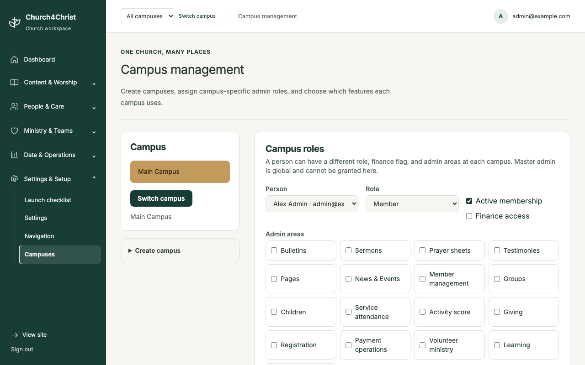
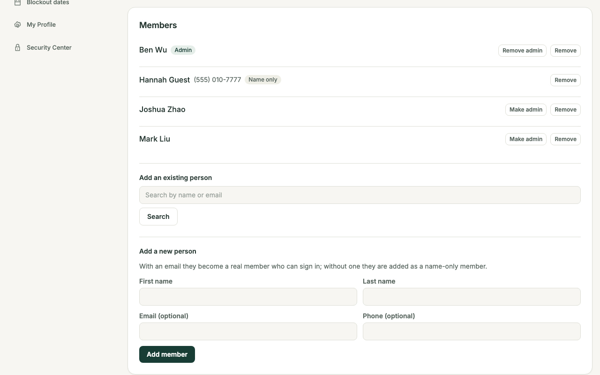
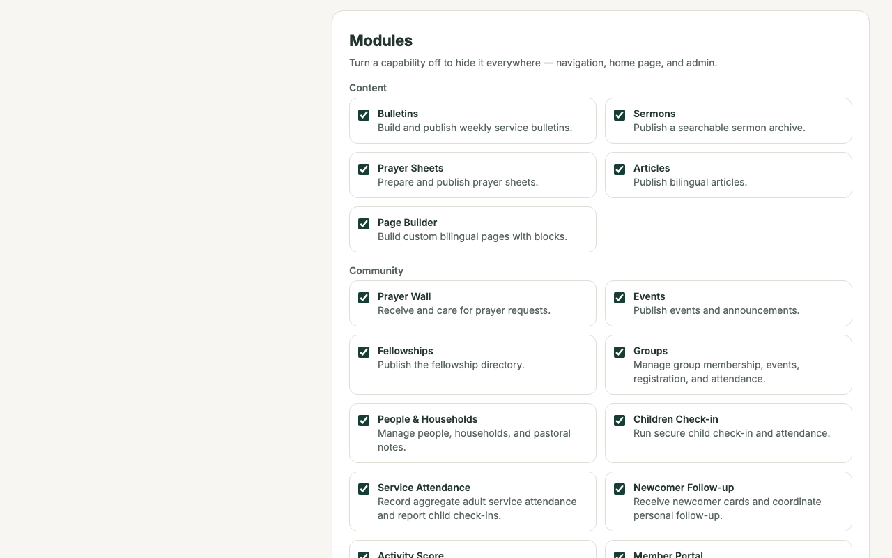

# Church4Christ：开源教会管理软件与教会网站

<p align="center"></p>

<p align="center"><a href="README.md">English</a> · <b>简体中文</b> · <a href="README.es.md">Español</a> · <a href="README.pt.md">Português (Brasil)</a> · <a href="README.fr.md">Français</a> · <a href="README.de.md">Deutsch</a> · <a href="README.ja.md">日本語</a> · <a href="README.ko.md">한국어</a> · <a href="README.ms.md">Bahasa Melayu</a> · <a href="README.id.md">Bahasa Indonesia</a> · <a href="README.vi.md">Tiếng Việt</a> · <a href="README.hi.md">हिन्दी</a></p>

*本文是 [README.md](README.md) 的译文，README.md 为权威的英文版本。译文由 AI 辅助完成，欢迎母语读者指正。*

[](https://github.com/leveo/church4christ/actions/workflows/ci.yml)
[](https://github.com/leveo/church4christ/releases)
[](LICENSE)
[](https://astro.build/)
[](https://workers.cloudflare.com/)
[](docs/i18n.md)

**一套 AI 原生的开源教会管理系统（ChMS）与教会 CMS，附带支持 12 种界面语言（包括英文和中文）的多语言教会网站。它是可自行托管、模块化的 Planning Center 替代方案，面向中小型教会、团契与非营利组织，基于 Astro 和 Cloudflare Workers 构建。**

会友与家庭、小组、服事排班、儿童报到、出席记录、新朋友跟进、祷告关怀、讲道、周报、活动，以及可选的会友平台、奉献账本和活动报名，全都在同一套你可以阅读、修改并自行托管的代码里。

**网站：[church4christ.org](https://church4christ.org) · 在线演示：[demo.church4christ.org](https://demo.church4christ.org)。**

[](https://church4christ.yunfei-song.com/C4C-modular-Voice.mp4)

观看 **[为你的事工量身打造（Built Around Your Ministry）](https://church4christ.yunfei-song.com/C4C-modular-Voice.mp4)**，这是演示站点的宣传视频（MP4）。

**从这里开始：[面向人和 AI 代理的安装指南](docs/setup.md)。** 运行 `npm run onboard`，在本地浏览器页面中选择你的机构身份、配色、标志和最初要启用的功能，然后把保存的偏好交给现有的安装程序。编码代理请先阅读 [AGENTS.md](AGENTS.md)；Claude 也会读取 [CLAUDE.md](CLAUDE.md)。

Church4Christ 把多语言的公开网站与后台管理系统结合起来，涵盖内容、祷告关怀、服事排班、会友和家庭。可选模块还提供会友平台及其他教会管理流程。本项目希望降低定制化实施的启动成本和长期维护成本，同时让运营者始终掌握代码和部署配置。

**当前源码版本为 1.6**。Church4Christ 是一个开源的基础框架，而不是开箱即用的托管服务。本地试用免费，部分部署可以落在服务商的免费额度之内，但正式环境的托管、邮件、数据库、域名、备份及其他服务可能会按配置和用量收费。在选择正式环境的部署方式之前，请先查看[部署方案与费用](#部署方案与费用)。

|  |  |  |
|---|---|---|
|  |  |  |
|  |  |  |
|  |  |  |

**每个核心模块都有专属的工作区。** 默认的 Sanctuary 设计以温暖的象牙白底色搭配森林绿导航，并为每类任务配上合适的版面：带本地预览的发布编辑器、会友和家庭档案、关怀队列、服事矩阵、适合触控的儿童报到、课程播放器，以及奉献账本。公开页面、会友、负责人和管理员的菜单会随已启用的模块和每个人的权限而变化。Harvest 与 Midnight 主题同样可用，并提供浅色和深色模式。请参阅[21 个模块的设计清单](docs/design/module-coverage.md)。

截图使用的是仓库里虚构的演示内容。首次安装时，你可以选择是否包含这些示例；两种选择都使用相同的版面、主题和内置的默认图片。英文页面使用英文界面和演示文案；中文页面支持中文和双语内容。全部 29 张界面截图均从运行中的应用重新截取；请参阅[截图清单与重新生成命令](docs/design/readme-screenshot-inventory.md)。

**分组导航。** 全部功能启用的站点会把公开页面归纳为“欢迎”“探索”“连接”和“参与”四组。内置链接留在各自面向的对象分组中，自定义页面和外部链接则显示在“更多”之下。在管理 → 导航中保存的顺序会在每个分组内保留，空的分组会自动隐藏。


内置十二种界面语言：英文和中文，以及西班牙语、巴西葡萄牙语、法语、德语、日语、韩语、马来语、印尼语、越南语和印地语。每间教会在安装时或之后通过设置 → 语言，选择网站提供哪些语言以及默认语言。其余十种译文由 AI 辅助完成，欢迎母语读者指正。此外还提供三种现成的外观，以及一个便于进一步定制的模块化起点。

---

## 适合谁使用？

Church4Christ 面向中小型教会、团契和非营利组织，尤其是多语言和移民会众，他们需要一个公开网站，以及一个可定制的教会管理基础。当有一位熟悉技术的同工、义工或实施伙伴能负责部署和维护时，它最合适。如果机构更看重由厂商负责安装、支持、升级和运营，而不是源码级的定制，托管平台可能更适合。

## 这种方式与其他方案相比如何？

不同类别的产品满足不同的需求，各服务商的条款也各不相同。下表比较的是运营模式，并不保证统一的价格、可迁移性或数据权利。

| | **Church4Christ** | **自行管理的插件式 CMS** | **托管建站平台** | **托管教会平台** |
|---|---|---|---|---|
| **主要适用场景** | 定制的多语言网站，加上模块化的教会工作流程 | 用插件组装的可扩展内容网站 | 由服务商托管的公开网站 | 由服务商托管的教会工作流程 |
| **费用模式** | 基础设施和服务用量；部分方案可落在免费额度内 | 托管、扩展插件和维护 | 订阅费和附加项目 | 订阅费，通常按套餐或模块计 |
| **定制能力** | 源码级修改和可选模块 | 主题、插件，以及在允许时修改源码 | 服务商支持的模板和扩展 | 服务商支持的配置和集成 |
| **运营方式** | 你的团队或实施伙伴负责部署、更新、监控和备份 | 你的团队或主机商负责核心程序和插件的维护 | 服务商负责大部分平台运营 | 服务商负责大部分平台运营 |
| **可迁移性** | 可通过代码和数据库访问来迁移，但迁移需要手动完成 | 取决于主机、插件和数据格式 | 取决于服务商的导出功能和条款 | 取决于服务商的导出功能、API 和条款 |
| **语言起点** | 内置十二种界面语言；每间教会自选所需语言 | 取决于所选的扩展 | 取决于服务和套餐 | 取决于服务和套餐 |

**需要权衡的地方。** Church4Christ 针对 Cloudflare Workers 及其绑定做了优化；迁移到其他托管环境在源码层面是可行的，但并不是受支持的一键迁移路径。目前也没有自动的 D1 到 Supabase 的内容迁移。内置页面的样式由主题决定，拖放编辑只适用于自定义页面。项目有版本管理，但采用者仍应预期需要投入实施工作，并仔细审查每次升级。

运营这个项目也意味着要维护它。你们的技术负责人始终要负责依赖项更新、安全审查与配置、监控、备份与还原测试，以及部署修复。这样的架构减少了部分基础设施工作，但并不会免去安全和运维方面的维护。设计思路请参阅 [**`docs/why-this-stack.md`**](docs/why-this-stack.md)。

## 想找开源的 Planning Center 替代品？

许多教会在寻找 Planning Center、Breeze、Church Community Builder 或类似托管式教会管理软件的免费或可自行托管的替代品时，想要两样东西：对自己数据的掌控，以及与这些记录共用数据的网站。Church4Christ 在一个可自行托管的应用里涵盖了日常教会管理的大部分内容：

| 常见 ChMS 需求 | Church4Christ |
|---|---|
| 会友与家庭名录 | [会友与家庭](docs/features/people-households.md)，支持 CSV 导入、保存来源栏位映射以及导出 |
| 小组 | [小组](docs/features/groups.md)，含公开名录、加入申请、活动和出席记录 |
| 服事排班 | [服事排班](docs/features/volunteer-serve.md)，含月度矩阵和邮件确认，无需登录 |
| 崇拜流程规划 | 面向崇拜和活动的[流程单、排练、可服事时间和日历](docs/features/service-planning.md) |
| 儿童报到 | [签到台报到](docs/features/children-checkin.md)，含接送码和出席图表 |
| 出席与参与度 | [崇拜出席](docs/features/service-attendance.md)和[活跃度评分](docs/features/activity-score.md) |
| 新朋友与关怀跟进 | [新朋友队列](docs/features/newcomers.md)、[祷告墙](docs/features/prayer-wall.md)和[社群工作流程](docs/features/community-workflows.md) |
| 教会网站与 CMS | [公开网站、主题、讲道、周报和页面编辑器](docs/features/public-site-and-themes.md) |
| 会友自助服务 | [会友平台](docs/features/member-portal.md)（家庭、小组、祷告；可运行在 D1 或 Supabase 上） |
| 多堂点 | [多堂点](docs/features/multi-campus.md)，数据和角色按堂点隔离 |

**从 Planning Center 逐步迁移。** 可选的只读 [Planning Center People 同步](docs/deploy.md#9-optional-configure-planning-center-synchronization)会把 Planning Center 的人员记录与 Church4Christ 现有的会友关联起来，对不确定的匹配则交由人工审核，因此在过渡期间两个系统可以并行运行。人员数据则通过 CSV 导入工具及其可重复使用的栏位映射导入。

**目前尚未取代的部分。** 没有原生手机应用，没有短信功能，也没有诗歌库或敬拜诗歌规划（服事流程涵盖流程单和排练）。通过 Stripe 的线上奉献（信用卡和银行扣款）在你完成上线清单之前一直处于测试模式；付费活动报名使用同一个 Stripe 模式。奉献模块还会把支票和现金记入线下账本，并生成年度奉献报表。Church4Christ 是由你的团队自行运行和维护的基础框架，而不是附带厂商支持的托管服务。

Planning Center 及上文提到的其他产品名称均为其各自所有者的商标。Church4Christ 是独立项目，与它们没有任何关联。

---

## 只需要其中一部分？

可以从小处开始，日后再扩展。每个单一功能版本都是安装本仓库，并且只启用一个领域，使用默认的 Cloudflare D1 数据库：

| 如果你需要 | 从这里开始 | 预设 |
|---|---|---|
| 儿童报到签到台 | [church-checkin](https://github.com/leveo/church-checkin) | `checkin` |
| 服事排班 | [church-volunteer-scheduling](https://github.com/leveo/church-volunteer-scheduling) | `volunteer-scheduling` |
| 小组管理 | [church-small-groups](https://github.com/leveo/church-small-groups) | `small-groups` |
| 教会网站与 CMS | [church-website-cms](https://github.com/leveo/church-website-cms) | `website` |

这些版本没有独立的代码，所以不需要额外维护。你也可以跳过它们，直接在这里运行 `npm run onboard -- --preset checkin`。随时可以在**设置 → 功能模块**中开启更多功能。请参阅[单一功能版本](docs/editions.md)。

---

## 借助 AI 助手来搭建

人和代理共用同一套浏览器引导、安装程序、功能目录和就绪检查。[AGENTS.md](AGENTS.md) 和 [CLAUDE.md](CLAUDE.md) 会让助手先检查现有安装情况；如果是尚无偏好的全新安装，就运行 `npm run onboard`，并让你自己填完表单。你的回答保存在被 Git 忽略的 `.church/preferences.json` 中；之后的会话会读取这个文件，沿用你选定的机构身份、品牌和功能。[安装指南](docs/setup.md)里有相关命令和故障恢复步骤。你可以这样启动助手：

> “请阅读 AGENTS.md 和 docs/setup.md。启动浏览器引导，让我来选择我们机构的品牌和最初要启用的功能。使用我保存的偏好搭建本地预览，检查网站和管理员页面，然后告诉我网址和剩下的检查项目。”

你不必亲手做每一项修改。本仓库的组织方式让 AI 编码助手可以按照 [`docs/features/`](docs/features/) 里的白话指南，并依托完善的自动化测试来工作。这能降低定制和维护的工作量，但仍然需要维护者审查改动、运行相关测试，并谨慎地部署。

思路是：用 AI 助手打开这个项目，用日常的语言描述你想要的效果，让它来完成修改。下面是一些可以直接粘贴的真实例子：

> “请阅读 `docs/features/public-site-and-themes.md`，然后把我们的主色改成宝蓝色，并让我看看首页。”

> “请按照 `docs/i18n.md` 添加意大利语（`it`）语言版本。”

> “请按照 docs/setup.md 配置我们的教会，不要演示内容。给我看安装计划和就绪检查的结果，然后参照 docs/deploy.md 准备部署。”

同样的流程也适用于日常维护：描述一项改动，检查它提出的差异，在本地测试，审查通过后再部署。AI 的协助并不能取代安全决策、备份、正式环境测试以及运营责任。

---

## 我们的使命

**降低启动定制化教会管理系统和多语言网站的成本与门槛。** Church4Christ 提供经过测试的模块化基础，教会或实施伙伴可以在此基础上调整，而不必从零开始。它并不承诺零订阅或零预算的正式服务：基础设施、邮件、数据库、域名、支持和维护方面的选择，决定了真实的运营成本。

---

## 内含功能

每项功能都有各自的白话指南。可以从下面任何一项开始：


| | 功能 | 它能做什么 |
|---|---|---|
| [](docs/features/public-site-and-themes.md) | **[公开网站与主题](docs/features/public-site-and-themes.md)** | 教会的门面，包括首页、讲道、活动和同工介绍，提供三种现成的外观。 |
| [](docs/features/cms-admin.md) | **[管理后台](docs/features/cms-admin.md)** | 免密码登录、角色权限，以及对受支持的版本化编辑内容的一键还原。 |
| [](docs/features/admin-permissions.md) | **[管理员权限](docs/features/admin-permissions.md)** | 只授予每位管理员所需的范围，祷告墙和会友名录默认开放，其余按需选择。 |
| [](docs/features/multi-campus.md) | **[多堂点](docs/features/multi-campus.md)** | 在同一个后端运行多个堂点，数据、设置、功能和堂点内角色相互隔离；只有总管理员能看到所有堂点。 |
| [](docs/features/bulletins.md) | **[每周周报](docs/features/bulletins.md)** | 编排主日崇拜单张，并安排它自动发布。 |
| [](docs/features/sermons.md) | **[讲道库](docs/features/sermons.md)** | 贴上 YouTube 链接，就能得到可搜索、加载迅速的往期讲道库。 |
| [](docs/features/prayer-wall.md) | **[祷告墙](docs/features/prayer-wall.md)** | 接收祷告事项，并在简单的看板上私下跟进处理。 |
| [](docs/features/volunteer-serve.md) | **[服事排班](docs/features/volunteer-serve.md)** | 一眼看完整个月的服事安排；义工通过邮件确认，无需登录。 |
| [](docs/features/people-households.md) | **[会友与家庭](docs/features/people-households.md)** | 个人档案和家庭，加上规范的仅创建式 CSV 导出，以及可重复使用的来源栏位映射，方便迁移。 |
| [](docs/features/member-identity.md) | **[会友身份安全](docs/features/member-identity.md)** | 在奉献、活动报名、小组、团队、新朋友和导入之间进行有凭证绑定的身份识别；不确定的重复记录会交由审核，而不是仅凭姓名合并，并配有一次性验证码（OTP）绑定的批准流程和受保护的 24 小时回滚。 |
| [](docs/features/groups.md) | **[小组](docs/features/groups.md)** | 小组含公开名录、成员清单、加入申请、活动，以及每人通过邮件链接记录的出席。 |
| [](docs/features/children-checkin.md) | **[儿童报到](docs/features/children-checkin.md)** | 适合触控的签到台，家长凭接送码为孩子报到和接走，并附有每周出席图表。 |
| [](docs/features/service-attendance.md) | **[崇拜出席](docs/features/service-attendance.md)** | 记录成人汇总人数，由报到记录推算可选的儿童人数，更正历史记录，并下载不含身份信息的 CSV 报表。 |
| [](docs/features/newcomers.md) | **[新朋友跟进](docs/features/newcomers.md)** | 接收经同意的双语公开联系卡，在限定范围的同工队列中分流处理，并把完全匹配的记录转入会友名录，同时不泄露备注或回答。 |
| [](docs/features/onboarding-readiness.md) | **[上线准备](docs/features/onboarding-readiness.md)** | 一份双语清单，由安装程序、doctor 检查和每位实际管理员共用，手动检查项目由超级管理员确认。 |
|  | **[服事流程](docs/features/service-planning.md)** | 规划带时间的流程单、被召集人员参与的排练、会友可服事时间、找时间搜索、日历，以及自动发送邮件。 |
|  | **[活跃度评分](docs/features/activity-score.md)** | 把选定的、与个人关联的活动合并为可解释的会友评分，并给出全教会的参与度概览。 |
| [](docs/features/learning.md) | **[学习](docs/features/learning.md)** | 通过双语视频、文件、作业、测验以及与服务商同步的状态，让主日学和门徒训练在聚会之间延续。 |
| [](docs/features/page-builder.md) | **[页面编辑器](docs/features/page-builder.md)** | 用拖放方式拼出你自己的自定义页面，支持多语言，始终贴合主题，发布后的页面零 JavaScript。可选功能；关闭它不会破坏你已经建好的页面。 |
| [](docs/features/giving.md) | **[奉献](docs/features/giving.md)** | 已实现：通过 Stripe 的线上奉献（默认为测试模式，完成上线清单后切换为正式模式）、记录支票和现金的线下账本，以及年度奉献报表。 |
| [](docs/features/registration.md) | **[活动报名](docs/features/registration.md)** | 已实现：免费活动报名、自定义问题和名单导出，另有 Stripe 付费结账，与奉献使用相同的 Stripe 模式（正式依赖它之前，请先用一笔小额的正式报名验证）。 |
| [](docs/features/member-portal.md) | **[会友平台](docs/features/member-portal.md)** | 一个登录后的入口，集中显示目前的参与情况和开放的机会，另有家庭资料、活动、服事、日历、奉献，以及限定范围的祷告。 |
| [](docs/features/i18n.md) | **[十二种语言](docs/features/i18n.md)** | 每个站点可从 12 种界面语言中选择，缺失时回退到英文，并支持一键简体转繁体中文。 |
| [](docs/features/email-automation.md) | **[邮件与自动化](docs/features/email-automation.md)** | 登录链接、提醒和摘要，本地环境记录日志，并提供可使用付费服务的正式配置。 |
| [](docs/features/modules.md) | **[功能模块](docs/features/modules.md)** | 关闭用不到的功能；不会删除任何内容，随时可以重新开启。 |

**选择你的模块。** 大部分可选的功能领域都是**模块**，可以在设置的同一个面板里关闭，包括周报、讲道、祷告墙、服事排班等等。新安装会根据安装时的选择，明确写入每个模块的设置；Full Church 演示选用其中 21 个（服事流程需要另外开启）。只有旧版安装中，缺失的模块记录才会保持以前默认开启的行为。如果某间教会只想要崇拜时间和讲道，一键就能隐藏其余功能：该模块的页面、链接和邮件会一并消失，也不会删除任何内容。请参阅 [**`docs/features/modules.md`**](docs/features/modules.md)。

| Key | English | 中文 | Required database |
|---|---|---|---|
| `bulletins` | Bulletins | 周报 | Either |
| `sermons` | Sermons | 讲道 | Either |
| `prayer-sheets` | Prayer Sheets | 祷告单 | Either |
| `prayer-wall` | Prayer Wall | 祷告墙 | Either |
| `events` | Events | 活动 | Either |
| `serve` | Volunteer Scheduling | 服事排班 | Either |
| `gifts` | Spiritual Gifts | 恩赐探索 | Either |
| `testimonies` | Testimonies | 见证 | Either |
| `articles` | Articles | 文章 | Either |
| `fellowships` | Fellowships | 团契 | Either |
| `groups` | Groups | 小组 | Either |
| `people` | People & Households | 会友与家庭 | Either |
| `children` | Children Check-in | 儿童报到 | Either |
| `attendance` | Service Attendance | 崇拜出席 | Either |
| `newcomers` | Newcomer Follow-up | 新朋友跟进 | Either |
| `activity-score` | Activity Score | 活跃度评分 | Either |
| `page-builder` | Page Builder | 页面编辑器 | Either |
| `portal` | Member Portal | 会友平台 | Either |
| `giving` | Giving | 奉献 | Supabase |
| `registration` | Registration | 活动报名 | Supabase |
| `learning` | Learning | 学习 | Either |
| `planning` | Service Planning | 服事流程 | Either |

### 社群管理与工作流程

堂点可以直接管理小组和会友跟进。可选的团契模块则增加一个社群层，拥有独立的成员关系和下属小组。可重复使用的工作流程提供分派的步骤、截止日期、完成情况追踪，以及通过 Cloudflare 发送的邮件提醒。设置方法、权限和发送控制，请参阅[社群工作流程指南](docs/features/community-workflows.md)。

### 超越主日的学习

1.1 版新增了可选的**学习**模块，适用于主日学、门徒训练，以及其他在聚会之间持续进行的事工。学员可以看到双语的课程页面，其中包含不公开列出的 YouTube 视频、文件、作业和测验，并受到隐私范围的限制。提交仍以服务商为准：网站会把学员引导到所配置的服务商，而不是自行收集作业、答案、评论、成绩或文件内容。

管理员可以通过官方 API 连接 Google Classroom，也可以连接另行运营的 Church4Christ Canvas 衍生版本。课程映射、加密的 OAuth 凭证、带签名的服务商通知、手动同步，以及有上限的定时对账，只会提供 Church4Christ 所需的活动元数据。


| 英文学员视图 | 中文学员视图 | 服务商管理 |
|---|---|---|
| [](docs/images/learning/genesis-1-en.png) | [](docs/images/learning/genesis-1-zh.png) | [](docs/images/learning/admin-overview.png) |

服务商设置、隐私边界、同步额度、创世记第 1 章演示，以及另行运营 Canvas 的相关要求和对应源码要求，请参阅**[学习功能指南](docs/features/learning.md)**。

### 会友的家

可选的**会友平台**把教会已经维护的记录，转化为登录后的实用体验。它的机会总览页把所有已启用的学习、归属和服事途径集中在一处：既有会友已参与的小组、课程和团队，也有目前开放加入或申请的机会。会友还可以更新家庭资料、查看自己的奉献记录、报名活动、查看服事安排、订阅个人日历，以及分享限定范围的祷告。它与 Church4Christ 的其他部分使用同样的免密码登录链接，不需要记住新的账号或密码。


事工、小组、主日学和服事团队的负责人，可以在 `/<locale>/manage` 使用限定资源范围的面板。它由教会应用的登录保护，每项操作都会检查负责人对该特定资源的权限。因此 Cloudflare Zero Trust 可以只用于完整的 `/admin` 区域。


会友平台既可以运行在默认的 D1 后端上，也可以运行在可选的 **Supabase（Postgres）**后端上。家庭、小组、受保护的小组文件，以及教会、小组和私人祷告的审核，都可以在 D1 上使用。活动范围的祷告、活动管理员和“我的报名”需要活动报名模块，而它只能用于 Supabase。详情请参阅 [**`docs/features/member-portal.md`**](docs/features/member-portal.md)。

---

## 5 分钟试用（在你自己的电脑上）

在选择部署方式之前，你可以先在本地运行这个网站，也可以选择是否加入虚构的示例内容。你需要安装 [Node.js](https://nodejs.org/) 22.22.1 或更高版本。浏览器引导会建议首次启动选择 **Website + Community**，并搭配 **Cloudflare D1**。


```bash
# 1. Get the code and install it
git clone https://github.com/leveo/church4christ.git
cd church4christ
npm ci

# 2. Open the local browser form, complete it, and save your preferences
npm run onboard

# 3. Review the plan, then initialize with those same preferences
node scripts/setup/index.mjs --preferences .church/preferences.json --yes --dry-run --json
node scripts/setup/index.mjs --preferences .church/preferences.json --yes --json

# 4. For D1, start it (always follow the exact handoff setup prints)
npm run dev
```

表单会询问这是教会、非营利组织还是堂点，并收集名称、标语、地址、时区、主色和辅色、可选的 PNG/JPEG/WebP 标志（最大 2 MiB）、语言、第一位管理员，以及是否使用演示内容。只勾选你需要的功能。推荐的选择使用 D1 作为数据库；应用仍然运行在 Cloudflare Workers 上，媒体文件存放在 R2 中。**奉献和活动报名**是进阶选项，需要明确切换到兼容 Supabase 的 PostgreSQL。

保存时会把 `.church/preferences.json` 和上传的标志写入 `.church/`，Git 会忽略这个目录。保存不会创建数据库，也不会部署网站。再次运行 `npm run onboard` 可以重新载入并编辑已保存的偏好。填写表单期间请让终端保持运行，完成后按 Ctrl+C 停止。若想自己打开终端打印出的网址，请使用 `npm run onboard -- --no-open`；要指定端口，请加上 `--port 4310`。直接入口是 `node scripts/onboard/index.mjs`。安装程序会应用哪些设置，以及代理如何使用其余的偏好，请参阅[安装指南](docs/setup.md)。

如果你使用 `npm ci --ignore-scripts` 安装，请在运行安装程序或 `npm run dev` 之前，手动运行 `npm run tokens`。

对于本地 Supabase，交接说明会改为在 `npm run dev` 之前，于宿主 shell 中导出 `CLOUDFLARE_HYPERDRIVE_LOCAL_CONNECTION_STRING_HYPERDRIVE`；这个连接 URL 不能放进 `.dev.vars`。

首次安装时，请选择**包含演示内容**或**不含演示内容**。两种选择使用相同的内置设计、本地装饰图片、已启用的功能和管理员工具。演示内容会增加虚构的会友、讲道、周报、活动、事工和其他示例。它的媒体步骤会把 `seed/media/` 里生成的图片包复制到本地 R2。不含演示内容则会创建数据库结构、运行默认值、教会设置、模块选择和第一位管理员，但不会有示例业务记录。

偏好文件会记录表单中对演示内容的选择。若用明确的命令行参数安装，请传入 `--demo-data` 或 `--no-demo-data`；在非交互式安装中两者都省略，则沿用现有的默认值，即不含演示内容。这两个参数不能同时使用。重复执行同样的安装，会保留已记录的内容选择和现有记录。`--no-demo-data` 不会清空现有的数据库，而且安装程序拒绝在已有会友记录的基础上添加演示数据。想尝试另一种起始模式，请使用另外全新的工作区和数据库。

打开安装程序打印出的地址（通常是 `http://localhost:4321`）。

**登录管理后台。** 这里没有密码。在登录页面输入安装时填写的第一位管理员邮箱（安装交接说明中也会重复这个邮箱），然后请求一个链接。由于本地邮件设置为打印而不发送，**魔法链接 URL 会直接显示在你的终端里**。把它粘贴到浏览器就能登录。（为了更方便地做本地测试，安装程序会把同一个地址作为 `AUTH_DEV_BYPASS_EMAIL` 写入 `.dev.vars`，这样会自动登录。要测试真实的登录流程，请删除这一行。）

两种内容模式下，安装程序都会同时创建一位新的管理员及其有审计记录的登录身份。重复执行会保留现有的联系人归属；它们不会验证已有的邮箱，也不会恢复已被撤销的权限。如果安装程序报告身份方面的问题，请先完成[身份审核或恢复流程](docs/features/member-identity.md)，再重新执行。

仅限终端的 `npm run setup` 依然可用。安装程序提供 **Website**（8 个专注于发布的模块）、**Website + Community**（18 个模块；在 D1 上可加入会友平台）和 **Full Church**（21 个模块；服事流程需要另外开启）。奉献和活动报名会自动选择 Supabase；与 D1 兼容的选择会选用 D1，除非你明确覆盖后端。所需的账号取决于本地还是部署模式，详见下文。若要自动化，请用 `--yes` 传入所有答案；再加上 `--json` 可得到一份机器可读的结果。若要以人类可读的方式进行非交互式运行，请使用同样完整的参数，执行 `npm run setup -- ... --yes` 并省略 `--json`。若要让 npm 输出的 stdout 保持严格的 JSON，请使用静默形式：

```bash
npm run --silent setup -- --mode local --preset website --site-slug my-church \
  --church-name "My Church" --locale en --admin-email admin@example.com \
  --admin-name "First Admin" --app-origin http://localhost:4321 \
  --email-from admin@example.com --demo-data --yes --json
```

---

## 部署方案与费用

这些是用于规划的方案，并非价格保证。下列价格截至 **2026 年 8 月**，可能变动，部署前请到所链接的官方定价页面确认。

| 方案 | 包含范围 | 费用与就绪说明 |
|---|---|---|
| **本地试用** | 使用本地 D1 的网站或社群模块；使用兼容的本地 Postgres 的全部模块 | 本地 D1 试用不需要支付任何托管服务费用。你仍需自备电脑、开发时间和任何可选的外部服务。 |
| **D1 网站/社群** | Cloudflare Worker、D1 和 R2，最多 20 个与 D1 兼容的模块 | 小规模的部署可以落在 Cloudflare 的免费额度之内。流量、存储、超出额度的操作、域名和其他服务可能产生费用，请查看 [Workers 定价](https://developers.cloudflare.com/workers/platform/pricing/)。正式环境的邮件另行计算。 |
| **正式环境邮件** | 向任意收件人发送事务性的登录链接、提醒、申请和摘要 | 本仓库支持可使用付费服务的 Cloudflare 邮件配置。向任意收件人发送需要 Workers Paid，目前最低 **每月 5 美元**，包含 **3,000 封邮件**，超出部分为 **每 1,000 封 0.35 美元**。这些金额可能变动，请查看 [Cloudflare Email Service 定价](https://developers.cloudflare.com/email-service/platform/pricing/)。 |
| **Supabase/全部模块** | Cloudflare 部署，加上 Supabase/Postgres，用于 21 个 Full Church 模块，包括会友平台、奉献和活动报名 | Cloudflare 的费用依然适用，所选的 [Supabase 方案](https://supabase.com/pricing)可能增加订阅费或用量费。截至 2026 年 8 月，Supabase Free 没有自动的每日备份，活动量低的 Free 项目可能会根据七天内的活动情况被[自动暂停](https://supabase.com/docs/guides/platform/free-project-pausing)。正式环境请定期做异地的数据库转储并演练还原，或者选择[备份选项](https://supabase.com/docs/guides/platform/backups)能满足你业务连续性要求的付费方案。定价和服务政策可能变动。Stripe 从测试模式开始；正式收款需要在完成 [`docs/supabase-setup.md`](docs/supabase-setup.md) 中的上线清单之后，明确选择启用。 |

服务商的免费额度对试用或小规模部署很有帮助，但并不保证正式服务会一直免费。除上述服务外，预算还应包括技术负责人、依赖项和安全维护、监控、备份、还原测试，以及未来用量的增长。

---

## 上线部署

刚接触？请先看 [**`docs/cloudflare-setup.md`**](docs/cloudflare-setup.md)，这份白话指南会说明 Cloudflare 是什么、费用模式，以及上线的两种方式（包括让 AI 助手代劳）。需要具体命令时，[**`docs/deploy.md`**](docs/deploy.md) 提供完整的分步说明。

先运行 `npm run setup`，选择 **Deploy**，回答功能和教会方面的问题。它会创建或导入所需的资源，写入生成的配置，应用迁移，记录全部 22 项模块设置，并建立第一位管理员。然后交接给 `npm run deploy`。运行 `npm run doctor` 可得到 schema-v2 的就绪报告，也可以使用始终开启的 `/admin/onboarding` 清单，它使用同样稳定的检查标识。奉献、活动报名、小组、团队、新朋友、导入，以及可选的只读 Planning Center 集成，共用一个有凭证绑定、先审核再合并的身份网关。它绝不会仅凭姓名或未验证的联系方式自动合并会友。工作流程、防欺诈控制、目前的迁移边界和服务商验证方面的缺口，请参阅[会友身份](docs/features/member-identity.md)；密钥的设置和轮换规则仍记录在[部署手册](docs/deploy.md#stable-identity-source-key)中。部署刻意设计为手动操作：仓库的自动化只会测试改动，不会替你发布改动，也不会迁移正式环境的数据。

**首次部署和升级是两种不同的操作。** 引导式安装会创建或导入资源，并建立一个经过审核的安装。对于已存有教会数据的站点，它并不是无人值守的一键升级。现有的运营者应当先阅读[升级手册](docs/upgrade.md)，备份数据库、R2 媒体、配置和密钥清单，在预发布环境中演练，并在应用向前迁移之前查看 [`Unreleased` 更新日志](CHANGELOG.md)。准备发布版本的维护者，请遵循[发布流程](docs/release-process.md)。

**选择你的数据库。** 20 个与 D1 兼容的模块不包含**奉献**和**活动报名**，这两个模块需要 Postgres。所需的账号取决于模式：本地 D1 不需要任何外部账号；部署 D1 需要 Cloudflare 账号；本地 Supabase 需要 Supabase 账号或兼容的本地 Postgres 数据库；部署 Supabase 则需要 Cloudflare 和 Supabase 两者。目前还没有自动的 D1 与 Supabase 之间的内容迁移，所以请在输入真实内容之前，先选定正式环境的数据库。请参阅 [**`docs/supabase-setup.md`**](docs/supabase-setup.md)。

**Stripe 从测试模式开始；切换到正式模式需要明确选择启用。** Stripe 负责托管付款页面、收据、Billing Portal、退款和争议；本应用只保存金额、奉献项目、日期、状态和 Stripe 的 id。奉献和活动报名只能用于 Supabase；D1 不支持这些模块。当安装程序询问这两个模块之一时，请用一次性的 `CHURCH_SETUP_STRIPE_SECRET_KEY` 和 `CHURCH_SETUP_STRIPE_WEBHOOK_SECRET` 环境变量导入 `sk_test_…` 密钥和 `whsec_…` 签名密钥；安装程序会保存运行时的密钥，并写入 `STRIPE_MODE=test`。要接收真实的奉献，请遵循 Supabase 指南中的上线清单（正式密钥、API 版本为 `2025-03-31.basil` 的 webhook、`STRIPE_MODE=live` 加上 `STRIPE_LIVE_CONFIRMED=1`）。模式与所配置的模式不符的事件会被拒绝，由 Supabase 支撑的 Worker 每五分钟执行一次持久化恢复。本地测试并不能证明 Stripe 的正式投递能够成功。

---

## 底层是什么

给好奇的读者：Church4Christ 使用 **[Astro](https://astro.build/)** 在服务器端渲染页面，作为单一的 **Cloudflare Worker** 运行。应用数据存放在所选的后端，即 Cloudflare **D1** 或 **Supabase/Postgres**；上传的媒体存放在 Cloudflare **R2**（对象存储）；邮件通过 Cloudflare 的邮件绑定发出。面向访客的页面**没有客户端 JavaScript 框架**，只是简洁、快速的 HTML，再加上一点原生脚本，这正是网站加载迅速、运行成本很低的重要原因。（唯一的例外在同工登录之后：拖放式的页面编辑器是一个小型 React 编辑器，只有你的团队才会下载它；它发布出来的页面仍然是纯 HTML。）

整套外观来自**[设计令牌](design/README.md)**：一组颜色和字体的数值，编译成三种现成的主题（Sanctuary、Harvest、Midnight），每种都有浅色和深色模式。项目对核心工作流程有**完善的自动化测试覆盖**，让维护者能在部署之前验证改动。

**为什么这样选择？** 针对 Cloudflare 优化部署的理由、Astro + Tailwind + TypeScript 技术栈的选择，以及托管平台可能是更好的运营模式的情形，都写在 [**`docs/why-this-stack.md`**](docs/why-this-stack.md) 中。技术层面的全貌，请参阅 [`docs/architecture.md`](docs/architecture.md)、[`docs/design-system.md`](docs/design-system.md) 和 [`docs/i18n.md`](docs/i18n.md)。

---

## 常见问题

**Church4Christ 是什么？**
一套开源的教会管理系统（ChMS）和教会 CMS。它把多语言的教会网站（12 种界面语言）与同工使用的工具结合起来，涵盖会友与家庭、小组、服事排班、儿童报到、出席、新朋友跟进和祷告关怀。

**有免费的开源 Planning Center 替代品吗？**
Church4Christ 是其中一个选择。源代码依 GPL-3.0 免费提供，你可以自行托管在 Cloudflare Workers 上。它涵盖会友、小组、报到、服事排班、出席和教会网站，在过渡期间还可以通过可选的只读同步读取 Planning Center People。它没有 Planning Center 的手机应用、短信或敬拜诗歌规划。请参阅[想找开源的 Planning Center 替代品？](#想找开源的-planning-center-替代品)

**它免费吗？**
软件本身免费。托管、邮件、数据库和域名服务可能需要付费，取决于你的配置和用量；一些小规模的部署可以落在服务商的免费额度之内。请参阅[部署方案与费用](#部署方案与费用)。

**它支持哪些语言？**
十二种界面语言：英文、中文、西班牙语、巴西葡萄牙语、法语、德语、日语、韩语、马来语、印尼语、越南语和印地语。每间教会选择网站提供哪些语言以及默认语言；中文页面还支持一键简体转繁体。可以继续增加更多语言，请参阅 [docs/i18n.md](docs/i18n.md)。

**没有开发人员的小教会也能运行吗？**
当有一位熟悉技术的同工、义工或伙伴负责部署和更新时，效果最好。浏览器引导和 AI 助手指南降低了这方面的工作量，但仍然需要有人审查改动、备份数据并部署。

**它是用什么构建的？**
Astro 运行在 Cloudflare Workers 上，数据使用 Cloudflare D1 或 Supabase/PostgreSQL，媒体使用 Cloudflare R2。公开页面不带客户端框架。

---

## 许可证

Church4Christ 是依据 **[GNU 通用公共许可证第 3 版](LICENSE)**（GPL-3.0）发布的自由开源软件。你可以使用和研究它、私下修改、分享副本，也可以对副本、定制开发、托管、支持或其他商业服务收费。

如果你分发了受该许可证约束的修改版本，GPL 的条件随之适用：接收者必须获得 GPL 所规定的各项自由，并且必须按许可证的要求，依据 GPL 提供对应的源代码。私下的修改不必公开。仅仅把修改后的版本作为网络服务运行、而不分发副本，本身并不会依 GPLv3 触发类似 AGPL 的源代码共享义务。

[`LICENSE`](LICENSE) 具有权威效力。本摘要仅供参考，不构成法律意见。

---

## 参与贡献与路线图

欢迎贡献，包括错误报告、翻译和新功能。请先阅读 [`CONTRIBUTING.md`](CONTRIBUTING.md)，了解开发环境的搭建和项目的五条规则；如果你发现了安全问题，请阅读 [`SECURITY.md`](SECURITY.md)。

**未来计划（尚未实现）：** 我们正在考虑建立教会之间互相交换主题和内容的“交换市集”，这只是一个想法，并不是承诺。如果这对你的教会很重要，请开一个 issue，我们一起谈谈。

---

怀着用心，也借助 AI 的帮助，为世界各地的教会和非营利组织而作。
