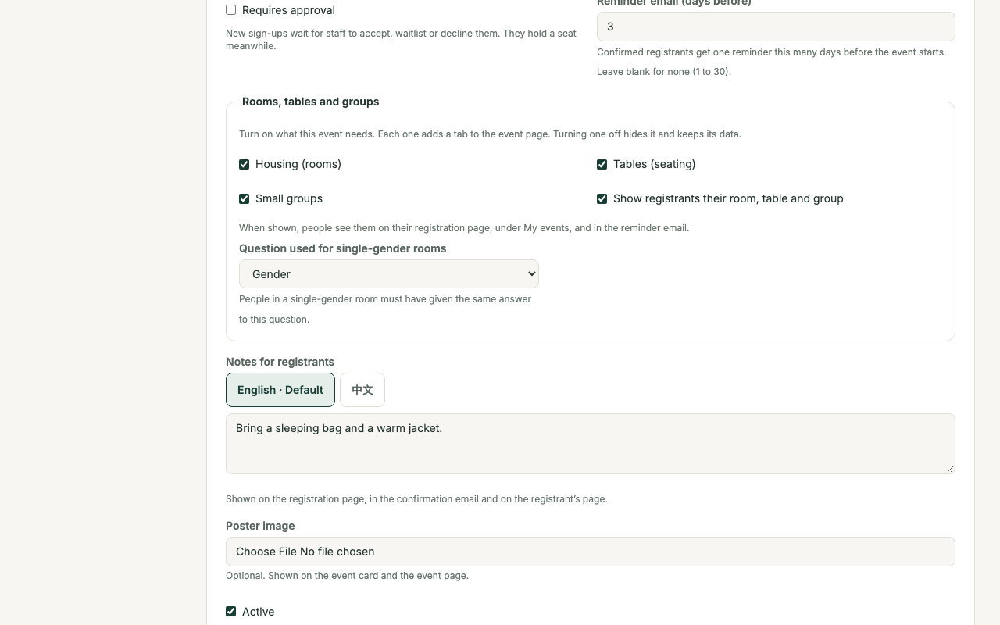
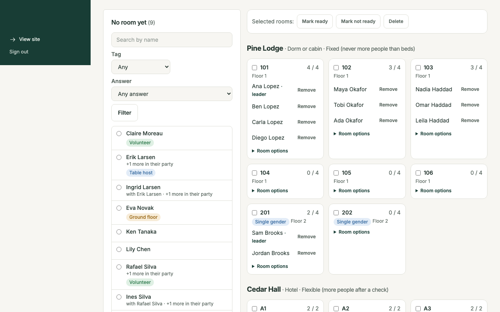
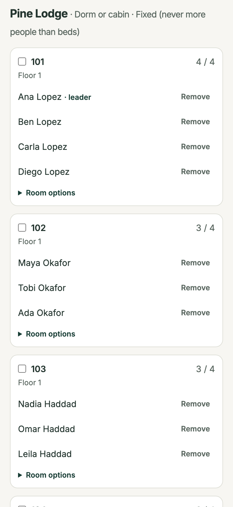
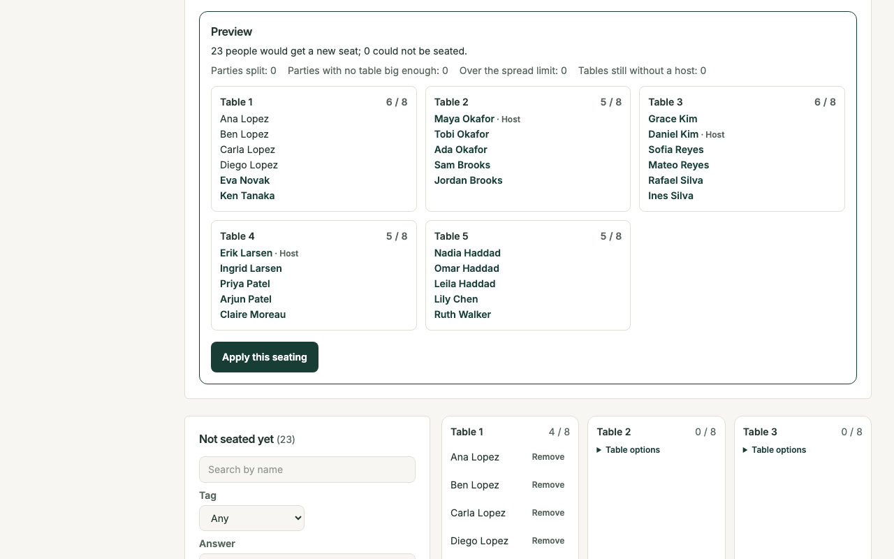
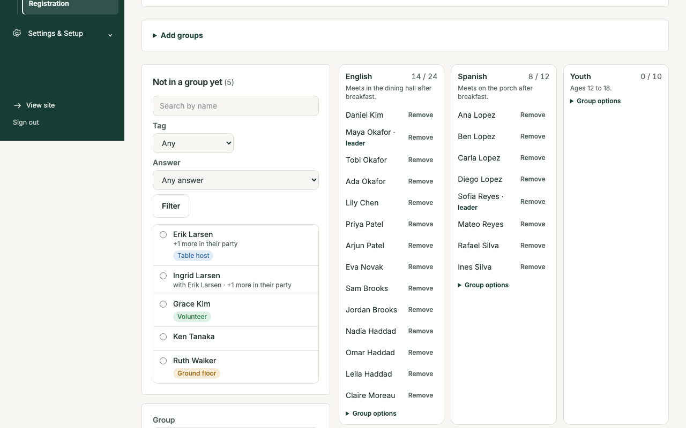
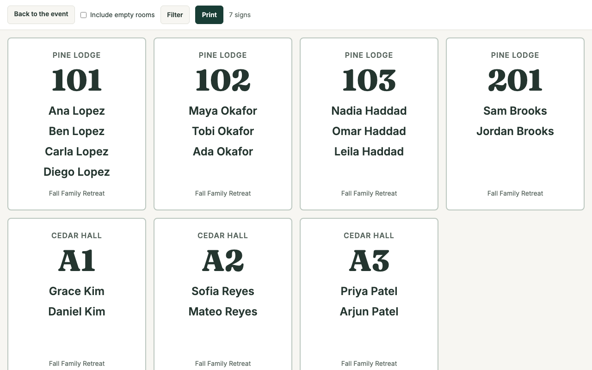

# Event logistics (rooms, tables, and small groups)

> **Optional, and off until you turn it on.** Event logistics adds to [Registration](registration.md).
> It works on the default Cloudflare D1 database and on Supabase (Postgres), and it needs
> Registration to be on as well.

## What it does

A retreat, a camp, or a banquet needs more than a list of who signed up. People need a bed, a
seat at a table, or a small group to meet with. **Event logistics** lets your team plan that on
the same page as the sign-ups, so there is no separate spreadsheet to keep in step.

Each event can use any of three parts:

- **Housing.** Add the places people stay (a lodge, a hotel, a campsite), their room types, and
  their rooms. Then put people in rooms. Families stay together by default.
- **Tables.** Add tables with a number of seats, seat people by hand, or let **Auto-seat**
  suggest a seating that keeps each party together. You see a preview before anything changes.
- **Small groups.** Add groups, put people in them by hand, or fill them from people's answer to
  a question on the sign-up form.

Around those three:

- **Tags.** Your own labels for people, such as "Volunteer" or "Needs ground floor". Use them to
  filter the lists and in the Auto-seat rules.
- **Prints.** A room list, door signs, a table list, table cards, and a group list. They show
  names only.
- **At the door.** The check-in desk shows each person's room and table.
- **For registrants.** If you choose, people see their room, table, and group on their
  registration page, under **My events**, and in the reminder email.

When someone cancels, their bed, seat, and group place are freed at once.

## How your team uses it

### Turn it on

1. A super admin opens **Settings → Modules**, ticks **Event Logistics**, and saves. Registration
   must be on too. Event logistics is off on new and upgraded sites until someone turns it on.
2. Open **Admin → Registration** and edit an event that already exists. The editor has a section
   called **Rooms, tables and groups**. (It does not appear while you are creating a new event.
   Save the event first, then edit it.)
3. Tick what this event needs:
   - **Housing (rooms)**
   - **Tables (seating)**
   - **Small groups**
   - **Show registrants their room, table and group** (off unless you tick it)
4. If you will use single-gender rooms, choose the **Question used for single-gender rooms**.
   This is a dropdown question on your form that is asked for each person. People in a
   single-gender room must have given the same answer to it.

Each part you turn on adds a tab to the event page: **Housing**, **Tables**, and **Groups**, next
to **Registrations**. Turning a part off hides its tab and keeps its data. Turn it back on and
everything is where you left it.

The event page's overview also gets a short **Rooms, tables and groups** summary, such as
"12 of 20 people have a room", and each person in a registration's detail panel shows their
room, table, and group.

### Who can be placed

Each tab lists the people who still need a place, with a search box and filters for tag, answer,
and (on events that have them) ticket type. A person can be placed when their registration is **Confirmed** or **In
review**.

- People whose payment is not finished (**Pending**) cannot be placed yet.
- People on the **Waitlist** can be placed only after they are checked in at the door.
- Cancelled and declined people cannot be placed.

Each person has at most one room, one table, and one group.

### Housing

On the **Housing** tab, set up where people will stay:

1. **Add a place to stay.** Give it a name and choose its kind: **Hotel**, **Dorm or cabin**,
   **Campsite**, or **Other**. The kind sets how strict its beds are:
   - **Fixed (never more people than beds).** The default for dorms, cabins, and campsites. A
     full room refuses anyone else.
   - **Flexible (more people after a check).** The default for hotels and other places. You can
     go over the beds after confirming. A rollaway bed is an example.

   You can change this for each place.
2. **Add room types**, such as "Double room" with 2 beds.
3. **Add rooms.** Type names or ranges separated by commas, for example `101-120, A1-A6, Loft`,
   up to 500 at a time. Each room has a room type, or its own number of beds. A room can also
   have a floor and notes.
4. **Mark rooms ready.** New rooms start as **Not ready**. Select the rooms you have booked and
   press **Mark ready**. Nobody can be put in a room that is not ready. A room with people in it
   cannot be marked not ready or deleted.

Each room also says **Who may share**:

| Setting | What it means |
|---|---|
| **Anyone** | No rule. |
| **Single gender** | Everyone in the room must have the same answer to the question chosen in the event settings. |
| **One party only** | Only people from one registration. |

To put someone in a room, choose them in the list, choose the room, and press **Put in room**.
**Bring the rest of their party** is ticked to start, so the rest of their registration who have
no room yet come along.

- If the room would have more people than beds and its beds are **Flexible**, or if the move
  would break the room's **Who may share** rule, the page lists the reasons and asks you to
  confirm. Tick **I understand** and press **Do it anyway** to go ahead.
- If the beds are **Fixed** and the room is full, the move is refused.
- **Move someone** moves one person to another room. **Swap two people** swaps two people's
  rooms. **Remove** takes one person out. **Empty this room** takes everyone out.
- Moving or removing someone who is already **checked in** asks for a reason. The reason is kept
  in the registration's history.
- Under **Room options** you can rename the room, change its beds or rule, and choose a **Room
  leader** from the people in the room.

On a phone, the rooms stack in one column.

### Tables and Auto-seat

On the **Tables** tab, **Add tables** creates several at once: how many, the seats at each, a
name such as "Table", and the number to start from.

To seat someone by hand, choose them, choose a table, and press **Seat**. **Seat their whole
party** is ticked to start. The page asks you to confirm if a table would have more people than
seats, or if part of a party would sit at another table. **Move someone** moves one person to
another table and **Remove** takes one person off. Under **Table options** you can rename a
table, change its seats, and choose a **Host** from the people at it. A table can be deleted only
when nobody sits at it.

**Auto-seat** suggests a seating for you:

1. Choose what happens to **People already seated**: **Keep them where they are**, or **Start
   over**.
2. If you like, add one or both rules. They need tags (see "Tags" below).
   - **Spread out people tagged** X, **at most this many per table**.
   - **Tables with someone tagged** Y **get a host tagged** Z.
3. Press **Preview**. Nothing changes yet. The preview shows each table and a summary: how many
   people would get a new seat, how many could not be seated, and how many parties were split,
   parties with no table big enough, people over the spread limit, and tables still without a
   host. With **Start over**, it also says how many people would lose their seat.
4. Press **Apply this seating**.

Auto-seat keeps each party at one table. It splits a party only when the party is bigger than
every table. It then fills tables evenly. The same people and tables always give the same
suggestion.

If anything changed between the preview and **Apply** (a new sign-up, a check-in, or another
change to the tables), the seating is not applied. The page asks you to **Preview again**.

### Small groups

On the **Groups** tab, **Add groups** creates a group with a name, an optional **Size limit**, and
notes. Add people one at a time with **Add to group**. A group over its size limit asks you to
confirm first. **Move someone** moves one person to another group and **Remove** takes one person
out. Under **Group options** you can rename a group, change its size limit and notes, and choose a
**Group leader** from its members. Only an empty group can be deleted.

To fill groups automatically, choose a question under **Fill groups by the answer to** and press
**Fill groups**. The question must be a dropdown or a yes/no question asked for each person.

- Everyone who has no group yet goes into the group for their answer.
- If a group already has the same name as the answer, it is used. Otherwise a new group is
  created with that name and the **Size limit for new groups**, if you set one.
- People who did not answer are left as they are. The message says how many.
- If a group would go over its size limit, the page asks you to confirm first.

### Tags

Every tab has a **Tags** panel. A tag is a label your team makes for this event, with a name and
a color. Tags have no built-in meaning.

- **Add tag** or **Remove tag** for one person.
- **Tag everyone with** a tag **who answered** a given way to a dropdown, checkbox, or yes/no
  question. This tags the people who answered that way now. People who answer later are not
  tagged. For a question asked once per registration, everyone on that registration is tagged.
- Deleting a tag takes it off everyone.

Use tags to filter the lists on each tab and in the Auto-seat rules.

### Prints

Each tab has print buttons. Every print shows names only, never an email, a phone number, or an
answer.

| Print | Tab | What it shows |
|---|---|---|
| **Room list** | Housing | Each place, its rooms, the floor, who is in each room, and the room leader. |
| **Door signs** | Housing | One large sign per room, with the room name and the names of the people in it. Rooms that are not ready are never printed. Empty rooms are left out unless you tick **Include empty rooms**. |
| **Table list** | Tables | Each table with the people at it and its host. |
| **Table cards** | Tables | One card per table with its name and the people at it. |
| **Group list** | Groups | Each group with its leader and members. |

### At the door

When housing or tables are on for the event, the [check-in desk](registration.md#check-in-desk)
shows each person's room and table (or "not assigned yet") next to their name. It does not show
groups. This does not depend on the **Show registrants** switch.

### What registrants see

When **Show registrants their room, table and group** is on, people see each person's room,
table, and group on their private registration page, under **My events**, and in the reminder
email. Only the parts turned on for the event are shown. A person who has not been placed yet
sees "Not assigned yet". When the switch is off, registrants see nothing about logistics.

### Cancelling and the waitlist

- When a person or a whole registration is cancelled, by the registrant or by your team, or when
  your team declines a sign-up, their room, seat, and group place are freed. Any room leader,
  table host, or group leader role they held is cleared. The history records it.
- Moving a registration to the waitlist keeps their room, seat, and group.

### Who can do what

| Person | Can |
|---|---|
| **Registration admins** and per-event **Registrars** | Everything on the Housing, Tables, and Groups tabs, plus the prints. |
| Per-event **Viewers** | See the tabs without changing anything, and use the prints. |
| Per-event **Check-in desk** volunteers | See room and table on the check-in desk only. |

Only registration admins can turn the parts on or off in the event editor. See
[Access to one event](registration.md#access-to-one-event).

## How it fits together

Event logistics lives inside each registration event. The module switch in Settings decides
whether it exists at all. Each event's own switches then decide which tabs that event has.
Rooms, tables, groups, and tags belong to one event and never mix with another event's.

People come from the event's registrations. Each change to rooms, tables, or groups runs as one
step, one at a time for each event, so two staff members working at once cannot put the same
person in two rooms or fill the last bed twice. If a rule fails, nothing changes and the page
says why. Cancelling a registration frees its places in the same step that cancels it.

The check-in desk, the detail panel, the registrant's page, and the reminder email all read the
same placements, so everyone sees the same room, table, and group.

## For developers

- **Module and gating.** The `event-logistics` capability (`config/capabilities.json`) has no
  `requiresBackend` and `dependsOn: ["registration"]`. Setup enforces `dependsOn`; at runtime
  every surface asks `logisticsModuleEnabled` (`src/lib/modules.ts`), which needs both
  `registration` and `event-logistics`. No preset includes it. The capability owns no route
  prefixes: its screens are tabs on `/admin/registration/<id>` (`?tab=housing|tables|groups`)
  and five print pages.
- **Schema.** D1 `migrations/0054_registration_logistics.sql` and Postgres
  `migrations-supabase/0046_registration_logistics.sql` add to `reg_events` the switches
  `housing_enabled`, `seating_enabled`, `groups_enabled`, `show_assignments`,
  `gender_question_id`, and `logistics_version`, and create `reg_tags`, `reg_attendee_tags`,
  `reg_venues`, `reg_room_types`, `reg_rooms`, `reg_room_assignments`, `reg_tables`,
  `reg_table_seats`, `reg_groups`, and `reg_group_members`. Each assignment table is keyed by
  `attendee_id`, so a person has at most one room, seat, and group. Leaders and hosts are
  attendee ids. `assigned_by`, `seated_by`, and `added_by` are registered as
  `historical_preserve` in the identity merge inventory. On an initialized database the
  migration writes `module.event-logistics = 0` (an explicit row is never changed). The setup
  doctor (`scripts/setup/checks/database.mjs`) expects the ten tables, and they are listed in
  `D1_CAMPUS_SCOPED_TABLES`.
- **Guarded writes.** Every change goes through `logisticsWrite` (`src/lib/regLogistics.ts`),
  one batch that locks the event row, claims `logistics_version = -(v + 1)` only where every
  rule of the change holds (the area switch, eligibility, capacity, room policy, ownership by
  the event), runs the work with each statement ANDed with the "held" predicate, and releases
  `logistics_version = v + 1`. A failing rule makes the whole batch a no-op, and the writer
  re-reads to name the reason. Hard rules refuse (`ROOM_FULL`, `room_unconfirmed`,
  `not_eligible`, `not_active`, `reason_required`, `not_found`, `stale`, ...). Soft rules return
  `NEEDS_CONFIRM` with every applying reason (`room_over_capacity`, `room_other_party`,
  `room_mixed_gender`, `gender_unknown`, `gender_question_missing`, `table_full`,
  `party_split`, `group_full`). `registrations.version` is never touched.
- **Eligibility.** `eligibleSql`: an active attendee on a `review` or `confirmed` registration,
  or on a `waitlist` registration once checked in. `pending` is not eligible.
- **Auto-seat.** `src/lib/regSeatPlanner.ts` is a pure, deterministic planner.
  `previewSeating` (`src/lib/regSeating.ts`) returns the plan with a stamp from
  `seatingStamp` (`logistics_version`, the registration count, the sum of registration versions,
  and the check-in count). `applySeatingPlan` re-runs the planner on the server and claims with
  that stamp, so a plan made from older data is refused as `stale`. Group auto-fill
  (`autoFillGroups` in `src/lib/regGroups.ts`) claims on `logistics_version` the same way.
- **Cancel release.** `src/lib/regLogisticsRelease.ts` is a leaf module.
  `releaseLogisticsStatements` deletes the room, seat, and group rows (and clears leader and host
  columns) of every cancelled attendee, or of everyone on a cancelled or declined registration,
  and writes one `logistics_released` activity row. The cancel paths append it to their own
  batch: `cancelRegistrationPromoting` (`regDb.ts`), `cancelAttendee` (`regManage.ts`), and
  `adminRemovePerson`, `adminCancelRegistration`, and `decideRegistration` when declining
  (`regAdmin.ts`). `logisticsReleaseNeeded` keeps the statements out of batches on events that
  never used logistics. Moving to the waitlist releases nothing.
- **Actions and access.** `LOGISTICS_ACTIONS` (`src/lib/regLogisticsPage.ts`) is spread into
  `REG_ADMIN_ACTIONS`, so the event page's one dispatcher checks, in order: `manage` on the
  event (`requireRegRole`), the module (404), a real event and not a template (404), the area
  switch (`lx_disabled`), then the data layer, which refuses any id of another event
  (`not_found`). Refusals are namespaced `lx_<code>`. Reads need `view`, so per-event viewers
  see the boards read-only. The prints (`room-list`, `door-signs`, `table-list`, `table-cards`,
  `group-list` under `src/pages/admin/registration/[id]/`) are in `REG_EVENT_STAFF_PATHS` with
  `view`, and `logisticsPrintGate` (`src/lib/regLogisticsPrint.ts`) checks the role again, then
  the module, the event, and the area switch; anything else is a 404.
- **Where placements show.** `assignmentsForAttendees` (`src/lib/regLogistics.ts`) returns room,
  table, and group for the areas switched on; with `forRegistrant` it also needs
  `show_assignments`. It feeds the check-in desk (`findForDesk` in `regCheckin.ts`, room and
  table only), the detail panel, `registrationSummary` (`regManage.ts`, for the manage page and
  My events), and the reminder email (`regEmails.ts`, reminder variant only).
- **Files.** `src/lib/regLogistics.ts` (shared core, tags, settings, overview),
  `regHousing.ts`, `regSeating.ts`, `regSeatPlanner.ts`, `regGroups.ts`,
  `regLogisticsRelease.ts`, `regLogisticsPage.ts`, `regLogisticsPrint.ts`, and
  `regLogisticsView.ts`; components in `src/components/regAdmin/logistics/`; the settings
  section in `src/pages/admin/registration/index.astro`.
- **Tests.** Shared cases in `test/shared/regLogisticsCases.ts` (run by
  `test/regLogistics.d1.test.ts` and `test/pg/regLogistics.pg.test.ts`) and
  `test/shared/regLogisticsUiCases.ts` (run by `test/regLogisticsUi.d1.test.ts` and
  `test/pg/regLogisticsUi.pg.test.ts`), `test/regLogisticsPure.test.ts`,
  `test/regLogisticsRegistrant.test.ts`, `test/node/registrationLogisticsMigrationDefault.test.ts`,
  and end to end `test/e2e/regLogistics.e2e.test.ts` and `test/e2e-pg/regLogistics.e2e.test.ts`.
  See [Registration](registration.md) and [Modules](modules.md).
