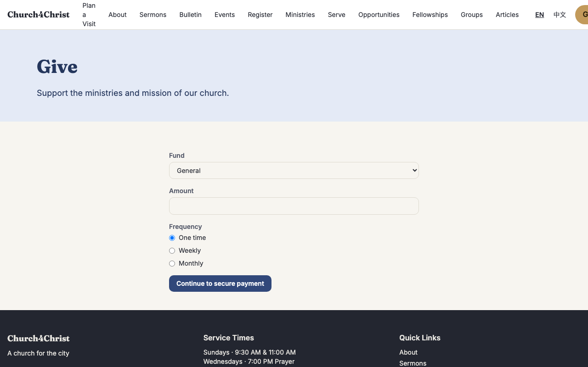
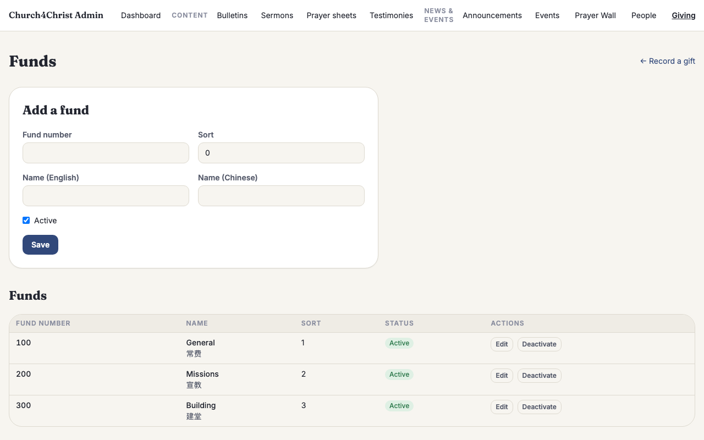
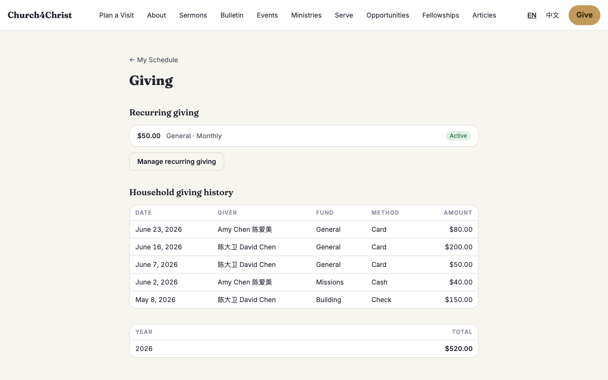
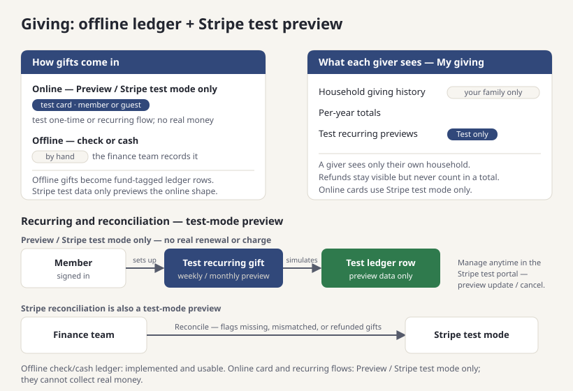

# Giving (online and offline gifts, annual statements)

> **Giving takes real donations through Stripe when you opt into live mode.** Stripe
> collects card and bank details on its own hosted pages; this application stores only
> amounts, funds, dates, status, and Stripe ids. Test mode stays the default until you
> deliberately go live (see the [go-live checklist](../supabase-setup.md#7-stripe-setup-and-go-live-giving-and-registration)).

## What it does

**Giving** records every gift in one ledger: online one-time and recurring gifts through
Stripe, plus checks and cash your finance team keys in by hand. It adds funds, a household
giving history, per-fund totals, a CSV export, and an **annual giving statement** donors can
print.

**Everything Stripe can do stays at Stripe.** That is a deliberate rule:

- **Payment details.** Donors pay on Stripe-hosted Checkout (cards, wallets, and ACH bank
  debits `us_bank_account`, per what you enable in the Stripe dashboard). Card and bank
  details never touch this application or its database.
- **Receipts.** Stripe emails a receipt for each payment (one-time gifts send it to the
  donor's email; subscription invoices follow your Stripe email settings). The app does not
  send per-payment receipts.
- **Changing a recurring gift.** A donor opens Stripe's **Billing Portal** from **My giving**
  to change the amount, update the payment method, or cancel.
- **Failed recurring payments.** Stripe's own dunning emails the donor. The app only marks
  the subscription **past due**.
- **Refunds and disputes.** You issue them in Stripe; the ledger follows automatically.

What this application adds on top:

- **Funds you define** — General, Missions, Building, and any others, each with a number, a
  name and an optional description in English and Chinese, a **default** flag (preselected on
  the give form), and a **tax-deductible** flag (only deductible funds appear on statements).
- **Offline gifts** — checks and cash recorded by hand, in your giving currency, with an
  audit row for who recorded each one.
- **A giving history each family can see** — a private **My giving** page with the
  household's gifts (pending, refunded, and disputed gifts are labeled), recurring gifts, and
  year totals.
- **Annual giving statements** — a printable page per donor per year, plus an admin action
  that emails everyone a link to theirs.

Because money is involved, the module excludes refunded and disputed money from totals,
keeps **test-mode** Stripe rows separate from real money, and limits a giver to their own
household's history.

## How your team uses it

**A member or guest gives online.** The public giving page at `/give` shows a short form:
pick a fund, enter an amount, choose one-time or (once signed in) weekly, monthly, or
yearly, and continue to Stripe's secure checkout. A guest can give once; recurring giving
needs a signed-in member. If Stripe is not configured for the current mode, the form is
hidden and the page explains that online giving is not available yet. After paying, the
thank-you page explains that **Stripe emails the receipt** and that the annual statement
will be in **My giving**.



**Bank (ACH) gifts take days.** Checkout reports an ACH payment as unpaid until the bank
debit settles. The ledger shows it as **Pending** (never counted), then **Succeeded** when
Stripe confirms, or **Failed** if the debit fails or is returned. The recorded date is the
day Stripe confirmed payment.

**The finance team records checks and cash.** The giving admin page at `/admin/giving` has a
**Record a gift** form for everything that came in offline. Choose the giver (or type a
guest's name), pick the fund, enter the amount in your giving currency, mark it a check or
cash, add the check number and the date received, and save. Below it, a filterable **ledger**
lists every gift with its status (pending, failed, refunded, partly refunded, disputed) and
labels **Test** rows from Stripe test mode. **Totals by fund** are net of refunds and shown
per currency. **Export CSV** downloads the (filtered) ledger for admins and finance users,
within the current campus.


**Setting up funds.** On `/admin/giving/funds` an admin adds each fund with a number, a name
and description in English and Chinese, and can mark one fund as the **default** and decide
whether it is **tax-deductible**. A fund can be deactivated without deleting it. Saving or
toggling a fund writes an audit row, as does each manual gift.



**Annual giving statements.** Under `/admin/giving/statements`:

1. Fill in the statement details once: your **legal name**, **tax ID**, an optional note,
   and the "no goods or services were provided" wording (a default is used when blank).
   The address comes from your site settings.
2. Choose a year and **Queue statements**. Every donor with an email and tax-deductible gifts
   that year gets one queued email. The existing five-minute job sends about ten per run,
   retries failures with a growing delay, and shows progress and failures on the page.
3. Each email links to the donor's **printable statement** at
   `/my/giving/statement/<year>`: legal name, address, tax ID, the donor, a per-fund and
   per-currency total, and the no-goods wording. No attachment is sent.

A statement counts only **live** money: succeeded gifts (manual gifts count as live), net of
refunds, in tax-deductible funds, bucketed by calendar year **in the church time zone**
(America/Chicago) using the date Stripe reports the payment — so a gift paid at 11:30 pm on
Dec 31 counts in that year. Pending, failed, disputed, and test-mode gifts are excluded.
A household owner's statement covers the household; anyone else sees only their own gifts.

**What a giver sees.** **My giving** at `/my/giving` shows recurring gifts with a status and a
**Manage** button that opens Stripe's Billing Portal, the household's gift history, a
per-year total, and a link to each year's statement.



**Checking records (reconciliation).** The optional **Reconcile** page at
`/admin/giving/reconcile` cross-checks the ledger against Stripe through a read-only
connection and flags a missing record, an amount mismatch, or a refund the ledger missed. It
is read-only; without the connection it shows setup notes.

**Who can see the money.** Giving figures are sensitive, so access is deliberately narrow:

- The **giving admin** pages (record gifts, funds, statements, export, reconcile) are open
  only to an **admin** or to someone with the **finance** flag set on their profile. An admin
  turns that flag on from a person's page in `/admin/people`, so a church treasurer can manage
  giving without being a full site admin. This is a shared **payment operations** permission:
  when paid Registration is enabled, it also grants Stripe recovery and registration-payment
  cancellation authority.
- **My giving** and the statement page show a giver only their **own household's** gifts
  (a household owner) or their own (anyone else) — never another family's.
- Refunds and disputes stay visible in a giver's history so it is honest, but never count
  toward totals or statements.

## How it fits together

Online gifts start at Stripe Checkout. Stripe sends signed webhook events to
`/api/stripe/webhook`; the app stores each event durably, then writes or updates the ledger
idempotently. Offline gifts are keyed in by the finance team into the same ledger.



How events change the ledger:

| Stripe event | Ledger effect |
| --- | --- |
| `checkout.session.completed` (card, paid) | Succeeded gift, dated from Stripe |
| `checkout.session.completed` (ACH, unpaid) | Pending gift (not counted) |
| `checkout.session.async_payment_succeeded` | Pending becomes succeeded, dated from Stripe |
| `checkout.session.async_payment_failed`, `charge.failed` (ACH) | Gift becomes failed |
| `invoice.paid` | Succeeded gift for a recurring payment; the PaymentIntent is learned from the invoice |
| `invoice.payment_failed` | Recurring gift becomes past due (Stripe emails the donor) |
| `customer.subscription.updated` / `.deleted` | Amount, interval, fund, and status follow Stripe |
| `charge.refunded` | `refunded_cents` is recorded; the gift becomes refunded only when fully refunded |
| `charge.dispute.created` | Gift becomes disputed (excluded) |
| `charge.dispute.closed` | Won: back to succeeded. Lost: stays disputed |

Refunds and disputes are matched to **your** gifts by the database (PaymentIntent, charge,
then invoice, then a Stripe invoice lookup), not by metadata, so a refund on a subscription
payment is found. A charge that matches no gift (a registration payment, another app on the
same Stripe account) is ignored. Every row records whether it is live or test, and an event
whose mode differs from the configured mode is rejected.

## Setting it up

Giving is **Supabase (Postgres)-only**; the module gate keeps it off in the D1
configuration. Stand up the Supabase backend first (see
[`docs/supabase-setup.md`](../supabase-setup.md)), then follow **Stripe setup and go-live**
there. Setting up Stripe itself takes forms, not code. Create an account, activate it with
your organization's details and bank account, and, if you qualify, ask Stripe for its
[nonprofit fee discount](https://support.stripe.com/questions/fee-discount-for-nonprofit-organizations).
The step-by-step overview with Stripe's official links is in
[Setting up Stripe for a church or nonprofit](../supabase-setup.md#setting-up-stripe-for-a-church-or-nonprofit).
Then, in this project:

1. Start in **test mode** with an `sk_test_…` key and a test webhook endpoint; pass them only
   to the setup installer, which stores them under the runtime secret names:

   ```bash
   CHURCH_SETUP_STRIPE_SECRET_KEY="sk_test_…" \
   CHURCH_SETUP_STRIPE_WEBHOOK_SECRET="whsec_…" \
   npm run setup
   ```
2. Add your funds on `/admin/giving/funds`, fill in the statement details, and mark your
   treasurer with the finance flag.
3. When ready for real donations, work through the go-live checklist (webhook at API version
   `2025-03-31.basil`, Stripe receipt emails, Billing Portal configuration, live key,
   `STRIPE_MODE=live` plus `STRIPE_LIVE_CONFIRMED=1`). Switching modes is explicit and
   reversible; test and live data never mix.
4. Optionally set `giving.currency` (default `usd`; for example `cad`) in site settings.

The Supabase worker runs durable webhook and Checkout recovery, and drains the statement
outbox, every five minutes (no extra schedule). Admins and finance users can inspect bounded
receipts and retry or dismiss eligible events at `/admin/stripe-events`; raw customer and
payment payloads are never shown there.

> Local fixtures and tests do not prove live Stripe delivery, receipt emails, or payment
> processing. Verify each with a real small live gift after go-live.

## For developers

- **Backend gating:** `giving` is Supabase-only (`requiresBackend: 'supabase'`). It owns the
  `/give/checkout`, `/my/giving`, `/api/giving`, and `/admin/giving` prefixes.
- **Schema:** `migrations-supabase/0002_giving.sql` (funds, gifts, recurring gifts) and
  `0039_giving_production.sql`, which adds `gifts.livemode`, `paid_at`, `refunded_cents`,
  `stripe_charge_id`, the `us_bank_account` method and `disputed` status, `recurring_gifts.livemode`
  and the `year` interval, `stripe_customers` (one customer per person per mode),
  fund description / `is_default` / `tax_deductible`, `giving_statement_outbox`, and
  `giving_audit_events`. Money is **integer cents** everywhere. `people.stripe_customer_id`
  is a legacy test-mode read fallback only.
- **Modes:** `src/lib/stripe.ts` — `STRIPE_MODE` is `test` or `live`; live needs an
  `sk_live_`/`rk_live_` key, a `whsec_` secret, and `STRIPE_LIVE_CONFIRMED=1`. Every request
  pins `Stripe-Version: 2025-03-31.basil`. Objects and events must carry a `livemode`
  equal to the configured mode.
- **Data libraries:** `fundDb.ts`, `givingDb.ts` (ledger, totals, statements, idempotent
  webhook writers), `givingWebhook.ts` (event dispatcher), `givingStatements.ts` (outbox),
  `givingExport.ts` (CSV), `givingAudit.ts`, `givingReconcile.ts`.
- **Year bucketing:** one SQL rule in `givingDb.ts` (`EFFECTIVE_DATE`): `received_on` for
  manual gifts, else `paid_at` converted from UTC to the church time zone.
- **Tests:** `test/pg/givingProduction.test.ts` (webhook flows, statements, outbox, CSV),
  `givingWebhook.test.ts`, `givingDb.test.ts`, `stripe.test.ts`, and the e2e checks in
  `test/e2e-pg/`. They use injected Stripe fetchers and a mocked mailer: they do not prove
  live Stripe or email delivery.
