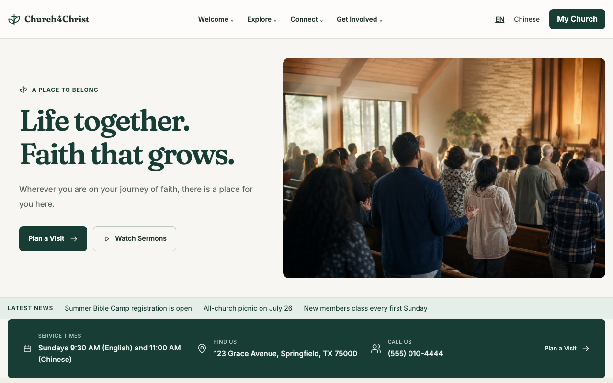
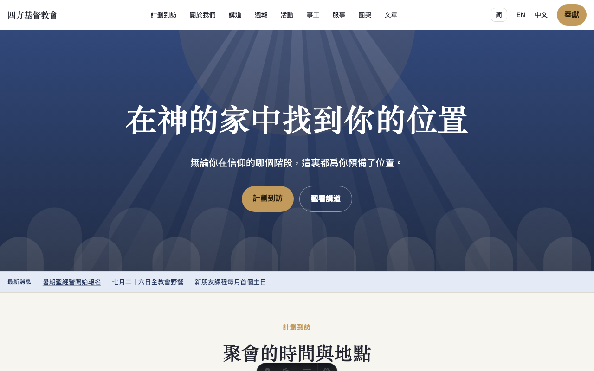
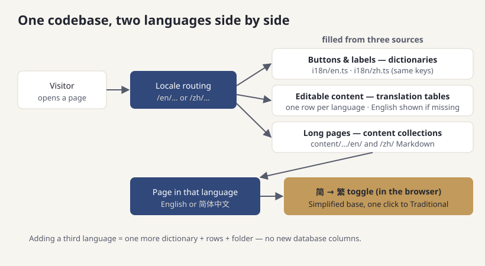

# Twelve languages, one website

## What it does

The whole site works in up to twelve interface languages from a single codebase: English,
Chinese, Spanish, Brazilian Portuguese, French, German, Japanese, Korean, Malay, Indonesian,
Vietnamese, and Hindi. Each church turns on the languages it needs and picks a default. There is
no separate site per language to keep in step — every page exists in each enabled language, and
a visitor's browser picks the language to show first. A switcher in the header changes languages
without leaving the page. The ten newer interface translations are AI-assisted; corrections from
native speakers are welcome.

The words on the site come from three places, and it helps to know which is which. Fixed labels
like buttons and menus live in **dictionaries** your developers maintain. Editable content —
ministry names, event titles, announcements — has a **translation row** per language that your
staff fill in from the admin forms, one tab per language. Longer pages like "About"
and the pastor's articles are **Markdown files**, one per language.

For content, your default language and then English are the safety net. If a translation has
not been written yet, the page falls back to the default (or English) version and marks it as not yet translated, rather than showing a
blank. So the site is never broken while a translation is in progress — it just shows what it has.

## How your team uses it

**One page, many languages.** Here is the home page in English and in Chinese. The content was
written once per language by your team — nothing is machine-translated — and the switch in the
header flips between them while keeping you on the same page.

**One tab per language.** In the admin forms, each translatable field shows a tab for every
language your site has turned on, with your default language first. You fill in the languages you
use; the others are optional. Turning a language off only hides it — nothing you wrote is deleted.

**Choosing languages.** During onboarding you tick the languages your site offers and pick the
default. Later, an administrator can change both under **Settings → Languages**. If a page or
email is missing in a visitor's language, the site falls back to your default language, then to
English.

**Simplified to Traditional, in one click.** The Chinese content is written in Simplified
characters. Readers who prefer Traditional characters can flip the whole page with a toggle —
the conversion happens right in their browser, instantly, and their choice is remembered. No
second copy of the content is stored; it is converted on the fly.

**Emails follow the reader.** The automatic emails (sign-in links, scheduling requests, the
weekly digest) go out in the recipient's saved language when it is turned on. When it is not known and
exactly two languages are on, both are stacked together; otherwise the default language is used.

**Adding more languages.** The site is built so a new language is mostly data: a registry entry, a
dictionary, and translated content. Existing churches keep exactly English and Chinese, with English
as the default, until an administrator turns on more languages. Your developers can follow the checklist in the
technical docs.

**Good to know:**

- Nothing on the site is machine-translated. Your team writes each language, so the tone is yours
  in each.
- Search engines are told which page belongs to which language, so each language is found on its
  own.
- Chinese, Japanese, and Korean pages use comfortable line spacing tuned for their scripts, and
  Japanese, Korean, and Hindi get suitable system fonts, so the reading experience is not just
  English typography with different words.
- The Simplified-to-Traditional switch never creates a second copy to maintain — you write in
  Simplified once, and Traditional readers get their conversion automatically.

## How it fits together

The diagram shows a request being routed by language, filled from the three sources, and then —
for Chinese readers — optionally converted to Traditional characters in the browser.

## For developers

- **Registry & routing:** `src/lib/locales.ts` (`LOCALE_REGISTRY`, `fallbackChain`, `parseLocale`,
  `localePath`); enabled languages and the default come from `src/lib/localeSettings.ts`; routing,
  negotiation and the `c4c_locale` cookie are in `src/middleware.ts`. See [`docs/i18n.md`](../i18n.md).
- **Dictionaries:** one file per language in `src/i18n/<code>.ts` (`en` is the complete fallback);
  `t(locale, key, vars)` interpolates `{vars}` and HTML-escapes them. Parity is enforced by
  `test/i18n.test.ts` and `node scripts/i18n/check.mjs --strict` (same keys, placeholders and
  tags, script checks, no untranslated copy outside the allowlist).
- **Database content:** the `*_i18n` companion tables, joined with a LEFT JOIN along the fallback
  chain (requested → default → `en`) and `COALESCE` per field — one helper builds
  these joins (`i18nJoin` in `src/lib/db.ts`). N languages by inserting rows, never new columns.
- **Content collections:** `src/content/{pages,articles,fellowships,staff}/{en,zh}/…`, loaded by
  `src/lib/content.ts` with English fallback + a "not translated" badge.
- **Simplified → Traditional Chinese toggle:** `src/lib/s2t.ts` (`toTraditional`) with the generated table
  `src/lib/s2t-table.json`; the client toggle is `src/lib/zh-client.ts`. To add a language, follow the
  checklist in `docs/i18n.md` (registry entry, dictionary, glossary, lookup row, fonts).
- **Tests:** `test/i18n.test.ts`, `test/locales.test.ts`, `test/s2t.test.ts`.
