# Registration (event sign-ups)

> **Free events run on the default Cloudflare D1 database. Paid events need Postgres
> (Supabase) and Stripe.** Free sign-ups never touch Stripe. Paid sign-ups use the same
> Stripe mode as Giving: test mode by default, live mode only after the go-live checklist in
> [`supabase-setup.md`](../supabase-setup.md#7-stripe-setup-and-go-live-giving-and-registration).

## What it does

**Registration** lets your church put an event online and collect sign-ups, answers to your
own questions, and a roster. You create the event, add the questions you need, set a seat
limit if there is one, and share the link.

It replaces the paper sign-up sheet, the separate payment link, and the spreadsheet:

- **Events anyone can sign up for.** A signed-in member registers with one tap, with their name
  and email already filled in. A guest enters a name and email, then confirms the email with a
  short code before the sign-up is saved. Each event shows its date, place, and price (or
  **Free**) on a simple public page.
- **The questions you need.** Each event has its own short form. Ask for a T-shirt size as a
  dropdown, dietary needs as a paragraph, or "first time?" as yes/no. You choose which
  questions are required.
- **A form builder, ticket types and templates.** Drag your questions into order, ask some
  once and some for each person, show a question only when an earlier answer fits, offer
  ticket types such as Adult and Child, and save a finished event as a template for next time.
- **Seat limits that hold.** When the last seat is taken, the next person is never let in by
  mistake, even if two people press the button at the same moment.
- **A waitlist for free events.** When a free event is full, people can join a waitlist
  instead of being turned away. It is on for every event by default, and you can turn it off
  per event. Paid events never have a waitlist.
- **Families and groups.** One sign-up can cover several people, up to a limit you set. The
  whole group takes seats together.
- **Emails and a private page.** People get a confirmation email with a QR code and a calendar
  file, and a private link to view, change, or cancel their sign-up.
- **Your own languages.** Event titles, descriptions, notes, and question labels can be written
  in every language your site has turned on. Emails arrive in the language the person used.
- **A roster your team can export.** Every sign-up lands on the event's roster. One click
  downloads it as a spreadsheet (CSV).
- **A back office for each event.** One page shows the numbers at a glance, a roster you can
  search and filter, and every detail of each sign-up. Staff can fix mistakes, add walk-ins,
  approve sign-ups, spot double sign-ups, and email everyone who registered.
- **A check-in desk for the door.** Volunteers find people on a phone by name or by scanning
  the QR code in their email, and check them in. Several phones stay in step.
- **Badges, a sign-in sheet, and refunds.** Print name badges and a sign-in sheet. On paid
  events, refund all or part of a card payment from the same page.
- **Access for one event only.** Give a volunteer a role on one event, such as the check-in
  desk, without opening the rest of the admin area.
- **Rooms, tables, and small groups (optional).** With the Event Logistics module on, plan
  housing, seating, and small groups on the event page. See [Event logistics](event-logistics.md).

Rosters hold names and emails, so the admin pages and exports are open only to staff and to
people you give a role on that event.

## Free and paid events

| | Free event | Paid event |
|---|---|---|
| Database | Cloudflare D1 or Supabase | Supabase (Postgres) only |
| Stripe | Not used | Required, same mode as Giving |
| Price field | Leave blank | Enter a price |
| Waitlist | Available | Never |

On a church that uses D1, the **price** field in the event editor is turned off, and saving an
event with a price is refused with a message. If you want paid events, choose Supabase when you
set up (see [Supabase setup](../supabase-setup.md)).

## How your team uses it

### Create an event

Go to **Admin → Registration**. The page lists every event with its stage, how many people
have signed up, and its seats.


Open **New event** to fill in:

- the **title** and **description** (one tab per site language),
- when it **starts** and **ends**, and an optional **location**,
- an optional **capacity** (leave blank for unlimited),
- an optional **poster** image,
- an optional **confirmation prefix** (see below),
- the **waitlist** switch,
- **Max people per registration** (1 to 20, default 1; see "Families and groups"),
- **Allow self-service changes** (on by default; see "Changes by the registrant"),
- **Requires approval** (off by default; free events only; see "Approval"),
- **Reminder email (days before)** (blank for none, or 1 to 30; see "Reminder emails"),
- optional **Notes for registrants** (one tab per language),
- the schedule: **Visible from**, **Opens**, and **Closes**.


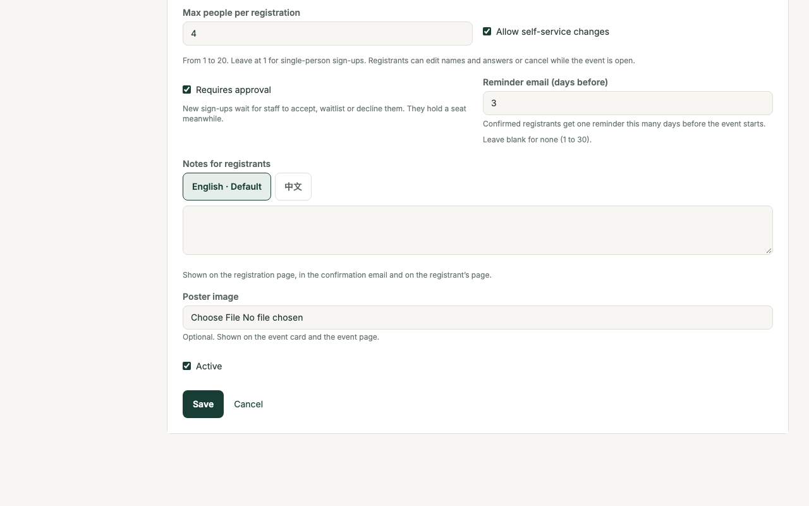

**Notes for registrants** are shown on the event page, on the registrant's private page, and in
their emails. Use them for parking, what to bring, or the schedule.

Dates and times on the registration pages and in the admin events list are shown in your
church's time zone. Earlier versions showed UTC, so times may look different after you upgrade.
They are now the times you meant.

### Stages

Every event is in one of four stages. The list shows the stage on each event.

| Stage | What visitors see |
|---|---|
| **Hidden** | Nothing. The event is switched off or its Visible-from time has not come. |
| **Preview** | The event page is public, but sign-up has not opened yet. |
| **Open** | Visitors can sign up. |
| **Closed** | Sign-up has ended. The event ends at its Closes time, or at its start time if no Closes time is set. |

Buttons on each event move it along: **Open now**, **Close now**, **Hide**, and **Show**. If
you open an event whose closing time has already passed, you are asked for a new closing time.


### Duplicate an event

**Duplicate** copies an event's details and questions, but not its registrations. The copy
starts hidden so you can change the dates and then show it.

### The form builder

Open an event from **Admin → Registration**. The **Registration form** section on that page
is where you build the questions. Each question is a card. Drag a card by its handle to move
it. The up and down buttons do the same from the keyboard. Open a card to change it. Press
**Save form** when you are done. **Undo** and **Redo** are always there, and the page tells you
about unsaved changes.

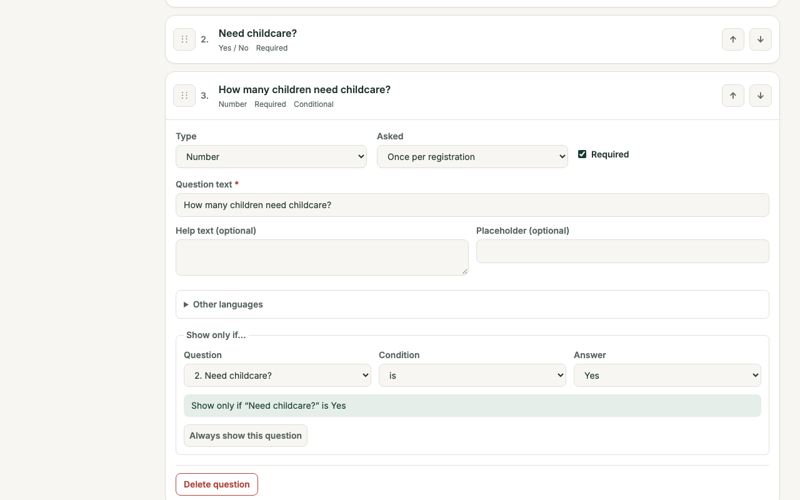

**Question types.** Short answer, Paragraph, Dropdown, Checkboxes, Yes / No, Number, Date,
Email address, Phone number, Section heading, and Terms checkbox.

**For each question you can set:**

- **Once per registration** or **For each person.** A shirt size is asked for each person. A
  contact note is asked once.
- **Required.**
- **Help text.** People see it as a small ⓘ next to the question.
- **Placeholder** and **maximum length** for text questions.
- **A label in every site language.** Dropdown and checkbox options are translated too, one
  box per option and language. Blank translations fall back to your default language.
- **Show only if…** Show the question only when an earlier answer matches, for example show
  "Which allergies?" only if "Any allergies?" is Yes. Only an earlier question can be used.


**Terms agreement.** A Terms checkbox shows your text next to a checkbox. The server records
the time the person agreed. It does not trust the time sent by the browser.

**Rules that protect your data:**

- A question that another question's "Show only if…" depends on cannot be deleted. Remove
  that condition first.
- A question that already has answers cannot switch between once per registration and for
  each person.
- Deleting a question that has answers also deletes those answers when you save. The page
  warns you first.

Editing a question's wording later keeps the answers people have already given.

### Ticket types

Use ticket types when people at the same event pay different amounts or fill different
seats, for example **Adult** and **Child**. Add them in the **Ticket types** section below
the form.

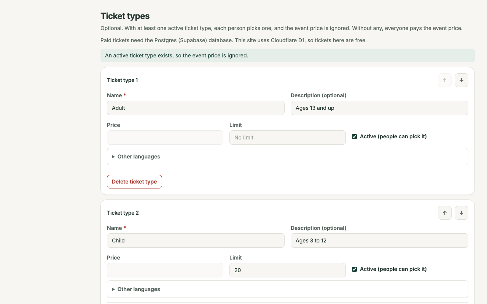

- Each type has a **name**, an optional **description**, a **price**, and an optional
  **limit**.
- Each person picks one ticket type. The event's own price is ignored once the event has an
  active ticket type.
- Limits hold, even when two people sign up at the same moment. On a free event with a
  waitlist, a group that does not fit joins the waitlist as a whole.
- A type that people already hold cannot be deleted. Turn off **Active** to stop new
  sign-ups.
- On the default D1 database, ticket prices must be free. Paid tickets need Postgres
  (Supabase) and Stripe, like paid events.
- People cannot change their ticket type on the private manage page. Staff can change it
  from the registration's detail panel (see "A registration's detail panel"). The amount
  already charged is not recalculated.

### Templates

When an event is set up the way you like, press **Save as template** on the events list. A
template keeps the form and the ticket types. Under **Templates** on the same page you can
open one to edit it, start a **New event from template** (the new event is hidden until you
turn it on), or delete the template. Events made from a template are not changed when you
delete it. Templates never appear on the public site and nobody can register for them.

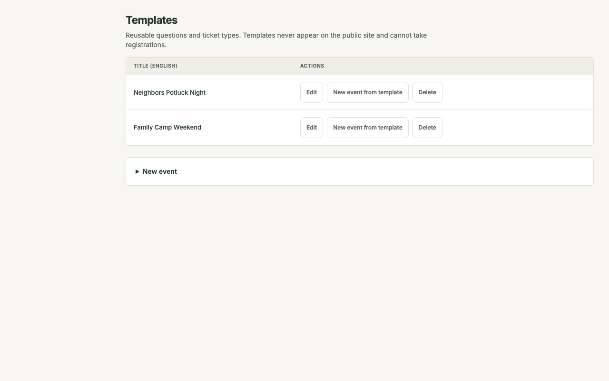

### Signing up

The public page at `/register` lists the events that are open or in preview. Opening an
event shows its details and its form.


Events with ticket types show a card for each type, with its price and the seats left. A
type that is full is marked **Sold out**. On the event list, an event shows **Full** when every
ticket type is sold out.


Each person picks a ticket type and answers the questions meant for each person. Questions
you asked once per registration appear once, and "Show only if…" questions appear when they
apply.

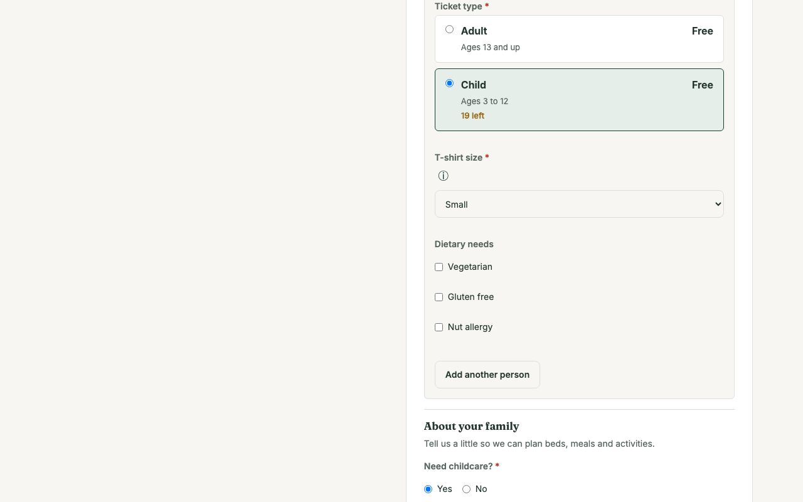


The review step and the private manage page show each person's ticket type and answers too,
and so do the confirmation emails, My events, and the roster.


On a phone, the same pages fit the screen.

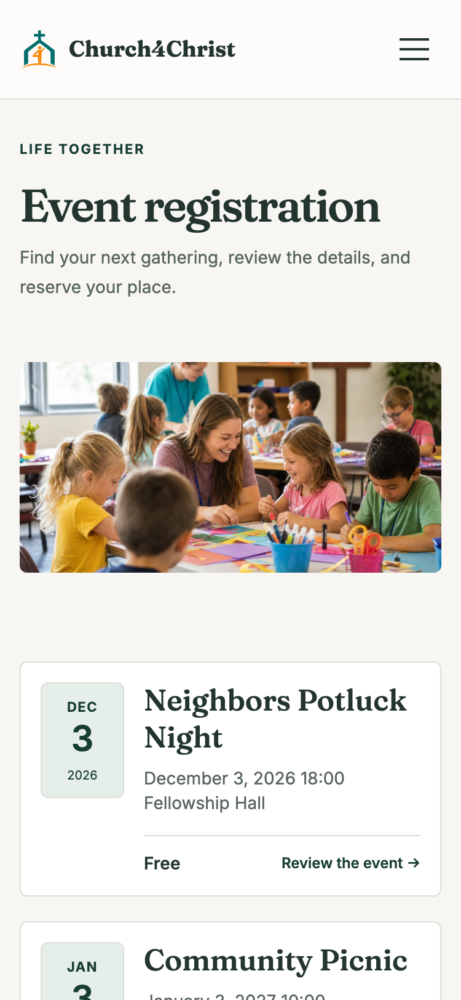


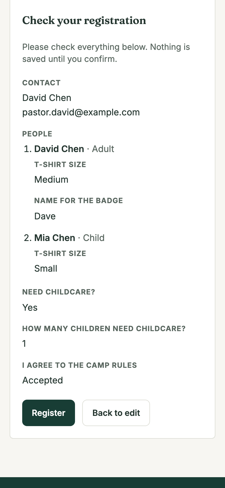


### Families and groups

Set **Max people per registration** on the event. At 1 (the default), each sign-up is one
person. At a higher number, the form asks "Who is coming?" and the person can add more people
with **Add another person**. Blank rows are ignored. A signed-in member can add people from
their household with one tap.


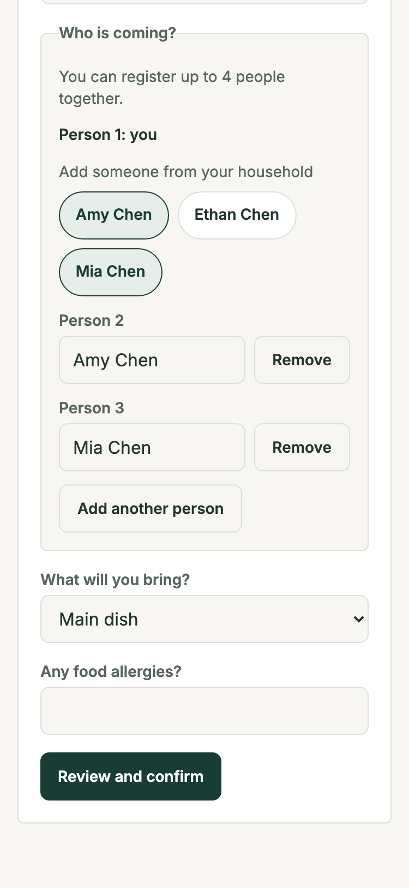

- The whole group takes seats together. A group of four uses four seats.
- On a free event with a waitlist, if the group does not fit in the seats left, the **whole
  group** joins the waitlist. Groups are never split.
- On a paid event, the price is the event price times the number of people.
- Phone is optional. Questions are still answered once for the whole sign-up.

### Check before saving

After the form, people see a page to check everything. Nothing is saved until they confirm.
If something is wrong, the page shows the problem beside the field. **Back to edit** returns
to the form with their answers kept.


If a free event is full and its waitlist is on, the form says so and the person (or the whole
group) joins the waitlist. They see a message that says they are on the waitlist.


### Emails

People get an email when they:

- are confirmed, or join the waitlist,
- sign up for an event that requires approval ("we received your registration", with no QR
  code yet),
- are accepted, put on the waitlist, or declined by your team (see "Approval"),
- pay (a paid sign-up is confirmed only after Stripe confirms the payment),
- move from the waitlist to confirmed,
- cancel, or are cancelled by your team,
- are due a reminder, if the event has one (see "Reminder emails").

Your team can also write to everyone at once (see "Email the registrants").

Each email arrives in the person's language. It shows the event, the time in your church's
time zone, the place, the confirmation number, the people, your notes, and a QR code. The
confirmation also has a calendar file (.ics) and a **Manage my registration** button.

The button opens a private page. **Only the newest email's link works.** Each new email gives
a fresh link and turns off the one in older emails. If someone says their link stopped working,
ask them to use the link in the most recent email. Reminders, accept and waitlist emails, and
**Resend confirmation** all bring a fresh link. A decline email and a message from **Email the
registrants** have no link and leave the current one working.

If an email could not be sent, the site tries again during its daily job. The first daily job
after you upgrade does **not** email people who registered before the upgrade.

Sending needs the same Cloudflare email setup as your other emails.

### Changes by the registrant

People can open their private page to see their sign-up, with its confirmation number and QR
code.


While the event is in Preview or Open, and **Allow self-service changes** is on, they can:

- change names, phone, and answers (the email address stays the same),
- press **Can't come** for one person, which frees that person's seat,
- cancel the whole registration.


If the last person is removed, the registration is cancelled. People cannot add someone new on
this page. A new person needs a new sign-up. Turn off **Allow self-service changes** if you
want to handle all changes yourself.

Signed-in members can do the same from **My events**.

**Paid sign-ups are not refunded automatically.** The page tells people to contact the church
office. Staff with the payment operations permission can refund from the registration's
detail panel, or in the Stripe dashboard (see "Refunds").

### Waitlist promotion

On free events, when seats free up, the people on the waitlist move to confirmed
**automatically**, oldest first. If the oldest group is too big for the seats left, it is
skipped and a smaller group behind it may get the seats. Each promoted person gets an email.
This also happens when your team cancels a registration. Paid events never have a waitlist.

On an event that **requires approval**, a promoted group moves to **In review**, not to
confirmed. It holds the seats, and the email says a place opened up and is waiting for
approval. Your team still decides.

### Confirmation numbers

Each registration gets a confirmation number such as `R26-0001`. It starts with `R` and the
last two digits of the event's start year, then counts up from 0001 within that event. To use
your own prefix, set the **confirmation prefix** on the event: one to six capital letters or
digits.

### The event page

Open an event from **Admin → Registration** to reach its page. The top of the page is an
**overview**:

- **Seats taken** (out of the capacity), **Seats left**, **On the waitlist**, **Awaiting a
  decision**, and **Checked in** (out of the people who are confirmed).
- A count for each status: Confirmed, In review, Waitlist, Pending, Declined, and Cancelled.
- Seats taken and the waitlist for each ticket type.
- A tally for every dropdown, checkbox, and yes/no question, such as how many people chose
  each T-shirt size.
- On events that took money: **Collected**, **Refunded**, and **Net collected**.

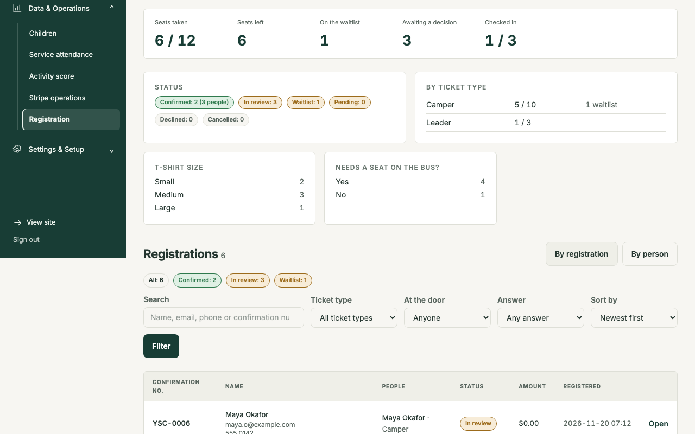

Below it is the **roster**. It shows 50 registrations per page.

- **Search** by name, email, phone, or confirmation number. The names of everyone in a group
  are searched too. On the default D1 database, search ignores capital letters for English
  letters only.
- Press a **status** to show only that status. Each one shows its count.
- Filter by **Ticket type**, by **At the door** (checked in or not yet), or by an **Answer**
  to a dropdown, checkbox, or yes/no question.
- **Sort by** newest, oldest, name, status, or confirmation number.
- **By registration** shows one row per sign-up. **By person** shows one row per person.

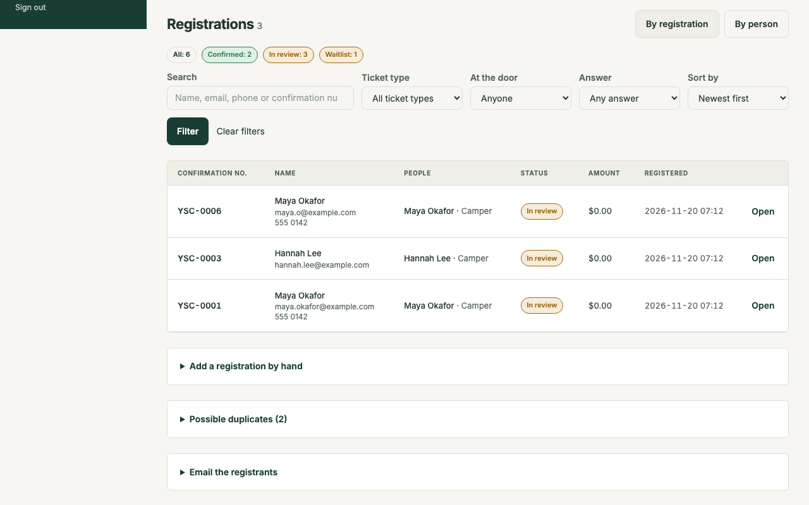

The statuses are:

| Status | Meaning |
|---|---|
| **Confirmed** | Has a seat. |
| **In review** | Waiting for your team to decide. Holds its seats. |
| **Waitlist** | Waiting for a seat. |
| **Pending** | Paying at Stripe. Holds its seats until Stripe answers. |
| **Declined** | Your team said no. |
| **Cancelled** | Cancelled by the person or by your team. |

### A registration's detail panel

Press **Open** on a roster row. A panel shows the contact, the people with their ticket types
and answers, who decided and when, and when the confirmation was sent. If you can make
changes, the panel also lets you:

- **Edit details:** the contact's name, email, and phone, each person's name, and the
  answers. Staff can leave required answers blank.
- **Change** one person's ticket type. The amount already charged is not recalculated.
- **Add a person** or **Remove** one. Removing the last person cancels the registration. A
  paid registration cannot get extra people: add a new registration instead.
- **Move to the waitlist** or **Move to confirmed** (free registrations only). The person moved
  is not emailed. Press **Resend confirmation** if they should hear about it.
- **Cancel registration.** The seats go to the waitlist and the person gets an email.
- **Resend confirmation.** This sends a fresh private link. The old link stops working.
- Write a **Staff note**. Only staff see it.
- **Refund** a paid registration (see "Refunds").

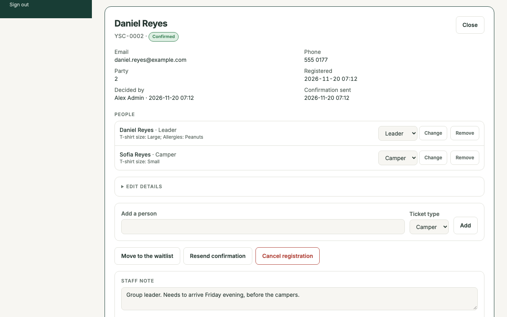

The **History** at the bottom lists every change: who made it and when. Check-ins, emails sent
from the page, and refunds appear there too.

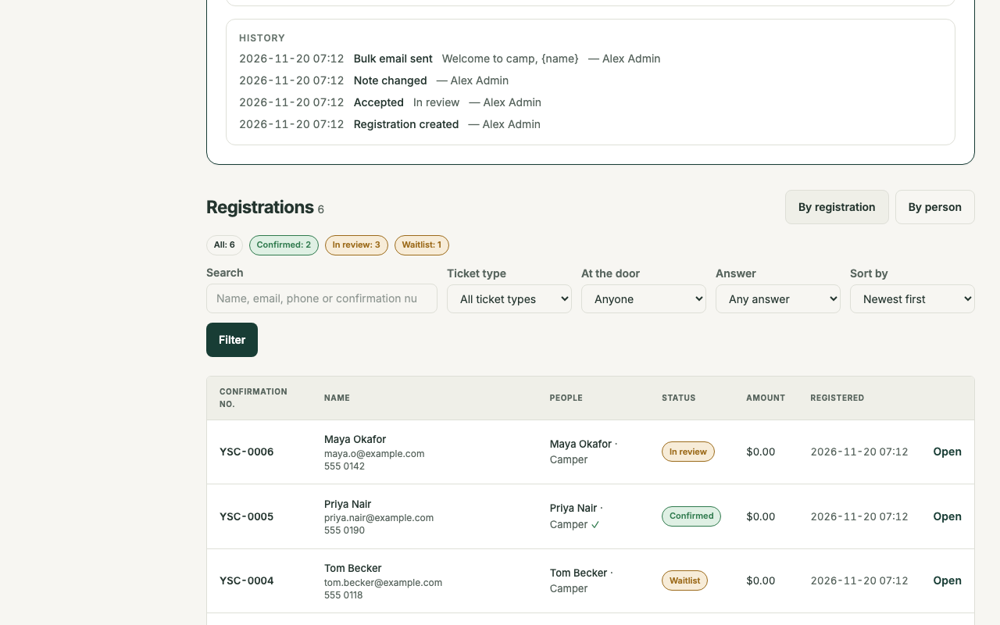

On a phone, the panel fits the screen.

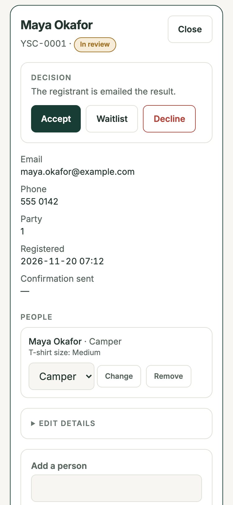

**Two people editing at once.** If someone else changed the registration after you opened it,
your change is not saved. The page says "Someone else changed this registration." Reload and
try again. Changes the registrant makes on their private page count too.

**Going over the limit.** If a change would put the event or a ticket type over its limit, the
page asks first. Press **Do it anyway** to go ahead.

### Approval

Turn on **Requires approval** in the event's settings when you want to choose who comes.
Approval is for free events only. The switch is turned off while the event or any active
ticket type has a price.

- New sign-ups become **In review**. They hold their seats while they wait. The person gets a
  "we received your registration" email without a QR code. Their private page says "Waiting
  for approval".
- If the event is full and the waitlist is on, new sign-ups join the waitlist as usual.
- Open the registration and press **Accept**, **Waitlist**, or **Decline**. The person is
  emailed the result. An accepted person gets the full confirmation with the QR code and a
  calendar file. A declined person gets a polite note.
- Waitlisting or declining someone frees their seats. The oldest group on the waitlist then
  moves to **In review**, not straight to confirmed.
- You can also accept someone who is on the waitlist or was declined earlier. If that goes
  over the limit, the page asks first.

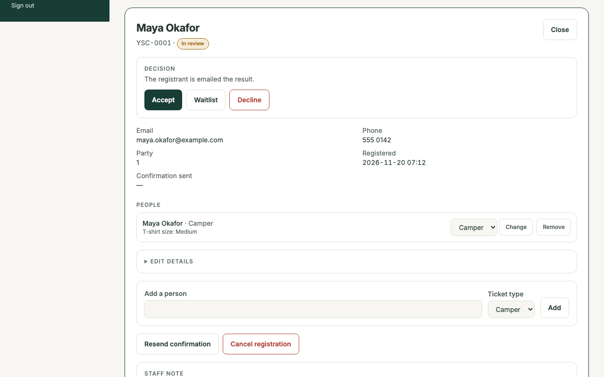

### Add a registration by hand

Use **Add a registration by hand** for walk-ins and phone sign-ups. Fill in the contact, then
each person with a ticket type and answers. It works even when sign-up is closed, and required
answers may be left blank. If the event is full, the page asks first. Tick **Email the
confirmation to the registrant** to send the usual email.

A registration added by hand is **confirmed at once**, even on an event that requires approval.

On a paid event the page never charges a card. Choose **Cash or check** and enter the amount
collected, or **Complimentary** for no charge.

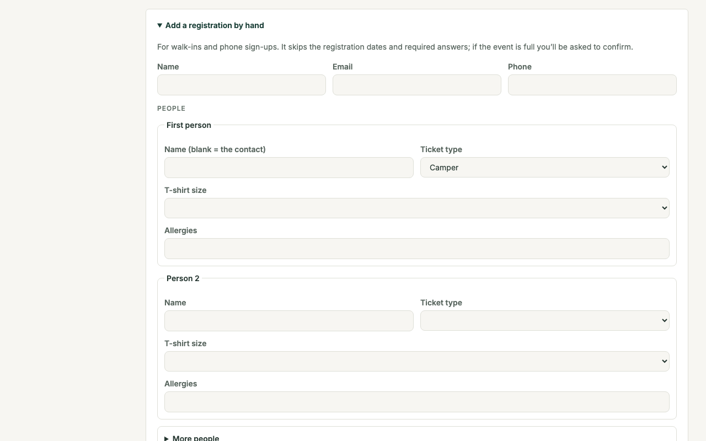

### Possible duplicates

**Possible duplicates** lists sign-ups that look like the same people twice: the same
person's name (capitals, accents, and extra spaces ignored), the same email, or the same phone
number. Cancelled and declined sign-ups are left out. Open one and cancel it if it is extra.

### Reminder emails

Set **Reminder email (days before)** on the event, from 1 to 30. The daily job then sends one
reminder to each confirmed registration once the event is that many days away. The reminder
has the event details, the people, your notes, the QR code, and a fresh private link. Each
registration gets it once. A send that fails is tried again the next day.

The daily job sends up to 40 reminders a day across all events. For a big event, the rest go
out on the following days, so allow a few extra days.

### Email the registrants

**Email the registrants** sends one message to many people.

1. Choose **Who gets it** by status (Confirmed is ticked to start) and, if you like, one
   ticket type.
2. Write a **Subject** (up to 200 characters) and a **Message** (plain text, up to 10,000
   characters). You can use `{name}`, `{event}`, and `{confirmation}`. Each email fills them in
   for that person.
3. Press **Preview recipients** to see how many registrations it will reach.
4. Press **Send email**.

Each registration gets one email at its contact address. Your message is sent as you wrote it.
The email's frame and footer are in each person's language. The first 20 emails go out at
once. The rest go out with the hourly job, up to 60 an hour. The **Email queue** line shows how
many are waiting, sent, and failed. A failed email is tried up to three times. One message can
reach up to 5,000 registrations.

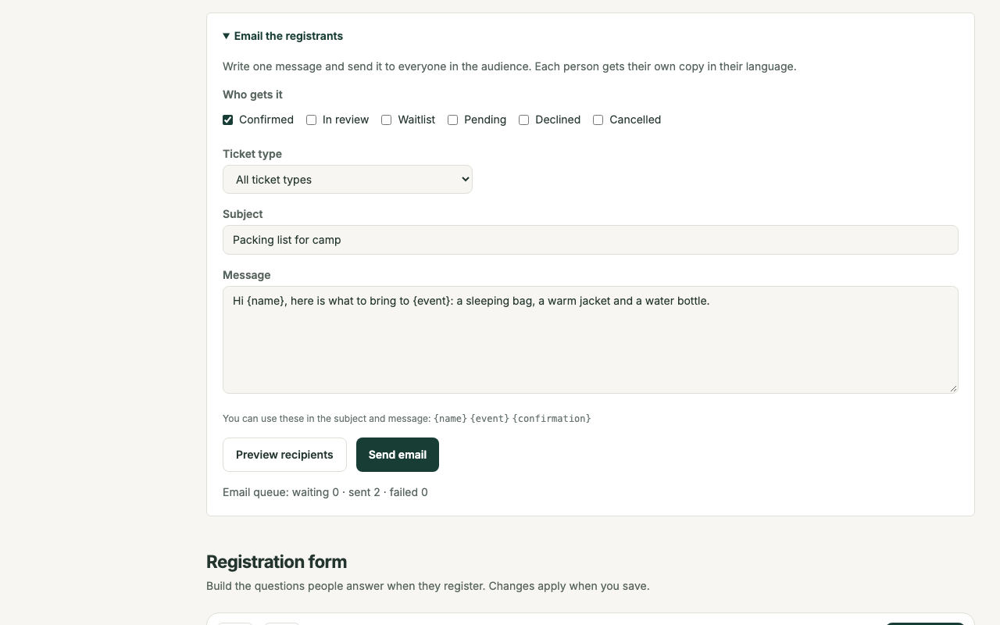

### Check-in desk

Press **Check-in desk** on the event page, or open `/admin/registration/<event number>/checkin`.
The desk is made for a phone at the door.

- **Find someone** by name, confirmation number, email, or phone. Or press **Scan code** and
  point the camera at the QR code in the person's confirmation email. The code holds the
  confirmation number. If the camera is not available, search by name instead.
- The result shows the group: each person's name and ticket type, the confirmation number,
  and the status. It never shows emails, phone numbers, or answers. With
  [Event logistics](event-logistics.md#at-the-door) on, it also shows each person's room and
  table.
- Press **Check in** for one person, or **Check in everyone** for the whole group. **Undo**
  takes a check-in back, as if the person never came. **Check out** records that a person
  left. They can be checked in again later.
- A group that is not confirmed (waitlist, in review, payment not finished, cancelled, or
  declined) shows a warning. So does a person who was cancelled. To check them in anyway, tick
  **I understand — check in anyway** first.
- The top shows **Checked in X of Y**. Y is the number of people on confirmed registrations.
- Several phones can run the desk at once. Every 10 seconds, while the page is open on screen,
  each desk picks up changes made at the others. Two desks checking in the same person at the
  same moment record one check-in.

The desk also works without JavaScript, as plain buttons. Check-ins show up in the overview,
in the roster's **At the door** filter, in each registration's history, and in the people
export.

### Badges, sign-in sheet, and CSV

The event page has buttons for printing and exports:

- **Badges** prints one badge per person with the name, the event title, and the ticket type.
  Filter by status (Confirmed to start) and ticket type, then press **Print**.
- **Sign-in sheet** prints one row per person, sorted by name, with a blank column for a
  signature. It has the same filters.
- **Export CSV** downloads one row per registration. The columns are, in this order:
  Confirmation, Name, Email, Status, Party size, Amount, Registered, one column per question
  that is asked once, then **People** and **Phone**. After those come **Ticket types** (only for
  events that have ticket types, written like "Ana: Adult; Ben: Child") and one column for each
  per-person question. The earlier columns keep their order.
- **Export people (CSV)** downloads one row per person: Confirmation, Person, Ticket type,
  Status, Contact name, Email, Phone, Checked in, Registered, then the answers. A family of
  four is four rows.

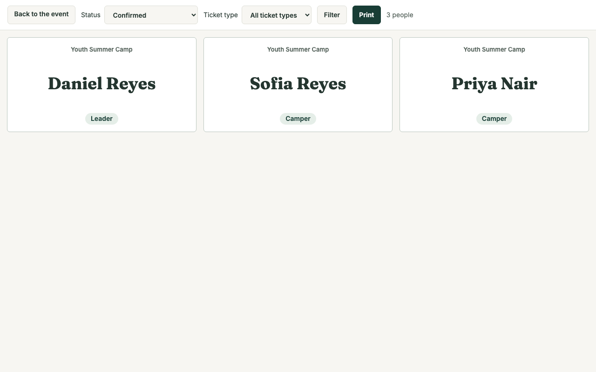

Both CSV files now start with an invisible marker (a UTF-8 byte-order mark), so Excel shows
accents and Chinese correctly. A script that reads the first column header may need to remove it.

### Refunds

Card refunds need **Postgres (Supabase) and Stripe**. Only staff with the **payment
operations** permission (or the finance team) see the refund controls, and only on events
where they can manage registrations.

- Open a registration that was paid by card. Under **Refund by card**, enter an amount up to
  what is still refundable, and tick **Also cancel the registration** if they are not coming.
  Stripe sends the money back. This cannot be undone.
- A double click does not refund twice. If a refund shows an error, reload the page and check
  the refunded amount before you try again.
- A refund made in the Stripe dashboard is recorded on the registration too. The two never
  add up twice.
- For a payment taken in cash or by check, **Record offline refund** only updates the books.
  No money moves. Add a note if you like.
- A complimentary registration has nothing to refund.

A refund does not cancel the registration unless you tick the box. The overview shows the
total refunded.

### Access to one event

Registration admins can give any active member a role on **one** event in the **Access to this event**
panel at the bottom of the event page. Find the person by name or email, pick a role, and
press **Save**. Press **Remove** to take it away.

| Role | Can do |
|---|---|
| **Viewer** | See the overview, roster, detail panel, and duplicates. Download the CSV files and print badges and the sign-in sheet. With [Event logistics](event-logistics.md) on, also see the Housing, Tables, and Groups tabs and use their prints. Cannot change anything or use the check-in desk. |
| **Check-in desk** | Use the check-in desk for this event. Cannot see the roster. |
| **Registrar** | Everything for this event: edits, approval, adding registrations, emails, the check-in desk, exports, and printing, and rooms, tables, and groups when [Event logistics](event-logistics.md) is on. Not the event settings, the form builder, access, or refunds. |

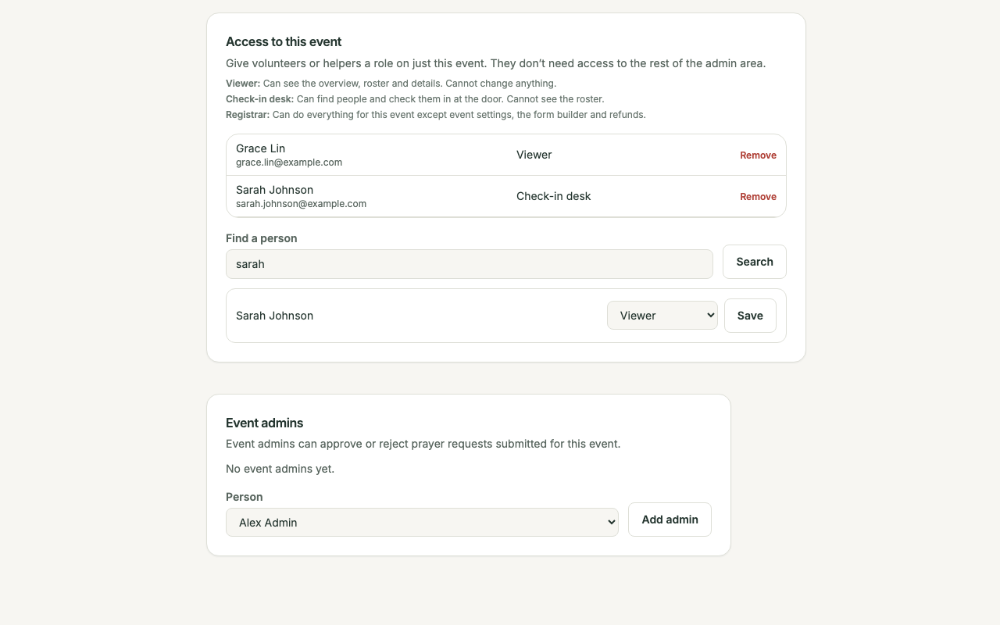

The person signs in with their own account. There is no menu link for them, so send them the
link: `/admin/registration/<event number>` for viewers and registrars, or
`/admin/registration/<event number>/checkin` for the desk. The site checks their role before
the page opens and again for every button they press. Without the right role, they are
turned away.

A person who has a role on an event cannot be merged into another person in the identity
merge tool until the role is removed. The tool reports it as a conflict.

### Show registration on a page

The page builder has a **Registration** block that puts an event on any custom page. See
[Page builder](page-builder.md#show-a-registration-event-on-a-page). In **Admin → Events**,
an event card can also link straight to a registration event.

### Who can manage events

**Registration admins** are editors, and admins who hold the **Registration** area (super
admins always do). They act as registrars on every event, and only they can change event
settings, build forms, and give people access to one event. Anyone else needs a role on that
event (see "Access to one event"). Refunds also need the **payment operations** permission.
Volunteer team leaders without one of these cannot open the admin pages. The public pages are
open to everyone. A hidden anti-spam field quietly drops bot sign-ups so they cannot use up an
event's seats.

### Event admins and the member portal

Registration also stores which people are **event admins**, and which groups are linked to an
event. The Member Portal uses these for event prayers and "My events". These tables are
available on D1 too, once Registration is enabled. A person who is an event admin cannot be
merged away into another person in the identity merge tool. The tool reports it as a conflict.

Event admins are separate from the roles in **Access to this event**. An event admin approves
prayer requests for the event. It does not open the event's roster or check-in desk.

### Rooms, tables, and small groups

For retreats, camps, and banquets, the optional **Event Logistics** module adds **Housing**,
**Tables**, and **Groups** tabs to the event page. Your team can put people in rooms, seat them
at tables (with an Auto-seat preview), sort them into small groups, tag them, print room lists,
door signs, table cards, and group lists, and choose whether registrants see their placements.
It is off until a super admin turns it on in **Settings → Modules**, and then each event turns on
only the parts it needs. See [Event logistics](event-logistics.md).

## Setting it up

**Registration on its own.** A church that only wants event sign-up can install Registration by
itself with the `event-registration` preset, which turns on Registration and nothing else:

```bash
npm run onboard -- --preset event-registration
```

It runs on the default Cloudflare D1 database, so every event is free. The home page then lists
the events people can sign up for, and the menu links to **Register**. Rooms, tables, and small
groups ([Event logistics](event-logistics.md)) stay off until you turn them on in
**Settings → Modules**. If you plan to charge for events, install with Supabase from the start,
for example `npm run setup -- --mode local --preset event-registration --backend supabase`, then
follow the Stripe steps below. An existing D1 site is not moved to Supabase automatically. The
same setup is published as the
[church-event-registration](https://github.com/leveo/church-event-registration) edition; see
[Single-feature editions](../editions.md).

**On D1 (free events).** Nothing extra is needed. If you are upgrading an existing D1 church,
Registration stays **off** after the upgrade. Turn it on in **Admin → Settings → Modules**.
A new install follows the module choice you made in setup. See [Upgrading](../upgrade.md).

**For the private page and emails.** Run `npm run setup`. It creates the secrets the private
page needs (`NEWCOMER_RATE_LIMIT_SECRET`, and the `IDENTITY_SOURCE_KEY_*` secrets for signed-in
members). An install that lacks `NEWCOMER_RATE_LIMIT_SECRET` shows "can't load right now" on the
private page. The QR images at `/register/qr/...` are public and cached by browsers. They hold
only the confirmation number. Links in emails end in `?campus=<slug>` so they open on the right
campus.

**On Supabase (free and paid events).** Free events need no payment setup. To try paid events,
set up Stripe in test mode:

1. **Import Stripe test credentials through setup.** Give setup an `sk_test_…` key and the test
   endpoint's `whsec_…` signing secret:

   ```bash
   CHURCH_SETUP_STRIPE_SECRET_KEY="sk_test_…" \
   CHURCH_SETUP_STRIPE_WEBHOOK_SECRET="whsec_…" \
   npm run setup
   ```

   Setup writes the runtime secrets for you. Live keys are rejected, and live webhook events
   are refused. If Giving already imported these test credentials, Registration uses the same
   pair.
2. **Point a Stripe test-mode webhook at your site.** In the Stripe dashboard's test mode, add
   one endpoint at `https://your-site/api/stripe/webhook` and subscribe it to the full event list in
   [Supabase setup, section 7](../supabase-setup.md#7-stripe-setup-and-go-live-giving-and-registration).
   A paid seat is confirmed by `checkout.session.completed` or
   `checkout.session.async_payment_succeeded`, and released by `checkout.session.expired` or
   `checkout.session.async_payment_failed`. Giving and Registration share this one endpoint.
3. **Create your first event** at `/admin/registration`, add its questions, and share
   `/register`.

A paid seat is held as **pending** while the person is at Stripe, and becomes **confirmed**
only when Stripe's signed notice arrives. If checkout expires, the seat is released. Every
five minutes the site recovers lost notices. Admins and finance users can review them at
`/admin/stripe-events`.

The **payment operations** permission covers both Giving and paid Registration. Give it only to
people you trust to reconcile Stripe events, cancel pending paid registrations, and refund
registrations. Registration refunds use the `charge.refunded` event you already send to the
webhook.

Paid registration records no live or test marker of its own. Rehearse in test mode, make one
small live registration before collecting real fees, and resolve pending checkout requests
before switching modes.


## For developers

- **Backends and gating:** `registration` has no `requiresBackend`, so it is available on D1
  and Postgres. `giving` is still Postgres-only. On D1 the admin price field is disabled and
  `saveEventFromForm` (`src/lib/regAdminActions.ts`) refuses a price with `admin.reg.priceD1Error`.
  Paid events rely on Stripe, which needs the Supabase worker.
- **Schema:** D1 `migrations/0050_registration_d1.sql` creates `reg_events`, `reg_event_i18n`,
  `reg_questions`, `reg_question_i18n`, `registrations`, `reg_answers`, `reg_attendees`,
  `group_reg_events`, and `event_admins`, and registers `reg_attendees.person_id` in the
  identity merge inventory. On an initialized database it writes `module.registration = 0`
  (an existing explicit row is never changed). Postgres
  `migrations-supabase/0042_registration_v2.sql` adds `visible_from`, `waitlist_enabled`,
  `confirmation_prefix`, `next_confirmation`, `poster`, `submission_key`, `confirmation_no`,
  and `party_size`, widens the status and question-type checks, and backfills a legacy
  submission key, one attendee row, and confirmation numbers per event in id order. Original
  tables: `migrations-supabase/0003_registration.sql`. Money is integer cents.
- **Setup doctor:** `scripts/setup/checks/database.mjs` expects the registration tables,
  `group_reg_events`, and `event_admins` on D1.
- **Party flow (Phase 2):** D1 `migrations/0051_registration_party.sql` and Postgres
  `migrations-supabase/0043_registration_party.sql` add `reg_events.max_party_size` and
  `allow_self_edit`, `reg_event_i18n.notes`, and `registrations.manage_token_hash` (SHA-256 of
  the token), `locale`, `phone`, `confirmation_sent_at`, `cancelled_at`, plus
  `identity_registration_continuations.party_json`. No backfill.
  New modules: `src/lib/regManage.ts` (view, edit, cancel, token, promotion),
  `src/lib/regManageApi.ts` and `src/pages/api/register/manage.ts` (token POST API),
  `src/lib/regNotify.ts` (send, token rotation, retry sweep run by the daily cron in
  `src/worker.ts`), `src/lib/regEmails.ts` (builders), `src/lib/qrPng.ts` plus
  `src/pages/register/qr/[eventId]/[confirmation].png.ts` (QR PNG), and `src/lib/regPublic.ts`.
  Pages: `src/pages/[locale]/register/manage.astro` (token read from the URL fragment) and
  `src/pages/[locale]/my/events/[id].astro`.
- **Event builder (Phase 3):** D1 `migrations/0052_registration_builder.sql` and Postgres
  `migrations-supabase/0044_registration_builder.sql` add question scope (once or per person),
  option keys with per-language labels, help text, placeholder, max length, show-if
  conditions, ticket types (`reg_ticket_types` and per-person ticket columns), consent time,
  and template events. Existing option text becomes option keys with the labels copied, and
  stored answers are not rewritten. New modules: `src/lib/regConditions.ts` (show-if
  evaluator and validator), `src/lib/regFormSave.ts` and the form writer in
  `src/lib/regDb.ts`, `src/lib/regBlock.ts` (page-builder card), and the React island for the
  admin form editor (admin only; public pages are unchanged). Tests: shared cases in
  `test/shared/regBuilderCases.ts`.
- **Back office (Phase 4):** D1 `migrations/0053_registration_back_office.sql` and Postgres
  `migrations-supabase/0045_registration_back_office.sql` add `reg_events.requires_approval` and
  `reminder_days`; `registrations.admin_note`, `decided_at`, `decided_by`, `reminder_sent_at`,
  `version`, `refunded_cents`, and `payment_method` (`stripe`, `offline`, or `comp`; backfilled to
  `stripe` where a Checkout session exists); and the tables `reg_checkins`, `reg_activity`,
  `reg_event_access`, and `reg_outbox`. The `review` and `declined` statuses, allowed since
  0050 and 0042, are now used. Modules:
  `src/lib/regAccess.ts` (roles and needs), `src/lib/regAdmin.ts` and `src/lib/regAdminCore.ts`
  (roster, detail panel writes with `version` checks and the `NEEDS_CONFIRM` soft confirm,
  approval, manual add, duplicates, overview), `src/lib/regAdminPage.ts` (the one POST action
  table, `REG_ADMIN_ACTIONS`, each with its need), `src/lib/regCheckin.ts`, `src/lib/regDesk.ts`
  and `src/lib/reg-desk-client.ts` (the desk; `jsqr` is imported only there, and only when the
  browser has no `BarcodeDetector`), `src/lib/regOutbox.ts` and `src/lib/regMessaging.ts`
  (reminder candidates, bulk audience and outbox), `src/lib/regRefunds.ts` (Stripe refunds with
  an idempotency key, offline refunds), and `src/lib/regExport.ts` (per-person CSV and the BOM).
  `sweepReminders` (`REMINDER_SWEEP_LIMIT` 40) runs in the daily `0 13 * * *` cron, and
  `sweepOutbox` (`CRON_DRAIN_LIMIT` 60) in the hourly `0 * * * *` cron; a send drains
  `DRAIN_ON_REQUEST` (20) at once. `charge.refunded` for a registration's PaymentIntent goes
  through `syncRefundedTotal`, which only raises `refunded_cents` to Stripe's cumulative amount.
  Pages: `src/pages/admin/registration/[id].astro` with `src/components/regAdmin/`, plus
  `[id]/checkin.astro`, `[id]/badges.astro`, `[id]/sign-in-sheet.astro`,
  `[id]/export.csv.ts`, and `[id]/export-people.csv.ts`.
- **Event logistics (Phase 5):** D1 `migrations/0054_registration_logistics.sql` and Postgres
  `migrations-supabase/0046_registration_logistics.sql` add the optional `event-logistics`
  module's per-event switches and the room, table, group, and tag tables. Its writes, cancel
  release, files, and tests are described in
  [Event logistics](event-logistics.md#for-developers).
- **Key modules:** `src/lib/regDb.ts` (reads, the shared locked registration writer that
  enforces capacity, waitlist, confirmation numbers, roster and CSV, `cloneEvent`,
  `setEventLifecycle`), `src/lib/regPhase.ts` (pure `eventPhase`, `isEventFull`,
  `offersWaitlist`), `src/lib/regAdminActions.ts` (editor save and list buttons),
  `src/lib/regForms.ts` (form parsing), `src/pages/api/register/submit.ts`, and the pages under
  `src/pages/[locale]/register/` and `src/pages/admin/registration/`. Guests start at
  `/api/identity/continuation/start` and finish after email verification.
- **Stripe:** paid registrations ride the shared webhook, `src/pages/api/stripe/webhook.ts`
  to `src/lib/givingWebhook.ts`, routed by `metadata.kind === 'registration'`.
- **Access:** registration admins (`hasRegistrationArea`: an editor, or an admin with the
  `registration` area) are registrars on every event. Per-event roles live in `reg_event_access`
  and are capabilities, not a ladder: `viewer` = view, `desk` = checkin, `registrar` = view,
  checkin, and manage. `REG_EVENT_STAFF_PATHS` in `src/lib/routePolicy.ts` is the one table of
  per-event pages (`/admin/registration/<id>` and its exports, badges, sign-in sheet, and the
  five event-logistics prints need view; `/checkin` needs checkin). Those paths are the `regEventStaff` route class, and
  `src/middleware.ts` runs `requireRegRole` for the event in the URL before the page (fail
  closed; a path the table does not know is refused). Pages and every action check again, and
  each action derives the event from the registration or attendee it targets. Event settings,
  the builder, and grants need `canEditEvent`; refunds need `canRefund`. Every other
  `/admin/registration` path stays registration-admins only.
- **Demo data:** `seed/registration-seed.sql` (Postgres) seeds fictional events and
  registrations.
- **Tests:** `test/e2e/registration.e2e.test.ts` (D1 end to end), `test/regCore.d1.test.ts`
  and `test/pg/regCore.pg.test.ts` (shared cases in `test/shared/regCoreCases.ts`),
  `test/regPhase.test.ts`, `test/regAdminActions.test.ts`,
  `test/node/registrationMigrationDefault.test.ts`, and the Postgres suites `test/pg/regDb.test.ts`,
  `regSchema.test.ts`, `regWebhook.test.ts`. Phase 2 adds `test/regCampus.d1.test.ts`,
  `test/regManageApi.d1.test.ts`, `test/regNotify.d1.test.ts` and `test/pg/regNotify.pg.test.ts`
  (shared cases in `test/shared/regNotifyCases.ts`), `test/regEmails.test.ts`, `test/qrPng.test.ts`,
  `test/regPublic.test.ts`, and more e2e cases. Phase 4 adds shared cases in
  `test/shared/regOfficeCases.ts`, `regMessagingCases.ts`, `regDeskCases.ts`, and
  `regBackOfficeUiCases.ts` (run by `test/regOffice.d1.test.ts`, `test/regMessaging.d1.test.ts`,
  `test/regDesk.d1.test.ts`, `test/regBackOfficeUi.d1.test.ts` and their `test/pg/` twins),
  `test/pg/regRefunds.pg.test.ts`, `test/regBackOfficeSchema.d1.test.ts`,
  `test/regEventStaffGate.test.ts`, `test/regEventStaffMiddleware.test.ts`,
  `test/regExportGuard.test.ts`, `test/node/registrationBackOfficeMigration.test.ts`, and
  `test/e2e/regBackOffice.e2e.test.ts` and `test/e2e/regDesk.e2e.test.ts`. See [Modules](modules.md).
