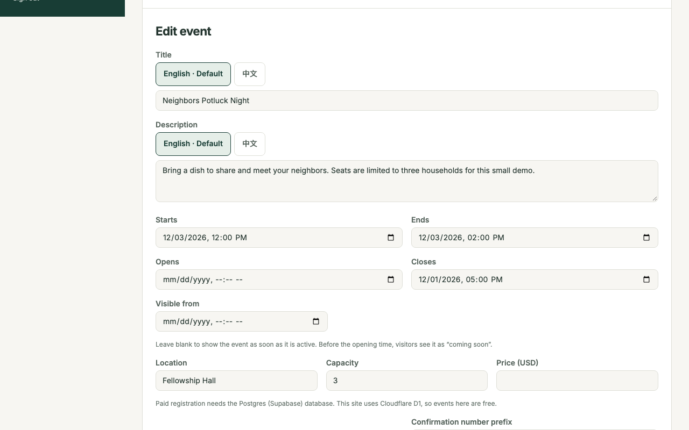
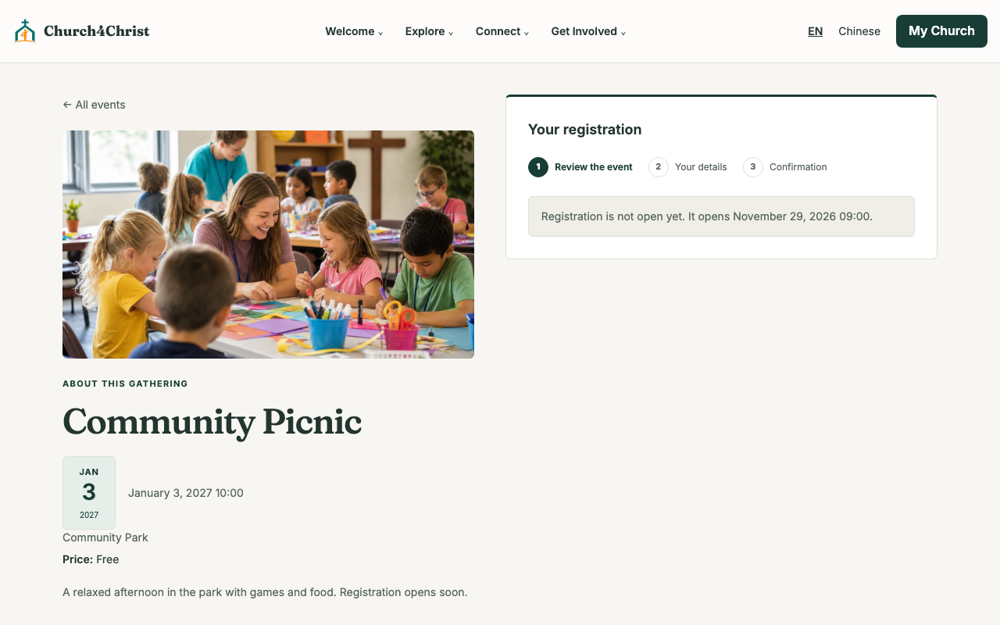
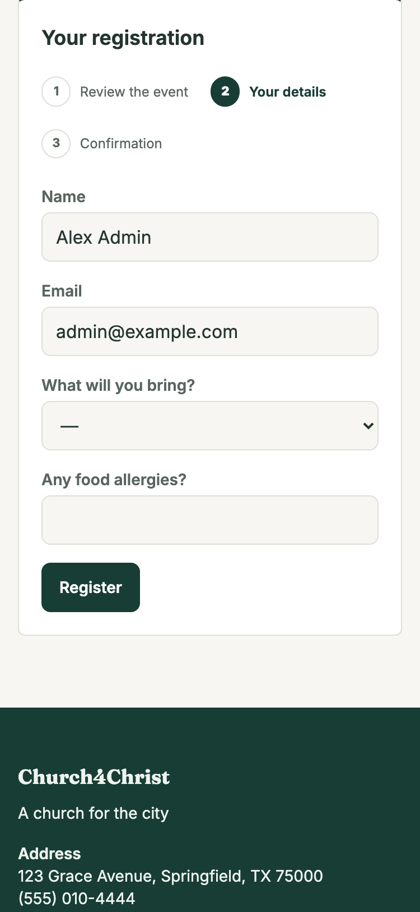
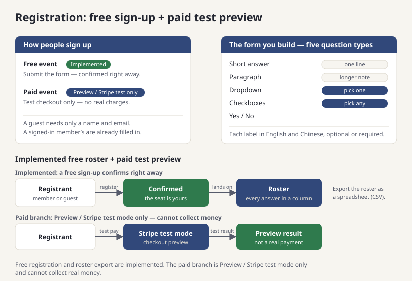

# Registration (event sign-ups)

> **Free events run on the default Cloudflare D1 database. Paid events need Postgres
> (Supabase) and Stripe.** Free sign-ups never touch Stripe. Paid sign-ups use the same
> Stripe mode as Giving: test mode by default, live mode only after the go-live checklist in
> [`supabase-setup.md`](../supabase-setup.md#7-stripe-setup-and-go-live-giving-and-registration).

## What it does

**Registration** lets your church put an event online and collect sign-ups, answers to your
own questions, and a roster. You create the event, add the questions you need, set a seat
limit if there is one, and share the link.

It replaces the paper sign-up sheet, the separate payment link, and the spreadsheet:

- **Events anyone can sign up for.** A signed-in member registers with one tap, with their name
  and email already filled in. A guest enters a name and email, then confirms the email with a
  short code before the sign-up is saved. Each event shows its date, place, and price (or
  **Free**) on a simple public page.
- **The questions you need.** Each event has its own short form. Ask for a T-shirt size as a
  dropdown, dietary needs as a paragraph, or "first time?" as yes/no. You choose which
  questions are required.
- **Seat limits that hold.** When the last seat is taken, the next person is never let in by
  mistake, even if two people press the button at the same moment.
- **A waitlist for free events.** When a free event is full, people can join a waitlist
  instead of being turned away. It is on for every event by default, and you can turn it off
  per event. Paid events never have a waitlist.
- **Your own languages.** Event titles, descriptions, and question labels can be written in
  every language your site has turned on.
- **A roster your team can export.** Every sign-up lands on the event's roster. One click
  downloads it as a spreadsheet (CSV).

Rosters hold names and emails, so the admin pages and exports are open only to staff.

## Free and paid events

| | Free event | Paid event |
|---|---|---|
| Database | Cloudflare D1 or Supabase | Supabase (Postgres) only |
| Stripe | Not used | Required, same mode as Giving |
| Price field | Leave blank | Enter a price |
| Waitlist | Available | Never |

On a church that uses D1, the **price** field in the event editor is turned off, and saving an
event with a price is refused with a message. If you want paid events, choose Supabase when you
set up (see [Supabase setup](../supabase-setup.md)).

## How your team uses it

### Create an event

Go to **Admin → Registration**. The page lists every event with its stage, how many people
have signed up, and its seats.


Open **New event** to fill in:

- the **title** and **description** (one tab per site language),
- when it **starts** and **ends**, and an optional **location**,
- an optional **capacity** (leave blank for unlimited),
- an optional **poster** image,
- an optional **confirmation prefix** (see below),
- the **waitlist** switch,
- the schedule: **Visible from**, **Opens**, and **Closes**.



### Stages

Every event is in one of four stages. The list shows the stage on each event.

| Stage | What visitors see |
|---|---|
| **Hidden** | Nothing. The event is switched off or its Visible-from time has not come. |
| **Preview** | The event page is public, but sign-up has not opened yet. |
| **Open** | Visitors can sign up. |
| **Closed** | Sign-up has ended. The event ends at its Closes time, or at its start time if no Closes time is set. |

Buttons on each event move it along: **Open now**, **Close now**, **Hide**, and **Show**. If
you open an event whose closing time has already passed, you are asked for a new closing time.



### Duplicate an event

**Duplicate** copies an event's details and questions, but not its registrations. The copy
starts hidden so you can change the dates and then show it.

### Questions

Each event has a **Questions & roster** page. Add as many questions as you like. Each has a
type, a label in every site language, and a **Required** switch. Dropdown and checkbox
questions get an **Options** box with one choice per line. Editing a question later keeps the
answers people have already given.

### Signing up

The public page at `/register` lists the events that are open or in preview. Opening an
event shows its details and its form.


On a phone, the same pages fit the screen.




If a free event is full and its waitlist is on, the form says so and the person joins the
waitlist. They see a confirmation page that says they are on the waitlist.


A waitlisted person is not moved to confirmed automatically yet. Staff can see them on the
roster. Automatic promotion is planned for a later release.

### Confirmation numbers

Each registration gets a confirmation number such as `R26-0001`. It starts with `R` and the
last two digits of the event's start year, then counts up from 0001 within that event. To use
your own prefix, set the **confirmation prefix** on the event: one to six capital letters or
digits.

### Roster and CSV

The **Questions & roster** page lists every registration: confirmation number, name, email,
status, party size, amount, when they signed up, and each answer. Statuses are confirmed,
pending, waitlist, and cancelled. Cancelling a registration frees its seat.

**Export CSV** downloads the roster. The columns are, in this order: Confirmation, Name,
Email, Status, Party size, Amount, Registered, then one column per question. If you have a
script or spreadsheet that reads the old export, update it for this order.

### Who can manage events

Admins and editors can create events, edit questions, and view or export rosters. Volunteer
team leaders without an editor role cannot. The public pages are open to everyone. A hidden
anti-spam field quietly drops bot sign-ups so they cannot use up an event's seats.

### Event admins and the member portal

Registration also stores which people are **event admins**, and which groups are linked to an
event. The Member Portal uses these for event prayers and "My events". These tables are
available on D1 too, once Registration is enabled. A person who is an event admin cannot be
merged away into another person in the identity merge tool. The tool reports it as a conflict.

## Setting it up

**On D1 (free events).** Nothing extra is needed. If you are upgrading an existing D1 church,
Registration stays **off** after the upgrade. Turn it on in **Admin → Settings → Modules**.
A new install follows the module choice you made in setup. See [Upgrading](../upgrade.md).

**On Supabase (free and paid events).** Free events need no payment setup. To try paid events,
set up Stripe in test mode:

1. **Import Stripe test credentials through setup.** Give setup an `sk_test_…` key and the test
   endpoint's `whsec_…` signing secret:

   ```bash
   CHURCH_SETUP_STRIPE_SECRET_KEY="sk_test_…" \
   CHURCH_SETUP_STRIPE_WEBHOOK_SECRET="whsec_…" \
   npm run setup
   ```

   Setup writes the runtime secrets for you. Live keys are rejected, and live webhook events
   are refused. If Giving already imported these test credentials, Registration uses the same
   pair.
2. **Point a Stripe test-mode webhook at your site.** In the Stripe dashboard's test mode, add
   one endpoint at `https://your-site/api/stripe/webhook` and subscribe it to the full event list in
   [Supabase setup, section 7](../supabase-setup.md#7-stripe-setup-and-go-live-giving-and-registration).
   A paid seat is confirmed by `checkout.session.completed` or
   `checkout.session.async_payment_succeeded`, and released by `checkout.session.expired` or
   `checkout.session.async_payment_failed`. Giving and Registration share this one endpoint.
3. **Create your first event** at `/admin/registration`, add its questions, and share
   `/register`.

A paid seat is held as **pending** while the person is at Stripe, and becomes **confirmed**
only when Stripe's signed notice arrives. If checkout expires, the seat is released. Every
five minutes the site recovers lost notices. Admins and finance users can review them at
`/admin/stripe-events`.

The **payment operations** permission covers both Giving and paid Registration. Give it only to
people you trust to reconcile Stripe events and cancel pending paid registrations.

Paid registration records no live or test marker of its own. Rehearse in test mode, make one
small live registration before collecting real fees, and resolve pending checkout requests
before switching modes.



## For developers

- **Backends and gating:** `registration` has no `requiresBackend`, so it is available on D1
  and Postgres. `giving` is still Postgres-only. On D1 the admin price field is disabled and
  `saveEventFromForm` (`src/lib/regAdminActions.ts`) refuses a price with `admin.reg.priceD1Error`.
  Paid events rely on Stripe, which needs the Supabase worker.
- **Schema:** D1 `migrations/0050_registration_d1.sql` creates `reg_events`, `reg_event_i18n`,
  `reg_questions`, `reg_question_i18n`, `registrations`, `reg_answers`, `reg_attendees`,
  `group_reg_events`, and `event_admins`, and registers `reg_attendees.person_id` in the
  identity merge inventory. On an initialized database it writes `module.registration = 0`
  (an existing explicit row is never changed). Postgres
  `migrations-supabase/0042_registration_v2.sql` adds `visible_from`, `waitlist_enabled`,
  `confirmation_prefix`, `next_confirmation`, `poster`, `submission_key`, `confirmation_no`,
  and `party_size`, widens the status and question-type checks, and backfills a legacy
  submission key, one attendee row, and confirmation numbers per event in id order. Original
  tables: `migrations-supabase/0003_registration.sql`. Money is integer cents.
- **Setup doctor:** `scripts/setup/checks/database.mjs` expects the registration tables,
  `group_reg_events`, and `event_admins` on D1.
- **Key modules:** `src/lib/regDb.ts` (reads, the shared locked registration writer that
  enforces capacity, waitlist, confirmation numbers, roster and CSV, `cloneEvent`,
  `setEventLifecycle`), `src/lib/regPhase.ts` (pure `eventPhase`, `isEventFull`,
  `offersWaitlist`), `src/lib/regAdminActions.ts` (editor save and list buttons),
  `src/lib/regForms.ts` (form parsing), `src/pages/api/register/submit.ts`, and the pages under
  `src/pages/[locale]/register/` and `src/pages/admin/registration/`. Guests start at
  `/api/identity/continuation/start` and finish after email verification.
- **Stripe:** paid registrations ride the shared webhook, `src/pages/api/stripe/webhook.ts`
  to `src/lib/givingWebhook.ts`, routed by `metadata.kind === 'registration'`.
- **Access:** admin pages and the CSV route require `editor` or `admin` before any read.
- **Demo data:** `seed/registration-seed.sql` (Postgres) seeds fictional events and
  registrations.
- **Tests:** `test/e2e/registration.e2e.test.ts` (D1 end to end), `test/regCore.d1.test.ts`
  and `test/pg/regCore.pg.test.ts` (shared cases in `test/shared/regCoreCases.ts`),
  `test/regPhase.test.ts`, `test/regAdminActions.test.ts`,
  `test/node/registrationMigrationDefault.test.ts`, and the Postgres suites `test/pg/regDb.test.ts`,
  `regSchema.test.ts`, `regWebhook.test.ts`. See [Modules](modules.md).
