# Registration (event sign-ups)

> **Free events run on the default Cloudflare D1 database. Paid events need Postgres
> (Supabase) and Stripe.** Free sign-ups never touch Stripe. Paid sign-ups use the same
> Stripe mode as Giving: test mode by default, live mode only after the go-live checklist in
> [`supabase-setup.md`](../supabase-setup.md#7-stripe-setup-and-go-live-giving-and-registration).

## What it does

**Registration** lets your church put an event online and collect sign-ups, answers to your
own questions, and a roster. You create the event, add the questions you need, set a seat
limit if there is one, and share the link.

It replaces the paper sign-up sheet, the separate payment link, and the spreadsheet:

- **Events anyone can sign up for.** A signed-in member registers with one tap, with their name
  and email already filled in. A guest enters a name and email, then confirms the email with a
  short code before the sign-up is saved. Each event shows its date, place, and price (or
  **Free**) on a simple public page.
- **The questions you need.** Each event has its own short form. Ask for a T-shirt size as a
  dropdown, dietary needs as a paragraph, or "first time?" as yes/no. You choose which
  questions are required.
- **A form builder, ticket types and templates.** Drag your questions into order, ask some
  once and some for each person, show a question only when an earlier answer fits, offer
  ticket types such as Adult and Child, and save a finished event as a template for next time.
- **Seat limits that hold.** When the last seat is taken, the next person is never let in by
  mistake, even if two people press the button at the same moment.
- **A waitlist for free events.** When a free event is full, people can join a waitlist
  instead of being turned away. It is on for every event by default, and you can turn it off
  per event. Paid events never have a waitlist.
- **Families and groups.** One sign-up can cover several people, up to a limit you set. The
  whole group takes seats together.
- **Emails and a private page.** People get a confirmation email with a QR code and a calendar
  file, and a private link to view, change, or cancel their sign-up.
- **Your own languages.** Event titles, descriptions, notes, and question labels can be written
  in every language your site has turned on. Emails arrive in the language the person used.
- **A roster your team can export.** Every sign-up lands on the event's roster. One click
  downloads it as a spreadsheet (CSV).

Rosters hold names and emails, so the admin pages and exports are open only to staff.

## Free and paid events

| | Free event | Paid event |
|---|---|---|
| Database | Cloudflare D1 or Supabase | Supabase (Postgres) only |
| Stripe | Not used | Required, same mode as Giving |
| Price field | Leave blank | Enter a price |
| Waitlist | Available | Never |

On a church that uses D1, the **price** field in the event editor is turned off, and saving an
event with a price is refused with a message. If you want paid events, choose Supabase when you
set up (see [Supabase setup](../supabase-setup.md)).

## How your team uses it

### Create an event

Go to **Admin → Registration**. The page lists every event with its stage, how many people
have signed up, and its seats.

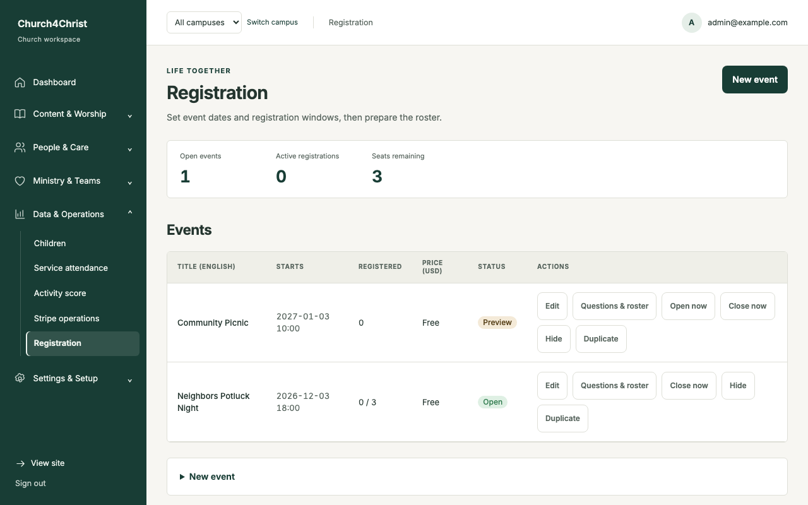

Open **New event** to fill in:

- the **title** and **description** (one tab per site language),
- when it **starts** and **ends**, and an optional **location**,
- an optional **capacity** (leave blank for unlimited),
- an optional **poster** image,
- an optional **confirmation prefix** (see below),
- the **waitlist** switch,
- **Max people per registration** (1 to 20, default 1; see "Families and groups"),
- **Allow self-service changes** (on by default; see "Changes by the registrant"),
- optional **Notes for registrants** (one tab per language),
- the schedule: **Visible from**, **Opens**, and **Closes**.


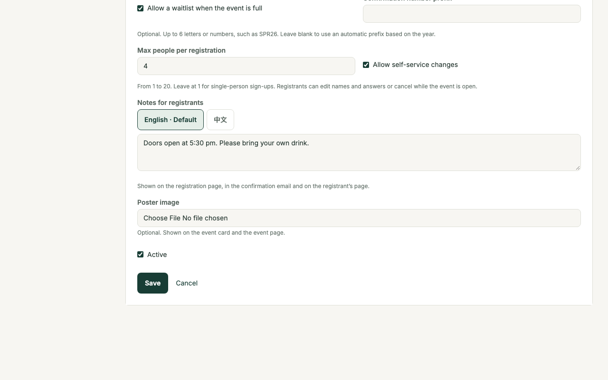

**Notes for registrants** are shown on the event page, on the registrant's private page, and in
their emails. Use them for parking, what to bring, or the schedule.

Dates and times on the registration pages and in the admin events list are shown in your
church's time zone. Earlier versions showed UTC, so times may look different after you upgrade.
They are now the times you meant.

### Stages

Every event is in one of four stages. The list shows the stage on each event.

| Stage | What visitors see |
|---|---|
| **Hidden** | Nothing. The event is switched off or its Visible-from time has not come. |
| **Preview** | The event page is public, but sign-up has not opened yet. |
| **Open** | Visitors can sign up. |
| **Closed** | Sign-up has ended. The event ends at its Closes time, or at its start time if no Closes time is set. |

Buttons on each event move it along: **Open now**, **Close now**, **Hide**, and **Show**. If
you open an event whose closing time has already passed, you are asked for a new closing time.


### Duplicate an event

**Duplicate** copies an event's details and questions, but not its registrations. The copy
starts hidden so you can change the dates and then show it.

### The form builder

Open an event from **Admin → Registration**. The **Registration form** section on that page
is where you build the questions. Each question is a card. Drag a card by its handle to move
it. The up and down buttons do the same from the keyboard. Open a card to change it. Press
**Save form** when you are done. **Undo** and **Redo** are always there, and the page tells you
about unsaved changes.


**Question types.** Short answer, Paragraph, Dropdown, Checkboxes, Yes / No, Number, Date,
Email address, Phone number, Section heading, and Terms checkbox.

**For each question you can set:**

- **Once per registration** or **For each person.** A shirt size is asked for each person. A
  contact note is asked once.
- **Required.**
- **Help text.** People see it as a small ⓘ next to the question.
- **Placeholder** and **maximum length** for text questions.
- **A label in every site language.** Dropdown and checkbox options are translated too, one
  box per option and language. Blank translations fall back to your default language.
- **Show only if…** Show the question only when an earlier answer matches, for example show
  "Which allergies?" only if "Any allergies?" is Yes. Only an earlier question can be used.

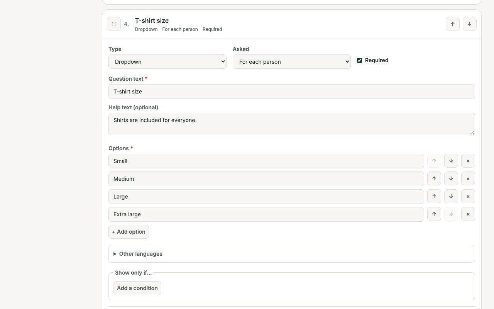

**Terms agreement.** A Terms checkbox shows your text next to a checkbox. The server records
the time the person agreed. It does not trust the time sent by the browser.

**Rules that protect your data:**

- A question that another question's "Show only if…" depends on cannot be deleted. Remove
  that condition first.
- A question that already has answers cannot switch between once per registration and for
  each person.
- Deleting a question that has answers also deletes those answers when you save. The page
  warns you first.

Editing a question's wording later keeps the answers people have already given.

### Ticket types

Use ticket types when people at the same event pay different amounts or fill different
seats, for example **Adult** and **Child**. Add them in the **Ticket types** section below
the form.


- Each type has a **name**, an optional **description**, a **price**, and an optional
  **limit**.
- Each person picks one ticket type. The event's own price is ignored once the event has an
  active ticket type.
- Limits hold, even when two people sign up at the same moment. On a free event with a
  waitlist, a group that does not fit joins the waitlist as a whole.
- A type that people already hold cannot be deleted. Turn off **Active** to stop new
  sign-ups.
- On the default D1 database, ticket prices must be free. Paid tickets need Postgres
  (Supabase) and Stripe, like paid events.
- People cannot change their ticket type on the private manage page. To change one, ask the
  office to cancel that person and register them again.

### Templates

When an event is set up the way you like, press **Save as template** on the events list. A
template keeps the form and the ticket types. Under **Templates** on the same page you can
open one to edit it, start a **New event from template** (the new event is hidden until you
turn it on), or delete the template. Events made from a template are not changed when you
delete it. Templates never appear on the public site and nobody can register for them.


### Signing up

The public page at `/register` lists the events that are open or in preview. Opening an
event shows its details and its form.

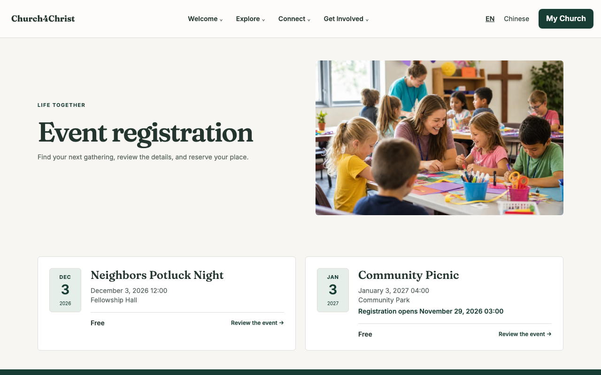

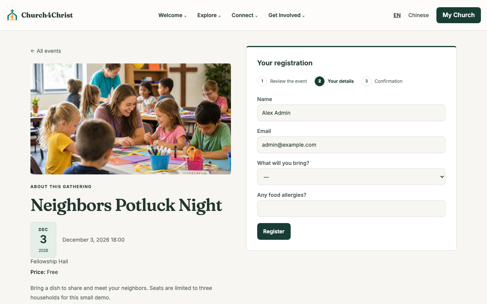

Events with ticket types show a card for each type, with its price and the seats left. A
type that is full is marked **Sold out**. On the event list, an event shows **Full** when every
ticket type is sold out.

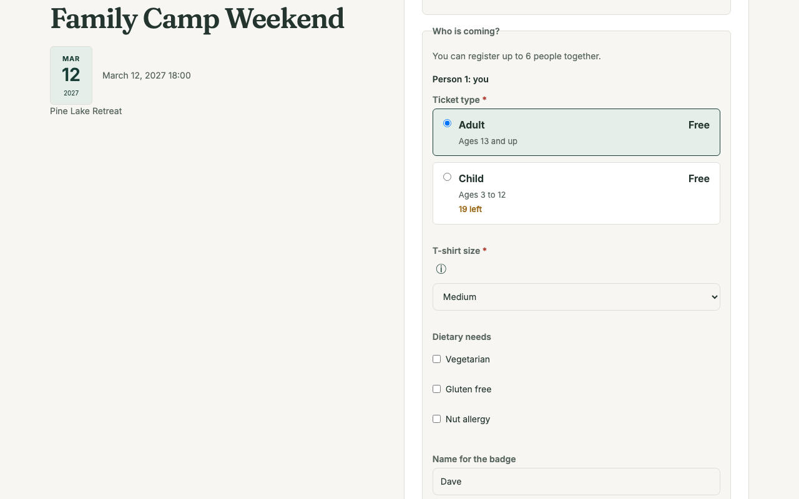

Each person picks a ticket type and answers the questions meant for each person. Questions
you asked once per registration appear once, and "Show only if…" questions appear when they
apply.


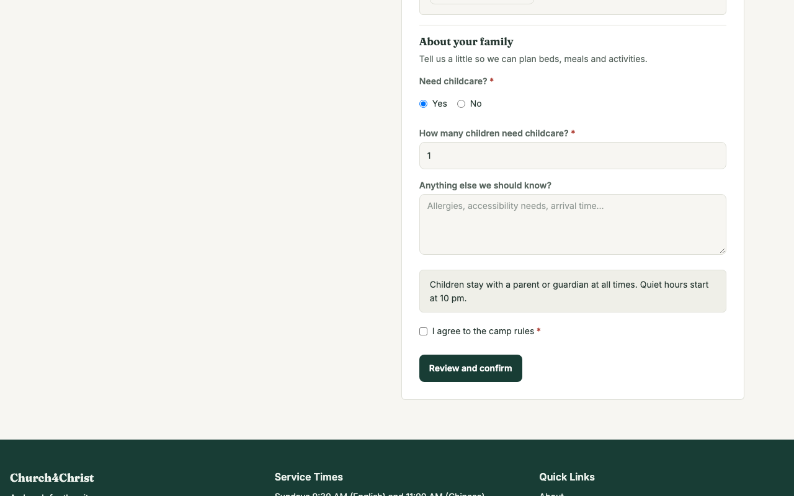

The review step and the private manage page show each person's ticket type and answers too,
and so do the confirmation emails, My events, and the roster.

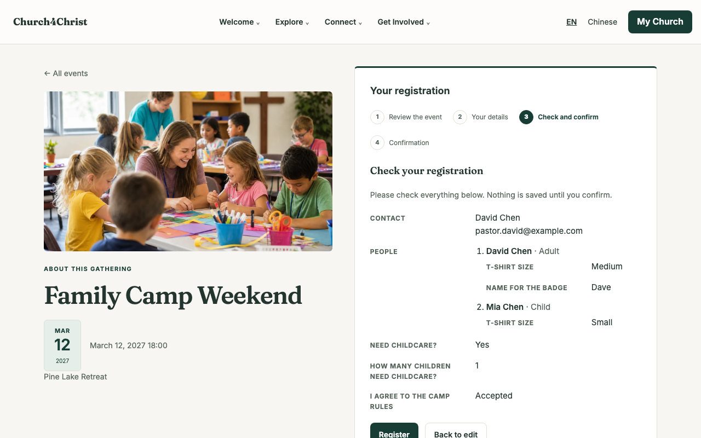

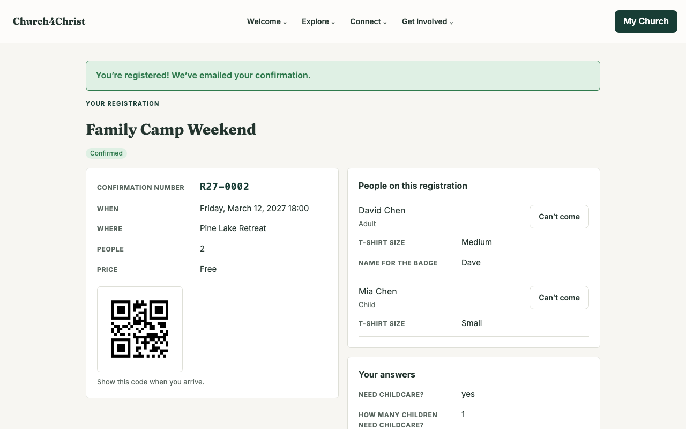

On a phone, the same pages fit the screen.


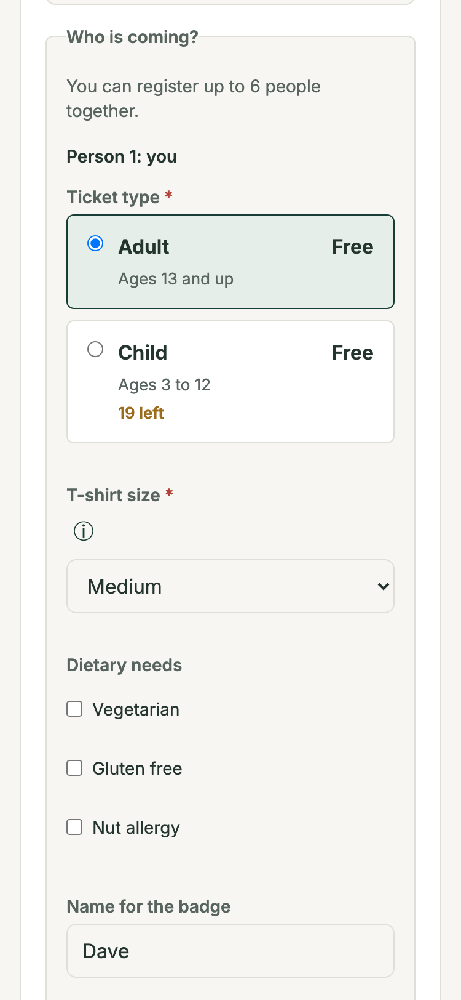

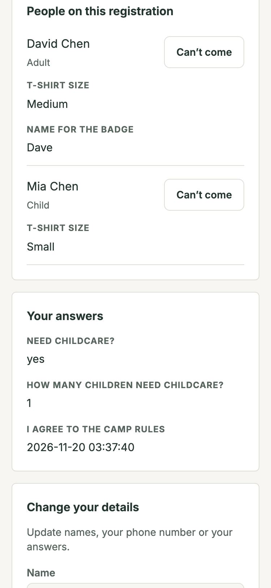

### Families and groups

Set **Max people per registration** on the event. At 1 (the default), each sign-up is one
person. At a higher number, the form asks "Who is coming?" and the person can add more people
with **Add another person**. Blank rows are ignored. A signed-in member can add people from
their household with one tap.

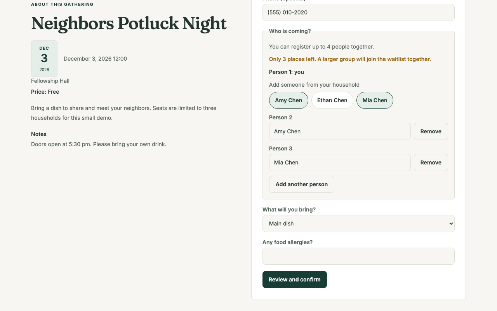


- The whole group takes seats together. A group of four uses four seats.
- On a free event with a waitlist, if the group does not fit in the seats left, the **whole
  group** joins the waitlist. Groups are never split.
- On a paid event, the price is the event price times the number of people.
- Phone is optional. Questions are still answered once for the whole sign-up.

### Check before saving

After the form, people see a page to check everything. Nothing is saved until they confirm.
If something is wrong, the page shows the problem beside the field. **Back to edit** returns
to the form with their answers kept.

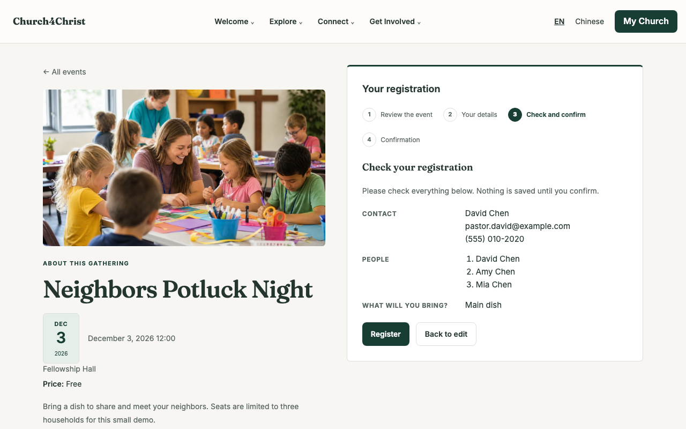

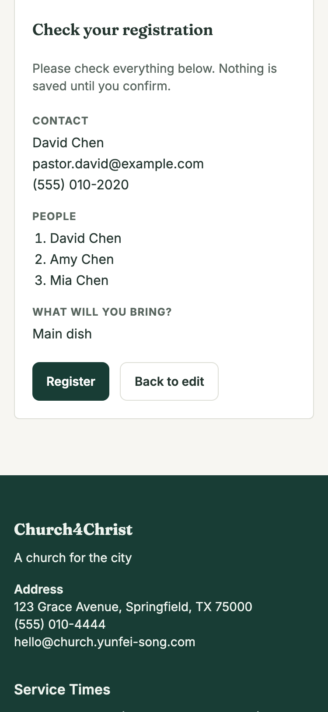

If a free event is full and its waitlist is on, the form says so and the person (or the whole
group) joins the waitlist. They see a message that says they are on the waitlist.

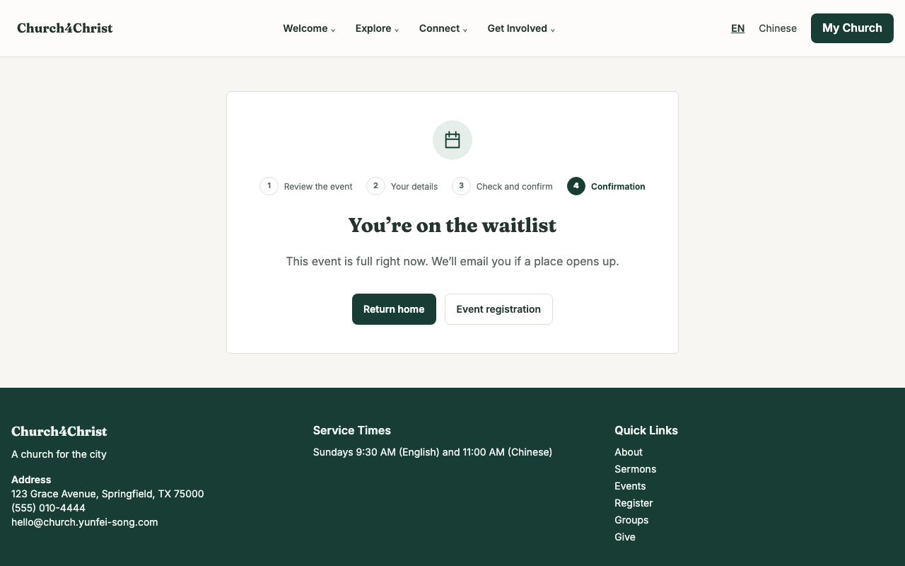

### Emails

People get an email when they:

- are confirmed, or join the waitlist,
- pay (a paid sign-up is confirmed only after Stripe confirms the payment),
- move from the waitlist to confirmed,
- cancel, or are cancelled by your team.

Each email arrives in the person's language. It shows the event, the time in your church's
time zone, the place, the confirmation number, the people, your notes, and a QR code. The
confirmation also has a calendar file (.ics) and a **Manage my registration** button.

The button opens a private page. **Only the newest email's link works.** Each new email gives
a fresh link and turns off the one in older emails. If someone says their link stopped working,
ask them to use the link in the most recent email.

If an email could not be sent, the site tries again during its daily job. The first daily job
after you upgrade does **not** email people who registered before the upgrade.

Sending needs the same Cloudflare email setup as your other emails.

### Changes by the registrant

People can open their private page to see their sign-up, with its confirmation number and QR
code.

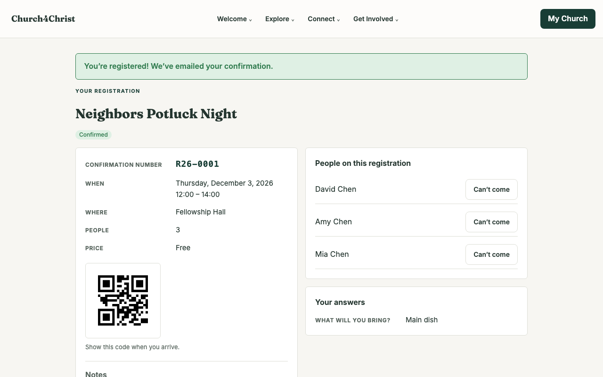

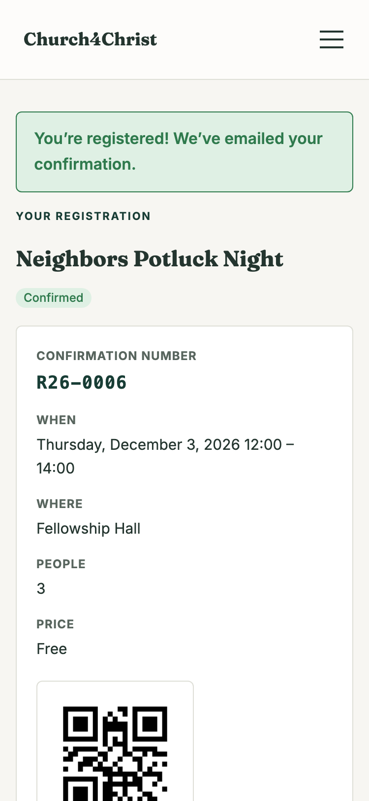

While the event is in Preview or Open, and **Allow self-service changes** is on, they can:

- change names, phone, and answers (the email address stays the same),
- press **Can't come** for one person, which frees that person's seat,
- cancel the whole registration.

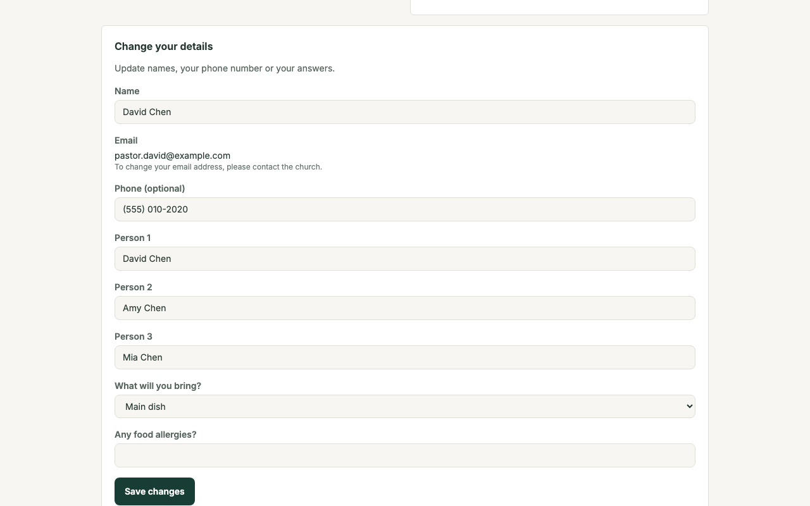

If the last person is removed, the registration is cancelled. People cannot add someone new on
this page. A new person needs a new sign-up. Turn off **Allow self-service changes** if you
want to handle all changes yourself.

Signed-in members can do the same from **My events**.

**Paid sign-ups are not refunded automatically.** The page tells people to contact the church
office. Refund in Stripe yourself.

### Waitlist promotion

On free events, when seats free up, the people on the waitlist move to confirmed
**automatically**, oldest first. If the oldest group is too big for the seats left, it is
skipped and a smaller group behind it may get the seats. Each promoted person gets an email.
This also happens when your team cancels a registration. Paid events never have a waitlist.

### Confirmation numbers

Each registration gets a confirmation number such as `R26-0001`. It starts with `R` and the
last two digits of the event's start year, then counts up from 0001 within that event. To use
your own prefix, set the **confirmation prefix** on the event: one to six capital letters or
digits.

### Roster and CSV

The **Questions & roster** page lists every registration: confirmation number, name, email,
status, party size, amount, when they signed up, each answer, the names of the people, and
the phone number. Statuses are confirmed,
pending, waitlist, and cancelled. 

**Export CSV** downloads the roster. The columns are, in this order: Confirmation, Name,
Email, Status, Party size, Amount, Registered, one column per question that is asked once, then **People** and
**Phone**. After those come **Ticket types** (only for events that have ticket types, written
like "Ana: Adult; Ben: Child") and one column for each per-person question. The earlier
columns keep their order, so existing scripts that read by position keep working. Cancelling a registration frees its seats and starts waitlist
promotion.

### Show registration on a page

The page builder has a **Registration** block that puts an event on any custom page. See
[Page builder](page-builder.md#show-a-registration-event-on-a-page). In **Admin → Events**,
an event card can also link straight to a registration event.

### Who can manage events

Admins and editors can create events, edit questions, and view or export rosters. Volunteer
team leaders without an editor role cannot. The public pages are open to everyone. A hidden
anti-spam field quietly drops bot sign-ups so they cannot use up an event's seats.

### Event admins and the member portal

Registration also stores which people are **event admins**, and which groups are linked to an
event. The Member Portal uses these for event prayers and "My events". These tables are
available on D1 too, once Registration is enabled. A person who is an event admin cannot be
merged away into another person in the identity merge tool. The tool reports it as a conflict.

## Setting it up

**On D1 (free events).** Nothing extra is needed. If you are upgrading an existing D1 church,
Registration stays **off** after the upgrade. Turn it on in **Admin → Settings → Modules**.
A new install follows the module choice you made in setup. See [Upgrading](../upgrade.md).

**For the private page and emails.** Run `npm run setup`. It creates the secrets the private
page needs (`NEWCOMER_RATE_LIMIT_SECRET`, and the `IDENTITY_SOURCE_KEY_*` secrets for signed-in
members). An install that lacks `NEWCOMER_RATE_LIMIT_SECRET` shows "can't load right now" on the
private page. The QR images at `/register/qr/...` are public and cached by browsers. They hold
only the confirmation number. Links in emails end in `?campus=<slug>` so they open on the right
campus.

**On Supabase (free and paid events).** Free events need no payment setup. To try paid events,
set up Stripe in test mode:

1. **Import Stripe test credentials through setup.** Give setup an `sk_test_…` key and the test
   endpoint's `whsec_…` signing secret:

   ```bash
   CHURCH_SETUP_STRIPE_SECRET_KEY="sk_test_…" \
   CHURCH_SETUP_STRIPE_WEBHOOK_SECRET="whsec_…" \
   npm run setup
   ```

   Setup writes the runtime secrets for you. Live keys are rejected, and live webhook events
   are refused. If Giving already imported these test credentials, Registration uses the same
   pair.
2. **Point a Stripe test-mode webhook at your site.** In the Stripe dashboard's test mode, add
   one endpoint at `https://your-site/api/stripe/webhook` and subscribe it to the full event list in
   [Supabase setup, section 7](../supabase-setup.md#7-stripe-setup-and-go-live-giving-and-registration).
   A paid seat is confirmed by `checkout.session.completed` or
   `checkout.session.async_payment_succeeded`, and released by `checkout.session.expired` or
   `checkout.session.async_payment_failed`. Giving and Registration share this one endpoint.
3. **Create your first event** at `/admin/registration`, add its questions, and share
   `/register`.

A paid seat is held as **pending** while the person is at Stripe, and becomes **confirmed**
only when Stripe's signed notice arrives. If checkout expires, the seat is released. Every
five minutes the site recovers lost notices. Admins and finance users can review them at
`/admin/stripe-events`.

The **payment operations** permission covers both Giving and paid Registration. Give it only to
people you trust to reconcile Stripe events and cancel pending paid registrations.

Paid registration records no live or test marker of its own. Rehearse in test mode, make one
small live registration before collecting real fees, and resolve pending checkout requests
before switching modes.


## For developers

- **Backends and gating:** `registration` has no `requiresBackend`, so it is available on D1
  and Postgres. `giving` is still Postgres-only. On D1 the admin price field is disabled and
  `saveEventFromForm` (`src/lib/regAdminActions.ts`) refuses a price with `admin.reg.priceD1Error`.
  Paid events rely on Stripe, which needs the Supabase worker.
- **Schema:** D1 `migrations/0050_registration_d1.sql` creates `reg_events`, `reg_event_i18n`,
  `reg_questions`, `reg_question_i18n`, `registrations`, `reg_answers`, `reg_attendees`,
  `group_reg_events`, and `event_admins`, and registers `reg_attendees.person_id` in the
  identity merge inventory. On an initialized database it writes `module.registration = 0`
  (an existing explicit row is never changed). Postgres
  `migrations-supabase/0042_registration_v2.sql` adds `visible_from`, `waitlist_enabled`,
  `confirmation_prefix`, `next_confirmation`, `poster`, `submission_key`, `confirmation_no`,
  and `party_size`, widens the status and question-type checks, and backfills a legacy
  submission key, one attendee row, and confirmation numbers per event in id order. Original
  tables: `migrations-supabase/0003_registration.sql`. Money is integer cents.
- **Setup doctor:** `scripts/setup/checks/database.mjs` expects the registration tables,
  `group_reg_events`, and `event_admins` on D1.
- **Party flow (Phase 2):** D1 `migrations/0051_registration_party.sql` and Postgres
  `migrations-supabase/0043_registration_party.sql` add `reg_events.max_party_size` and
  `allow_self_edit`, `reg_event_i18n.notes`, and `registrations.manage_token_hash` (SHA-256 of
  the token), `locale`, `phone`, `confirmation_sent_at`, `cancelled_at`, plus
  `identity_registration_continuations.party_json`. No backfill.
  New modules: `src/lib/regManage.ts` (view, edit, cancel, token, promotion),
  `src/lib/regManageApi.ts` and `src/pages/api/register/manage.ts` (token POST API),
  `src/lib/regNotify.ts` (send, token rotation, retry sweep run by the daily cron in
  `src/worker.ts`), `src/lib/regEmails.ts` (builders), `src/lib/qrPng.ts` plus
  `src/pages/register/qr/[eventId]/[confirmation].png.ts` (QR PNG), and `src/lib/regPublic.ts`.
  Pages: `src/pages/[locale]/register/manage.astro` (token read from the URL fragment) and
  `src/pages/[locale]/my/events/[id].astro`.
- **Event builder (Phase 3):** D1 `migrations/0052_registration_builder.sql` and Postgres
  `migrations-supabase/0044_registration_builder.sql` add question scope (once or per person),
  option keys with per-language labels, help text, placeholder, max length, show-if
  conditions, ticket types (`reg_ticket_types` and per-person ticket columns), consent time,
  and template events. Existing option text becomes option keys with the labels copied, and
  stored answers are not rewritten. New modules: `src/lib/regConditions.ts` (show-if
  evaluator and validator), `src/lib/regFormSave.ts` and the form writer in
  `src/lib/regDb.ts`, `src/lib/regBlock.ts` (page-builder card), and the React island for the
  admin form editor (admin only; public pages are unchanged). Tests: shared cases in
  `test/shared/regBuilderCases.ts`.
- **Key modules:** `src/lib/regDb.ts` (reads, the shared locked registration writer that
  enforces capacity, waitlist, confirmation numbers, roster and CSV, `cloneEvent`,
  `setEventLifecycle`), `src/lib/regPhase.ts` (pure `eventPhase`, `isEventFull`,
  `offersWaitlist`), `src/lib/regAdminActions.ts` (editor save and list buttons),
  `src/lib/regForms.ts` (form parsing), `src/pages/api/register/submit.ts`, and the pages under
  `src/pages/[locale]/register/` and `src/pages/admin/registration/`. Guests start at
  `/api/identity/continuation/start` and finish after email verification.
- **Stripe:** paid registrations ride the shared webhook, `src/pages/api/stripe/webhook.ts`
  to `src/lib/givingWebhook.ts`, routed by `metadata.kind === 'registration'`.
- **Access:** admin pages and the CSV route require `editor` or `admin` before any read.
- **Demo data:** `seed/registration-seed.sql` (Postgres) seeds fictional events and
  registrations.
- **Tests:** `test/e2e/registration.e2e.test.ts` (D1 end to end), `test/regCore.d1.test.ts`
  and `test/pg/regCore.pg.test.ts` (shared cases in `test/shared/regCoreCases.ts`),
  `test/regPhase.test.ts`, `test/regAdminActions.test.ts`,
  `test/node/registrationMigrationDefault.test.ts`, and the Postgres suites `test/pg/regDb.test.ts`,
  `regSchema.test.ts`, `regWebhook.test.ts`. Phase 2 adds `test/regCampus.d1.test.ts`,
  `test/regManageApi.d1.test.ts`, `test/regNotify.d1.test.ts` and `test/pg/regNotify.pg.test.ts`
  (shared cases in `test/shared/regNotifyCases.ts`), `test/regEmails.test.ts`, `test/qrPng.test.ts`,
  `test/regPublic.test.ts`, and more e2e cases. See [Modules](modules.md).
